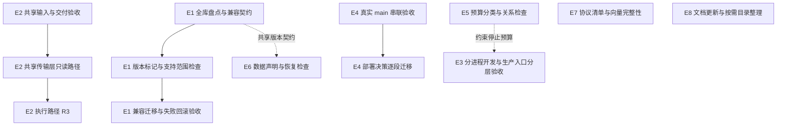

# 架构演进方案修订稿

版本：v0.2，2026-11-04。源码核对基线：`f30b4aa`。本文只讨论结构层面的演进：共享边界、运行拓扑、存储契约与交付工具。业务正确性的修复批次见[技术演进迭代初稿](technical-evolution-draft-2026-10-30.md)，本文不重复。本版完成方案与源码的静态核对；以下演进项仍未实施，所列测试是后续验收要求，不代表已经运行或通过。

## 1 结论

现有架构的基础继续保留：模块化单体、API/运行时分进程、模块 worker 隔离、SQLite WAL、五个内置模块统一仓库统一发布。没有证据表明需要拆分服务、换数据库或换语言（进入条件见技术演进迭代初稿第 4 节）。

下面八项涉及维护成本、契约一致性和验证覆盖。它们本身不构成已发生生产故障的证据：

| 编号 | 问题 | 优先级 | 改动等级 |
| --- | --- | --- | --- |
| S1 | Hub 迁移分散，缺少覆盖全库的版本与读写兼容契约 | 近期 | R3 |
| S2 | 交易所签名与传输层在多个模块重复实现 | 近期，先只读 | R2，涉及执行的部分为 R3 |
| S3 | 单进程开发、launcher 与生产服务单元的覆盖边界未对齐 | 按相关入口推进 | R2，涉及部署激活的部分为 R3 |
| S4 | 部署决策分散，安装器真实主流程仍有串联验收缺口 | 先补主流程验收，随改随迁 | R3 |
| S5 | 不同调用路径的超时与停止预算缺少可检查的关系 | 可独立准备 | R2，涉及部署停止边界的部分为 R3 |
| S6 | 恢复工具中的路径、分类、密钥关联与结构检查分散 | 按恢复工具改动推进 | R3 |
| S7 | 账户 writer 的跨语言语义与生命周期锁协议缺少完整性检查 | 可独立准备 | 仅补测试 R1；改变栅栏或协议为 R3 |
| S8 | `server/` 根目录平铺；架构基线文档落后 | 文档先行，目录按需 | 文档 R1；目录迁移按构建与调用影响定级，至少 R2 |

这里的优先级表示实施顺序，不使用审查缺陷的 P0–P3 标签。S1 应在后续字段演进前补齐统一契约；S2 先用一个交易所的只读路径验证共享收益和交付成本，再扩展范围，不据重复代码数量预设收益最大。

## 2 问题与证据

### S1 存储迁移机制不统一

- `server/control/schema.mjs` 的普通连接在写事务中建表；只有 `create: false` 的候选只读连接调用 `assertTables`。该检查只覆盖这里的控制表，不代表整个 `hub.sqlite` 的结构。Hub 已有加列迁移：`server/trading.mjs` 的 `createTrading` 在事务内为 `trading_accounts` 增加 `account_mode` 并回填；`trading-execution.mjs` 等服务还各自建表。问题是迁移分散，而非不能加列。
- 其余存储各有各的机制：
  - `modules/asset/lib/sqlite.ts:36`：`_schema_migrations` 加有序的 SQL 文件，并记录哈希。
  - `modules/monitor/server/market-store.mjs:52`、`perpetual-store.mjs:15`：`PRAGMA user_version`，两者已经拒绝大于当前支持版本的库。
  - `modules/aster/trading/store.py:117`：探测到缺列时临时执行 `ALTER TABLE`。
  - `server/recovery/inventory.mjs` 的 `databaseEvidence` 统一记录 `schemaHash`、`userVersion`、`applicationId` 和表行数；`restore.mjs` 与备份清单比较这些指纹。结构兼容与业务准入另由 `admission.mjs` 等检查，不是各库分别使用哈希判定兼容。
- 当前 `server/control/` 计入运行时组件键，变动会走 full 更新；候选 API 保持 `query_only=ON`，不迁移数据库。程序回滚保留持久数据，旧版能否读写新版留下的结构仍需明确契约。版本检查拒绝启动可以保护数据，但不能代替服务恢复。

### S2 交易所接入重复实现

带签名的私有接口实现分布如下（只统计非测试源码）：

| 位置 | 覆盖的交易所 |
| --- | --- |
| `server/trading-exchanges.mjs`、`trading-execution-exchanges.mjs`、`trading-okx-*.mjs` | Binance、Bybit、OKX、Gate |
| `modules/asset/lib/exchanges.ts`、`positions-readers.ts`、`okx.ts`、`gate.ts` | Binance、Bybit、OKX、Gate、Aster |
| `modules/crossex/server/live-client.mjs` | Gate CrossEx |
| `modules/greeks/app/bybit.py` | Bybit |
| `modules/aster/trading/exchange.py` | Aster |

Binance、Bybit、OKX 的签名、时间戳、超时、限流退避和整数/小数解析，在 hub 和 asset 各有一份 JS 实现，Bybit 在 greeks 还有一份 Python 实现。公开行情客户端也是同样情况，monitor 与 crossex 各自访问交易所的公开接口。pnpm workspace 只包含四个应用，没有共享包。

同类签名与传输问题需要逐个调用方核对。抽取前仍须确认它们的请求、取消、重试和解析语义确实相同；共享库不能替代各模块的业务契约检查。

### S3 开发与生产拓扑不同

- `server/index.mjs` 在 Linux 使用 `launcher.mjs`，由一个监督进程派生 runtime 和 API，适用于手动启动和旧式单单元部署。
- 当前 `deploy/install.sh` 生成独立的 runtime/API systemd 单元；双槽还有 entry 和 API 模板单元，分别直接启动 `server/runtime/main.mjs`、`server/api/main.mjs`、`server/entry/main.mjs`。launcher 不管理入口代理、候选槽和切流。
- `package.json` 的 `dev:server` 和部分浏览器夹具（如 `tests/aster-adl-margin.browser.mjs`）直接运行 `server/workbench.mjs`。已有 `tests/process-split.test.mjs` 和 `deploy/test-slots-systemd.sh` 分别覆盖进程拆分与真实 systemd 双槽；单进程浏览器通过不能代替这些路径。
- [#107](https://github.com/hxx344/project-aggregation/issues/107) 是既有浏览器重连场景的待核实问题，尚无证据指向进程拓扑。改用 launcher 后通过，不能据此排除原场景的问题。

### S4 部署与更新逻辑分散

- 去掉测试后，`deploy/` 加 `server/update-service/` 约 1.5 万行，多于 asset、crossex、greeks 任何一个模块。
- `deploy/install.sh`（3349 行）、`install-all.sh`（1506 行）、`release-common.sh`（1167 行）用 bash 承担了缓存键、版本比较、双槽切换和回滚判断。同一条交付链上还有 Node 的 `deploy/pipeline/` 和 Python 的 `server/update-service/`。
- [#71](https://github.com/hxx344/project-aggregation/issues/71) 的缺口是 `install.sh` 的真实 `main()` 对双槽分支的选择与串联：`test-ci-install.sh` 调用 main，但固定 single；`test-slots-systemd.sh` 使用真实 systemd，却直接调用激活辅助函数。现有函数级和系统级覆盖应保留，迁移语言本身不能补上主流程验收。

### S5 超时预算靠注释对齐

- API 转发到 runtime 的请求采用从接收时刻计算的 60 s 截止时间（`server/api/server.mjs`）；Portal 取得模块 socket 后直接代理，连接与响应头预算默认为 10/90 s（`server/portal.mjs`），不是同一条串联调用链。
- `server/modules/python-module.mjs` 在读完请求体后才创建 60 s 的 pending timer；该文件的 `server.requestTimeout = 30_000` 是接收完整 HTTP 请求的预算，含义见 [Node HTTP 文档](https://nodejs.org/docs/latest-v24.x/api/http.html#serverrequesttimeout)，不能当作 Python 响应的内层预算。
- 停止关系仍分散在多处：`server/modules/runtime.mjs` 注释记录 ASTER worker 110 s、bridge 约 102 s、监督者 115 s；API 关闭还包括排空、handler 宽限、协调器关闭和末次报告。安装器生成的 systemd 停止时限为 runtime 150 s、API 75 s、entry 15 s。只比较几个 JS 常数不足以检查整个停止过程。

### S6 恢复与凭据的耦合

- `server/recovery/inventory.mjs` 的 `DATA_FILES` 和 `restore.mjs`、`admission.mjs` 分散维护模块路径、类别与结构检查。现有 inventory 会递归发现数据根下未被排除的文件；未知路径默认归为 `secrets`，这是避免未知配置泄露秘密的保护，并不因未列入 `DATA_FILES` 就漏备份。
- Hub 和 CrossEx 各有一个 `credentials.key`，恢复流程已经分别读取并验证；Asset 的 `config.json` 另含凭据密钥与会话材料。恢复还处理环境配置、ASTER CA 引用绑定、会话撤销及隔离准入。演进目标是明确这些关联与责任，不能缩减为两把密钥的文件清单。

### S7 跨语言栅栏与锁协议的一致性检查

- `server/execution/account-writer.mjs` 与 `account_writer.py` 实现跨语言账户写入契约；ASTER 和 Greeks 共用 Python 实现。`tests/account-writer.test.mjs` 已有真实进程互操作用例，覆盖语义哈希、接管、隔离和退役。
- 两侧错误码通过 `fail(code)` / `_fail(code)` 等入口使用散落字符串，没有完整的可枚举协议目录。单独共享既有向量，不能发现新增但未被向量触发的错误分支。
- `server/recovery/lifecycle-lock.mjs` 会启动 `lifecycle_lock.py`：Node 是包装、监控和协议层，Python 承担 OS 锁操作。它们不是两套独立锁实现，包装层错误也无需与 helper 的错误集合完全相同。

### S8 组织与文档

- `server/` 根目录有 46 个平铺文件，`trading-*` 13 个、`asset-*` 6 个，和已经分好的 `api/`、`runtime/`、`control/`、`execution/` 子目录并存。
- `docs/architecture-baseline.md` 记录的基线是 `462e43a`，其中"M4 其余批次尚未实施"已不符合当前代码。

## 3 演进项

每项按“先加兼容和检查、再迁移、最后删除旧路径”分步交付。每步实施前明确可回滚版本、保留的数据与实际恢复入口；不能把拒绝启动、还原提交或恢复旧程序链接当成服务已恢复。

### E1 统一存储版本契约（对应 S1）

- 目标：每个 SQLite 存储有明确的版本、迁移拥有者和代码读写支持范围；在修改数据库前检查支持范围，未识别布局拒绝迁移；Hub 的控制表和业务表都纳入契约。
- 做法：
  1. 盘点 `hub.sqlite` 全部建表、索引、加列与回填入口，定义版本 0 的已知历史布局、版本 1 的完整结构及唯一迁移入口。不能只用 `assertTables` 给整个库标记版本 1；不同已知布局需要显式补齐路径，未知布局不得改版本号。
  2. 先发布版本读取、兼容检查及基线标记。只有完整结构匹配时，才在已有写锁内重新核验并原子写入 `PRAGMA user_version=1`；本批不混入业务 DDL。历史布局的补齐另按迁移步骤验收。尚不读取版本号的旧发布只作为经验证的兼容回退目标，不能宣称它具备版本拒绝能力。
  3. 再引入有序迁移，将结构变更、必要回填和版本推进放在同一事务中，复用有界锁等待；并发打开、失败与重跑不能重复迁移或提前推进版本。每步声明迁移前后支持的读写代码范围及上一可回滚版本，在停服或修改数据库前检查。控制 schema 改动仍走 full 更新，候选 API 始终只读，不为通过就绪检查执行迁移。
  4. Monitor 保留已有过新版本拒绝，Asset 保留 `_schema_migrations` 的顺序与哈希验证，再补支持范围检查；ASTER、CrossEx 按各自历史布局逐步适配。统一的是版本与兼容契约，不要求替换成熟的迁移记录。
  5. 恢复检查保留三个独立层次：备份完整性与数据库指纹、版本对应的真实结构检查、业务日志和静止/隔离准入。统一版本只用于选择受支持的结构读取器，不替代现有指纹、列/类型/主键、凭据与未决状态检查；同时声明旧备份的支持范围。
- 不做：不引入 ORM 统一迁移，不合并数据库文件。
- 退出条件：首个加列批次通过历史库升级、并发启动、迁移中断与重跑；迁移提交后注入启动失败和健康失败，上一可回滚版本在保留已提交数据的前提下恢复服务，并验证相关读写行为。版本号相同但结构或业务记录不符合契约的恢复材料仍被拒绝。
- 回滚：仅写基线标记的批次在旧代码上核对读写兼容；首批 DDL 只做上一版可读、可写的兼容扩展。不兼容迁移在执行前拒绝，另行评审停写、提交点、数据保留与恢复协议后才可进入，不能用旧版拒绝启动作为回滚通过，也不能默认用旧备份覆盖迁移后产生的数据。

### E2 共享交易所传输层（对应 S2）

- 目标：签名、时间同步、超时与重试预算、限流退避、数字解析、错误分类这几件事，每个交易所在 JS 侧只实现一次。
- 做法：
  1. 优先采用 workspace 包（暂名 `packages/exchange-transport`），只抽取已确认同语义的请求签名、带总预算的请求执行、int64/小数文本解析和错误分类。各调用方保留业务适配，明确超时、取消、重试次数和失败行为；有副作用请求不因共享重试逻辑自动重发。
  2. 先迁移只读路径：Asset 的持仓和余额读取、Hub 的 `trading.mjs` 账户读取。先用离线夹具比对签名和解析，再切换调用方；验收覆盖取消、超时包含响应体、响应大小限制、限流退避与现有诊断映射，不能把读取失败变成空余额或空仓。
  3. 再迁移执行路径（`trading-execution-exchanges.mjs`），按 R3 处理。传输层保留原响应与发送证据，区分明确未发送和已可能送达；业务层继续负责持久意图、交易所确认、明确拒绝及未知结果恢复，不把“已发送”等同成交成功，也不由传输层授权执行。
  4. 公开行情客户端（monitor、crossex）在只读路径稳定后再评估。
- 不做：不合并各模块的业务读取逻辑和展示口径；Python 侧（greeks 的 Bybit、aster）先不改，等出现第二条同语义的 Python 路径时再抽。
- 交付输入：共享包的直接和传递源码依赖必须进入消费者构建键、冻结安装材料、可信源码提取、独立发布包及 runtime 激活指纹。除 `deploy/package-release.py`、`deploy/pnpm-module-inputs.py` 外，还须覆盖 `scripts/modules.mjs` 和 `deploy/install.sh` 的固定输入、importer 链接与源码归档路径，不能只更新依赖声明。
- 退出条件：按交易所记录已迁移调用方，完成范围内的签名与解析只保留一份 JS 实现；仅改共享包源码且 manifest/锁文件不变时，Asset 缓存失效并重新构建，Hub runtime 的激活指纹改变并执行必要重启。冷安装、跨目录热缓存及脱离原工作树的发布包均加载目标实现；无变化重跑保留增量跳过能力。
- 回滚：每个只读批次可还原调用方和包依赖，按变化重新生成相关产物与指纹；执行批次另验证原持久记录的兼容恢复。不能通过复用迁移前缓存假装完成回退。

### E3 对齐开发进程边界与生产入口验收（对应 S3）

- 目标：Linux 开发和相关浏览器夹具覆盖 runtime/API 分进程行为；生产双槽另按真实服务单元验收。
- 做法：Linux 的 `dev:server` 使用 launcher，Windows 保留 `workbench.mjs`；其他平台在支持条件核实前不自动套用 Linux 路径。watch 应观察子进程源码，等待整组退出后再启动下一组，并有自己的停止截止时间和残留检查，不能依赖开发环境不存在的 systemd 兜底。先迁移涉及重连和实时流的夹具，单进程单元测试按用途保留。
- 退出条件：分进程夹具覆盖 API 单独重启、runtime 故障、socket 重连以及 watch 无残留；生产侧复用 `deploy/test-slots-systemd.sh` 和实际单元入口，核对候选、切流、旧槽排空与回滚。Linux 验收使用既有 CI 或明确指定的非 WSL 环境。
- #107 按原场景单独调查路由、可见性、轮询与取消契约，取得确定性成功和失败对照；不能以 launcher 场景通过代替其关闭依据。开发入口可独立回退，生产激活行为若有变化另按 R3 交付。

### E4 部署状态逻辑收拢（对应 S4）

- 目标：逐步集中缓存键、版本比较、槽位选择、回滚判断等纯决策，同时保留可核对的系统调用顺序和持久化提交点。
- 做法：先从真实 `main()` 补齐 #71 的串联验收，再在相关改动中将已覆盖的纯决策迁成 Python 函数，bash 负责调用与系统操作。优先复用现有 updater 的语言和契约，不直接假定其安装后的文件已可使用。
- 引导条件：`install-all.sh` 当前复制单个安装器；槽位和缓存判断早于应用源码获取，updater 又在后续才安装。抽取前必须确定同目标版本 helper 的获取、校验及调用协议，覆盖首次安装无 helper、升级只有旧 helper 的情况；取得失败在改变服务状态前退出。保留依赖准备的先后顺序，不能为无变化更新重复下载或安装依赖。
- 不做：不一次性重写安装器，不改变安装入口和命令行参数。
- 退出条件：真实 main 覆盖首次双槽、API-only、full、候选失败、记录提交后失败及中断续作；验证 scope/layout、调用顺序和恢复记录。对分支或调用顺序加入受控错误时验收确实失败，迁移前后复用这些用例，并保留现有真实 systemd 验收。纯函数单测是补充，不能替代 #71 的关单条件。
- 回滚：安装器和 helper 作为同一目标版本交付、回退；每次抽取保留原持久记录语义，并通过同一主流程失败恢复用例，不以“没有新增 bash 判断”作为完成标准。

### E5 超时预算表（对应 S5）

- 先按实际路径登记接收请求、连接、响应头、绝对 deadline、流空闲和停止预算，记录计时起点、拥有者、取消传播与超时后的行为。Portal 代理、runtime 转发和 Python bridge 分别建关系，不拼成一条不存在的链。
- 对真正嵌套的阶段检查外层剩余预算能覆盖内层和余量；顺序停止阶段检查总和，并发阶段按实际等待方式检查。长连接不套普通响应总时限。
- 集中可共享的配置，并核对 Python 参数和生成的 systemd 单元最终生效值；不能只检查一张未被消费者采用的 JS 常量表。
- 首批只收拢来源并保持现有预算，发现关系冲突单独登记和修正，不为通过断言随意增大超时。退出条件覆盖真实路径的取消/超时与停止顺序，并有修改一个受约束预算就能使关系检查失败的对照；回退配置时同步回退其生成单元。

### E6 模块数据声明（对应 S6）

- 在 `server/modules/catalog.mjs` 或模块清单中集中声明已知数据路径、类别、版本/结构检查和密钥/配置关联。声明只补充分类与检查，inventory 继续递归发现文件，保留原有路径限制、排除规则及未知文件 `secrets` 兜底，不能改成仅备份声明文件的白名单。
- 保留 Hub/CrossEx 密钥、Asset 配置材料、环境配置和外部引用绑定的完整检查，以及恢复后的会话撤销、未决记录和隔离准入。迁移清单不自动授予交易恢复能力。
- 退出条件：旧备份仍按声明的支持范围恢复；未声明的新文件、模块文件改名、密钥缺失/不匹配、引用材料缺失均有确定结果，未知材料不会遗漏或降为普通 data。若调整既有文件类别，先定义备份清单版本与新旧恢复工具的兼容方式。
- 凭据密钥合并不是本项前置条件，另行评估隔离目的与密文迁移成本；本项不改变现有密钥和密文，可回退声明读取方式，保留原恢复检查。

### E7 栅栏一致性向量（对应 S7）

- 账户 writer 在现有互操作测试之外共享 JSON 向量，覆盖语义哈希、票据格式、错误条件及支持版本，保留并发、接管、隔离和退役的真实进程场景。
- 增加完整性门禁：声明共同协议的错误码与票据字段集合，并核对两侧实现和向量覆盖。若保持实现不变，必须可靠提取源码中的码集，覆盖辅助函数参数和动态构造；无法可靠提取时先引入显式目录。语言专属错误单独映射，不强求全部集合相等。
- 生命周期锁按 Node 包装层与 Python helper 的输入输出、错误映射、失联和释放协议验收，不按两套独立实现比较。
- 退出条件：故意只在一侧新增错误码或修改票据字段、而不更新协议与向量时，门禁失败；原有互操作仍通过。仅增加测试不改变生产语义；若为目录接线改动栅栏实现或协议，另按 R3 独立交付和回滚。

### E8 目录与文档整理（对应 S8）

- 先按实际交付证据更新 `docs/architecture-baseline.md` 的批次状态，区分源码、CI 与生产验收。
- 目录搬移按需要单独进行，不作为 E2 前置条件。若移动 `server/trading-*`、`server/asset-*`，同步所有 import、测试夹具、脚本和构建输入；例如 `asset-identity.*` 还被 `scripts/modules.mjs` 与 `deploy/install.sh` 的输入清单引用。
- 退出条件：没有遗留旧路径消费者，相关模块构建与增量缓存反映新路径，正式包入口可加载。纯文档按 R1，影响调用与构建的移动至少 R2；涉及执行或公共契约时按实际边界升级。回退时一并还原路径、消费者及输入清单。

## 4 顺序与依赖

- 可以独立准备：E1 全库盘点、E2 依赖与交付输入清单、E4 主流程验收、E5 预算分类、E7 协议目录、E8 文档更新。不能直接把所有历史 Hub 库标记成版本 1。
- E2 先选择一个交易所的只读路径，再按交易所拆小批；共享输入接线与验收须在首个消费者切换前完成。E8 的目录整理不阻塞 E2。
- E3 的分进程开发入口与 E5 可并行，watch 停止约束在启用前完成；生产双槽仍有独立验收。E6 的分类整理可先行，版本读取器与 E1 对齐，不要求先完成全部数据库迁移。
- #71 的主流程验收独立推进，不必等待迁移语言；E4 的纯决策抽取跟随相关安装器改动进行。

## 5 实施约束

- 每个演进项只改变一类结构，不顺带修改业务行为；涉及资金执行、部署激活、数据库结构的步骤按 R3 留存独立审查与回滚记录。
- 先补检查再迁移：E1 先确认完整布局和回滚兼容，再标记版本与迁移；E2 先接齐共享输入并做新旧对比；E4 先覆盖真实 main；E7 同时建立向量与完整性检查。
- 共享代码只抽语义确实相同的部分，各模块的业务口径不为外观统一而合并。
- 每批按受影响入口选择最小必要检查；Linux 专属行为由既有 CI 或指定的非 WSL 环境验证。引用现有测试、完成文档或 CI 绿色不自动等于实现与生产验收完成，沿用[审查标准](code-review-standard.md)和[交付流程](code-review-process.md)。

## 6 待决策

1. E1 盘点后确定完整的版本 1 布局、受支持历史布局和上一可回滚版本；这是写入版本号及迁移前的正确性前提。
2. E2 优先使用 `packages/` workspace 包，首批固定包路径和交易所范围；若改为 `server/` 路径引用，仍须完成同样的共享源码依赖闭包与交付验收。
3. 凭据密钥是否合并（E6）单独评估，不阻塞声明整理；本稿不授权变更现有密钥布局。
4. 实施时按演进项建立工作包，并关联现有技术批次和 Issue，避免重复跟踪；#71、#107 按各自原始验收条件关闭。
