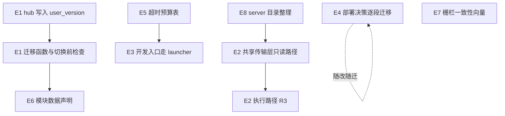

# 架构演进方案初稿

版本：v0.1，2026-11-03。源码基线：`5f89be4`。本文只讨论结构层面的演进：共享边界、运行拓扑、存储契约与交付工具。业务正确性的修复批次见[技术演进迭代初稿](technical-evolution-draft-2026-10-30.md)，本文不重复。这是待评审的初稿，下文任何一项都还没有实施。

## 1 结论

现有架构的基础继续保留：模块化单体、API/运行时分进程、模块 worker 隔离、SQLite WAL、五个内置模块统一仓库统一发布。没有证据表明需要拆分服务、换数据库或换语言（进入条件见技术演进迭代初稿第 4 节）。

需要演进的是下面四类结构问题。它们不会立刻造成故障，但会持续抬高同类缺陷的修复成本和漏修概率：

| 编号 | 问题 | 优先级 | 改动等级 |
| --- | --- | --- | --- |
| S1 | `hub.sqlite` 无法给已有表加列，四个存储各用一套迁移机制 | P1 | R3 |
| S2 | 交易所签名与传输层在多个模块重复实现 | P1 | R2，涉及执行的部分为 R3 |
| S3 | 开发入口和生产使用不同的进程拓扑 | P2 | R2 |
| S4 | 部署/更新状态逻辑大量写在 bash 里，且分散在三种语言 | P2 | R3 |
| S5 | 跨层超时与停止预算只靠注释对齐 | P3 | R2 |
| S6 | 恢复工具硬编码各模块的数据文件；凭据密钥分两处 | P3 | R3 |
| S7 | Node/Python 两份账户写入栅栏与生命周期锁 | P3 | R3 |
| S8 | `server/` 根目录平铺；架构基线文档落后 | P3 | R1 |

优先级反映的是：放着不管的代价有多大，以及改起来有多少前置依赖。S1 会阻塞 hub 后续的任何字段变更，S2 是同类缺陷重复修复的主要来源，所以列为 P1。

## 2 问题与证据

### S1 存储迁移机制不统一

- `server/control/schema.mjs` 每次打开都执行 `CREATE TABLE IF NOT EXISTS`，再由 `assertTables`（第 49 行起）检查每一列是否存在，注释明确写着"hub.sqlite has no schema version"。schema 里没有 `ALTER TABLE`，所以给已有表加一列，旧安装在启动时就会因缺列而拒绝启动。现在 hub 的 schema 实际上只能新增表。
- 其余存储各有各的机制：
  - `modules/asset/lib/sqlite.ts:36`：`_schema_migrations` 加有序的 SQL 文件，并记录哈希。
  - `modules/monitor/server/market-store.mjs:52`、`perpetual-store.mjs:15`：`PRAGMA user_version`。
  - `modules/aster/trading/store.py:117`：探测到缺列时临时执行 `ALTER TABLE`。
  - `server/recovery/inventory.mjs` 读取 `user_version` 和 schema 哈希来判断备份能否恢复。
- 双槽切换和回滚时，旧代码会打开新代码改过的库。兼容现在靠"只加不改"的约定维持，没有任何机制能拒绝旧代码打开它不支持的版本。

### S2 交易所接入重复实现

带签名的私有接口实现分布如下（只统计非测试源码）：

| 位置 | 覆盖的交易所 |
| --- | --- |
| `server/trading-exchanges.mjs`、`trading-execution-exchanges.mjs`、`trading-okx-*.mjs` | Binance、Bybit、OKX、Gate |
| `modules/asset/lib/exchanges.ts`、`positions-readers.ts`、`okx.ts`、`gate.ts` | Binance、Bybit、OKX、Gate、Aster |
| `modules/crossex/server/live-client.mjs` | Gate CrossEx |
| `modules/greeks/app/bybit.py` | Bybit |
| `modules/aster/trading/exchange.py` | Aster |

Binance、Bybit、OKX 的签名、时间戳、超时、限流退避和整数/小数解析，在 hub 和 asset 各有一份 JS 实现，Bybit 在 greeks 还有一份 Python 实现。公开行情客户端也是同样情况，monitor 与 crossex 各自访问交易所的公开接口。pnpm workspace 只包含四个应用，没有共享包。

LESSONS 里限流、超时、int64 精度一类的经验需要逐个模块复核，AGENTS.md 也专门要求"同类路径一起处理"，这两点都是在弥补缺少共享传输层。

### S3 开发与生产拓扑不同

- `server/index.mjs:4-5`：Linux 上走 `launcher.mjs`，派生 runtime 和 API 两个进程，模块 worker 通过 unix socket 通信，Python 模块再经 stdio bridge。
- `package.json` 的 `dev:server` 和浏览器夹具（例如 `tests/aster-adl-margin.browser.mjs` 第 1 行的启动方式）都直接运行 `server/workbench.mjs` 单进程。
- 结果是 IPC、socket 目录、跨进程重连、API 槽位切换这些路径，只能在 CI 和生产上暴露。#107 的重连回归是否与此有关尚未核实。

### S4 部署与更新逻辑分散

- 去掉测试后，`deploy/` 加 `server/update-service/` 约 1.5 万行，多于 asset、crossex、greeks 任何一个模块。
- `deploy/install.sh`（3349 行）、`install-all.sh`（1506 行）、`release-common.sh`（1167 行）用 bash 承担了缓存键、版本比较、双槽切换和回滚判断。同一条交付链上还有 Node 的 `deploy/pipeline/` 和 Python 的 `server/update-service/`。
- 相关测试很多（`deploy/test-*`），但 bash 里的状态分支难以做单元级覆盖，#71（真实 main 流程分支覆盖）就是这个问题的直接体现。

### S5 超时预算靠注释对齐

一次 Python 模块请求依次经过：API 进程 `REQUEST_TIMEOUT_MS = 60_000`（`server/api/server.mjs:47`）→ runtime → worker → `python-module.mjs` 中 `requestTimeout = 60_000`、bridge 端 `server.requestTimeout = 30_000`（第 11、55 行）。停止预算的约束写在 `server/modules/runtime.mjs:16-18` 的注释里：ASTER worker 110 s、bridge 102 s、监督者 115 s。谁大于谁这样的不变量没有代码检查，某一层单独调整后就会悄悄失效。

### S6 恢复与凭据的耦合

- `server/recovery/inventory.mjs:17` 的 `DATA_FILES` 和 `restore.mjs`、`admission.mjs` 写死了每个模块数据库的相对路径和 schema 检查。模块新增或改名一个数据文件，就必须同步修改恢复代码，否则这个文件会被漏备份，或者被归到 `secrets` 类。
- hub（`server/runtime/credentials.mjs:8`）和 crossex（`modules/crossex/server/store.mjs:10`）各有一个 `credentials.key`。备份、恢复、换钥都要处理两处。

### S7 Node/Python 双实现的安全栅栏

`server/execution/account-writer.mjs`（698 行）对应 `account_writer.py`（1103 行），`server/recovery/lifecycle-lock.mjs` 对应 `lifecycle_lock.py`。Python 侧已经集中实现，aster 和 greeks 通过 `importlib` 加载同一份文件，所以重复只存在于语言之间。`tests/account-writer.test.mjs` 已有十余个 Node 与 Python 真实进程互操作的用例（第 334、522、629、655、719、754 行等），覆盖语义哈希、接管、隔离和退役。风险在于：今后新增的错误码或票据字段可能只在一侧实现，而现有互操作用例按场景组织，不会因此自动失败。

### S8 组织与文档

- `server/` 根目录有 46 个平铺文件，`trading-*` 13 个、`asset-*` 5 个，和已经分好的 `api/`、`runtime/`、`control/`、`execution/` 子目录并存。
- `docs/architecture-baseline.md` 记录的基线是 `462e43a`，其中"M4 其余批次尚未实施"已不符合当前代码。

## 3 演进项

每项都按"先加兼容和检查、再迁移、最后删除旧路径"的顺序分步交付，每步可以单独发布、单独回滚。

### E1 统一存储版本契约（对应 S1）

- 目标：每个 SQLite 存储都有可读取的版本号；打开时，代码支持的版本范围不包含库的版本，就明确拒绝启动；加列有正式的迁移路径。
- 做法：
  1. hub 引入 `PRAGMA user_version`。现有库视为版本 1，由现在的 `assertTables` 校验通过后写入，不改动任何表。
  2. 增加按版本递增的迁移函数，在已有的写锁内执行；每个版本声明"最低可读代码版本"，在双槽切换前检查。
  3. 写一份"版本、迁移、兼容"的最小约定，供 monitor、aster、crossex 逐个对齐。asset 的 `_schema_migrations` 已经满足，只需补上"拒绝过新版本"的检查。
  4. 恢复工具的准入判断改为读取统一的版本号，不再依赖各库自己的哈希规则。
- 不做：不引入 ORM 统一迁移，不合并数据库文件。
- 退出条件：hub 能在一次发布里给已有表加列，并且回滚到上一槽位后旧代码能正常启动，或者被明确拒绝。
- 回滚：第 1 步只写版本号，旧代码不读它，可以直接回退。

### E2 共享交易所传输层（对应 S2）

- 目标：签名、时间同步、超时与重试预算、限流退避、数字解析、错误分类这几件事，每个交易所在 JS 侧只实现一次。
- 做法：
  1. 新建 workspace 包（暂名 `packages/exchange-transport`），只包含无业务语义的部分：请求签名、带总预算的请求执行、按 int64 和小数文本安全解析、统一错误码（超时、限流、鉴权、未知结果）。
  2. 先迁移只读路径：asset 的持仓和余额读取、hub 的 `trading.mjs` 账户读取。每个交易所迁移后，用现有离线夹具对比新旧实现的请求签名和解析结果。
  3. 再迁移执行路径（`trading-execution-exchanges.mjs`），按 R3 处理，保留原有的持久意图与未知结果语义，传输层只返回"已发送 / 未发送 / 结果未知"。
  4. 公开行情客户端（monitor、crossex）在只读路径稳定后再评估。
- 不做：不合并各模块的业务读取逻辑和展示口径；Python 侧（greeks 的 Bybit、aster）先不改，等出现第二条同语义的 Python 路径时再抽。
- 退出条件：Binance/Bybit/OKX 的签名与解析各只剩一份 JS 实现；改一处限流规则，所有调用方都能生效。
- 风险：新包会进入 asset、hub 的构建与发布清单，需要同步修改 `deploy/package-release.py`、`deploy/pnpm-module-inputs.py`，并通过模块增量构建测试。

### E3 开发入口与生产拓扑一致（对应 S3）

- 目标：在 Linux 上，本地开发和浏览器验收都走与生产相同的 launcher 拓扑。
- 做法：`dev:server` 在非 Windows 平台改用 launcher，增加 watch 时整组重启的逻辑；浏览器夹具提供 launcher 版启动方式，先迁移涉及重连和实时流的用例。`workbench.mjs` 只保留给 Windows 和确实需要单进程的单元测试。
- 退出条件：重连和更新流相关的浏览器用例在 launcher 拓扑下稳定通过；#107 能在本地复现或排除。

### E4 部署状态逻辑收拢（对应 S4）

- 目标：bash 只做系统调用和文件搬运，缓存键、版本比较、槽位选择、回滚判断这些决策集中到一种可以单元测试的语言里。
- 做法：沿用已有的 Python updater（`server/update-service/`），每次修改 `install.sh` 的某段决策逻辑时，就把那一段迁成 Python 函数，再由 bash 调用。以 #71 涉及的分支作为第一批。
- 不做：不一次性重写安装器，不改变安装入口和命令行参数。
- 退出条件：`install.sh` 里没有新增的状态判断；#71 列出的分支都有单元级测试。

### E5 超时预算表（对应 S5）

把 API、runtime、worker、bridge 各层的请求超时和停止预算集中到一个模块，在启动时断言"外层 > 内层 + 余量"，原来的注释改为引用这张表。

### E6 模块数据声明（对应 S6）

- 每个模块在 `server/modules/catalog.mjs`（或模块自带的清单）里声明自己的数据文件、类别（data/secrets）和 schema 检查函数，恢复工具从声明生成 inventory，不再硬编码路径。
- 凭据密钥是否合并为一处，取决于恢复流程，单独评估。在此之前，先让备份和恢复按声明覆盖两把密钥。

### E7 栅栏一致性向量（对应 S7）

在现有互操作用例之外，补一份共享的 JSON 测试向量：语义哈希的输入输出、每个错误码的触发条件、票据格式。Node 和 Python 两侧都读取同一份文件。任何一侧新增错误码时，如果向量没有同步，测试就失败。不改变两套实现本身。

### E8 目录与文档整理（对应 S8）

- 把 `server/trading-*`、`server/asset-*` 移入子目录，单独提交、不夹带行为改动，最好在 E2 迁移前后完成，避免和 E2 的 diff 混在一起。
- 按当前代码更新 `docs/architecture-baseline.md` 的批次状态。

## 4 顺序与依赖

- 可以立即开始、彼此独立的：E1 第 1 步、E5、E7、E8 的文档部分。
- E2 是收益最大的一项，建议单独立项，每个交易所一个 PR。
- E4 不设专门批次，跟着 #71 和今后的安装器改动推进。

## 5 实施约束

- 每个演进项只改变一类结构，不顺带修改业务行为；涉及资金执行、部署激活、数据库结构的步骤按 R3 留存独立审查与回滚记录。
- 先补检查再迁移：E1 先写版本号再引入迁移，E2 先做新旧对比再切换，E7 先有向量再依赖它。
- 共享代码只抽语义确实相同的部分，各模块的业务口径不为外观统一而合并。

## 6 待决策

1. E2 新包的放置位置和命名：放在 `packages/` 下作为 workspace 包，还是放在 `server/` 下由模块按路径引用。前者更符合 pnpm 结构，但需要修改发布清单。
2. 凭据密钥是否合并（E6），需要先确认 crossex 独立密钥是否有隔离方面的意图。
3. 本稿各项是否逐项建 Issue 跟踪，还是并入现有的技术演进批次。
