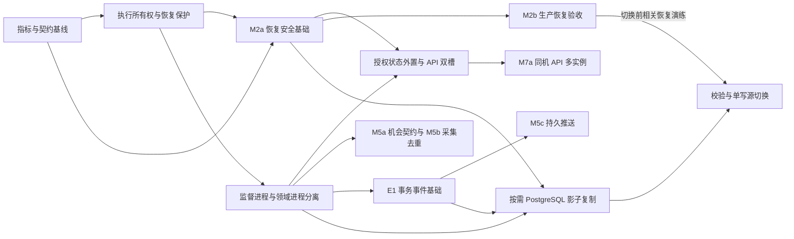
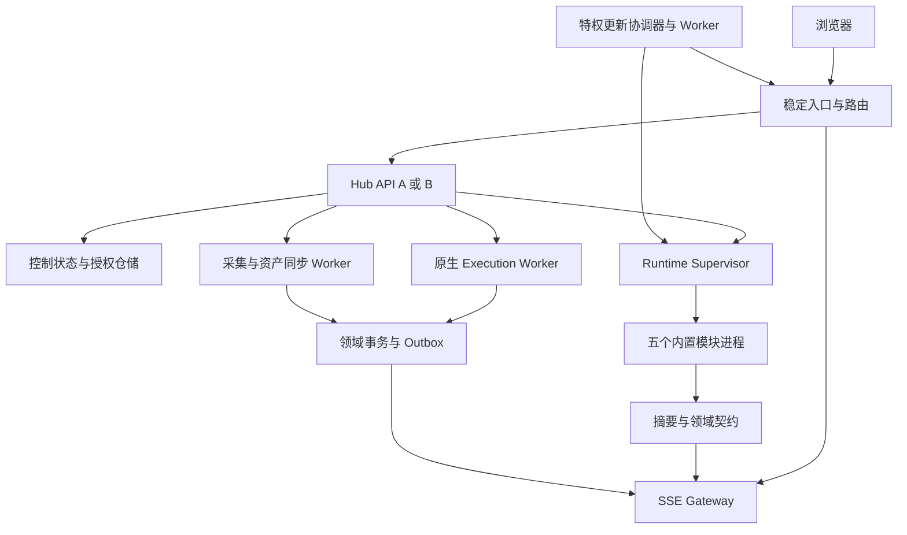

# 统一工作台架构演进技术实现文档

| 项目 | 内容 |
| --- | --- |
| 文档版本 | v1.1 修订稿 |
| 日期 | 2026-10-26（初稿 2026-10-18） |
| 参考方案 | 用户提供的《统一工作台目标架构与演进蓝图》v1.0 |
| 修订核对基线 | project-aggregation `462e43a31efaa7fc4965dee20f0ef960031e2322`；第 1.1 节保留初稿 `0469bd21d7eb2112c59c1ff1df5e4af271419fb5` 的历史起点 |
| 适用范围 | `server/`、`src/`、`modules/`、`deploy/`、契约与验收 |
| 设计状态 | M0、M1、M2 恢复安全基础及 M3 已接入，M4-1 共享登录风控与 M4-2 持久 Portal 授权已合入；生产验收和后续设计按实施基线逐项记录，不以源码合入代替正式发布或验收 |
| 读者 | 工作台与内置模块开发者、审查者、部署维护者 |

工作台继续采用模块化单体和进程隔离。实施顺序是先明确执行所有权和恢复证据，再分离进程生命周期，最后按实际容量迁移存储、集中行情和扩展读服务。近期交付保留 SQLite、现有前端和五个内置模块，沿用统一仓库、统一正式发布与一键更新。

本方案把蓝图转为可分批开发的进程边界、数据结构、接口、状态机和验收条件。进度以阶段退出条件为准；蓝图中的月份作为规划窗口，容量数字作为待压测目标，均不代表现有性能。

实施进度与当前覆盖边界以 [架构实施基线](architecture-baseline.md) 为入口，分别记录实现、CI、正式发布与生产验收。M3 的 P0/P1/P2/P2b 已接入并发布，真实双单元与五模块的组合演练、P2b 的生产 API-only 更新证据仍待收口；M4-1 已合入不代表双槽完成。当前恢复步骤与限制见 [备份与恢复](backup-recovery.md)。本文保留后续目标，新增表、目录和参数除已明确接入者外仍属设计，不因文档修订成为已交付能力。原始《目标架构与演进蓝图》未纳入仓库，本轮未核对其原文。

## 1 现有实现与设计修订

### 1.1 历史源码基线

下表描述初稿基线 `0469bd2` 的实施起点，不代表修订时的运行状态。现有 Linux 受管部署已由独立 API、运行时单元承载；Windows 与开发兼容入口的边界见实施基线。

| 领域 | 初稿基线实现 | 当时待解决的问题 |
| --- | --- | --- |
| 应用入口 | `server/index.mjs` 先启动模块，再创建 `createApp`；关闭时同时关闭应用和模块 | API 生命周期与模块监督仍耦合 |
| 模块故障 | `runtime.mjs` 中任一已就绪子进程退出，会关闭其他模块并调用 `onFailure`；入口随后关闭工作台 | 已有进程边界，尚未形成独立故障恢复 |
| 事务存储 | `app.mjs` 打开 `.data/hub.sqlite`，使用 WAL、外键和 5000 ms busy timeout | 保留现有库，先分清表的写入归属 |
| 原生执行 | `trading-execution.mjs` 已有全局 `execution_lease`、资源锁、请求主键去重、持久订单和确定性 `clientId` | 保留并演进，不重新实现一套执行器 |
| 租约恢复 | 当前租约 TTL 为 60 s，默认每 1 s 调度续约；失去租约的旧实例退休，晚到回执不能覆盖新持有者记录 | 尚不能据此声称所有模块具有统一账户级租约 |
| 模块通信 | `.workspace.internal` 虚拟来源解析到 UDS 或 Windows named pipe，每模块有随机 secret | 跨进程拆分必须补注册和发现机制，现有注册表在进程内 |
| Portal 授权 | ticket、grant 和 grant 中的上游认证状态保存在内存 | 外置时同时处理认证材料、会话撤销和项目 revision |
| 首页推送 | `overview-stream.mjs` 每连接生成 snapshot、patch 和局部 sequence；`app.mjs` 管理 SSE | 局部 sequence 不是持久事件游标，当前不能跨连接重放 |
| 现有保护 | SSE 已有全局 60、单会话 12 连接限制，以及 256 KiB 写缓冲保护 | 按压测扩容，不能直接移除限制以达到容量目标 |
| 更新流程 | 已有独立 Python 更新协调器和 worker；`install.sh` 已有不可变版本目录、程序与配置回滚 | 仍会重启统一服务，不能等同于双槽在线切换 |
| 摘要契约 | `integration-state.test.mjs`、`adapters.test.mjs` 及模块测试已有 v1/v2、缺失、认证和新鲜度用例 | 补齐跨模块能力矩阵与兼容夹具，不能称为从零建立契约测试 |

### 1.2 对蓝图的实施修订

1. **租约续约周期应小于 TTL。** 新账户租约的初始设计值为 TTL 60 s、续约 5 s、安全余量 10 s，覆盖当前原生执行默认 35 s 调用预算，并通过暂停与延迟测试再采用。不能采用“TTL 小于心跳周期三分之一”的关系；现有全局租约参数在替换完成前保持原契约。
2. **资金状态不能跨交易所承诺线性一致。** 本地意图、幂等记录和账本入账使用事务；交易所委托、成交和持仓通过查询与对账收敛，超时保留结果未知。
3. **双槽不能先于生命周期分离兑现持续采集。** API 候选验证阶段不接外部流量、不转发有副作用的命令；晋升后仅按可信会话转发受控命令。API 在任何阶段都不启动模块、不持执行租约、不直接向交易所写出。数据进程自身升级仍需要受控交接。
4. **SSE 目标采用可恢复连接。** API 或网关更新允许浏览器重连，通过游标重放或全量快照恢复状态；只有网关本身未重启时，才验收原连接持续存活。
5. **模块独立版本先用于兼容判断和选择性重启。** 正式包仍由本仓库统一发布，不引入独立仓库发版或任意模块包拼装。
6. **数据库切换采用单一权威写源。** 影子复制通过事务 outbox 驱动，不要求请求同时写入 SQLite 与 PostgreSQL，也不把旧 SQLite 文件当作切换后的实时降级库。

## 2 范围与阶段依赖

近期范围包括指标基线、执行所有权梳理、契约固定、恢复安全基础、进程监督分离、Portal 持久授权和 API 双槽切换。生产恢复承诺单独验收；机会契约、采集去重、持久 SSE 重放及 PostgreSQL 分别按收益和前置条件接入，不按阶段编号强制串行推进。

实施不新增微服务平台、Kubernetes、多租户和跨区域多活；模块现有 React、Next.js、Python 和原生页面继续使用。外部平台和存储组件仅在对应阶段启用。



双槽切换在 M2a 恢复安全基础、M3 及共享授权准备完成后交付；生产 RPO/RTO 目标不替代这些安全检查，也不作为纯 API 切换的容量前置。M6 首次切换前须完成 M2b 中与该迁移相关的取包、取密钥和生产规模恢复演练。M7b 跨主机运行另外要求共享权威存储、任务归属及旧写者隔离，见第 15 节。所有前置条件按证据验收，不以日历窗口代替退出条件。

## 3 目标进程与部署边界

### 3.1 单机目标结构



稳定入口对外继续提供一个 TCP 端口。新增路由层属于后续双槽能力，需同时支持工作台 Host、项目 Host、流式响应和升级连接；首期不改变 `.localhost` 访问方式，也不承诺任意公网域名代理。

| 进程或组件 | 拥有的职责 | 启动及重启边界 |
| --- | --- | --- |
| Hub API | 会话、CSRF、项目配置、查询编排、鉴权后转发命令、Portal 请求 | API 更新不启动或停止数据进程 |
| Runtime Supervisor | 模块目录、运行实例身份、IPC 注册、健康检查、维护和停止协调 | systemd 单独托管；只有它能启动模块 |
| Execution Worker | 现有原生执行任务、租约、订单核对 | 与 API 分离；不能替代尚未迁移的模块内部执行器 |
| 采集与资产同步 Worker | 摘要调度、交易只读采集、资产同步协调和投影 | 不依赖浏览器或 API 长连接存活 |
| SSE Gateway | 会话授权、连接管理、事件投递和快照恢复 | 当前连接附着 API，投影归运行时；达到容量或隔离门槛后再评估独立 |
| 更新服务 | 固定发布身份、构建准备、维护准入、激活、回滚、完成回执 | 保留当前 root 特权边界，业务进程不能提交任意命令 |

首个拆分版本使用两个独立进程组：API 组和运行时组，现已接入。运行时组承载监督与现有数据任务，SSE 连接留在 API，投影与采集归运行时。后续只有在资源竞争、容量或恢复边界的测量支持时才继续拆出进程；领域所有权清楚不要求每个组件都成为独立服务。

### 3.2 数据库访问归属

拆分前把 `app.mjs` 中 SQL 和依赖注入整理成仓储接口。每个进程建立自己的数据库连接；`DatabaseSync`、Statement 和加密闭包不能直接跨进程传递。

| 数据域 | 唯一逻辑写入方 | 其他进程访问方式 |
| --- | --- | --- |
| 配置、会话、登录失败计数与锁定、项目 revision、Portal 授权 | Control Store | 内部读写契约；API 多槽共享仓储并使用原子更新 |
| 原生执行任务、订单、执行租约 | Execution Worker | API 发送已鉴权命令，读取公开投影 |
| 摘要、采集游标、资产同步状态 | 对应数据 Worker | API 与 SSE 读取投影 |
| 模块私有数据库 | 对应模块 | 摘要、维护和显式领域契约 |

过渡期允许以上域共用本机 SQLite 文件，但写事务必须短小，不在事务中等待外部请求。SQLite 文件不放到网络共享目录用于多主机写入。跨域操作通过版本检查与任务记录协调，不要求跨模块数据库事务。

### 3.3 IPC 与监督协议

新增 `SupervisorClient`，向 API 提供 `listInstances`、`resolveTransport`、`readHealth`、`setMaintenance`、`prepareStop`。仅监督进程发布 `moduleId`、`instanceId`、`generation`、版本和 IPC 位置；浏览器请求和项目配置不得指定 socket、pipe 或内部 secret。

每次启动生成新的实例身份与 secret。API 缓存的注册记录在 generation 变化、连接拒绝、模块退出或监督连接断开时失效；后续请求重新解析，旧注册不得指向替代模块。解析失败返回模块不可用，不能回退到用户可控 HTTP 地址。

新增内部调用默认总预算 5 s、最多一次重新解析后读取重试；维护命令不自动重发，由状态查询确认。现有 ASTER 更新检查保留最长 60 s 的专用预算，不能套用一般健康读取超时。

当前默认连续失败 5 次进入 `fault`，此前使用 1、2、4、8 s 加 20% 抖动退避；稳定就绪满 10 min 后，下一次退出清零连续失败计数并从 1 s 开始。16、30、60 s 仅为提高故障阈值时才可能使用的后备档位，不是默认必经路径。等待依赖不累计自身失败。交易模块崩溃后先恢复只读与对账，未满足账户写入条件前不恢复新任务。重启监督进程时确认遗留实例退出后才能生成新的可写实例。

## 4 源码改造位置

以下是初稿的职责划分示意，文件名不是强制迁移清单；已有实现采用 `runtime/main.mjs`、`runtime/data-plane.mjs`、`api/main.mjs`、`execution/account-writer.mjs` 及 `server/recovery/` 等实际路径。后续按阶段建立缺少的职责接口，不为匹配示意重复拆文件；没有接入实际调用方的文件不计入完成。

```text
server/
  app.mjs                       # 保留公开路由，逐步移出生命周期和领域实现
  control/                      # 配置、会话、Portal 授权仓储
  runtime/
    supervisor.mjs              # 模块生命周期与实例注册
    supervisor-client.mjs       # API 与运行时通信
    data-worker.mjs             # 第一阶段常驻数据入口
  execution/
    account-registry.mjs        # 真实账户身份与写入作用域
    writer-lease.mjs            # 账户租约和 fencing token
    command-service.mjs         # 复用原生预览、确认、核对行为
  events/                       # outbox、投影、持久游标与投递
  gateways/                     # 后续行情与 SSE 进程入口
deploy/
  backup.py                     # 一致性备份与清单
  restore.py                    # 隔离恢复和完整性检查
  systemd/                      # 拆分后的服务单元与资源限制
tests/
  contracts/                    # 五模块摘要和能力兼容夹具
```

原有 `server/trading-execution.mjs`、`server/modules/*.mjs`、`server/portal.mjs` 先增加适配接口，再迁移调用方，最后移除旧路径。`scripts/modules.mjs`、`deploy/install.sh` 和发布打包器必须同步识别真正新增的构建与运行输入，避免缓存复用漏掉共享代码。

## 5 公共接口与模块契约

### 5.1 保留现有入口

| 接口 | 现有用途 | 演进方式 |
| --- | --- | --- |
| `GET /api/overview` | 工作台聚合查询 | 返回字段保持兼容，数据由投影仓储提供 |
| `GET /api/overview/events` | 首页 SSE | 保留现有协议，按显式新协议参数启用持久游标 |
| `GET /api/trading/execution` | 原生执行状态 | 读取执行进程公开投影，不触发交易 |
| `POST /api/trading/execution/preview` | 原生实盘预览 | 继续绑定会话、连接 revision 和预览有效期 |
| `POST /api/trading/execution/jobs` | 明确确认后的任务提交 | 保留 `previewId`、`requestId`、`confirmLive` 语义 |
| `GET /api/system/updates` 及事件接口 | 更新状态和进度 | 保留状态白名单、任务身份和终态语义 |
| 模块 `GET /api/hub/summary?schemaVersion=2` | 轻量摘要 | 沿用 [接入协议](integration.md)，不附带交易动作 |

已有 v2 解析拒绝未知字段，能力信息不能直接追加到旧响应。内部 `/__workspace/capabilities` 已接入，当前字段与模块兼容矩阵见实施基线；后续新增命令或健康协议仍需显式协商，不能因接口存在就认定统一 readiness 已实现。能力接口只接受认可的 IPC 来源与模块密钥，不暴露给页面代理。

兼容矩阵随同一正式包发布。旧模块缺少能力接口时按已登记的旧版本处理；需要新维护或写入协议的候选包必须拒绝激活，不猜测兼容。摘要读取继续仅在 404/405 时回退，不因认证失败、坏数据或超时降级为旧契约。

### 5.2 内部命令与错误

内部命令包含 `commandId`、完整账户集合 `accountKeys`、各账户的 `expectedRevision`、会话引用、动作、规范化参数、请求截止时间及追踪标识。账户和权限上下文由 Hub 根据可信会话及账户注册表生成，不能直接信任浏览器提交的身份声明。

Execution Worker 在接受和实际发送副作用前验证会话仍有效、维护状态、连接 revision、账户所有权和预览内容。同一命令身份及同一内容返回原任务；同一身份携带不同内容返回 409。具体错误沿用现有 HTTP 结构，至少区分未认证、版本冲突、未持有租约、维护中、来源过期和交易结果未知。

内部 secret 只证明进程身份，不自动赋予所有账户执行权限。Portal 继续拦截 `__workspace` 和凭据导出路径；新内部契约不能借原页面代理公开。

## 6 账户所有权与交易恢复

### 6.1 真实账户身份

`accountKey` 由交易所、生产或测试环境、交易所账户 UID 和子账户 UID 确定；同一账户轮换 API Key 后身份保持不变。API Key 哈希、模块名称和页面连接 ID 不能代替真实账户身份。无法确认真实身份的连接只允许读取，不授予跨模块共享写入权。

建立账户注册表，枚举 Hub 原生执行、CrossEx、Greeks、ASTER 以及其账户连接。首期同一真实账户只能配置一个受管理写入模块，其他连接只读或拒绝激活。所有会改变订单、杠杆、保证金与资金划转的入口都必须登记；某个模块未接入保护前，不把它加入跨模块自动接管范围。

### 6.2 租约数据与约束

| 表 | 主键或唯一约束 | 关键字段与用途 |
| --- | --- | --- |
| `account_registry` | `account_key`；可信外部账户身份唯一 | 环境、外部 UID、凭据 revision、授权执行模块 |
| `account_writer_leases` | `account_key` | `owner_id`、单调递增 `fence`、`expires_at_ms`、运行实例身份 |
| `execution_intents` | `intent_id`；`account_key, request_id` 唯一 | 规范化请求摘要、预览 revision、状态、接管代次 |
| `execution_order_keys` | `account_key, client_order_id` 唯一 | 本地订单、原始合约、订单类型与远端订单身份映射 |
| `execution_reconciliation` | `intent_id, check_id` | 查询来源、源时间、已确认累计成交、差异与待处理原因 |

新增表采用可重复的增量迁移，保留现有任务和订单 ID。补建唯一约束前先扫描旧记录；存在冲突时停止迁移并输出可核对的身份，不删除或重编历史订单。

同一持有者续约不增加 fence，所有权交接才增加。租约记录不通过删除重建重置 fence。SQLite 过渡期在短 `BEGIN IMMEDIATE` 事务内读取、判断和更新；PostgreSQL 阶段使用等价条件更新。共享租约按数据库时间判断，本地等待使用单调时钟；时钟异常或续约结果未知时停止新增副作用。

每次发送、写回和提交投影都检查 owner、fence 与 revision。实际发送前若租约剩余时间小于调用预算加安全余量，先续约；续约失败即拒绝发送。失去租约的实例只能终止工作，不能恢复旧回调继续写入。

跨所或配对任务建立一个父命令与多个账户子意图，子意图分别保留 `account_key, request_id` 去重约束。首期所有相关账户的租约与资源预留在同一事务仓储内按固定顺序整体取得，不能只取得一腿就开始发送。任一账户失去所有权后停止整个任务的新副作用，对已发出的各腿原单分别核对；不能承诺两家交易所原子成交。

**fencing token 只能约束受管理服务和数据库。** 交易所通常不会校验本地 fence，暂停的旧进程、已发送请求和交易所排队请求不能单靠 TTL 排除。单机接管必须确认旧进程退出、禁止其继续出站，并核对其全部持久在途记录；无法确认时冻结该账户。多节点网络分区自动接管留到有可靠旧写者隔离机制之后。

### 6.3 提交和核对状态机

```text
预览有效 → 已持久化意图 → 待发送 → 已确认委托 → 成交或撤销核对 → 完成
                                ↘ 结果未知 → 查询原单 → 已确认委托或人工处理
任一步失去所有权 → 停止新副作用 → 保留原编号 → 新持有者只读核对
```

意图、原订单参数和待投递事件在同一事务提交后才能访问交易所。订单继续使用确定性客户端编号，并保留原生实现与不同交易所策略单的区别；重启、重试和参数显示变化不能产生新的订单身份。

若请求超时、连接断开或响应无法校验，记录结果未知，使用原客户端编号或已确认远端编号查询。未查到不等于交易所未受理，禁止自动换编号重发。累计成交数量只允许在可解释的交易所更正流程之外单调增加，未知值不填零。

修改杠杆、划转等不具备交易所客户端幂等键的操作，使用持久操作 ID、发送前条件校验和发送后核对；结果未知时进入受控处理，不承诺交易所侧恰好执行一次。

成交后持仓验证必须带交易所源时间或其他能证明包含该成交的证据。两次 REST 结果相同、HTTP 刚刚完成和本地记录时间新鲜都不足以证明仓位已反映成交。

## 7 事件与投影

### 7.1 事务 Outbox

需要持久复制或异步投影的领域写入方，在自己的事务中同时保存业务记录和 outbox。只覆盖明确登记的 Hub 自有数据域；普通查询、实时快照和无需复制的模块不要求先接事件总线。投递器采用至少一次投递，消费者通过 `consumer_id, event_id` 唯一约束去重，去重记录与投影更新在同一事务内提交；本地同步 RPC 仍用于需要立即返回的命令接受结果，不能将所有写入都改成无确认广播。

| 事件字段 | 约定 |
| --- | --- |
| `eventId`、`eventType`、`schemaVersion` | 稳定事件身份、名称和显式版本 |
| `aggregateId`、`aggregateRevision` | 对象身份与该对象内的递增修订号 |
| `sourceInstanceId`、`correlationId` | 来源实例与业务追踪关系 |
| `occurredAt`、`receivedAt` | 来源事件时间和本机接收时间，UTC ISO 8601 |
| `payload` | 有界且经校验的业务数据，不含凭据 |

不承诺不同账户、不同模块事件具有全局业务顺序。缺失对象修订号时重读该对象快照，重复事件不重复入账。交易事件按真实账户、交易所、原始合约和远端成交身份去重，不能按展示名称合并。

每次投递尝试预算 5 s，单轮总预算 45 s，最多 5 次尝试，退避依次为 1、2、4、8 s；次数或截止时间任一耗尽即转为待处理记录。累计次数与整轮截止时间持久化，进程重启不重置。人工或受控恢复任务可对原事件重新排队，不能生成替代事件绕过去重。事件投递失败不撤销已持久化业务状态，但阻止依赖该投影的后续自动操作。

交易 outbox 不因积压直接丢弃。只有消费者确认且超过恢复保留窗口后才归档清理；持续积压时限制新的依赖性写入并告警。高频报价允许按完整身份保留最新值，不能和订单事件共用丢弃策略。

### 7.2 数据投影和缓存

| 投影或缓存 | 缓存身份 | 失效条件 |
| --- | --- | --- |
| 模块摘要 | 项目 ID、项目 revision、摘要版本、查看条件 | 来源 TTL、项目变更、凭据变更、明确故障 |
| 机会 | 双腿原始合约、算法版本、费率周期、筛选 revision | 任一依赖报价过期、源代次变化、筛选改变 |
| 执行预览 | 会话、账户 revision、参数摘要、市场规格版本 | 现有 30 s 到期、账户或参数变化、维护切换 |
| Portal 上游认证 | 授权 ID、项目 revision、凭据版本 | 授权撤销、会话过期、认证拒绝、目标变化 |
| 构建产物 | 真实源码输入、依赖锁、构建命令、运行环境版本 | 任一真实输入或完整性校验变化 |

动态数据的 TTL 从源时间计算，轮询成功、事件转发和页面重连不能延长有效期。缓存失效后可保留上次值用于展示，但必须附带旧时间、缺失或过期状态；不得用于新的执行准入。

### 7.3 E1 事务事件基础的交付门槛

E1 是独立批次，不随 M3 完成自动成立。先登记需要复制或投影的数据域、唯一写入方、事件身份、水位及保留策略，再接入消费者。M5c 的持久流和 M6 的影子复制依赖各自所用数据域通过以下检查：

- 业务记录与事件原子提交；提交前后崩溃均可按原身份恢复，更新和删除不会漏记。
- 消费去重与投影更新同事务；重复、乱序及修订缺口不会重复入账或跳过变化。
- 快照与游标来自一致检查点；恢复或重建后使用新 epoch，旧游标明确回退快照。
- 重试、积压、归档与磁盘预算有界；交易事件不因慢消费者直接丢弃，失败不撤销已提交业务状态。

E1 按消费者需要分步交付；用于 M6 的变更日志必须覆盖迁移域的完整增删改，不能用首页展示事件代替数据库复制日志。

## 8 行情与机会服务

Quote Gateway 按交易所、环境、现货或衍生品市场、原始合约、频道及深度参数合并订阅。公开行情可跨账户复用；私有账户频道按真实账户隔离，不能把“每账户单连接”扩展成不同市场只保留一个连接的硬规则。

每个订阅明确所属采集者，避免新旧路径同时无界采集。消费者切换顺序为影子比对、只读试用、正式读取、停用旧采集器。失联时优先展示过期状态；若临时回退旧读取，仍受同一出站预算和所有权控制。

报价结构至少包含交易所和市场类型、原始合约、基础与计价及结算币、bid/ask、价格和数量单位、源时间、接收时间、序号、采集代次与质量状态。内部金额和数量使用现有精确十进制语义；JSON 传输十进制字符串，不能先转为浮点再恢复精度。

限频预算按交易所、端点权重、IP 和账户维度配置。初始可取已核实额度的 70% 作为预算，但须预留撤单和核对容量。429 按上游恢复提示或配置退避；不能为追赶轮询周期提前重试。公共读取最多 2 次重试且共享总预算，交易写入不适用这套重试器。

Opportunity Service 先从 Monitor 现有投影提供相同契约，再将 CrossEx 改为消费该契约。只有两侧完成切换并停用旧依赖后，才移除 Monitor 先启动的约束。

机会保留双腿原始费率、结算周期、下次结算时间、独立开仓价差、费用假设和各来源时效。8 h 等效费率只用于比较，不能直接作为下一笔资金费收入；缺失周期或过滤证据时不推断可交易。消费机会只预填合约和方向，继续清空数量并经过原有预览确认。

## 9 Portal 持久授权与 SSE 恢复

### 9.1 Portal 状态

首期把授权放入现有事务仓储，无需为两个 API 槽先引入 Redis。ticket 仍为 30 s 一次性凭证，grant 有效期仍受现有 12 h 上限、工作台会话和上游会话最短期限约束。

| 记录 | 保存内容 | 必要操作 |
| --- | --- | --- |
| `portal_tickets` | token 摘要、会话、项目、revision、受限目标路径、到期时间 | 事务内条件消费，仅一个实例成功 |
| `portal_grants` | token 摘要、会话、项目、revision、到期时间、撤销标记 | 每请求确认会话与 revision |
| 上游认证材料 | 绑定 grant 的加密 Cookie 或认证信息、密钥版本 | 仅代理进程解密；不进入浏览器和日志 |

持久化只保存 ticket/grant token 的摘要。若受管 API 支持服务端代登录外部项目，上游认证材料也须通过共享加密仓储读取，不能只迁移 Map 的授权字段。当前双进程 API 仅处理内置模块，不解密外部项目凭据，M4 首期可只持久化不含此材料的授权；单进程兼容入口的外部代登录仍保留原边界，不能据此承诺跨槽恢复。浏览器仍持有随机 host-only Cookie。

退出、会话失效、项目变更和凭据更换触发撤销，活动流通过撤销事件或最多 1 s 的复核关闭。授权状态不可读时拒绝新代理请求，不能通过无限缓存放行。过期清理任务按索引分批执行，清理与是否授权分别判断。

M4-1 已将原 `loginAttempts`、`accountLockouts` 对应的 IP 限流、管理员失败计数、校验预占及锁定截止时间迁入共享仓储；当前崩溃预占的到期处理见 M4 文档与实现。双槽接流前仍须验证跨实例交替失败、锁定中正确密码、并发失败、成功清零及进程异常，不能只凭共享会话或两连接单测声明真实双槽验收完成。共享风控状态不可读时拒绝登录。

### 9.2 SSE 游标与恢复

持久流使用新的协议版本；旧协议继续每连接先发全量快照。新 SSE 的 `id` 为 `streamEpoch:offset`，offset 来自已提交投影事件日志，不能重用当前连接局部 sequence。

连接时验证会话及 `Last-Event-ID` 或受控初始游标。游标有效且事件仍在保留窗口内，按顺序重放；游标损坏、过期、超前、所属流不符或备份恢复后 epoch 改变，发送带当前游标的 snapshot。客户端只能将匹配 base revision 的 patch 应用到已有快照。

快照与其 offset 必须从一致的投影检查点读取，再订阅检查点之后的事件。不能先读快照、稍后随意读取当前 offset，否则两者之间的变化可能丢失。

初始保留窗口为 10 min，且每条流最多保留 100,000 条事件；任一上限导致历史删除后都允许回退快照。15 s 心跳不占业务事件 offset。保留现有慢消费者断开保护，发送容量按实际负载调优；订单状态先持久化，连接断开不丢权威记录。

浏览器断线后沿用有界退避与恢复合并，只允许一条连接和一轮兜底读取。用户退出、离线或卸载取消定时器；恢复仅发读取请求。页面分别展示连接是否可用、最后收到时间和源数据是否过期。

## 10 PostgreSQL 迁移

### 10.1 仓储和类型

先按第 17 节的写等待、数据规模、维护负担或跨主机需求决定是否进入 M6，再增加 PostgreSQL 窄仓储实现；业务层不直接拼接方言。SQLite 继续用于当前单机形态和模块私有数据，PostgreSQL 只迁移明确由工作台拥有的事务域。同机 API 多实例不强制先迁 PostgreSQL；跨主机共享权威存储另行验收，不能通过网络共享 SQLite 文件实现。

金额与数量保持精确十进制，跨库复制不经 JavaScript `Number`；空值、订单原始编号、时间和 revision 保持原语义。迁移脚本记录 schema 版本、批次和校验水位，重复执行从已确认水位续跑。

### 10.2 切换步骤

1. 创建目标结构与索引，验证空库迁移和重复执行；新增字段先保持旧版本可读。
2. 在 SQLite 写入方接通事务变更日志，取得一致快照及其水位；从该快照回填，再重放水位之后的事件，不漏记回填期间更新或删除。
3. SQLite 保持唯一权威，PostgreSQL 只作影子目标。按表计数、主键、版本、金额汇总和账户逐笔核验，不以行数相等代替一致。
4. 对齐全部写入方进入维护，确认执行静止、复制积压归零并记录最终水位；切换存储世代，启动 PostgreSQL 单写者。
5. 对账、契约和健康检查通过后才逐步恢复写入；SQLite 旧库改为只读快照并保留。

切换前可停止影子复制并继续使用 SQLite。切换后尚未产生新写入时可按固定检查点退回；已有 PostgreSQL 新写入时，必须先停写并完成反向复制与核验，或使用经演练的前向修复。禁止直接切回旧 SQLite 丢弃新订单或授权记录。

数据库不可写时禁止新配置变更和交易副作用。只读投影可继续展示并标记时间；受管理执行器不得绕过持久意图发送撤单或其它写请求，紧急人工处置沿用交易所原入口。

## 11 增量更新与双槽激活

### 11.1 保留现有更新契约

用户继续运行现有 `deploy/install-all.sh` 一条命令，重复执行完成增量升级。源码模式与 CI 运行包模式均固定正式提交身份，保留配置、密钥、业务数据和上一健康版本。

构建前按真实输入判断变更，无变化跳过依赖安装、构建和必要性之外的检查。新提交即使运行内容相同，也要更新受保护的部署身份和成功回执；界面分别显示版本对齐与本次更新是否完整成功。

### 11.2 激活状态机

```text
解析正式版本 → 校验来源 → 计算影响 → 准备候选 → 候选只读检查
  → 关闭相关新任务入口 → 核验交接证据 → 切换相关组件
  → 健康与恢复检查 → 写入完整完成回执 → 解除允许恢复的维护门
任一步失败 → 保留任务与原因 → 恢复可兼容的旧程序和配置或保持维护
```

API 候选使用内部地址，不占用外部入口，不运行迁移、不启动采集或模块、不取得执行租约。通过共享授权与契约检查后，稳定入口原子切换新请求；旧 API 停止接受新写请求并排空连接。排空超时后断开流，客户端按第 9 节恢复。

候选、服务中与排空阶段必须显式区分，不能把普通 API 启动直接称为只读预检：

| 阶段 | 允许行为 | 禁止行为与退出证据 |
| --- | --- | --- |
| 候选验证 | 私有探针读取既有 schema、运行时状态、授权兼容性与静态资源；报告槽、实例和固定版本身份 | 不签发或消费真实用户授权，不初始化密码、种子或表，不启动更新协调轮询或同步维护，不转发副作用；逐槽探针通过后才允许接流量 |
| 服务中 | 接受外部请求，按会话、revision 和维护准入提交受控命令 | 不启动数据任务、不持执行租约、不直接资金写出；新旧槽必须同时满足共享契约 |
| 排空 | 停止接受新连接和新写请求，等待已接纳请求完成，按预算关闭流 | 不以重试生成新命令身份；超时保留不确定结果，浏览器按既有协议恢复 |

schema 扩展、密码与种子初始化由受控准备阶段完成；需要改变共享数据语义的更新按兼容矩阵扩大范围，不能偷偷放入候选启动。每个槽绑定不可变 release 路径，自动重启仍使用该版本；`current` 只表示部署选择，不能作为两个槽共同的重启版本来源。受信控制路径同时核对槽绑定、就绪身份及单元实际进程，并通过该槽私有地址验证 HTTP、Portal 与静态资源；公共健康端点不能替代定向候选检查。

稳定入口的实现方式由 M4 方案评审确定，但必须保持验证前不导流、切流可控、旧槽失败隔离和确定回滚。仅依赖同端口负载分配与自报 ready 文件不满足该契约。切换后新连接不得落到排空槽；已接纳的 HTTP 请求及其保活连接须有明确关闭策略，SSE、WebSocket 可按预算断开并恢复，不承诺原连接永不关闭。验收覆盖并发短连接、保活、流和写入请求，分别记录拒连、重置、HTTP 失败与恢复时间，不能只用低频存活探针证明无损。

模块或执行进程更新仍沿用安全停机准入：关闭新任务、等待在途请求静止、确认所有权和全部实盘账户完整且新鲜的挂单证据。读取失败、凭据缺失、身份变化或证据过期都不允许停机。已持久化的未知订单与历史观察跨版本原样保留，不要求删空记录来更新。

只有当前版本与候选版本都支持维护和重启保护时，才选择性重启变化模块。全局契约、schema 或监督协议变化按兼容矩阵扩大影响范围。数据进程升级目标是有界、安全恢复，不承诺该进程的采集与执行完全无停顿。

### 11.3 回滚边界

程序回滚恢复旧代码、路由和兼容配置，不回滚已经发生的交易，也不直接覆盖业务数据库。采用先扩展后收缩的 schema；存在旧代码不兼容的新结构时，禁止自动回退执行进程，保持维护并修复。

健康检查拆为存活与就绪。新增内部就绪检查至少覆盖存储可读、schema 兼容、运行时注册与恢复状态；业务依赖失败不能简单转为不停重启。原 `GET /api/health` 在兼容期保留，更新器在双方支持后改用就绪条件。

成功回执覆盖应用、相关服务单元、更新服务和运行时恢复检查，不能在仅切换程序成功时提前宣告更新完成。

M4 必须验证候选启动或探针失败、旧槽同期崩溃、切流后健康失败、安装器在各持久化步骤中断及断电重跑。恢复依据来自持久槽绑定、切换阶段与实际进程身份；每一步的提交点和回滚窗口写清，不能只恢复 `current` 就宣告旧版本继续服务。首次引入双槽还须保留迁回单槽的兼容路径。

## 12 备份与隔离恢复

本节保留架构目标和后续退出条件。M2 当前采用完整服务组冷停与数据根 OS 锁形成一致性窗口，已实现双密钥归档、新目录恢复、持久 `quarantine` 和依赖原源的一次性 sealed handoff；验收以对应提交的 Checks 为准。当前命令、材料范围、崩溃续作和交易准入限制以 [备份与恢复](backup-recovery.md) 为准，不把下文的后续拥有者检查点、交易所补查或生产恢复目标描述为已交付能力。

M2a 是恢复安全基础：完整材料、冷停与双锁、隔离恢复、旧写者隔离、唯一交接和兼容程序回滚演练；材料准备可与 M1 并行，涉及交易 authority 的准入必须依赖 M1。M2b 是生产恢复能力：周期与异地备份、保留期、密钥取回、生产规模恢复、恢复点后的交易对账及 RPO/RTO 实测。当前没有自动配置这些运维流程，原源丢失的历史备份也没有自动交易开闸入口。M2a 完成不授予 M2b 的交易恢复能力，不能手工清除隔离来补足验收。

备份集合包含 Hub 库、各模块自有数据库、必要运行状态、环境配置、凭据密钥、schema 版本及正式提交清单。密钥与数据库分离加密保管，清单记录关联版本和摘要；不把明文凭据写入备份日志。

SQLite 使用一致性备份机制获取数据库，不直接复制活动中的主文件并忽略 WAL。跨模块备份先请求各拥有者生成恢复检查点；没有跨库事务时记录各自水位及差异，恢复后通过交易所和模块契约核对，不声称存在全局原子快照。

恢复默认进入隔离目录并禁止交易出站，完成完整性检查、凭据解密检查、schema 兼容和持久任务核验。租约不随备份成为有效运行权；重建实例身份与流 epoch，撤销旧会话和 Portal 授权，旧执行者停止后才可请求账户所有权。

即使交易所没有活动挂单，恢复点之后也可能已有成交。新执行准入前必须按恢复水位补查委托、成交、划转及持仓，保留全部不确定记录；不能用恢复后的空库或旧余额证明安全。

| 目标 | 初始设计 | 验收方式 |
| --- | --- | --- |
| RPO | 关键持久记录最多落后 5 min | 故障时刻减去异地完整材料中最后可恢复的一致水位；计入备份间隔、制作与上传延迟、失败积压，超时即不达标 |
| RTO | 隔离恢复至可读服务不超过 30 min | 从宣布故障开始计入取包、取密钥、恢复和检查时间 |
| 交易恢复 | 核对完成后单独开放 | 不把可读服务恢复时间等同于允许新交易时间 |
| 演练 | 每季度一次及首次迁移前一次 | 在非 WSL 的隔离 Linux 环境恢复，保留水位、耗时和差异 |

备份进程每轮有锁、空间上限和任务截止时间；失败保留最近有效备份，禁止覆盖成功标记。达到 RPO 所需的实际备份方式和存储预算在首轮演练中确定，未完成前不宣称已具备该恢复承诺。

冷停备份会中断模块与采集，不能默认以每 5 min 全站停服满足 RPO。M2b 先测量停机、新鲜度与资源成本；若与可用性目标不兼容，再评审各数据拥有者检查点或日志方案，并验证跨库水位及恢复核对。工具任务截止时间、单次 CI 夹具耗时均不是生产 RPO/RTO。

## 13 超时与失败预算

下表为新增调用的初始设计预算。现有交易客户端和 Asset 慢同步保持原行为，修改预算须单独验证相关路径；重试全部计入总预算。

| 调用 | 总预算 | 自动重试 | 失败行为 |
| --- | --- | --- | --- |
| API 查询内部投影 | 5 s | 至多 1 次，只限可重试读取 | 返回明确不可用或带旧时间的缓存 |
| 模块轻量摘要 | 5 s | 默认 0 次，等待下一有界调度 | 保留旧源时间并标记故障 |
| 普通交易所读取 | 15 s | 至多 2 次，受全局限频和总预算约束 | 停止依赖该数据的新操作 |
| 订单提交、修改与撤销 | 沿用各适配器预算 | 0 次盲目重试 | 持久化未知结果并查询原单 |
| 现有资产同步 | 保留 60 s 专用预算 | 不在代理层另起重复同步 | 共享已有同步任务并保留源时间 |
| ASTER 更新检查 | 保留 60 s 专用预算 | 0 次 | 证据不足则拒绝切换 |
| 页面代理 | 保留现有 90 s 响应头预算，分类后再收紧 | 0 次 | 清理连接；流式正文不套普通响应总时限 |

后台任务使用固定任务身份保存失败次数、下一允许时间和终态，手动触发与重启不重置失败预算。缓存、调度周期、请求耗时和来源有效期分别记录，不能相互替代。

## 14 指标与验收口径

首期使用结构化日志和受保护的内部指标端点采集基线，后续按实际需要接入 OpenTelemetry。请求链传递追踪标识，异步任务另带稳定的业务关联标识；日志不记录 Cookie、API Key、secret 或完整敏感请求体。

| 指标 | 定义及标签边界 | 初始目标 |
| --- | --- | --- |
| 摘要新鲜度 | 启用动态来源中源时间有效且未过 TTL 的观测占比；未知计失败 | 采集 4 周后校准，阶段目标 99% |
| 执行接受与结果 | 分别统计合法确认的接受率、交易所确认率、未知结果数量及持续时间；用户取消单列 | 重复副作用为 0，未知不计成功 |
| 推送延迟 | 源时间到浏览器应用状态的耗时，另记接收后处理耗时及钟差 | 1000 连接、目标事件负载下 P95 不超过 2 s |
| 运行时恢复 | 故障到只读恢复、到核对完成分别计时 | 达到阶段约定，不能由单个存活探针代替 |
| 更新结果 | 以完整回执成功数除以真实激活尝试数 | API 切换不重启数据进程，兼容程序回滚目标小于 3 min |
| 出站调用 | 同一市场集合、账户集合和观测时长的加权调用量 | 网关切换后争取降低 50%，不足时记录实际原因 |

高基数字段如账户 UID、订单 ID 和请求 ID 进入受控日志，不能直接用作指标标签。1000 SSE 连接为扩展阶段压测目标；现有默认连接上限保持有效，只有容量验收通过才提高。

建议压测分级为 50、200、1000 连接，分别注入 10% 慢消费者、断线突发和过期游标；记录 CPU、内存、事件循环延迟、数据库等待及丢弃或回退快照数。模拟负载需注明报价更新频率和 payload 大小，不能用只有心跳的连接数证明推送容量。

架构收益按同一硬件、运行版本、数据规模、请求组合和观测时长对比，不预设拆进程必然降低延迟。IPC、事件落盘和更多进程的内存成本必须计入；对未覆盖的指标标记缺失，不用“已完成开发”代替测量。

| 目标 | 必须记录的证据 |
| --- | --- |
| 性能 | P50/P95/P99 延迟、吞吐、CPU/RSS、事件循环延迟、SQLite 等待与繁忙、外部加权调用量及源数据新鲜度；改善不得以漏采或放宽有效期换取 |
| 扩展能力 | 单实例与新增实例的同负载对比，以及提高负载后的吞吐、延迟、资源和瓶颈；区分同机与跨主机，不把进程数当容量 |
| 交易与授权安全 | 并发、暂停、失锁、晚回执、UNKNOWN、跨槽撤销及恢复故障不突破既有账户、命令和授权不变量；测试范围与未覆盖实盘项分别记录 |
| 可靠性 | API 更新期间运行时、模块、采集和租约连续；故障局部恢复、候选失败与兼容回滚结果，以及冷备份的可用性成本 |

进程隔离首先是生命周期边界。共享服务账号、文件和 IPC 权限时，不据此声称已具备抵御进程被攻陷的强隔离；若有此目标，另行验证最小文件权限、IPC 命令授权、凭据访问与特权更新边界。

## 15 开发批次与退出条件

| 批次 | 交付范围 | 退出条件 | 依赖 |
| --- | --- | --- | --- |
| M0 基线 | 五模块能力清单、现有契约夹具、指标和账户写入口清单 | 明确哪些写入口受统一保护；SLI 有连续采样 | 无 |
| M1 执行保护 | 账户身份注册、共享写入准入、租约和持久幂等映射 | 跨模块冲突被拒绝；旧写者、晚回执和未知订单场景通过 | M0 |
| M2a 恢复安全基础 | 完整材料、冷停与锁、隔离恢复、源退休与唯一交接、兼容程序回滚 | 实际包恢复演练及失败路径通过；旧执行者不能与获准恢复实例同时写入，隔离不可绕过 | M0；材料准备可与 M1 并行，交易准入依赖 M1 |
| M2b 生产恢复 | 周期与异地备份、保留、密钥取回、生产规模恢复与交易对账 | 实测生产规模的可读 RTO、可恢复 RPO；交易恢复单独核对后开放，缺证保持隔离 | M2a；按故障范围单独交付 |
| M3 生命周期 | 运行时独立、IPC 发现、领域仓储和故障分级 | Hub API 重启不停止模块和采集；模块故障不无条件关闭全站 | M1，且保留现有停止保护 |
| M4 API 双槽 | 持久 Portal、共享登录风控、稳定入口、候选验证、兼容切换 | 候选验证前不导流；槽版本固定；数据进程持续；跨槽授权/风控、页面恢复、完整回执和故障回滚通过 | M2a、M3；双槽激活前收口 P2b 生产 API-only 验收 |
| E1 事务事件基础 | 所需领域的 outbox、消费去重、投影检查点与 epoch | 第 7.3 节通过，记录所覆盖的领域与消费者，不等同全模块事件化 | M3 及明确的数据写入归属 |
| M5a 机会契约 | 机会拥有者与版本化契约、CrossEx 消费切换 | 来源中断或换代行为明确；停用旧依赖后才取消 Monitor 启动顺序，不能只改接口名 | M3；确认解耦收益 |
| M5b 采集去重 | Quote Gateway、订阅拥有者、影子比对与切换 | 同集合加权调用量及新鲜度对比；旧重复采集已停止，配额和失败恢复通过 | M3；确认重复采集成本 |
| M5c 持久推送 | 新协议、持久游标、重放与快照回退 | 一致检查点、跨实例重连、过期游标和慢消费者通过，目标负载验收 | M3、所用投影域的 E1；有重放或容量需求 |
| M6 主库切换 | 按需 PostgreSQL 仓储、影子复制、水位校验和维护切换 | 切换前后逐域一致；回滚边界演练；上线收益与运维成本已确认 | M2a、M3、迁移域 E1；首次切换前完成相关 M2b 恢复演练 |
| M7a 同机 API 多实例 | 常驻多实例及共享控制状态 | 共享授权、登录风控、执行准入和跨实例重连通过；全量快照或已验收的重放可恢复；容量确有收益 | M4；不强制 M5 全部完成或迁移 PostgreSQL |
| M7b 跨主机运行 | 共享权威存储、按账户分配任务、旧写者隔离 | 网络分区、暂停与恢复演练通过；旧写者无法继续出站，模块归属与未决操作不丢失 | M2b、M3、M4 及共享存储；采用 PostgreSQL 时依赖 M6，现有保护库也须完成共享权威改造 |

M1 到 M4 各自拆为可审查的小改动，不能在单个提交同时替换执行器、库和部署入口。M2a/M2b、E1、M5a/b/c、M7a/b 是本次对原批次的细分，不把历史 M2、M5、M7 交付记录自动升级为这些子批次通过。M4 的共享状态、单实例排空改进可先行；候选就绪与切流属于 R3 部署激活边界，不能与低风险关闭顺序调整合并定为 R2。预计工期取决于真实前置条件，不以日历到期代替验收。

## 16 必要验证与交付

### 16.1 按行为选检查

| 影响行为 | 复用的现有检查 | 实施时补充的关键失败场景 |
| --- | --- | --- |
| 原生执行 | `tests/trading-execution.test.mjs`、`tests/trading-execution-http.test.mjs` | 同账户跨模块冲突、多腿租约整体取得、续约失败、进程暂停、旧回执、同幂等键不同参数 |
| 模块生命周期 | `tests/embedded-runtime.test.mjs`、`tests/process-split.test.mjs`、`tests/runtime-protocol.test.mjs`、`tests/entry-symlink.test.mjs` | API 重启、监督者丢失、遗留实例、就绪后退出、恢复期间禁止新交易；真实包按单元路径启动和五模块故障组合 |
| 摘要与机会 | `tests/integration-state.test.mjs`、`tests/adapters.test.mjs`、`tests/embedded-funding.test.mjs` | v1/v2 矩阵、缺失周期、源时间过期、机会切换后旧采集停止 |
| 授权与推送 | `tests/portal.test.mjs`、`tests/portal-auth.test.mjs`、`tests/login-guard.test.mjs`、`tests/account-lockout.test.mjs`、`tests/api-server.test.mjs` | ticket 并发消费、真实跨槽撤销与登录锁定、崩溃预占、认证材料适用边界、快照游标竞态、慢消费者 |
| 更新与恢复 | `tests/embedded-updates.test.mjs`、`deploy/test-updater.py`、`deploy/test-incremental.sh`、`deploy/test-units-systemd.sh`、`deploy/test-slots-systemd.sh`、`deploy/test-recovery-systemd.sh` | 候选副作用、定向就绪、固定槽版本、候选失败叠加旧槽崩溃、激活各阶段中断与续作、无变化更新、兼容回滚、备份恢复 |
| 打包与缓存 | `deploy/test-module-builds.mjs`、`deploy/test-typecheck-cache.mjs`、`deploy/test-workspace.sh` | 新共享输入失效、冷安装、跨目录恢复、正式包真实入口 |

这些是后续开发的检查入口，不表示本次文档交付已经运行业务测试。局部变更先运行直接相关测试；共享生命周期、鉴权、存储和部署变更再扩大对应回归。

Windows 原生环境覆盖可运行的单元与集成检查。Linux 的 systemd、权限、UDS、真实安装和恢复由现有 Ubuntu CI 或明确指定的非 WSL 隔离环境验收。浏览器只覆盖变化的工作台入口、页面恢复和更新交互，不用无关页面整套验收替代关键失败场景。

### 16.2 逐批交付证据

每批交付保存固定提交、改动风险等级、真实运行结果、未覆盖的平台行为、回滚入口和阶段退出状态。执行、凭据、schema、公共契约与部署激活实现按 R3 独立审查；本文本身为 R1 文档变更。

证据分为源码已接入、检查已通过、正式包已发布、真实入口演练和生产验收，不相互替代。尤其 M3：真实 systemd 替身测试与真实五模块启动器验收各有覆盖边界；须另存真实包在双单元下 API-only 更新/失败回退及五模块逐个故障的连续性证据。工作台会话和概览重连可恢复，不代表 M4 持久 Portal 前的模块页面授权可跨 API 重启保留。

正式发布继续走仓库已有 CI 候选包与正式晋升流程，核实清单提交、运行包身份和发布结果。正式发布后服务器由用户运行现有更新入口，服务端部署验收与源码或发布成功分开记录。

## 17 实施前核定项

| 待核定内容 | 核定方法 | 阻塞范围 |
| --- | --- | --- |
| 同一外部账户是否在多个模块配置可写连接 | 枚举账户 UID、子账户与全部副作用入口，形成冲突清单 | M1；不能据现有全局租约直接启用跨模块接管 |
| 模块维护、重启与旧 schema 兼容能力 | 对五模块记录 capabilities 和故障夹具 | M3、M4 的选择性重启 |
| 真实事件速率、SSE 峰值与外部配额 | 连续基线及固定负载压测；配额按当前实际接入核实 | M5、M7 的容量和限频参数 |
| 数据量、备份位置、加密密钥取回方式 | 首次隔离恢复与空间测量 | M2 的 RPO/RTO 承诺、M6 的切换窗口 |
| SQLite 写等待及多实例需求 | 统计等待、事务耗时、故障恢复和维护负担 | PostgreSQL 上线优先级，不阻塞 M0 至 M4 |
| 候选隔离、槽版本与切流实现 | 定向探针和副作用检查；并发连接、候选失败与旧槽崩溃、中断重跑演练 | M4 激活；下位端口复用与共享 `current` 草案须先满足第 11 节再实施 |
| 复制域、事件拥有者与水位 | 按第 7.3 节逐域登记并注入提交/消费故障 | E1、M5c、M6，不阻塞不依赖事件的 M5a/b |
| 跨主机账户保护与旧写者出站隔离 | 核对现有 `execution-control.sqlite` 的共享权威方案和网络分区演练 | M7b；仅完成 PostgreSQL 主库迁移不满足 |

这些信息由对应开发批次核定；当前不据容量估算部署 Redis、时序库或多节点组件。

## 18 关联资料

- [控制面与数据面分离](control-data-plane-separation.md)与 [API 双槽](api-dual-slot.md)：M3 与 M4 的实现方案和批次。
- [接入协议](integration.md)：当前摘要、Portal、后台同步与新鲜度语义。
- [备份与恢复](backup-recovery.md)：M2 当前冷备份、隔离恢复、一次性交接与验收边界。
- [运行时入口](../server/runtime/main.mjs)、[数据面](../server/runtime/data-plane.mjs)、[API 入口](../server/api/main.mjs)与[模块监督](../server/modules/runtime.mjs)：当前生命周期边界；[兼容组合](../server/app.mjs)保留进程内使用。
- [原生执行](../server/trading-execution.mjs)与[模块更新准入](../server/modules/updates.mjs)：租约、幂等与维护保护基线。
- [Portal 实现](../server/portal.mjs)与[当前首页编码器](../server/overview-stream.mjs)：内存授权和连接局部增量协议。
- [安装器](../deploy/install.sh)、[更新协调器](../server/update-service/updater.py)与[正式发布流程](../.github/workflows/promote-release.yml)：增量安装、任务状态和发布边界。
- [审查标准](code-review-standard.md)、[审查清单](code-review-checklist.md)与[项目经验](../LESSONS.md)：实施与验收入口。
