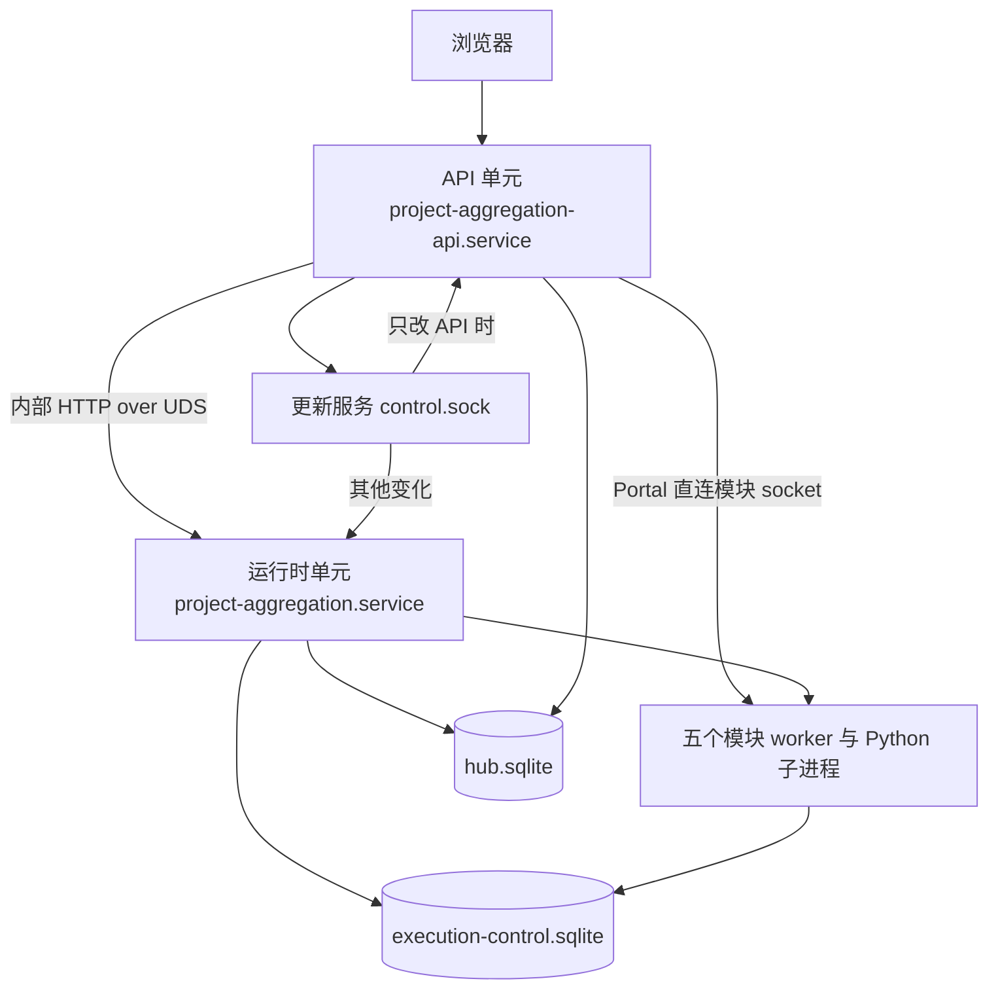

# 工作台控制面与数据面分离技术实现方案

| 项目 | 内容 |
| --- | --- |
| 文档版本 | v1.1 评审稿 |
| 日期 | 2026-10-20 |
| 源码基线 | project-aggregation `647bfa49e8ea091733a0950357e760b90c3a8b79` |
| 上位文档 | [架构实现方案](architecture-implementation.md) 第 3、11、15 节中的 M3 生命周期批次 |
| 适用范围 | `server/`、`modules/crossex/server/`、`deploy/`、`server/update-service/`、`server/recovery/` 与相关测试 |
| 设计状态 | 评审稿；P0、P1-1 与 P1-2 已发布（实现差异见第 9 节），P1-3 分三步实施（P1-3a 进程内组合、P1-3b 数据面 UDS 链路已发布，P1-3c 进程入口与启动器在分支实施，生产入口在 P1-4 切换），P1-4、P2、P2b 尚未实施；新增参数为初始设计值 |
| 改动分级 | 本文为 R1 文档；实现批次的等级见第 10 节，除一个 R2 批次外均为 R3 |
| 读者 | 工作台与内置模块开发者、审查者、部署维护者 |

本文把架构实现方案中 M3 的「运行时独立、IPC 发现、领域仓储和故障分级」细化为三个可以分别交付、分别回滚的阶段。本文只补充实现细节，不改变上位文档的目标、预算和退出条件；两者出现差异时以上位文档为准，差异登记在第 9 节。

文中 `路径:行号` 均指上述源码基线。行号会随代码变化漂移，实施时以符号名重新定位。

## 本轮同步（v1.1）

本轮对照原基线 `aca4637` 至 `647bfa4` 的提交，只更新与分离方案有关的现状、引用与兼容约束。当前仍由 `server/index.mjs` 在同一进程中组合模块监督和 `createApp`；以下修复不代表已完成控制面与数据面分离。

| 主题 | 最新代码变化 | 对本文的影响 |
| --- | --- | --- |
| 启动失败日志 | `91b65c9` 在退出前记录启动失败原因；已有关闭原因时记为启动中止警告，`647bfa4` 补齐锁失效测试夹具 | 更新启动行号，P0/P1 保留日志级别及先记录、后退出的顺序 |
| 首页推送与投影 | `adb79c6` 改为比较完整项目投影；`a123112` 让停用、未配置和链接项目提前返回，不读取旧快照 | 拆分后保留完整字段的变化检测和投影的提前返回语义 |
| 登录风控 | `a7f01ef` 为并发密码校验预占账户名额，修复失败累计与过期清理，并新增 `accountLockoutMs` 参数 | 这些逻辑仍归 API，拆分时保留并发、过期及成功清零契约 |
| 请求诊断 | `2a75898` 将调用方的 `AbortError` 记为 `cancelled`，诊断页不计入失败率 | 转发与重连的验收沿用取消、超时、网络失败的区别 |
| 运维清理 | `c543ee8` 使两个清理脚本仅停止显式列出的项目单元，端口占用只报告 | P2 更新单元清单时保留项目范围与 systemd 停止方式 |

## 1 结论与范围

### 1.1 结论

- **先做 P0。** 在现有单进程内，把「任一模块退出即关闭全站」改为按模块重启。它不改部署和数据库，直接满足 M3 的「模块故障不无条件关闭全站」。
- **P1 拆进程，不拆单元。** Hub 拆成 API 进程和运行时进程，仍由一个 systemd 单元托管。API 崩溃不再中断模块、采集和原生执行；跨进程契约在部署不变的前提下先固定下来。
- **P2 拆单元并按范围激活。** 改为两个 systemd 单元，安装器在只有 API 输入变化时只重启 API。完成后才满足 M3 的「Hub API 重启不停止模块和采集」。
- P1、P2 的工作量和风险明显高于 P0。建议 P0 稳定运行后，按第 10 节的进入条件再决定是否继续。M4 及以后的 API 双槽、持久 Portal 授权、SSE 重放和多实例不在本文范围。

### 1.2 术语

| 本文用语 | 包含 | 对应上位文档 |
| --- | --- | --- |
| 控制面（API 进程） | HTTP 入口、登录与会话、来源校验、项目配置、Portal 页面代理、静态资源、更新协调与更新推送、首页 SSE 连接管理 | 第 3.1 节 Hub API |
| 数据面（运行时进程） | 模块监督与五个模块进程、摘要采集与快照、交易数据刷新、资产同步、原生执行与执行租约、Hub 账户写入器、基线采样 | 第 3.1 节 Runtime Supervisor、Execution Worker、采集与资产同步 Worker 的首期合并形态 |
| 运行时实例 | 一次运行时进程启动，带 `instanceId` | 第 3.3 节实例身份 |
| 模块实例 | 一次模块 worker 启动，带 `instanceId` 和按模块递增的 `generation` | 第 3.3 节 generation |
| 持久维护标记 | Hub 库 `settings` 中的 `updates-maintenance` 与 `updates-pending-plan` | 第 11.2 节「关闭相关新任务入口」 |

模块监督归数据面，因为 API 重启时它必须继续持有模块进程。这与上位文档第 3.1 节「首个拆分版本使用两个独立进程组：API 组和运行时组」一致。

### 1.3 非目标

- 不做 API 双槽、稳定路由层、持久 Portal ticket/grant，也不让登录失败计数跨重启保留（M4）。
- 不做 SSE 持久游标与重放（M5）。API 重启后浏览器按现有 `retry` 重连并取得全量快照。
- 不把原生执行、采集、SSE 再拆成独立进程，不迁移 PostgreSQL。
- 不做按模块的选择性更新。一次更新要么只重启 API，要么整体重启运行时。
- 不根据健康探测结果自动杀进程。P0 只处理进程退出，挂起检测等有误杀评估后再做。

## 2 现状与约束

| 领域 | 当前实现 | 对本方案的约束 |
| --- | --- | --- |
| 启动顺序 | `server/index.mjs:39` 取得数据根生命周期锁，`:41` 检查恢复状态，`:42` 创建 Hub 账户写入器，`:43` 启动五个模块，`:46` 创建应用，`:57` 开始监听 | 锁、写入器、模块和 HTTP 在同一进程，任一环节退出都关闭整体 |
| 启动诊断 | `server/index.mjs:49-54` 在 `shutdown(1)` 前记录错误；若已进入关闭流程，则记录 `warn` 级别的「工作台启动已中止」，否则记录 `error` 级别的「工作台启动失败」 | 拆分入口及启动器时保留真实原因，锁失效等已有关闭原因不能重复归为新的启动失败 |
| 模块故障 | 就绪模块退出时，`server/modules/runtime.mjs:75` 关闭全部模块并调用 `onFailure`，入口随即 `shutdown(1)`（`server/index.mjs:43`）；`tests/embedded-runtime.test.mjs:150` 固定了这一行为 | P0 修改的正是这条路径，测试契约同步修改 |
| 模块启动 | `runtime.mjs:42` 按目录串行启动，Monitor 先于 CrossEx（注释见 `:40-41`）；`:14` 在系统临时目录建私有目录；`:16-19` 每次整组启动时生成 socket 与 secret；`:48` 所有模块以 `WORKSPACE_MAINTENANCE=1` 启动；Linux 下 Monitor 由 `flock` 包装，锁冲突退出码为 75（`:56-60`） | 单个模块重启时要重新生成它的传输信息，并沿用维护态启动 |
| 关闭预算 | 监督者等待 ASTER 115 s、其他模块 32 s 后强杀（`runtime.mjs:28`）；worker 自身关闭时限为 ASTER 110 s、其他 30 s（`server/modules/worker.mjs:24`） | 确认旧实例退出时复用这些预算 |
| 传输下发 | `runtime.mjs:78` 把五个模块的 socket 与 secret 全部发给每个 worker；只有 CrossEx 使用其他模块的传输（`server/modules/crossex.mjs:10-11`） | 最小权限缺口，P0 一并收窄 |
| 传输注册 | 进程内 `Map`（`server/modules/transport.mjs:4`）；重复注册抛错（`:11`）；虚拟来源找不到注册即报模块不可用（`:21`）；Portal 与摘要读取每次请求查表（`server/portal.mjs:223`、`server/adapters.mjs:99`） | 每请求查表让重启后自动切换成为可能；跨进程后需要发现机制 |
| CrossEx 依赖 | CrossEx 启动时取一次 Monitor 传输（`server/modules/crossex.mjs:11`）；`modules/crossex/server/clients.mjs:83` 用它创建读取器，`createEmbeddedRequest` 在创建时就固定了 socket 与 secret（`modules/crossex/server/embedded-request.mjs:7`） | Monitor 单独换代后，CrossEx 会一直使用失效的传输，读取持续失败；必须改为每次读取当前值 |
| Python 子进程 | `server/modules/python-module.mjs:12` 启动 Python 桥时不建立独立进程组；正常关闭超时后才 `kill`（`:131`）。worker 消失后，桥读到 stdin 结束才开始关闭，最长为关闭时限加 2 s（`server/modules/greeks-bridge.py:164`）；ASTER 的关闭时限为 100 s（`server/modules/aster.mjs:14`），Greeks 使用默认的 10 s | worker 异常退出后，ASTER 的 Python 子进程最长约 102 s 内仍可能持有模块锁和账户租约 |
| 模块实例锁 | ASTER（`modules/aster/trading/lock.py`）与 Greeks（`modules/greeks/app/lease.py`）有模块内文件锁，Monitor 有 `instance.lock`（`runtime.mjs:60`）；CrossEx 与 Asset 未找到实例锁 | 重启前必须由监督者确认旧进程树已全部退出，不能依赖模块自查 |
| 账户写入保护 | 每个 `AccountWriter` 实例注册新的 owner（`server/execution/account-writer.mjs:321`、`:340`）；接管其他 owner 的账户要求旧 owner 已关闭或其 pid 不存在，接管时 fence 加一（`:488-490`） | 旧进程未退出时新实例得到 `OWNER_ALIVE`，这也要求先确认旧进程退出 |
| 模块维护门 | 三个交易模块的维护开关一次全部设置，任一失败即整体失败（`server/modules/updates.mjs:9-14`）。模块侧：CrossEx 维护中拒绝 GET、HEAD 以外的请求（`modules/crossex/server/app.mjs:84`）；ASTER 拒绝新的交易请求（`modules/aster/trading/workspace_control.py:44-49`）；Greeks 提供维护接口（`modules/greeks/app/main.py:74-85`），维护中停止自动开仓（`modules/greeks/app/engine.py:760`） | 需要能按单个模块设置维护 |
| 更新准入 | `server/updates.mjs:202-208` 的 `status()` 每次同步全部交易模块；`:222-231` 的 `withExecutionEntry` 调用 `status()`，任一模块同步失败即拒绝；`:240` 激活前要求没有在途入口和未终结的原生任务。Portal 的内嵌模块写请求（`server/portal.mjs:431-438`，接线见 `server/app.mjs:218`）和原生执行写入口（`app.mjs:462-465`）都经过它，停止与核对（`app.mjs:467`）不经过 | 一个交易模块重启期间，所有模块的写请求和原生执行都会被拒绝；`tests/embedded-updates.test.mjs:225` 固定了这一行为 |
| 更新推送 | `server/update-stream.mjs:35` 把任何读取失败都显示为更新服务不可用 | 模块维护同步失败会被误报为更新服务故障 |
| Hub 数据库 | `server/app.mjs:82-83` 打开 `hub.sqlite`，启用 WAL 与 5000 ms busy timeout；采集写入快照（`:276`、`:287`），计算投影时也会回写诊断（`:247`） | 拆分后快照只能有一个写入方 |
| 首页推送 | `app.mjs:200-209` 每次推送逐连接检查会话和 256 KiB 写缓冲；连接上限见 `:494`，15 s 心跳见 `:606`，采集调度见 `:588-607` | SSE 连接与采集调度在同一进程，API 重启会停掉采集 |
| 首页投影与增量 | `server/overview-stream.mjs:5-15` 按完整项目的 `JSON.stringify(item)` 比较，任何项目字段变化均可产生 patch；`app.mjs:237-242` 对停用、未配置和链接项目先返回，再读取内存或数据库快照 | 不能改回只比较 revision、时间与状态等部分字段；投影迁入运行时后也应避免这些提前返回分支读取旧快照 |
| 后台任务 | 交易数据刷新定时器（`server/trading.mjs:457-458`）、资产同步（`app.mjs:582-587`）、原生执行保护初始化（`app.mjs:608`）、基线采样（`app.mjs:610-615`，SSE 连接数直接读 `streams.size`，见 `:611`） | 这些都属于数据面 |
| 原生执行 | 全局 `execution_lease`（`server/trading-execution.mjs:37`），TTL 60 s（`:12`）；新取得领导权时暂停全部活动任务（`:217-218`）；关闭时暂停活动任务并删除租约（`:660-669`） | 当前每次 Hub 重启都会暂停原生任务；移到运行时后，API 重启不再触发暂停 |
| 登录风控 | IP 限流与账户锁定保存在内存（`app.mjs:183-188`）；账户阈值为 5，`accountLockoutMs` 默认 30 min，校验范围为 1000 至 86400000 ms（`:59-62`）；读完请求体、密码哈希前预占名额，使失败数加进行中校验数不超过阈值（`:353-365`）；未锁定失败自首次失败起到期，锁定在截止时刻到期，进行中记录不清理，成功登录清零（`:188`、`:369-389`） | 风控仍归 API，API 重启会清零；拆分不能丢失并发计数和过期语义 |
| 共享保护库读取 | `/api/system/accounts` 与 `/api/system/recovery` 直接调用写入器的 `snapshot()`（`app.mjs:407-408`） | 写入器归运行时，这两个接口要转发 |
| 生命周期锁 | 只支持排他锁（`server/recovery/lifecycle_lock.py:210`、`:217`）；工作台入口（`server/index.mjs:39`）与恢复 CLI（`server/recovery/cli.mjs:67`、`:75`）取得同一把锁；锁本身不能证明服务 cgroup 已空（`lifecycle_lock.py:1`） | 两个进程不能共用这把锁，需要第二把锁 |
| 基线结构 | 样本 `schema_version` 固定为 1（`server/observability.mjs:33`），有效性校验要求 SSE 计数为整数（`:35-46`） | 运行时拿不到 API 的连接数时不能写 0 冒充 |
| 服务单元 | `deploy/install.sh:2344-2374` 只写一个单元：`Type=simple`、`Restart=on-failure`、`TimeoutStopSec=150`、`PrivateTmp=true`、`ProtectSystem=strict` | 两个单元各有私有 `/tmp`，模块 socket 不能再放在临时目录 |
| 安装激活 | 部署键只覆盖一个单元文件（`install.sh:2486`）；激活只重启一个服务（`:2508`）；健康检查只看一个服务和 `/api/health`（`:1295-1297`）；回滚只恢复一个单元（`:1349-1367`）；`server` 整树是一个运行输入（`:1519`、`:1558`）；CI 模式只导入校验 `server/app.mjs`（`:2473`） | 需要组件级输入键和按范围激活 |
| 首次密码提示 | 初始密码由 `createApp` 写入日志（`app.mjs:92`），安装器提示 `journalctl -u $SERVICE`（`install.sh:2521`） | 密码生成归 API 后，提示要改到 API 单元 |
| 更新服务登记 | `server/update-service/registry.py:27-31` 只登记一个单元；`:93-94` 要求唯一 `ExecStart`；`:102-105` 只要存在 drop-in 即判为未受管；`:117` 身份摘要包含单元文本 | 需要支持两个单元，并只放行受管 drop-in |
| 恢复操作 | `server/recovery/operations.py:19` 固定一个服务名；`:69` 按 `index.mjs` 匹配 `ExecStart`；`:150-163` 只检查一个服务和 cgroup；`:253`、`:317` 停止与启动一个服务 | 拆分后必须同时停止并核对两个单元 |

## 3 目标结构

### 3.1 P2 完成后的进程结构



运行时单元沿用现有服务名 `project-aggregation.service`。这样运维习惯、恢复 guard 的 drop-in 目录，以及 `systemctl stop project-aggregation` 停止整个工作台的含义都不变。API 单元新增为 `project-aggregation-api.service`，通过 `PartOf=` 跟随运行时单元的停止和重启（6.1 节）。

### 3.2 组件归属

| 组件 | 当前位置 | 目标进程 | 说明 |
| --- | --- | --- | --- |
| 数据根生命周期锁 `.runtime.lock` | `server/index.mjs:39` | 运行时 | 排他语义不变 |
| API 锁 `.api.lock`（新增） | 无 | API | 共享锁，恢复工具取排他锁（5.7 节） |
| Hub 账户写入器 | `server/index.mjs:42` | 运行时 | 原生执行使用 |
| 模块监督与传输注册表 | `server/modules/runtime.mjs`、`server/modules/transport.mjs` | 运行时；API 只持有按 generation 失效的缓存 | 只有监督者能注册传输 |
| 摘要采集、快照与诊断 | `app.mjs:236-291`、`:588-607` | 运行时 | 快照唯一写入方 |
| 首页投影计算 | `app.mjs:196-199` | 运行时 | 投影依赖诊断与资产同步状态 |
| 首页 SSE 连接与编码 | `app.mjs:200-209`、`:491-499` | API | 运行时推送投影，API 分发 |
| 交易数据、导入与持仓 | `app.mjs:143`、`:211-216` | 运行时 | `/api/trading*` 转发 |
| 原生执行 | `app.mjs:148`、`:608` | 运行时 | 写入口准入见 5.5 节 |
| 资产同步 | `app.mjs:582-587` | 运行时 | Portal 的同步协调走内部接口 |
| 基线采样 | `app.mjs:610-615` | 运行时 | SSE 计数由 API 上报（5.8 节） |
| 会话、登录、密码、项目配置与模块偏好 | `app.mjs` 的 `api()` | API | 运行时只读会话表 |
| Portal 票据、授权与页面代理 | `server/portal.mjs` | API | 直连模块 socket，正文不经运行时 |
| 更新协调与更新推送 | `server/updates.mjs`、`server/update-stream.mjs` | API | 维护标记下发到模块归运行时（5.5 节） |
| 静态资源 | `app.mjs:568-577` | API | |

上位文档第 3.1 节允许 SSE Gateway 初期附着采集进程。本文在 M4 的稳定入口出现前把 SSE 连接留在 API：对外端口只由 API 持有，连接即使附着运行时也要经 API 转发，API 重启时同样会中断。投影计算与诊断仍在运行时。这一差异登记在第 9 节。

### 3.3 Hub 库写入归属

过渡期两个进程共用 `hub.sqlite`，按上位文档第 3.2 节各自建立连接，不传递 `DatabaseSync`、Statement 或加密闭包。

| 数据 | 唯一写入方 | 其他进程的访问 |
| --- | --- | --- |
| `settings` 中的密码、模块偏好、持久维护标记 | API | 运行时只读维护标记与偏好 |
| `projects`、`sessions` | API | 运行时只读 |
| `snapshots` | 运行时 | API 不读表，只用运行时推送的投影 |
| 交易、导入、原生执行各表，以及新增的执行入口表 | 运行时 | API 只在更新准入事务中只读执行表（5.5 节） |
| `platform_baseline_samples` | 运行时 | API 通过转发读取 |

`settings` 中其他键的写入方在实施时用 SQL 审计逐一确认。未确认的键不能默认只有一方写入。

### 3.4 阶段总览

| 阶段 | 交付 | 退出条件 | 依赖 |
| --- | --- | --- | --- |
| P0 进程内按模块恢复 | 实例状态机、退避重启、旧进程树确认、传输换代、CrossEx 动态依赖、按模块的维护同步与写入准入、模块状态接口 | 强杀任一就绪模块后其余四个保持就绪、站点持续服务；该模块按退避恢复；交易模块恢复后先保持维护 | 无 |
| P1 双进程单单元 | 运行时与 API 入口、单元内启动器、内部协议、请求转发、概览推送链路、执行入口串行化、第二把锁、SSE 计数上报 | 杀掉 API 进程后模块、采集、原生执行持续；API 重启后页面自动恢复；以 `createApp` 为入口的测试不改语义通过 | P0 |
| P2 双单元与按范围激活 | 两个 systemd 单元、组件输入键、只重启 API 的激活、运行版本固定、更新服务登记、恢复入口双单元 | 只改 API 的更新不改变运行时与模块进程 pid；整体更新、回滚、备份恢复在 Ubuntu CI 通过 | P1 |
| P2b 按范围的更新准入（可选） | API 范围的更新不进入交易维护 | 计划范围与安装器判定不一致时不激活 | P2 |

### 3.5 备选方案与取舍

| 方案 | 结论 | 原因 |
| --- | --- | --- |
| 只把模块监督拆出，采集与原生执行留在 API 进程 | 不采用 | API 重启仍会停止采集和原生执行，达不到 M3 退出条件 |
| 为每个业务操作定义细粒度 RPC | 不采用 | 改动面大；本文只为监督、维护、概览定义专用接口，业务路由整体转发，复用现有处理代码 |
| Portal 放在运行时 | 不采用 | 页面流量和升级连接要多一跳；上位文档第 3.1 节把 Portal 请求归 Hub API |
| 跳过 P1，直接改两个单元 | 不采用 | 代码边界和部署激活同时变化，失败时难以定位和回滚 |

## 4 P0：进程内按模块恢复

### 4.1 模块实例状态机

```text
starting ──就绪──▶ ready ──非关闭退出──▶ draining
starting ──启动失败、超时或退出──▶ draining
draining ──旧进程树全部退出──▶ backoff ──到期且依赖就绪──▶ starting
draining / backoff ──连续失败达到阈值──▶ fault ──管理员恢复──▶ starting
draining ──强杀后旧进程树仍存在──▶ fault
任意状态 ──close()──▶ stopping ──▶ stopped
```

- **首次启动保持现状。** 五个模块仍串行启动，任一模块首次启动失败仍使整组启动失败并退出进程。这样安装器的健康检查仍能发现坏版本并回滚。若首次启动也降级运行，必须先有 P1 的就绪接口，否则坏版本会被判为健康。
- `close()` 取消所有待执行的退避定时器，等待正在启动或排空的实例结束，再按现有方式关闭全部模块。
- `onFailure` 只在首次启动失败和监督者自身不可恢复的错误（如私有目录无法创建）时调用，不再因单个模块退出而调用。

### 4.2 重启策略

- 退避序列沿用上位文档第 3.3 节：1、2、4、8、16、30、60 s 加抖动。抖动取每档 0 至 20% 的正向随机值，为本文的初始设计值。上位文档把这一序列写给普通读取模块；交易模块使用同一序列，但重启后按 4.5 节先只读恢复。
- 连续失败 5 次进入 `fault`，不再自动重启。「失败」指实例未能就绪，或就绪后不足 10 min 即退出；实例保持就绪满 10 min 后计数清零。
- 阈值为 5 次时实际只用到前五档，30 s 与 60 s 不会出现。这一出入登记在第 9 节，由评审确定。
- CrossEx 依赖 Monitor。Monitor 不在 `ready` 时，CrossEx 停在 `backoff` 等待，不计失败次数，与首次启动先 Monitor 后 CrossEx 的顺序一致。
- Monitor 以退出码 75 退出说明旧实例仍持有 `instance.lock`，记为一次失败并继续退避。

### 4.3 旧实例退出确认

重启前必须确认旧实例的整个进程树已退出。原因有三：CrossEx 与 Asset 没有模块级实例锁；Python 桥在 worker 异常退出后仍会执行完自身的关闭流程（第 2 节）；账户写入器在旧 pid 存活时拒绝接管。

- **Linux：** 以 `detached: true` 启动 worker，使其成为新进程组的组长。Monitor 的 `flock --no-fork` 直接替换为 Node 进程，Python 桥继承同一进程组。worker 退出后每 100 ms 用 `process.kill(-pgid, 0)` 探测，直到返回 `ESRCH`。等待上限沿用 `runtime.mjs:28` 的 115 s 与 32 s，均大于 Python 桥最长的自行关闭时间（ASTER 约 102 s，Greeks 约 12 s）；超时后向整个进程组发送 `SIGKILL` 并再等 5 s；仍有成员则进入 `fault`，不启动新实例。
- Node 的 `detached: true` 在 Linux 上同时建立新会话，开发时终端的 Ctrl+C 不再直接送达 worker。worker 已在 IPC 断开时自行关闭（`worker.mjs:61`），监督者关闭时也会发送关闭消息；systemd 停止服务时按 cgroup 向全部进程发信号，不受进程组影响。
- **Windows：** worker 通过 IPC 上报它创建的子进程 pid，监督者逐个探测，超时后终止。Windows 只用于开发和单元测试，生产行为以 Linux 为准。
- **新路径：** 每个实例使用新的 socket 文件或 pipe 名，如 `<私有目录>/<id>-<generation>.sock`。这样不需要删除旧 socket 文件，残留的旧监听也接不到新流量。
- 实施时核对 Python 模块没有调用 `setsid` 或自行脱离进程组；若有，改为由模块上报 pid。

### 4.4 传输换代与依赖刷新

- `registerModuleTransport` 增加 `instanceId` 与 `generation`。只有更大的 generation 能替换现有注册，同一 generation 重复注册仍然抛错。旧调用方式在过渡期保持兼容，测试夹具不需要一次全部修改。
- 模块退出时立即注销其传输，Portal 与摘要读取直接得到「模块不可用」，不会连到失效 socket。虚拟来源仍不回退到 DNS 或用户可控地址（`transport.mjs:21`）。
- 每个实例生成新的 secret，符合上位文档第 3.3 节。
- 启动消息只携带模块目录中声明的依赖。目录为 CrossEx 增加 `dependencies: ['monitor']`，其他模块不再收到任何其他模块的传输。只有 CrossEx 读取 `transports`（`crossex.mjs:10-11`），收窄不影响其他模块。
- Monitor 每次就绪或退出时，监督者向 CrossEx worker 发送 `{ type: 'dependency', id: 'monitor', transport }`，退出时 `transport` 为 `null`。`worker.mjs` 把消息交给模块的 `updateDependency(id, transport)`。
- `server/modules/crossex.mjs` 保存可变的 Monitor 传输，并把取值函数传给 `createPublicClients`。`modules/crossex/server/embedded-request.mjs` 的 `createEmbeddedRequest` 同时接受对象和取值函数，每次请求读取当前值，`clients.mjs:83` 原样传入；取值为空时按现有读取失败处理。

### 4.5 交易模块恢复后的维护保持

- 重启后的交易模块与首次启动一样以维护态启动（`runtime.mjs:48`），只读运行，拒绝新的交易写入。
- 实例就绪后监督者发出 `ready(moduleId, generation)` 事件，更新协调器只同步这一个模块：持久维护标记关闭时解除维护，开启时保持维护。
- 同步失败时模块保持维护，协调器按 1 至 30 s 退避重试，模块状态显示为「维护未确认」。
- 解除维护的路径与当前整站重启相同：模块自身完成启动恢复与账户写入接管，再由维护同步解除（当前为 `app.mjs:609` 的 `updates.initialize()`）。因此按模块重启的安全性不低于现状。
- 更新正在应用时模块重启，新实例按已开启的维护标记保持维护；停机准入若读到重启中的模块，会按现有逻辑失败关闭。

### 4.6 写入准入按模块收窄

- `withExecutionEntry(operation, { scope })` 增加作用范围：`native` 表示原生执行，其他值为模块 ID。Portal 传入目标项目 ID。
- 所有范围仍要求更新服务状态可读、持久维护标记关闭、没有正在应用的更新。这部分继续失败关闭。
- 只有范围是交易模块时，才要求该模块的维护同步成功。Monitor、Asset 与原生执行不再受其他模块同步结果影响。
- `status()` 仍尝试同步全部交易模块，但改为返回逐模块结果，不再整体抛错。更新推送据此显示具体模块的维护状态，不再误报为更新服务不可用。
- `initialize()` 与 `apply()` 保持任一模块失败即失败关闭，`tests/embedded-updates.test.mjs:203`、`:235` 不变。`:225` 中针对 `withExecutionEntry` 的断言改为按范围断言：Greeks 范围被拒绝，CrossEx 与原生执行范围放行。这是契约变更，需要审查者明确确认。

### 4.7 管理接口与观测

- `GET /api/system/modules`：与现有 `/api/system/*` 读取接口一致，只接受无查询参数的 GET，要求登录和同源，禁止缓存。每个模块返回 `moduleId`、`state`、`generation`、`restartCount`、`consecutiveFailures`、`lastExitAt`、`lastExitKind`、`readyAt`、`maintenanceReleasedAt`、`nextAttemptAt`，不返回 pid、路径和 secret。
- `POST /api/system/modules/:id/restart`：只在 `fault` 状态可用，其他状态返回 409；沿用现有写接口的会话与来源校验；返回 202，结果通过 GET 查询。
- 生命周期日志使用结构化类型 `module-lifecycle`，记录退出码或信号、排空耗时、退避时长和维护同步结果。从退出到只读就绪、从只读就绪到解除维护分别计时，对应上位文档第 14 节的「运行时恢复」指标。基线结构在 P0 不变。
- 保留入口现有的启动诊断：新的启动失败先记录原因再退出；已因锁失效、信号或模块故障关闭时，后续启动中止只记录警告，不覆盖原始原因（`server/index.mjs:49-54`）。
- 前端展示可以后置。接入前，模块故障仍通过首页摘要的错误状态体现。

### 4.8 改动清单

| 文件 | 改动 |
| --- | --- |
| `server/modules/runtime.mjs` | 状态机、退避、进程组探测、按 generation 生成 socket 与 secret、依赖消息、`status()`、`restart(id)` 与事件 |
| `server/modules/transport.mjs` | generation 注册与替换规则 |
| `server/modules/catalog.mjs` | 依赖声明 |
| `server/modules/worker.mjs` | 处理依赖更新消息 |
| `server/modules/python-module.mjs` | Windows 下上报子进程 pid |
| `server/modules/crossex.mjs`、`modules/crossex/server/clients.mjs`、`modules/crossex/server/embedded-request.mjs` | Monitor 传输改为取值函数 |
| `server/modules/updates.mjs` | `setMaintenance(active, ids)` |
| `server/updates.mjs` | 按范围的 `withExecutionEntry`、逐模块同步结果、就绪事件触发单模块同步 |
| `server/portal.mjs`、`server/app.mjs` | 传入作用范围；模块状态与恢复接口 |
| `server/index.mjs` | `onFailure` 只处理首次启动失败与监督者致命错误；把监督者的状态、事件与 `restart` 传给 `createApp` |
| `server/update-stream.mjs` | 显示逐模块维护状态 |

### 4.9 验证与退出条件

- 改写 `tests/embedded-runtime.test.mjs:150`：就绪 worker 崩溃后只重启该 worker，其余 worker 的 pid 不变，新实例 generation 加一且 socket 路径不同。
- 新增：连续失败进入 `fault` 并可人工恢复；退避使用注入的时钟和随机数；`close()` 在退避和排空期间都能干净结束。
- 新增：Python 子进程不响应 stdin 结束时，新实例要等旧进程组退出或被强杀后才启动。
- 新增：交易模块重启后保持维护；维护标记关闭时由单模块同步解除，开启时保持。
- 新增：Monitor 重启后，CrossEx 无需重启即可用新传输读取；非 CrossEx 模块收不到其他模块的传输。
- 修改 `tests/embedded-updates.test.mjs:225` 为按范围断言，其余用例不变。
- 复用 `tests/embedded-node-modules.test.mjs`、`tests/embedded-aster.test.mjs`、`tests/portal.test.mjs`、`tests/embedded-hub.test.mjs`。
- 复用 `tests/startup-failure.test.mjs`、`tests/recovery-index-lifecycle.test.mjs`，保持启动原因先于退出写入日志，以及锁失效后先排空模块、后释放锁的顺序；后者的日志夹具已支持 `warn`。
- 退出条件：在 Ubuntu CI 中逐个对五个就绪模块发送 `SIGKILL`，站点持续响应，其余模块不重启，被杀模块在退避后重新就绪；交易模块恢复期间新交易请求被拒绝。

### 4.10 回滚

P0 不改数据库、配置和服务单元。程序回滚到上一健康版本，即恢复「模块退出即整站退出」的旧行为。模块状态只在内存中，回滚无需清理。

## 5 P1：运行时与 API 进程分离（单服务单元）

### 5.1 进程入口

| 入口 | 职责 |
| --- | --- |
| `server/runtime/main.mjs`（新增） | 取得 `.runtime.lock`，检查恢复状态，创建 Hub 账户写入器，启动模块监督，打开 Hub 库并建立数据面的表，创建采集、交易、原生执行、资产同步与基线，监听内部 socket，写入发现文件；由单元内启动器拉起时向其报告就绪 |
| `server/api/main.mjs`（新增） | 取得 `.api.lock`，检查恢复状态，打开 Hub 库并建立控制面的表，生成初始密码，连接运行时，创建更新协调器与 Portal，监听 `HOST:PORT` |
| `server/index.mjs` | 改为单元内启动器：先启动运行时并等待就绪，再启动 API；API 意外退出时按 1 至 30 s 退避重启 API；运行时意外退出时停止 API 并以非零码退出，由 systemd 整体重启；收到 SIGTERM 时先停 API 再停运行时，并汇总退出码 |
| `server/app.mjs` 的 `createApp` | 保留为进程内组合，供现有测试、`server/setup.mjs` 与 `scripts/verify-embedded.mjs` 使用；其中的运行时客户端为进程内实现，与跨进程实现遵守同一契约；保留现有 `accountLockoutMs` 等参数及其校验 |

启动器不打开数据库、不持锁、不处理业务请求。单元仍为 `Type=simple`，systemd 停止时信号同时到达同一 cgroup 内的全部进程，这与现在 Hub 和模块 worker 同时收到 SIGTERM 的情况相同；启动器的停止顺序只在单独向它发信号时生效。

API 进程在内嵌模式下不读取 `credentials.key`。交易账户凭据的加密和解密只在运行时进行，API 只转发请求体。非内嵌分支只保留在 `createApp` 的兼容组合中；实施时逐个核对 `encrypt`、`decrypt` 的调用点，确认 API 侧没有遗漏。

`server/setup.mjs:6` 目前用完整的 `createApp` 重置密码，会顺带创建原生执行和账户写入器。P1 改为只组合控制面存储。

### 5.2 内部协议

**传输与发现**

- 运行时在运行目录监听 HTTP/1.1：Linux 为 `<运行目录>/runtime-<instanceId>.sock`，Windows 为 `\\.\pipe\workbench-runtime-<instanceId>`。运行目录取环境变量 `WORKBENCH_RUNTIME_DIR`，P2 的两个单元都设为 `/run/project-aggregation`；未设置时为 `<DATA_DIR>/run`，权限 0700。
- 模块 socket 也从系统临时目录（`runtime.mjs:14`）移到运行目录，为 P2 的两个私有 `/tmp` 做准备。
- UDS 路径超过 100 字节时启动失败并给出明确错误，不截断路径。
- 监听成功后，以临时文件加改名的方式写入 `<运行目录>/runtime.json`，权限 0600，字段为 `schemaVersion`、`protocol`、`instanceId`、`pid`、`socketPath`、`secret`、`startedAt`、`release`。正常退出时删除。
- API 读取发现文件前校验：普通文件、非符号链接、属主为本进程 uid、非 Windows 下不含组和其他用户权限位、大小不超过 4 KiB。连接后 `GET /internal/v1/status` 返回的 `instanceId` 必须与文件一致。
- 每个请求携带 `x-workspace-runtime-key`，运行时用定长比较校验（与 `worker.mjs:13-17` 相同）。浏览器请求和项目配置不能指定内部 socket、pipe 或 secret；日志不记录 secret 和会话 ID。

**版本与失效**

- `protocol` 为整数，首版为 1。API 声明自己支持的版本集合；不兼容时 `/api/ready` 与转发路由返回 503，错误只记录一次。
- 以下情况使 API 缓存的发现记录和模块传输失效：运行时 `instanceId` 变化、连接被拒、模块 generation 变化或模块退出、内部连接断开（与上位文档第 3.3 节一致）。失效后重新解析，旧记录不得指向替代实例。
- 运行时 `instanceId` 变化时，API 重新确认维护同步（5.5 节）并重建概览订阅。

**预算**

| 调用 | 总预算 | 自动重试 | 失败行为 |
| --- | --- | --- | --- |
| 状态、投影、模块传输解析等读取 | 5 s | 重新解析后至多 1 次 | 返回 503「运行时不可用」 |
| 维护同步 | 15 s | 0 次，以状态查询确认 | 写入准入失败关闭 |
| 停机准入（现有 `prepareApply`） | 70 s，覆盖能力读取的 5 s 与 ASTER 状态读取的 60 s（`server/modules/updates.mjs:20-22`） | 0 次 | 拒绝更新 |
| 资产同步协调 | 60 s，沿用 `createAssetSync` 的 `timeoutMs`（`server/asset-sync.mjs:23`） | 0 次 | 共享已有同步任务 |
| 转发的业务请求 | 原请求剩余预算，最长 60 s（`app.mjs:581` 的 `requestTimeout`） | 0 次 | 写请求返回「结果未确认，请刷新后核对」，不自动重发 |
| 概览订阅 | 长连接 | 1 至 30 s 退避重连 | 见 5.4 节 |

**接口**

| 方法与路径 | 用途 |
| --- | --- |
| `GET /internal/v1/status` | 实例身份、协议版本、就绪与降级原因、各模块状态 |
| `GET /internal/v1/modules/:id/transport` | 当前模块实例的 socket、secret、`instanceId`、`generation`，仅供 Portal 使用 |
| `POST /internal/v1/maintenance/sync` | 按持久维护标记同步指定模块，返回逐模块确认 |
| `POST /internal/v1/maintenance/prepare-stop` | 执行现有停机准入检查 |
| `POST /internal/v1/modules/:id/restart` | `fault` 状态的人工恢复 |
| `GET /internal/v1/overview`、`GET /internal/v1/overview/events` | 最新首页投影，以及按修订号推送的 NDJSON 流 |
| `POST /internal/v1/projects/:id/changed` | 模块偏好变化通知，幂等 |
| `POST /internal/v1/api-stats` | API 上报 SSE 计数（5.8 节） |
| `/internal/v1/forward/*` | 转发的业务路由 |

内部 JSON 响应设上限，初始 4 MiB；转发请求沿用现有路由的请求体上限。

**业务请求转发**

API 先完成现有的会话、来源与 `Sec-Fetch-Site` 校验，再转发方法、路径、查询串、请求体和 `Content-Type`，并附加 `x-workspace-session`。运行时在 Hub 库中重新确认该会话未过期，再调用与现在相同的领域处理代码。Cookie 不转发，运行时也不设置 Cookie。

### 5.3 路由归属

| 路由 | 归属 | 说明 |
| --- | --- | --- |
| `/api/health` | API | 进程存活，兼容期保持现状 |
| `/api/ready`（新增） | API | API 已就绪、运行时可达且已就绪、协议兼容时返回 200，否则 503；不返回细节 |
| `/api/session`、`/api/login`、`/api/logout` | API | 登录失败与进行中密码校验计数仍在内存，保留第 2 节的名额预占、过期及成功清零语义 |
| `/api/projects`（GET）、`/api/projects/:id`（PUT） | API | 偏好写入后通知运行时，替代 `app.mjs:522-523` 的进程内调用 |
| `/api/projects/:id/launch` | API | 签发 Portal 票据（`app.mjs:530`） |
| `/api/projects/:id/check`、`/api/projects/:id/sync` | 转发 | 采集与资产同步（`app.mjs:526`、`:532-535`） |
| `/api/overview`、`/api/overview/events` | API | 使用运行时推送的投影 |
| `/api/system/updates*` | API | 更新协调器 |
| `/api/system/architecture`、`/api/system/metrics`、`/api/system/accounts`、`/api/system/recovery`、`/api/system/modules` | 转发 | 模块能力、基线和共享保护库都在运行时 |
| `/api/trading*` | 转发 | 交易数据、导入、持仓与原生执行；原生执行写入口另有 5.5 节的准入 |
| Portal 页面与升级连接 | API | 解析模块传输后直连模块 socket（`portal.mjs:221-224` 的 `targetFor` 已是异步函数） |
| 静态资源 | API | |

### 5.4 概览推送链路

- 运行时持有 `states`。采集完成、偏好变化和资产同步完成后重新计算投影，修订号单调递增，通过 `overview/events` 推送完整投影。项目数受 `MAX_PROJECTS` 限制，单次推送体积可控。
- 诊断回写（`app.mjs:245-248`）只在运行时发生，API 不调用 `snapshot()`。
- 运行时的 `snapshot()` 保留停用、未配置、链接项目的提前返回顺序，避免无用的内存或数据库快照读取（`app.mjs:237-242`）。
- API 维持一个上游订阅并缓存最新投影。逐连接会话检查、256 KiB 写缓冲保护、60/12 连接上限、协议 2 编码器和 15 s 心跳都留在 API，行为不变。
- 协议 2 编码器沿用完整项目投影比较（`server/overview-stream.mjs:5-15`）：即使 revision、检查时间和状态未变，仅 `sync`、`diagnostics`、`message` 或 `metrics` 变化也要发送 patch；项目删除、顺序变化和重连全量快照的语义保持不变。
- 运行时断开超过 30 s（初始设计值）后，API 把投影中的项目统一标为 `stale`，附固定消息「运行时不可用」。API 不自行重算诊断；重新连上后以新投影覆盖。
- API 重启后浏览器按现有 `retry: 5000` 重连并取得全量快照，符合上位文档第 1.2 节第 4 条的可恢复连接。

### 5.5 更新协调与写入准入

**持久维护标记是唯一权威**

持久维护标记（写入点见 `app.mjs:152-157`）由 API 的更新协调器写入，由运行时下发到模块：

- 模块实例就绪时，运行时自行读取标记并同步该模块，不依赖 API 在线。运行时重启而 API 暂时不可用时，交易模块也能按标记解除或保持维护。
- API 的 `status()`、`withExecutionEntry` 与 `apply()` 通过 `maintenance/sync` 要求运行时立即同步并等待逐模块确认，语义与 P0 相同。

**原生执行写入口的串行化**

API 与运行时分处两个进程后，API 内存中的入口计数会随 API 崩溃丢失，而运行时可能仍在执行已转发的写命令。为保证「激活更新时没有在途的原生写入」，用 Hub 库的写锁串行化准入和更新：

1. 运行时处理 `connect`、`disconnect`、`preview`、`start` 前，在 `BEGIN IMMEDIATE` 事务中读取持久维护标记。标记开启则返回 409；否则写入一条执行入口记录（入口 ID、创建时间、过期时间）并提交，然后执行操作，结束后删除记录。
2. API 的 `apply()` 在一个 `BEGIN IMMEDIATE` 事务中检查未过期的执行入口和未终结的原生任务，两者都为空才写入维护标记并提交。终结状态的 SQL 条件由 `server/updates.mjs:7` 的 `FINAL_EXECUTION` 生成，不另写一份；它与 `server/trading-execution.mjs:10` 的 `FINAL` 目前是两份相同的定义，可在实施时合并为一处导出。
3. 两个事务都必须取得 SQLite 写锁，因此执行入口要么先提交而被更新检查看到，要么在标记写入后提交而被拒绝。
4. 运行时启动时删除全部执行入口记录。新运行时持有 `.runtime.lock`，说明旧运行时已经退出。

入口过期时间取转发上限 60 s 加余量，初始 90 s；过期只用于防止崩溃后永久阻塞更新。停止与核对（`app.mjs:467`）仍不经过准入，保证维护期间仍能止损。

**Portal 写请求**

Portal 在 API 进程内代理，入口计数继续留在 API 内存，语义与现在相同。API 崩溃时，它代理的连接同时断开，模块可能已完成或仍在处理该请求。这部分由模块自身的维护门和停机准入的空闲证据兜底，与上位文档第 11.2 节的安全停机准入一致。

### 5.6 数据库与表结构

- Hub 库的建表与种子逻辑（`app.mjs:83-140`）抽到 `server/control/schema.mjs`。两个进程启动时都在 `BEGIN IMMEDIATE` 中幂等建表；数据写入按 3.3 节归属，初始密码只在 API 进程生成并记录日志。
- 运行时先于 API 启动。读取 `projects` 时若尚无数据，按空列表处理并等待下一轮调度，不报错退出。
- 新增的执行入口表只做加法，不修改现有列，旧程序忽略它。
- `busy_timeout` 仍为 5000 ms，写事务必须短小，不能在事务中等待网络或模块调用。P1 交付前统计两个进程的写等待分布，作为上位文档第 17 节「SQLite 写等待」的依据。

### 5.7 生命周期锁与恢复工具

- 运行时取得 `.runtime.lock` 排他锁，语义不变。
- API 取得 `.api.lock` 共享锁，为 M4 双槽保留余地。`lifecycle_lock.py` 增加锁名与模式参数，锁名只允许这两个；Windows 的 `LockFileEx` 去掉排他标志即为共享锁。
- 恢复 CLI（`cli.mjs:67`、`:75`）对两把锁都取得排他锁后，才进行备份、恢复和盘点，并在整个过程中断言两把锁仍然有效。任一进程存活时返回 `RUNTIME_LOCK_BUSY`。
- 两个进程启动时都调用 `assertRecoveryStartup`，恢复未完成时任何一方都不能打开 Hub 库。
- 锁仍然只证明没有并发实例，不证明服务 cgroup 已空。P2 由 `operations.py` 核对两个单元的 cgroup。

### 5.8 基线采样

- API 每 15 s 向运行时上报 SSE 连接数和慢消费者断开的累计次数，同时附 API 的 `instanceId`。运行时按差值累计；API 重启后从零重新计数。
- 采样时上报不超过 60 s，就按现有结构写入 v1 样本；否则跳过这一分钟并把原因记入 `lastError`，不写 0 冒充未知。现有规则本来就把停机缺口保持为缺失（见[架构实施基线](architecture-baseline.md)的采样说明）。
- 这样基线结构不变，回滚时旧程序可以直接读取。代价是 API 长时间不可用期间，摘要新鲜度样本也会缺失。若评审认为必须保留，再新增独立的 v2 表（只加不改，回滚安全）；不要修改现有的 `valid_sample` 生成列，因为它只在缺失时创建（`observability.mjs:49-52`），改写后旧程序也会沿用新表达式。

### 5.9 改动清单

| 文件 | 改动 |
| --- | --- |
| `server/runtime/main.mjs`、`server/runtime/data-worker.mjs`（新增） | 运行时组合与数据任务，从 `app.mjs` 迁出 |
| `server/runtime/internal-server.mjs`、`server/runtime/supervisor-client.mjs`、`server/runtime/protocol.mjs`（新增） | 内部协议服务端、客户端（进程内与跨进程两种实现）与共享契约；客户端包含上位文档第 3.3 节的 `SupervisorClient` 方法 |
| `server/api/main.mjs`、`server/api/routes.mjs`（新增） | API 组合、本地路由与转发 |
| `server/control/`（新增） | Hub 库结构、会话、设置与项目仓储 |
| `server/app.mjs` | `createApp` 改为进程内组合，逐步变薄 |
| `server/index.mjs` | 单元内启动器 |
| `server/modules/runtime.mjs` | 模块 socket 移到运行目录 |
| `server/updates.mjs`、`server/portal.mjs`、`server/update-stream.mjs` | 维护同步改走运行时；Portal 的传输解析改为异步查询 |
| `server/trading-execution.mjs` | 原生执行写入口准入 |
| `server/observability.mjs` | SSE 计数改为外部上报，过期时跳过样本 |
| `server/recovery/lifecycle-lock.mjs`、`server/recovery/lifecycle_lock.py`、`server/recovery/cli.mjs` | 第二把锁，恢复工具取双锁 |
| `server/setup.mjs` | 只组合控制面 |
| `deploy/install.sh` | 导入校验（`:2473`）同时覆盖两个新入口；单元不变 |

### 5.10 验证与退出条件

- 以 `createApp` 为入口的现有测试保持语义不变并通过，例如 `tests/server.test.mjs`、`tests/account-lockout.test.mjs`、`tests/trading-execution-http.test.mjs`、`tests/updates-http.test.mjs`、`tests/architecture-http.test.mjs`、`tests/embedded-hub.test.mjs`。
- 登录回归保留并发失败逐次计数、不超账户名额、未锁定失败过期、锁在截止时刻到期，以及成功登录清零；复用 `tests/account-lockout.test.mjs`。
- 概览回归复用 `tests/client-resilience.test.mjs` 中完整字段变化、删除、排序与重连的用例；投影迁移时覆盖提前返回分支不读取快照的行为。请求取消仍按 `tests/request-diagnostics.test.mjs` 的契约记录为 `cancelled`，诊断页保持不计入失败率。
- 新增运行时客户端契约测试，同一组用例分别运行进程内实现和 UDS 实现。
- 新增双进程集成测试（临时 `DATA_DIR`）：杀掉 API 后，模块 pid、快照更新时间和原生执行租约持有者都不变，API 由启动器重启；登出后运行时立即拒绝该会话的转发请求。
- 新增准入竞态测试：并发执行入口与更新准入，任何交错都不会出现「维护标记已开启，同时存在未过期入口或未终结任务」。
- 新增锁测试：任一进程存活时恢复 CLI 返回忙；多个 API 实例可以同时取得共享锁。
- 新增：运行时重启而 API 存活时，转发路由返回 503，30 s 后概览标为 `stale`，新实例就绪后维护重新同步。
- 新增：SSE 上报过期时跳过样本并记录原因。
- 复用 `tests/embedded-runtime.test.mjs`、`tests/embedded-updates.test.mjs`、`tests/recovery-startup.test.mjs`、`tests/recovery-admission.test.mjs`、`tests/startup-failure.test.mjs`、`tests/recovery-index-lifecycle.test.mjs`；入口拆分后调整夹具以覆盖新组合，保留启动日志与锁释放顺序契约。
- 退出条件：单元内杀掉 API 进程后，采集、模块与原生执行持续运行；API 退避后恢复，浏览器页面自动恢复；整个单元的停止与启动行为与现在一致。

### 5.11 回滚

P1 不改服务单元，程序回滚沿用现有安装器。新增的执行入口表、`.api.lock` 和运行目录对旧程序没有影响，基线结构不变。回滚仍受现有更新准入约束。

## 6 P2：systemd 双单元与按范围激活

### 6.1 服务单元

以下为安装器模板，`$` 变量由安装器替换。运行时单元沿用 `project-aggregation.service`，相对现有单元（`install.sh:2344-2374`）的变化：

```ini
[Unit]
Wants=project-aggregation-api.service

[Service]
ExecStart=$NODE_BIN $APP_DIR/current/server/runtime/main.mjs
Environment=WORKBENCH_RUNTIME_DIR=/run/project-aggregation
RuntimeDirectory=project-aggregation
RuntimeDirectoryMode=0700
```

其余字段保持现状，包括 `TimeoutStopSec=150` 与两个 Python 路径。API 单元为新增的 `project-aggregation-api.service`：

```ini
# Managed by project-aggregation installer
[Unit]
Description=Project Aggregation workspace API
After=project-aggregation.service
PartOf=project-aggregation.service

[Service]
Type=simple
User=$SERVICE_USER
Group=$SERVICE_USER
WorkingDirectory=$APP_DIR/current
ExecStart=$NODE_BIN $APP_DIR/current/server/api/main.mjs
EnvironmentFile=$ENV_FILE
Environment=WORKBENCH_RUNTIME_DIR=/run/project-aggregation
Restart=on-failure
RestartSec=2
TimeoutStopSec=75
UMask=0077
NoNewPrivileges=true
PrivateTmp=true
ProtectSystem=strict
ProtectHome=true
ReadWritePaths=$DATA_PATH
```

- `PartOf=` 使 `systemctl stop project-aggregation` 和 `systemctl restart project-aggregation` 同时作用于 API，运维命令的含义不变。依赖是单向的：API 自身的停止和重启不影响运行时。
- systemd 自动重启失败的服务时使用 restart 作业，预计也会经 `PartOf=` 带动 API 重启。运行时崩溃时 API 随之重启，与现状的整站重启相当；以 CI 实测为准。
- 运行时单元的 `Wants=` 在启动时拉起 API，API 单元无需单独 `enable`。API 不等待运行时就绪，就绪状态由 `/api/ready` 反映。
- API 单元的 `TimeoutStopSec` 取 60 s 请求上限加排空余量。
- API 以同一服务用户运行，按组权限访问更新服务 socket（`server/updates.mjs:3`、`server/update-service/updater.py:754-767`），更新服务无需修改。
- `ProtectSystem=strict` 使 API 单元看到的 `/run` 为只读。在只读挂载上连接 UNIX socket 通常可行，但必须在 Ubuntu CI 的真实 systemd 中验证，未验证前不能交付。
- 运行时单元停止时 systemd 删除 `RuntimeDirectory`，API 随即看到运行时不可用，符合预期。
- 两个单元都保持默认 `KillMode=control-group`，与现状一致。
- P2 之后 `server/index.mjs` 启动器只用于开发和 Windows。

### 6.2 安装器

**组件输入键**

在 `input_keys`（`install.sh:1504-1560`）中新增两个键，现有 `application_key` 不变：

- `api_component_key`：`server/api` 子树、前端构建键 `build_key`、API 单元文本。
- `runtime_component_key`：`server` 下除 `server/api` 以外的全部内容、`package.json`、`deploy/migrate-modules.py`、`deploy/diagnose-aster-margin.py`、`embedded_key`、运行依赖键、环境文件、Python 运行时路径和运行时单元文本。

只有 `runtime_component_key` 不变时才允许只重启 API。共享代码只要不在 `server/api` 下，变化就按整体重启处理。这个规则保守但容易核对，也不依赖静态分析导入关系（`worker.mjs:26` 等处使用动态导入）。只被 API 使用的文件若留在 `server/` 根目录（如 `server/portal.mjs`、`server/updates.mjs`、`server/update-stream.mjs`），改动它们也会整体重启；P2 前决定是把它们移到 `server/api/`，还是接受这一结果，移动会同时改动测试的导入路径。CI 运行包由 `deploy/package-release.py` 一并写出两个组件键，写法参照现有的 `.release-application-key`（`deploy/package-release.py:378`）。

**激活决策**

| 条件 | 动作 |
| --- | --- |
| 首次安装、单元拓扑变化（单单元到双单元）、`runtime_component_key` 变化、环境文件变化，或模块迁移日志尚未提交 | `systemctl restart project-aggregation.service`，API 经 `PartOf=` 一并重启 |
| 只有 `api_component_key` 变化 | 切换 `current` 后只执行 `systemctl restart project-aggregation-api.service` |
| 两者都不变 | 沿用现有跳过路径（`install.sh:2459-2468`、`:2487-2495`） |

只重启 API 的路径不能调用 `migrate_embedded_modules`，因为它在迁移前无条件停止整个服务（`install.sh:2327`）。跳过的前提是迁移日志已提交且没有待迁移的旧模块（`deploy/migrate-modules.py:119-122`），不满足时按整体重启处理。其他会停止服务或改动模块数据的步骤同样不能进入这条路径。

**运行版本固定**

- 只重启 API 时，运行时继续运行旧版本目录中的代码。运行时用 `import.meta.url` 定位仓库根（`runtime.mjs:11`），而 Node 默认把入口解析为真实路径，所以之后按模块重启时仍从旧版本目录启动，不会跟随新的 `current`。实施时用测试固定这一行为，并确认没有启用 `--preserve-symlinks-main`。
- 运行时之后若因崩溃从新的 `current` 重启，由于两版的 `runtime_component_key` 相同，运行的仍是同一份代码。
- 每次整体重启后原子记录 `$APP_DIR/.runtime-release`。`prune_releases` 除当前和上一版本外，还要保留该记录指向的版本，否则连续两次只改 API 的更新会删掉运行时正在使用的目录。
- Python 虚拟环境按依赖锁、Python 版本与架构的指纹存放（`install.sh:2249-2250`、`:2295-2296`），不随发布目录变化。依赖锁位于 `modules/` 下，属于 `runtime_component_key`；只改 API 时指纹不变，准备步骤直接复用已有环境，不影响运行中的模块。

**健康检查与回滚**

- `healthy()` 改为两个单元都处于 `active`，且 `/api/ready` 返回 200。目标版本没有就绪接口时（如回滚到旧版本）仍检查 `/api/health`，使用哪条路径由目标版本目录中的标记决定。
- 只重启 API 的激活失败时，把 `current` 指回原版本并只重启 API，运行时不动。现有 `rollback()` 先停止整个服务并回退模块迁移（`install.sh:1341-1347`），这条路径需要单独的分支。
- 整体激活失败时沿用现有回滚流程（`install.sh:1319-1377`），同时备份和恢复 API 单元文件。回滚目标是拆分前的版本时，停止、禁用并删除受管的 API 单元文件，做法与现有无旧单元分支（`:1351-1355`）相同。
- `deployment_key`（`:2486`）同时覆盖两个单元的文本。
- 首次登录密码提示（`:2521`）改为 `journalctl -u project-aggregation-api`。

### 6.3 更新服务登记

- `registry.py` 的 hub 条目改为描述两个单元：逐个校验 `WorkingDirectory`、`User`、唯一 `ExecStart` 和受管标记，身份摘要包含两个单元的文本。
- drop-in 规则改为：运行时单元只允许 `20-recovery-guard.conf`，且首行必须是 `operations.py:129` 写入的 `# Managed by project-aggregation recovery`；API 单元不允许任何 drop-in；其他情况仍判为未受管。
- 保留 `deploy/test-updater.py:168-170` 的自定义 drop-in 用例，新增「受管 guard 放行」和「伪造 guard 拒绝」用例。
- 成功回执覆盖两个单元，对应上位文档第 11.3 节。

### 6.4 备份与恢复入口

- `operations.py` 改为管理两个单元。停止时显式停止两个单元，不依赖 `PartOf=`；`require_stopped` 要求两个单元都不在运行、`MainPID` 为 0、两个 cgroup 都已清空；结束后启动运行时单元，由 `Wants=` 拉起 API。
- `deployment()` 中的 `ExecStart` 匹配（`:69`）改为运行时入口。`operations.py` 随发布版本更新，与同版本安装器写出的单元一致；恢复入口同时持有栈锁和安装锁（`:21-22`、`:234`），安装器持有同一把安装锁（`install.sh:2398-2399`），两者不会交叉进行。
- `install_guard` 只为运行时单元安装 drop-in，也只检查该单元的 `DropInPaths`（`:132-134`）。API 进程启动时自行调用 `assertRecoveryStartup`。
- 同步更新 `tests/test_recovery_operations.py` 和 [备份与恢复](backup-recovery.md) 中关于服务组的描述。

### 6.5 P2b：按范围的更新准入（可选）

P2 中只改 API 的更新仍要经过完整的交易维护与停机准入，只是不再重启模块。P2b 进一步放宽：

- 更新服务生成计划时比较候选版本与当前版本的组件键，计划中带上范围 `api` 或 `full`。
- 范围为 `api` 时，协调器不进入交易维护，不要求原生任务终结，只排空 API 自身的请求。
- 安装器激活前重新计算范围；与计划不一致时拒绝激活并要求重新检查，不能在最后一步扩大重启范围。

这一步改变了更新与交易之间的准入关系，必须单独审查，不与 P2 同批交付。

### 6.6 改动清单

| 文件 | 改动 |
| --- | --- |
| `deploy/install.sh` | 两个单元、组件键、激活决策、`.runtime-release`、清理保护、健康检查与回滚、密码提示 |
| `deploy/package-release.py` | 写出组件键 |
| `server/update-service/registry.py`、`server/update-service/updater.py` | 双单元登记、受管 guard 放行、回执覆盖两个单元 |
| `server/recovery/operations.py` | 双单元停止、核对与启动 |
| `deploy/test-update-systemd.sh`、`deploy/test-update-service.sh`、`deploy/test-updater.py`、`tests/test_recovery_operations.py` | 双单元的系统桩与用例 |
| `scripts/check-server.sh`、`scripts/force-reinstall.sh`、`scripts/kill-all-processes.sh`、`docs/deployment.md`、`docs/backup-recovery.md` | 更新服务名引用；两个清理脚本的显式 `UNITS` 清单增加 API 单元，保留通过 systemd 停止项目单元及端口占用只报告的行为 |

上表来自基线提交中对 `project-aggregation.service` 与 `$SERVICE` 的全仓搜索，实施时重新搜索确认。

### 6.7 验证与退出条件

- 安装器纯函数测试覆盖激活决策表的每一行，包括迁移日志未提交时回到整体重启（`install.sh:2524` 起允许 CI 只加载纯函数）。
- Ubuntu CI 真实 systemd：只改 API 的更新前后，运行时主进程和五个模块进程的 pid 不变，快照持续更新，完成回执覆盖两个单元；整体更新与现在一致；只改 API 的激活失败时只回退 API；跨拆分边界回滚后只剩一个单元；API 单元能连接运行目录中的 socket。
- 备份、恢复与交接在两个单元下通过，任一单元存活时拒绝执行。
- 存在受管 guard 时，网页更新仍为受管状态。
- 退出条件即 M3 的两项：Hub API 重启不停止模块和采集；模块故障不无条件关闭全站。

### 6.8 回滚

回滚到拆分前的版本时，安装器恢复单一单元并删除 API 单元，持久数据不回滚。恢复 guard 位于运行时单元的 drop-in 目录，服务名未变，回滚后继续生效。

## 7 故障处理矩阵

| 场景 | 现状 | P0 后 | P1 后 | P2 后 |
| --- | --- | --- | --- | --- |
| 就绪模块崩溃 | 整站退出，systemd 5 s 后整体重启 | 只重启该模块，交易模块先保持维护 | 同 P0 | 同 P0 |
| 模块持续崩溃 | 整站反复重启 | 5 次后该模块进入 `fault`，其余功能正常；模块页面提供重新启动。交易模块处于 `fault` 时停机准入失败关闭，网页更新须先人工恢复，或改用命令行部署 | 同 P0 | 同 P0 |
| 模块首次启动失败 | 整站启动失败 | 不变 | 运行时启动失败，启动器退出 | 运行时单元失败，API 显示运行时不可用 |
| API 进程崩溃 | 等同整站崩溃 | 不变 | 启动器重启 API，数据面持续运行 | systemd 重启 API，数据面持续运行 |
| 运行时进程崩溃 | 等同整站崩溃 | 不变 | 整个单元重启 | 运行时重启，API 预计经 `PartOf=` 一并重启（待实测） |
| 只改 API 的更新 | 整站重启，原生任务须先终结 | 不变 | 不变 | 只重启 API，模块和采集持续；P2b 之前仍需交易维护和原生任务终结 |
| 生命周期锁失效 | 整站退出 | 不变 | 持锁进程退出；若是运行时则整个单元重启 | 对应单元退出并重启 |
| 更新应用期间模块重启 | 不会发生（模块退出即整站退出） | 新实例保持维护，停机准入失败关闭 | 同 P0 | 同 P0 |

## 8 测试与平台覆盖

各阶段的检查已在 4.9、5.10、6.7 节列出，执行时遵循以下原则：

- 按上位文档第 16.1 节选择检查：局部改动先跑直接相关的测试，生命周期、存储和部署改动再扩大回归。
- Windows 原生环境覆盖单元与进程内集成测试，包括命名管道路径。进程组、systemd、`RuntimeDirectory`、`ProtectSystem` 与真实安装由 Ubuntu CI 验证。
- 引用测试不等于运行过测试。每批交付按 `AGENTS.md` 记录已运行、未运行和待确认的检查。

v1.1 文档同步的本地检查仅做提交差异、当前源码和引用核对，未运行上述业务测试、类型检查、构建、浏览器或 systemd 验收；第 4.9、5.10、6.7 节仍是未来实施批次的验证要求。

## 9 风险与待核实项

| 项目 | 依据 | 处理 |
| --- | --- | --- |
| 恢复 guard 可能使网页更新判为未受管 | 备份、交接、恢复与接纳等冷操作路径安装 `20-recovery-guard.conf`（`operations.py:258`、`:128`）；`keys` 与 `inspect` 在此前返回（`:242-245`）。`registry.py:102-105` 见到任何 drop-in 就判为未受管；更新服务对未受管条目直接返回，不计算候选（`updater.py:420-421`）。命令行安装器只检查更新服务自身单元的 drop-in（`install.sh:2042-2056`、`:2142-2143`），不受影响 | 静态推断，尚未在 Linux 实机确认。建议在 P0 之前单独核实并修复，不必等到 P2 |
| 退避序列与故障阈值不一致 | 上位文档第 3.3 节同时给出 7 档退避和 5 次故障阈值 | P0-2 暂按：首次重启及稳定运行后的重启等 1 s，第 n 次连续失败后等第 n 档，第 5 次失败进入 `fault`，实际用到 1、2、4、8 s 四档；评审确定调整阈值还是序列 |
| 依赖声明的位置 | 4.4 节写在模块目录中；目录项会整体写入 `projects` 表并经 `/api/projects` 返回 | P0-1 改为 `catalog.mjs` 单独导出的 `moduleDependencies`，不进入持久化的项目记录 |
| P0-2 与 P0-3 之间的维护解除 | 4.5 节的单模块同步属于 P0-3 | P0-2 在模块重新就绪后触发一次现有的整组维护同步（`resynchronize`），失败沿用 5 s 状态轮询重试；同步期间重启中的模块会使写入准入按现状整体拒绝。P0-3 已改为只同步就绪的这一个模块，写入准入按范围收窄（4.6 节） |
| 单模块同步失败的重试间隔 | 4.5 节写的是 1 至 30 s 退避 | P0-3 沿用 L072 的 5 s 服务端状态轮询：维护锁仍在或任一交易模块未确认时，按 5 s 调用 `status()` 同步全部交易模块，全部确认后停止。同步请求本身有 10 s 上限且串行执行，某个模块迟迟不应答时，其他范围的写入准入最多多等这一轮 |
| 未指定范围的写入准入 | 4.6 节只列出 `native` 与模块 ID | `withExecutionEntry` 不传 `scope` 时要求全部交易模块已确认，作为失败关闭的默认值；不认识的 `scope` 直接拒绝；Portal 传目标项目 ID，原生执行传 `native` |
| `fault` 期间的维护同步轮询 | 被保持在 `fault` 的交易模块永远无法确认 | 5 s 状态轮询会持续进行（读一次更新服务，再向三个交易模块各发一次维护请求），直到人工恢复。负载有上界，暂不改；若需降低，可在 `fault` 期间跳过该模块 |
| Portal 的 WebSocket 升级不进写入准入 | `server/portal.mjs` 的升级处理与 P0 之前相同 | 初查内置交易模块没有服务端 WebSocket 写入口，待逐个核实；与本方案无关，单独登记 |
| 准入前的串行等待与模块前端超时 | 准入要先读更新服务（8 s）再同步维护（10 s），模块前端超时可能更短（L075） | P0 之前已存在：浏览器先超时、服务端随后仍执行写入。单独评估超时链 |
| 超时后的维护请求顺序 | hub 侧 10 s 期限到后，模块可能稍后才处理旧请求 | P0 之前已存在，未复现；可能与下一次同步顺序颠倒，单独评估是否给维护请求加序号 |
| P0-2 与 P0-3 之间的 `fault` 出口 | 人工恢复依赖 4.7 节的管理接口（P0-3）；整组维护同步要求三个交易模块都确认，`fault` 的模块会让所有内嵌写入、原生执行入口和网页更新一直被拒绝 | P0-2 默认在 `fault` 时关闭工作台并调用 `onFailure`，由 systemd 整站重启。P0-3 接入管理接口（4.7 节）、按模块写入准入（4.6 节）与项目页的恢复入口后改为默认保持 `fault`；`startModules({ holdFaults: false })` 保留为回到整站重启的开关 |
| 人工恢复时的进程身份 | `restart(id)` 只在 `process-tree` 故障后重新排空旧进程组，此时仍按记录的 pid 或进程组号探测和强杀 | P0-3 在 Linux 上于 spawn 时记录 worker 的内核启动时间（`/proc/<pid>/stat` 第 22 字段），探测与强杀进程组前核对：组号对应的存活进程启动时间不同即视为已被复用，不再等待也不强杀；组长已退出而组仍在时视为旧组。Windows 仍按上报的 pid 探测，只用于开发与单元测试 |
| 模块状态的展示字段 | `consecutiveFailures` 在下一次退出时才按稳定运行清零；等待依赖期间 `nextAttemptAt` 停在过去的时间 | P0-3 已改：`status()` 对稳定运行满 `stableMs` 的实例实时报告 0；等待依赖时 `nextAttemptAt` 为空并以 `waitingFor` 列出依赖；`fault` 时给出 `faultReason` |
| 首次启动契约的结束点 | `started` 在整组就绪后置位，早于 `createApp` 与开始监听 | P0-3 改为由入口在开始监听后调用 `markStarted()`；此前任一模块退出仍使启动失败，安装器健康检查能发现创建工作台期间崩溃的版本 |
| 关闭时未等待 worker 的进程组 | `close()` 等待 worker 退出和进行中的排空，不探测它自己关闭的 worker 的进程组 | 基线行为相同，生产环境由 systemd（`KillMode=control-group`）清理整个 cgroup；P1 拆分进程时统一改走排空 |
| SSE 连接归属与上位文档不同 | 上位文档第 3.1 节允许 SSE Gateway 初期附着采集进程；本文在 M4 前把连接留在 API（3.2 节） | 评审确认；M4 引入稳定入口后再决定是否迁移 |
| ASTER 维护期间的保护性操作 | `workspace_control.py:44-49` 在维护中拒绝新的交易请求 | 核对止损等保护性下单是否同样被拒。若是，模块恢复时间越长，无保护窗口越长；整站重启时同样存在，不是本方案新增的风险 |
| 账户写入器接管与 pid 复用 | `account-writer.mjs:489` 只按 pid 是否存活判断旧 owner | 旧 pid 被无关进程复用时，接管会持续失败。现状已存在，P0 的进程树确认无法消除，需单独评估 |
| CrossEx 与 Asset 没有实例锁 | 本次核对未找到 | P0 的进程树确认是唯一防线，必须先于自动重启交付 |
| 在只读挂载上连接 UDS | 未验证 | P2 前在 Ubuntu CI 验证 |
| 两个进程的 SQLite 写等待 | 尚无数据 | P1 交付前统计 |
| 多一个 Node 进程的内存占用 | 尚无数据 | P1 交付前实测常驻内存 |
| `settings` 各键的写入方 | P1-1 审计：Hub 库中 `settings`、`projects`、`sessions` 的 SQL 只在 `server/control/` 中；`settings` 的键为 `password`、`seeded` 与各 `seeded-*`/`updated-*` 迁移标记、`module-preferences:<id>`、`updates-maintenance`、`updates-pending-plan`、`updates-pending-deploy-mode`，均由控制面写入；`server/recovery/restore.mjs` 只读 Monitor 自身库的 `monitorPassword` | 与 3.3 节一致，全部归 API；运行时只读维护标记与模块偏好 |
| 密码重置入口 | `server/setup.mjs` 原先用完整的 `createApp`（默认非内嵌）重置密码，会在内嵌安装上补种外部预设并创建原生执行 | P1-1 改为只打开 Hub 库的控制面存储，不建种子、不读 `credentials.key`；数据目录尚未初始化时拒绝执行，提示先启动工作台 |
| P1-2 的接线范围 | 5.2 节的 SupervisorClient 有进程内与 UDS 两种实现；P1-3 才有运行时与 API 两个入口 | `createApp` 的模块状态、人工恢复、维护同步与停机准入改由进程内客户端调用（`server/runtime/`）；UDS 服务端与客户端在 P1-3 接入入口前只由契约测试使用。概览、转发、偏好通知与 SSE 计数接口随 P1-3、P1-4 加入 |
| 维护同步的取值 | 5.5 节规定持久标记是唯一权威 | `maintenance/sync` 只接收模块列表，运行时自行读取标记并返回实际下发的值；协调器发现该值与自身不同时把这些模块全部记为未确认（失败关闭），由下一轮状态同步更正。运行时按到达顺序逐个执行同步，调用方超时放弃的同步也先于后续同步到达模块 |
| 状态与错误的细化 | 5.2 节只列出字段类别 | `status` 返回 `modulesEnabled` 与 `degraded`（处于 `fault` 的模块 ID）；状态行只保留白名单字段，未知状态、重复或未知模块一律按「运行时不可用」处理。运行时只返回 400、404、405、409、503；跨协议的消息去掉控制字符并截断到 400 字（两种实现相同，ASTER 停机原因因此不再含换行），其余状态或格式均视为不可用；密钥被拒视为发现记录过期，丢弃缓存。人工恢复按读取预算 5 s 且不重试。模块监督或状态读取抛出意外异常时，接口由 500「服务暂时无法处理请求」变为 503「运行时内部错误」 |
| 运行目录权限 | 5.2 节规定默认目录 0700 | 运行时与客户端都校验运行目录：必须属于当前用户、不能是符号链接、不含组或其他用户权限位，否则拒绝而不是改权限。发现文件以非阻塞方式打开，避免被替换成 FIFO 时卡住进程。P2 的 `RuntimeDirectoryMode` 必须设为 0700 |
| P1-3 接入 UDS 前的遗留项 | P1-2 独立审查的 P3 建议 | P1-3b 已处理：运行时开始监听前删除残留的 `.runtime.json.*.tmp` 与其他实例的 `runtime-*.sock`；`removeDiscovery` 读后删除之间不会被后继实例改名，因为 `.runtime.lock` 在它之后才释放。这两项都以调用方从启动到 `close()` 一直持有 `.runtime.lock` 为前提，P1-3c 的运行时入口必须满足；写操作收到 200 但结果校验失败时按不确定报告；进程内客户端与协调器适配层记录被隐藏的失败原因；并发解析共用一次 `/status` 探测（`server/runtime/connection.mjs`，SupervisorClient 与数据面客户端共用） |
| P1-3 的拆分 | 10 节把入口、启动器、转发与概览链路列为一个批次 | P1-3a：`createApp` 改为数据面（`server/runtime/data-plane.mjs`）与 API（`server/api/server.mjs`）的进程内组合，两者经 SupervisorClient 和数据面客户端（`server/runtime/data-client.mjs`：`overview`、`subscribeOverview`、`projectChanged`、`coordinateAssetSync`、`forward`、`observeSlowConsumer`）交互，行为不变；两种客户端都按「契约 + 实现」组织，UDS 实现共用同一组校验。仍有两条进程内直连：协调器的空闲检查读数据面的执行状态（见下一行），基线的 SSE 连接数读 API 的 `streamCount()`；后者在 P1-3c 的运行时入口拿不到时不得以 0 代替，P1-4 由 API 上报的 SSE 计数取代。`observeSlowConsumer` 是逐次调用的过渡接口，P1-4 并入同一上报。`forward` 的 `deadline` 由 API 在收到浏览器请求时按 60 s 计算并传入（P1-3b）。预热、登录限速与基线间隔的默认值和校验移入两个工厂（`resolveWarmup`、`resolveLoginLimits`），各入口共用；多项同时非法时，启动报出的第一项可能与原实现不同。P1-3b：数据面客户端的 UDS 实现与运行时内部端点（契约测试对两种实现各跑一遍）、API 自带心跳与 `stale` 标记、项目变更通知重试、P1-2 遗留项；生产入口仍是 `createApp` 单进程。P1-3c：运行时与 API 两个入口、单元内启动器、双进程测试、Portal 经 `resolveTransport` 解析、空闲检查改读 `execution_jobs`。`server/index.mjs` 在 P1-4 的执行入口串行化与第二把锁交付后才切换到双进程：在此之前，执行入口的准入与执行分处两个进程，缺少跨进程的串行化与互斥保护 |
| `/api/system/modules` 的归属 | 5.3 节列为转发 | 留在 API：它把 SupervisorClient 的状态与协调器的维护门控拼接，而协调器在 API。其余基线接口在 API 完成方法、查询参数、`sec-fetch-site` 与来源检查后转发，运行时再核对方法、查询参数与会话 |
| 原生执行写入口的准入顺序 | 5.5 节规定准入在 API | API 先读完并校验请求体，再在 `withExecutionEntry` 内原样转发这些字节，请求体错误仍先于准入拒绝返回。等待准入期间登出的请求由数据面以 401「登录已失效，请重新登录」拒绝，不再进入执行器。协调器的空闲检查在 P1-3a、P1-3b 读进程内的执行状态，P1-3c 改为只读查询 `execution_jobs`（`server/control/execution-jobs.mjs`，`createApp` 与 API 入口共用）：表尚未建立时视为没有任务，无法解析的行按未结束任务处理、阻止更新 |
| 概览推送的心跳与登出 | 5.4 节把 15 s 心跳列在 API | 投影的新鲜度由运行时计算，15 s 心跳改由运行时重新推送投影；API 只做逐连接会话检查、写缓冲保护、连接上限与协议 2 编码。登出与重置密码只关闭会话失效的连接，不再立即向其余连接补推一次投影（下一次采集或心跳送达）。SSE 首帧先取投影，再检查连接上限并登记，避免并发订阅在读取期间同时通过上限；取投影期间工作台开始关闭时返回 503「工作台正在关闭」（原实现会登记一条不再结束的流）。P1-3b 已补 API 自带心跳：有连接时每 15 s 检查一次，期间收到过运行时推送则跳过；否则按最近一次投影重新编码发送（协议 2 下内容未变即为 heartbeat 帧），会话清理与慢消费者检测随之进行，不依赖运行时推送。心跳检查时最近一次成功读取或推送已超过 30 s，就按该投影把全部项目标为 `stale`「运行时不可用」（检查间隔 15 s，所以在最后一次收到运行时数据后 30–45 s、即断开后约 15–45 s 标上）；下一次推送立即取代它，读取到的投影要到下一次心跳检查才送达已有连接。读取期间若已收到推送，读取结果不替换缓存，避免晚于推送返回的读取把旧投影带回；判断按到达顺序，不比较时间戳。数据面的 15 s 推送只负责新鲜度 |
| 项目变更通知失败 | 5.3 节只写「通知运行时」 | 项目行与偏好由 API 写入后即为权威；通知运行时失败只记录日志（进程内客户端同时记录被隐藏的原因），接口仍返回成功。此时运行时未清除的内容会滞留：内存状态与快照（可能是旧地址或旧凭据下读到的数据）到下一次到期采集才更新，持仓与成交缓存到各自缓存期满才失效，已删除项目的持仓在此之前仍可见。P1-3b 按 5.2 节的幂等语义有限重试：更新、删除与偏好的首次通知在接口返回前完成，新建的通知在返回后发出（与原实现一致）；失败后在后台按 1 s、5 s 再试两次，仍失败才记录一条带尝试次数的告警；关闭工作台时取消未完成的重试。同一 ID 的旧通知若在重试时晚于新变更到达（如删除后马上重建），会清掉新项目的内存状态与缓存，到下一次到期采集恢复 |
| 数据面 UDS 链路的取值 | 5.2、5.4 节只给出接口类别与预算 | 转发的请求体先在 API 缓冲至 32 KiB + 1 字节再发送，运行时据此照旧返回 413、415 与 400；转发的应答上限 16 MiB，超限按传输失败处理。HEAD 的应答没有正文，所以在内部链路上按 GET 发送并以 `x-workspace-method: HEAD` 标明，运行时只接受 GET 携带该头；截止时间头只做校验，运行时不据此中止已开始的处理。发现记录由并发调用共用一次 `/status` 探测，探测有自己的 5 s 预算，各调用最多等到自身截止时间与探测结果中先到的一个，所以发现记录失效时，60 s 的转发与 70 s 的停机准入也会在 `/status` 超过 5 s 时报不可用。读请求的传输失败报「运行时不可用」，写请求在连接建立后失败报「结果未确认，请刷新后核对」。概览事件流（NDJSON）在 API 订阅期间一直保持，运行时据此持续计算投影，不再像进程内那样按 `wants()` 跳过；45 s 无数据即重连，重连按 1、2、4、8、16、30 s 退避，事件成功交给 API 后清零；API 拒收的事件（不符合契约或处理抛错）记录告警并继续退避，不清除共享的发现记录。运行时写缓冲超过 8 MiB 的事件流直接断开 |
| 进程内客户端的错误状态 | 原实现中概览读取的意外异常返回 500 | 经数据面客户端后为 503「运行时内部错误」，与 SupervisorClient 一致；原因只写入运行时日志 |
| Portal 的模块传输解析 | 5.3 节规定 API 解析模块传输后直连模块 socket | `createApp` 仍在同一进程内查传输登记表。P1-3c 的 API 入口改由 `supervisorTransports`（`server/api/server.mjs`）经 SupervisorClient 的 `resolveTransport` 解析，先做与 `moduleTransport()` 相同的检查（`*.workspace.internal`、无用户信息、模块 ID 已知、来源与 `moduleOrigin(id)` 一致）。每个 Portal 请求解析一次、不缓存，因为重启的模块换了 socket 与密钥；代价是每个 Portal 请求多一次 UDS 往返，运行时不可用时最多等 5 s 才失败，P1-4 视实测决定是否按模块世代缓存。解析失败与原实现一样：读请求返回 502「无法连接项目服务」，经 `withMutation` 的写请求返回 503 |
| P1-3c 的进程入口 | 第 3.1、6 节把启动器写在 `server/index.mjs` | 运行时入口 `server/runtime/main.mjs`（`startRuntime`）、API 入口 `server/api/main.mjs`（`startApi`）与启动器 `server/launcher.mjs`（`launch`）已实现；两个入口共用 `server/process-entry.mjs` 处理信号、经 IPC 报告就绪（运行时报告实例 ID，API 报告端口）、与启动器断开时退出，启动诊断沿用第 2 节的规则。`server/index.mjs` 在 P1-4 交付执行入口串行化与 `.api.lock` 后才改为调用启动器；在此之前 API 入口不持锁，只由启动器保证同一时间一个 API。运行时从第一步到 `close()` 结束一直持有 `.runtime.lock`，关闭顺序为停止定时任务、关闭内部 socket（API 随即看到运行时不可用）、数据面与模块并行关闭、关闭 Hub 库，最后释放锁 |
| P1-3c 的职责划分 | 5.1 节只列两个进程的组件 | 控制表由 API 写入，所以初始密码与项目预置由 API 入口完成，运行时只读这些表。凭据密钥只在运行时加载（`server/runtime/credentials.mjs`），API 入口只支持内嵌模块，项目凭据的加解密路径在该模式下不可达。维护同步：首次启动的模块由 API 初始化时同步；运行时重启某个交易模块后自行调用 `syncMaintenance` 下发持久标记，不等 API；重启的模块没确认时，运行时按 1、2、5、10、30 s（之后每 30 s）重试，直到确认、该模块的新实例就绪或运行时关闭；模块再次退出、处于退避或故障时旧实例的重试仍继续，请求立即失败，日志只记前 5 次与之后每第 20 次。已有同步在排队或执行时跳过本轮重试（`syncMaintenance` 的 `ifIdle`），按同一档间隔再等；运行时发起的同步对每个模块只等 4 s，排在它后面的 API 同步（每个模块 10 s）仍在 15 s 预算内；这段时间模块自身处于维护状态，写入被模块拒绝，但 API 的 `maintenanceConfirmed` 仍是重启前的确认结果，P1-4 由运行时上报模块世代后纠正。API 发现运行时实例变化时对全部交易模块重新同步。API 初始化时有交易模块未确认（故障、退避或超时）不阻止 API 启动：该模块的执行入口以 503 拒绝，协调器每 5 s 重试同步，故障模块仍可从工作台恢复。新增 `/api/ready`：运行时报告就绪且协议兼容时返回 200，否则 503，只返回 `{ ready }` |
| P1-3c 的启动器取值 | 3.1 节只规定 1 至 30 s 退避 | API 重启退避 1、2、4、8、16、30 s，实例就绪后稳定运行 60 s 才清零；API 60 s 内未就绪或停止时 30 s 内未退出即强制结束。运行时的启动与停止不设期限，交给 systemd 的超时。API 反复启动失败时启动器按上限 30 s 无限重试、每次记录错误日志，不自行退出：退出会连带停止运行时与交易模块。启动顺序固定为运行时先就绪：运行时创建数据目录与凭据密钥，API 入口在密钥缺失时拒绝启动，避免先建出 `hub.sqlite` 后运行时因缺少密钥无法启动 |
| P1-3c 遗留到 P1-4 的项 | 第 5 节 | 运行时入口拿不到 API 的 SSE 连接数，基线不写样本，并以 `lastError.code = 'sse_unavailable'` 说明原因，P1-4 的 SSE 计数上报后恢复；模块 worker 的 socket 仍在系统临时目录下由 `startModules` 创建，迁入运行目录留到 P1-4；双进程测试（`tests/process-split.test.mjs`）覆盖启动、转发、Portal、API 崩溃重启与会话保留、运行时退出、有序停止与发现文件清理、运行时换实例后的恢复与重新同步、交易模块未确认时 API 仍能启动、重启模块的同步重试，模块 worker 用替身；`tests/launcher.test.mjs` 覆盖就绪超时、退避中停止、运行时无法启动、强制结束后的退出码，以及进程入口在启动中收到信号或 `fail()`、就绪后 `fail()`、关闭失败时的退出码；快照更新时间与原生执行租约持有者不变的断言随 P1-4 切换生产入口时补上 |
| `PartOf=` 对自动重启的传递 | 依据 systemd 的 restart 作业语义推断 | P2 在 CI 实测，并据此更新第 7 节 |

## 10 批次拆分与进入条件

| 批次 | 内容 | 等级 | 规模 |
| --- | --- | --- | --- |
| 0 | 核实并修复恢复 guard 导致的更新登记问题 | R3（部署激活） | 小 |
| P0-1 | 传输 generation、按依赖下发、CrossEx 动态依赖 | R3 | 小 |
| P0-2 | 实例状态机、进程树确认、退避与 `fault` | R3 | 中 |
| P0-3 | 按模块的维护同步与写入准入、模块状态接口、更新推送 | R3（公共契约与交易准入） | 中 |
| P1-1 | 抽取控制面存储与 Hub 库结构，`createApp` 语义不变 | R2 | 中 |
| P1-2 | 内部协议、运行时客户端的两种实现、契约测试 | R3 | 中 |
| P1-3 | 运行时与 API 入口、单元内启动器、请求转发、概览链路 | R3 | 大 |
| P1-4 | 执行入口串行化、第二把锁与恢复工具、SSE 计数上报 | R3（资金、恢复、数据库结构） | 中 |
| P2-1 | 两个单元、组件键、激活决策、运行版本固定与回滚 | R3（部署激活） | 大 |
| P2-2 | 更新服务登记与恢复入口双单元 | R3 | 中 |
| P2b | 按范围的更新准入 | R3 | 中 |

每个批次单独提交、单独审查。上位文档第 15 节要求不在单个提交中同时替换执行器、库和部署入口；本文同样不在一个提交中同时改动生命周期、存储和部署入口。R3 批次需要独立的审查记录和回滚方案。

建议满足以下条件后再进入 P1：

- P0 已在生产稳定运行，没有未处理的 P0/P1 缺陷。
- 发布统计表明，只涉及 API 与前端的发布占比足以抵消双进程的维护成本。
- 用户确认「更新期间保持模块与采集连续」是实际需求。

## 11 关联资料

- [架构实现方案](architecture-implementation.md)：M3 目标、IPC 与监督协议、超时预算和退出条件。
- [架构实施基线](architecture-baseline.md)：M0 至 M2 的当前覆盖与管理接口约定。
- [备份与恢复](backup-recovery.md)：冷备份、恢复 guard 与服务组停止方式。
- [部署说明](deployment.md)：现有安装与服务管理入口。
