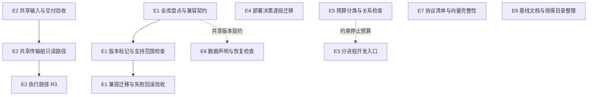

# 技术与架构演进

版本：v1.0，2026-11-07。源码基线：`d332074`。本文合并原《技术演进迭代初稿》v0.2（业务正确性批次）与《架构演进方案修订稿》v0.2（结构演进 E1–E8），两份原稿已移出跟踪，历史版本见 git。问题来源为[全面审查报告](comprehensive-audit-2026-10-30.md)与对应 Issues。

## 1 结论

- **业务正确性首轮已完成**：A–F 批次引用的 18 个 Issue 及后续 #179、#185、#187 全部关闭，两项产品决策已定（#91 ADL 按合约推进；#94 流水线只部署本轮提交）。多数修复没有经过真实交易所或生产验收。
- **结构演进 E1–E8 均未实施**；E1 第 1 步全库盘点已完成，见 [hub.sqlite 结构盘点](hub-schema-inventory.md)。其前置验收已完成：#71 安装器真实 `main()` 串联覆盖（PR #188、#213），#107 浏览器重连问题确认在夹具而非进程拓扑（PR #188）。
- **基础不变**：模块化单体、API/运行时分进程、模块 worker 隔离、SQLite WAL、五个内置模块统一仓库统一发布。#90/#179 已用部分索引解决已测的全量解析，仍没有证据需要拆服务、换数据库或换语言（进入条件见第 6 节）。
- **不再列为待办**的事项见第 8 节。

## 2 已完成：业务正确性首轮

“已关闭”表示代码合入且 Issue 关闭，不等于生产验收；各 PR 的已运行/未运行检查以 PR 正文和提交信息为准。

| 批次 | Issue | 合入 | 结果与未覆盖部分 |
| --- | --- | --- | --- |
| A 关键正确性 | #88 #87 #83 #98 | PR #115、#112、#110、#116 | 未经真实交易所验证；#98 的 Bybit 时间参数过滤字段官方未说明，被拒时按确认失败关闭 |
| B 身份与时间契约 | #84 #85 #86 #55 → #187 | PR #110、#109、#188、#214 | 新增 discover→rank→URL→history→reader 与投影→分组→预览契约测试，旧源码下失败 |
| C 研究可解释性 | #89 #95 #96 #97 | PR #113、#111、#120 | Windows 句柄释放只用 `/proc` 检查替代，未实测 |
| D 查询范围 | #90 → #179 | PR #188、#221 | 部分索引启动时一次性创建：5 万订单约 130ms、5000 任务约 20ms |
| E 发布身份与运行态 | #93 #94 #71 → #185 | PR #114、#120、#188、#213 | 目标不一致时 `deferred`（退出码 75）；`stack_main` 只由 CI sudo 覆盖，未在服务器激活验证 |
| F 验证与安全 | #92 #107 #162 | PR #113、#188 | 夹具定位已修 |

首轮落地的约束，后续改动不得回退：

- 发送依据：最终发送前失效为明确未发送；请求已可能送达的保持 UNKNOWN，不因时效门自动清零。
- 异步写入：锁令牌防止旧任务释放新锁，账本/凭据版本校验防止旧结果覆盖新值，两者在同一短事务内完成；外部请求不进长事务。
- 活动完整性：活动/未知订单与外部委托完整返回，只有终态历史限量分页；归档不得删除未知订单、原操作身份或恢复依赖。
- 部署目标：激活只针对本轮正式提交，目标不符明确推迟；缓存命中仍复核健康端点与部署记录。
- 研究数据：单位显式声明，含混输入拒绝；缺报价或未结算保留未决，不生成假零值。

## 3 业务侧剩余事项

以下各项均于 2026-11-07 对照 `d332074` 源码核实仍存在。

| 事项 | 现状 | 退出条件 |
| --- | --- | --- |
| 浏览器夹具 | `trading-okx`、`trading-resume`、`hub-positions` 在 PR #249 时于 main 上失败，此后夹具文件未改动，本版未重跑 | 恢复通过，或记录无法修复的原因 |
| ASTER 规划补单 | `trading/engine.py` 规划阶段仍 `book.require_fresh()`，行情持续中断时补偿以 10 秒退避等待且不转 attention；配对准入后不复核 BBO（PR #115 登记） | 决定是否在行情长时间中断时转人工；配对发送前是否复核 BBO |
| OKX 撤单 | 撤单前读单失败仍占撤单预算（PR #116 登记，修复可能造成忙等） | 有界且不忙等的读单失败处理 |
| 流水线状态 | 未加 `--apply` 时 `activate` 返回 deferred 但不撤销上一提交的成功记录，`status` 可能显示“新提交 + activate ok”（仅显示误导，`inputKey` 含提交不会误命中缓存） | `deferred` 一律清除旧成功记录 |
| 生产基线 | 服务器状态页（PR #144）与数据面卡顿卡片（PR #197）可读进程资源与 event-loop 延迟，尚未汇总 | 一周以上样本：RSS、event-loop p95、数据库/WAL 大小、摘要年龄、更新回执与恢复时长（需用户环境的脱敏数据） |

## 4 结构演进

### 4.1 问题

以下八项涉及维护成本、契约一致性和验证覆盖，本身不构成已发生生产故障的证据。优先级表示实施顺序，不使用审查缺陷的 P0–P3 标签。

| 编号 | 问题 | 优先级 | 改动等级 |
| --- | --- | --- | --- |
| S1 | Hub 迁移分散，缺少覆盖全库的版本与读写兼容契约 | 近期 | R3 |
| S2 | 交易所签名与传输层在多个模块重复实现 | 近期，先只读 | R2，涉及执行的部分为 R3 |
| S3 | 单进程开发、launcher 与生产服务单元的覆盖边界未对齐 | 按相关入口推进 | R2，涉及部署激活的部分为 R3 |
| S4 | 部署决策分散在 bash、Node、Python 三处 | 随改随迁 | R3 |
| S5 | 不同调用路径的超时与停止预算缺少可检查的关系 | 可独立准备 | R2，涉及部署停止边界的部分为 R3 |
| S6 | 恢复工具中的路径、分类、密钥关联与结构检查分散 | 按恢复工具改动推进 | R3 |
| S7 | 账户 writer 的跨语言语义与生命周期锁协议缺少完整性检查 | 可独立准备 | 仅补测试 R1；改变栅栏或协议为 R3 |
| S8 | `server/` 根目录平铺；架构基线文档落后 | 文档先行，目录按需 | 文档 R1；目录迁移至少 R2 |

**S1 存储迁移机制不统一。** `server/control/schema.mjs` 的普通连接在写事务中建表，只有 `create: false` 的候选只读连接调用 `assertTables`，且只覆盖控制表。Hub 已有分散的加列迁移（如 `createTrading` 为 `trading_accounts` 增加 `account_mode` 并回填），`trading-execution.mjs` 等服务各自建表。其他存储各有机制：Asset 用 `_schema_migrations` 加有序 SQL 文件与哈希；Monitor 的 `market-store.mjs`、`perpetual-store.mjs` 用 `PRAGMA user_version` 并拒绝过新的库；ASTER `trading/store.py` 探测缺列时临时 `ALTER TABLE`。`server/recovery/inventory.mjs` 统一记录 `schemaHash`、`userVersion`、`applicationId` 与表行数供恢复比较，结构兼容与业务准入另由 `admission.mjs` 检查。程序回滚保留持久数据，旧版能否读写新版结构仍缺明确契约；版本检查拒绝启动能保护数据，但不能代替服务恢复。

**S2 交易所接入重复实现。** 带签名的私有接口（非测试源码）：

| 位置 | 覆盖的交易所 |
| --- | --- |
| `server/trading-*.mjs`（28 个文件） | Binance、Bybit、OKX、Gate、Hyperliquid、RH Lighter |
| `modules/asset/lib/exchanges.ts`、`positions-readers.ts`、`okx.ts`、`gate.ts` | Binance、Bybit、OKX、Gate、Aster |
| `modules/crossex/server/live-client.mjs` | Gate CrossEx |
| `modules/greeks/app/bybit.py` | Bybit |
| `modules/aster/trading/exchange.py` | Aster |

Binance、Bybit、OKX 的签名、时间戳、超时、限流退避和数字解析在 Hub 与 Asset 各有一份 JS 实现，Bybit 在 Greeks 还有一份 Python 实现；公开行情客户端 Monitor 与 CrossEx 也各自实现。pnpm workspace 没有共享包。抽取前须逐个调用方确认请求、取消、重试和解析语义确实相同。

**S3 开发与生产拓扑不同。** `server/index.mjs` 在 Linux 用 `launcher.mjs` 监督 runtime 和 API；`deploy/install.sh` 生成独立的 runtime/API systemd 单元，双槽另有 entry 和 API 模板单元，launcher 不管理入口代理、候选槽和切流。`dev:server` 仍是 `node --watch server/workbench.mjs` 单进程。`tests/process-split.test.mjs` 与 `deploy/test-slots-systemd.sh` 分别覆盖进程拆分与真实 systemd 双槽，单进程浏览器通过不能代替这些路径。

**S4 部署决策分散。** `deploy/install.sh`、`install-all.sh`、`release-common.sh` 用 bash 承担缓存键、版本比较、双槽切换和回滚判断；同一交付链上还有 Node 的 `deploy/pipeline/` 和 Python 的 `server/update-service/`。真实 `main()` 的串联验收已由 #71、#185 补齐，成为后续迁移的回归基础。

**S5 超时预算靠注释对齐。** API 转发到 runtime 用从接收时刻计算的 60 s 截止（`server/api/server.mjs`）；Portal 取得模块 socket 后直接代理，连接与响应头预算默认 10/90 s（`server/portal.mjs`），两者不是同一条链。`server/modules/python-module.mjs` 读完请求体后才创建 60 s pending timer，其 `server.requestTimeout = 30_000` 是接收完整请求的预算，不是 Python 响应的内层预算。停止关系分散：`server/modules/runtime.mjs` 注释记录 ASTER worker 110 s、bridge 约 102 s、监督者 115 s；安装器生成的 systemd 停止时限为 runtime 150 s、API 75 s、entry 15 s。

**S6 恢复与凭据的耦合。** `inventory.mjs` 的 `DATA_FILES` 与 `restore.mjs`、`admission.mjs` 分散维护模块路径、类别与结构检查。inventory 递归发现数据根下未排除的文件，未知路径默认归为 `secrets`，不会因未列入 `DATA_FILES` 而漏备份。Hub 和 CrossEx 各有 `credentials.key`，Asset 的 `config.json` 另含凭据密钥与会话材料；恢复还处理环境配置、ASTER CA 引用绑定、会话撤销及隔离准入。

**S7 跨语言栅栏与锁协议。** `server/execution/account-writer.mjs` 与 `account_writer.py` 实现跨语言账户写入契约，ASTER 和 Greeks 共用 Python 实现；`tests/account-writer.test.mjs` 已有真实进程互操作用例。两侧错误码通过 `fail(code)` / `_fail(code)` 使用散落字符串，没有可枚举的协议目录。`lifecycle-lock.mjs` 启动 `lifecycle_lock.py`，Node 是包装与协议层，Python 承担 OS 锁，不是两套独立实现。

**S8 组织与文档。** `server/` 根目录现有 61 个平铺文件，其中 `trading-*` 28 个，与已分好的 `api/`、`runtime/`、`control/`、`execution/`、`recovery/` 等子目录并存。`docs/architecture-baseline.md` 的基线仍是 `462e43a`，“M4 其余批次尚未实施”已不符合当前代码。

### 4.2 演进项

每项按“先加兼容和检查、再迁移、最后删除旧路径”分步交付。每步实施前明确可回滚版本、保留的数据与实际恢复入口；不能把拒绝启动、还原提交或恢复旧程序链接当成服务已恢复。

#### E1 统一存储版本契约（S1）

- 目标：每个 SQLite 存储有明确的版本、迁移拥有者和代码读写支持范围；修改数据库前检查支持范围，未识别布局拒绝迁移；Hub 的控制表和业务表都纳入契约。
- 做法：
  1. 盘点 `hub.sqlite` 全部建表、索引、加列与回填入口，定义版本 0 的已知历史布局、版本 1 的完整结构及唯一迁移入口。不能只用 `assertTables` 给整个库标记版本 1；未知布局不得改版本号。
  2. 先发布版本读取、兼容检查及基线标记。只有完整结构匹配时，才在已有写锁内重新核验并原子写入 `PRAGMA user_version=1`；本批不混入业务 DDL。尚不读取版本号的旧发布只作为经验证的兼容回退目标。
  3. 再引入有序迁移，结构变更、必要回填和版本推进在同一事务中，复用有界锁等待；并发打开、失败与重跑不能重复迁移或提前推进版本。控制 schema 改动仍走 full 更新，候选 API 始终只读。
  4. Monitor 保留过新版本拒绝，Asset 保留 `_schema_migrations` 顺序与哈希验证再补支持范围检查；ASTER、CrossEx 按各自历史布局逐步适配。统一的是版本与兼容契约，不替换成熟的迁移记录。
  5. 恢复检查保留备份完整性与指纹、版本对应的真实结构检查、业务日志与隔离准入三层；统一版本只用于选择结构读取器。
- 不做：不引入 ORM，不合并数据库文件。
- 退出条件：首个加列批次通过历史库升级、并发启动、迁移中断与重跑；迁移提交后注入启动失败和健康失败，上一可回滚版本在保留已提交数据的前提下恢复服务。版本号相同但结构或业务记录不符合契约的恢复材料仍被拒绝。
- 回滚：仅写基线标记的批次在旧代码上核对读写兼容；首批 DDL 只做上一版可读写的兼容扩展。不兼容迁移在执行前拒绝，另行评审后才可进入，不能默认用旧备份覆盖迁移后产生的数据。

#### E2 共享交易所传输层（S2）

- 目标：签名、时间同步、超时与重试预算、限流退避、数字解析、错误分类，每个交易所在 JS 侧只实现一次。
- 做法：
  1. 采用 workspace 包（暂名 `packages/exchange-transport`），只抽取已确认同语义的请求签名、带总预算的请求执行、int64/小数文本解析和错误分类。有副作用请求不因共享重试逻辑自动重发。
  2. 先迁移只读路径：Asset 持仓与余额读取、Hub `trading.mjs` 账户读取。先用离线夹具比对签名和解析再切换；验收覆盖取消、超时、响应大小限制、限流退避与诊断映射，不能把读取失败变成空余额或空仓。
  3. 再迁移执行路径（`trading-execution-exchanges.mjs` 等），按 R3 处理。传输层保留原响应与发送证据，区分明确未发送和已可能送达；业务层继续负责持久意图、确认、拒绝及未知结果恢复。
  4. 公开行情客户端（Monitor、CrossEx）在只读路径稳定后再评估。
- 不做：不合并各模块业务读取与展示口径；Python 侧等出现第二条同语义路径再抽。
- 交付输入：共享包的直接和传递源码依赖必须进入消费者构建键、冻结安装材料、可信源码提取、独立发布包及 runtime 激活指纹，覆盖 `deploy/package-release.py`、`deploy/pnpm-module-inputs.py`、`scripts/modules.mjs` 与 `deploy/install.sh` 的固定输入。
- 退出条件：按交易所记录已迁移调用方，范围内签名与解析只保留一份 JS 实现；仅改共享包源码时，Asset 缓存失效并重建，Hub runtime 激活指纹改变并重启。冷安装、跨目录热缓存及脱离工作树的发布包均加载目标实现，无变化重跑保留增量跳过。
- 回滚：每个只读批次可还原调用方和包依赖并重新生成产物与指纹；执行批次另验证原持久记录的兼容恢复。
- 状态（2026-11-07 第一批完成）：共享代码放在 `server/exchange-transport/`，消费方用相对路径引用，沿用 `server/hub-navigation.mjs` 的先例。`packages/` + `workspace:*` 会让 `deploy/pnpm-module-inputs.py`、`deploy/package-release.py` 拒绝 link 依赖，冻结依赖缓存里也只有空壳（L019），因此不采用。`okx.mjs` 是 OKX 签名，`response.mjs` 是有上限的 JSON 读取；已迁移 Asset `lib/okx.ts`（OKX 签名与读取）和 `lib/positions-readers.ts`（OKX 签名，以及所有交易所共用的响应读取）。该目录整体计入 Asset 构建键（`scripts/modules.mjs`、`deploy/install.sh`），由 `deploy/test-module-builds.mjs`、`deploy/test-inputs.sh` 验证；runtime 指纹、可信提取与发布包本来就覆盖 `server/`。
- 状态（2026-11-07 第二批完成）：Hub `server/trading-okx-common.mjs`（OKX 只读与执行共用）的签名和响应读取也改用共享实现，JS 侧 OKX 签名只剩一份。共享读取现有的失败码在 Hub 侧原样转回 `OkxProtocolError`，变更请求读不出响应时仍标为结果不确定；唯一的行为变化是响应开头的 BOM 不再判为格式无效。`tests/exchange-transport.test.mjs` 固定了这组映射，其中现有失败码的用例在旧实现上除 BOM 外同样通过。Hub API 不引用该文件，runtime 指纹已覆盖共享目录，无需改构建键。共享读取以后新增的失败码在 Hub 侧一律按 `invalid_data` 处理。当时 Binance、Bybit 签名各有四份，见第三批。
- 状态（2026-11-08 第三批完成）：新增 `binance.mjs`（`binanceSignedQuery`：签名为精确查询串的十六进制 HMAC-SHA256，追加在最后）、`bybit.mjs`（`bybitAuthHeaders`：timestamp + apiKey + recvWindow + 查询串或 JSON 原文）、`gate.mjs`（`gateAuthHeaders`：APIv4 的 SHA-512 方案）。已迁移 Binance、Bybit 的四份（Asset `lib/exchanges.ts`、`lib/positions-readers.ts`，Hub 只读 `server/trading-exchanges.mjs`，Hub 执行 `server/trading-execution-exchanges.mjs`）和 Gate 的两份（Asset `lib/gate.ts`、CrossEx `server/live-client.mjs`），各调用方的 recvWindow 与时间来源不变。签名用 Python 独立计算的固定向量锁住。CrossEx 服务端从源码运行，`tsconfig` 只覆盖 `src`，共享目录由 runtime 指纹覆盖，构建键不变。至此 JS 侧带 HMAC 签名的交易所各只剩一份签名实现。共享签名拒绝输入时请求不会发出：Hub 执行按配置错误处理，记为拒绝；CrossEx 客户端报输入错误，但运行时在调用客户端前已标记已调用，仍按结果不确定走对账（与迁移前一致，偏保守）。尚未迁移：响应读取仍各自实现（Asset `lib/exchanges.ts` 的 `readJson`、Hub `server/trading-exchanges.mjs`、`server/trading-execution-exchanges.mjs`、`server/trading-binance-clock.mjs` 等），见第四批。

#### E3 对齐开发进程边界（S3）

- 目标：Linux 开发和相关浏览器夹具覆盖 runtime/API 分进程行为；生产双槽另按真实服务单元验收。
- 做法：Linux 的 `dev:server` 使用 launcher，Windows 保留 `workbench.mjs`。watch 观察子进程源码，等待整组退出再启动下一组，有自己的停止截止与残留检查。先迁移涉及重连和实时流的夹具。
- 退出条件：分进程夹具覆盖 API 单独重启、runtime 故障、socket 重连及 watch 无残留；生产侧复用 `deploy/test-slots-systemd.sh` 核对候选、切流、旧槽排空与回滚。Linux 验收用既有 CI 或非 WSL 环境。

#### E4 部署决策收拢（S4）

- 目标：逐步集中缓存键、版本比较、槽位选择、回滚判断等纯决策，保留可核对的系统调用顺序和持久化提交点。
- 做法：以已补齐的真实 `main()` 夹具为回归基础，在相关安装器改动中把已覆盖的纯决策迁成 Python 函数，bash 负责调用与系统操作。
- 引导条件：`install-all.sh` 复制单个安装器，槽位与缓存判断早于应用源码获取。抽取前须确定同目标版本 helper 的获取、校验与调用协议，覆盖首次安装无 helper、升级只有旧 helper；取得失败在改变服务状态前退出。
- 不做：不一次性重写安装器，不改安装入口和参数。
- 退出条件：迁移前后复用首次双槽、API-only、full、候选失败、记录提交后失败及中断续作用例，并保留真实 systemd 验收；对分支或调用顺序注入错误时验收确实失败。

#### E5 超时预算表（S5）

- 按实际路径登记接收请求、连接、响应头、绝对 deadline、流空闲和停止预算，记录计时起点、拥有者、取消传播与超时后行为；Portal 代理、runtime 转发和 Python bridge 分别建关系。
- 嵌套阶段检查外层剩余预算覆盖内层与余量；顺序停止检查总和；长连接不套普通响应总时限。核对 Python 参数和生成的 systemd 单元最终生效值。
- 首批只收拢来源、保持现有预算，冲突单独登记修正。退出条件：修改一个受约束预算就能使关系检查失败；回退配置时同步回退生成单元。

#### E6 模块数据声明（S6）

- 在 `server/modules/catalog.mjs` 或模块清单中集中声明已知数据路径、类别、结构检查和密钥/配置关联。inventory 继续递归发现，保留未知文件 `secrets` 兜底，不改成白名单。
- 保留密钥、配置材料、外部引用绑定的完整检查与恢复后的会话撤销、未决记录和隔离准入。
- 退出条件：旧备份按声明的支持范围恢复；未声明的新文件、改名、密钥缺失/不匹配、引用缺失均有确定结果。调整既有类别前先定义备份清单版本兼容方式。凭据密钥合并另行评估，不是本项前置条件。

#### E7 栅栏一致性向量（S7）

- 账户 writer 在现有互操作测试之外共享 JSON 向量，覆盖语义哈希、票据格式、错误条件及支持版本。
- 增加完整性门禁：声明共同协议的错误码与票据字段集合并核对两侧实现与向量覆盖；无法可靠提取源码码集时先引入显式目录。生命周期锁按包装层与 helper 的协议验收。
- 退出条件：只在一侧新增错误码或修改票据字段而不更新协议与向量时门禁失败。仅加测试为 R1；改动栅栏实现或协议按 R3。
- 状态（2026-11-07 已完成）：账户 writer 的协议目录为 `tests/fixtures/account-writer-protocol.json`（版本、时长、交易所与环境、48 个错误码、票据字段、账户键与语义哈希向量），`tests/account-writer-protocol.test.mjs` 从两侧抛错调用点提取码集（错误码须为字面量，模板与拼接直接判失败）并核对声明，让 Node 与 Python 实现逐条重放同一组向量、比对返回字段及类型；26 个错误码有向量，其余 22 个在 `notVectored` 写明原因（需篡改注册表、多实例或注入时钟）。生命周期锁的目录为 `tests/fixtures/lifecycle-lock-protocol.json`，`tests/lifecycle-lock-protocol.test.mjs` 同样按抛错点核对 helper 与包装层码集、包装层白名单与就绪消息版本（源码层检查，锁行为仍由现有生命周期锁测试覆盖）。向量中的哈希与账户键是现有账本已持久化的值，变化即需要新的协议版本。

#### E8 目录与文档整理（S8）

- 先按实际交付证据重写 `docs/architecture-baseline.md` 的批次状态，区分源码、CI 与生产验收。
- 目录搬移按需单独进行，不作为 E2 前置。移动 `server/trading-*`、`server/asset-*` 时同步所有 import、夹具、脚本和构建输入（如 `asset-identity.*` 被 `scripts/modules.mjs` 与 `deploy/install.sh` 输入清单引用）。
- 退出条件：没有遗留旧路径消费者，构建与增量缓存反映新路径，正式包入口可加载。

### 4.3 顺序与依赖

- 可独立准备：E1 全库盘点、E2 依赖与交付输入清单、E5 预算分类、E7 协议目录、E8 基线文档。
- E2 先选一个交易所的只读路径，再按交易所拆小批；共享输入接线在首个消费者切换前完成。
- E3 与 E5 可并行，watch 停止约束在启用前完成。E6 分类整理可先行，版本读取器与 E1 对齐。

## 5 横向契约与实施约束

| 契约 | 最小内容 | 失败行为 |
| --- | --- | --- |
| 动作依据 | 账户身份/代次、快照源时间、行情源时间、规则版本、原意图 ID | 最终发送前失效为明确未发送；已可能发送保持 UNKNOWN |
| 异步提交 | owner/token/fence、ledger revision、credential revision、截止时间 | 旧结果不提交、不释放新锁，保留可诊断原因 |
| 市场身份 | venue/nativeSymbol/canonical base、quote/settlement、乘数/单位 | 不猜等价，不以展示名改写执行身份 |
| 读取结果 | 数据、源时间、成功/缓存/缺失、完整性与版本 | 不把读取失败当空仓，不把截断当完整 |
| 部署目标 | 正式 commit/tag/manifest 摘要、scope、实际回执 | 不匹配明确失败或推迟，latest 变化不能静默换目标 |
| 研究数据 | 单位、schema、输入摘要、决策/报价时间、模型与费用版本 | 含混输入拒绝；缺失结果明确标记，不生成假零值 |

- 每项只改变一类行为或结构，不顺带修改业务；资金执行、部署激活、数据库结构、公共契约按 R3 留存独立审查与回滚记录。
- 先补检查再迁移；新外部调用写清超时、重试上限和总预算；缓存写清失效条件。
- 公共代码只在至少两条已确认同语义路径需要时抽取，不为外观统一合并业务口径。
- 每批按受影响入口选择最小必要检查；Linux 专属行为由既有 CI 或非 WSL 环境验证。引用现有测试、文档或 CI 绿色不等于实现与生产验收完成，沿用[审查标准](code-review-standard.md)与[审查流程](code-review-process.md)。

## 6 容量与后续架构的进入条件

| 后续选择 | 进入条件 | 暂不进入的原因 |
| --- | --- | --- |
| 事务事件/outbox | 至少一个明确跨进程消费者需要可重放、一致水位，已有本地事务写源 | 局部 SSE 快照重连不等于持久事件，也不要求为所有页面先建总线 |
| PostgreSQL | 索引/短事务/查询范围优化后仍有持续写争用，或确需跨主机权威写源 | #90/#179 已用部分索引解决已测的全量解析 |
| 新进程/服务拆分 | 观察到隔离收益、独立扩缩需求与故障边界 | 现有模块和 API/运行时已有隔离 |
| 多实例 | 共享控制状态、任务归属、旧写者隔离与部署证据齐全，容量测量支持 | 双槽切换不等于多主或跨主机运行 |
| 更换语言/算法栈 | 剩余 CPU 热点经 profile 确认，局部替换能保留可验证语义 | 未取得支持整仓重写的证据 |
| 有界缓存、受限并发、历史拆分 | 卡顿卡片或用户反馈显示具体页面/读取变慢，并取得该路径的规模测量 | 没有观测到 Asset、Greeks、ASTER 的规模瓶颈 |

## 7 待决策

1. ~~E1 盘点后确定完整的版本 1 布局、受支持历史布局和上一可回滚版本。~~ 已在 [hub.sqlite 结构盘点](hub-schema-inventory.md#7-唯一迁移入口与后续批次) 第 7 节确定。
2. ~~E2 首批固定包路径（优先 `packages/`）与交易所范围；若改为 `server/` 路径引用，仍须完成同样的依赖闭包与交付验收。~~ 已定为 `server/exchange-transport/`，首批为 OKX 只读，见 E2 状态。
3. 凭据密钥是否合并（E6）单独评估，不阻塞声明整理；本文不授权变更现有密钥布局。

## 8 不再列为待办

| 事项 | 原出处 | 处理 |
| --- | --- | --- |
| 全仓安全深扫 | 技术演进 F 批次 | 改为按需：鉴权、凭据、交易执行边界的改动已按差异做安全审查；全仓深扫只在用户明确要求时执行 |
| Asset 大持仓、Greeks 完整 JSON、ASTER 状态体积的规模基准 | 技术演进 D 批次 | 并入第 6 节进入条件，出现变慢证据再测 |
| 回测账户级指标（统一资本、未实现盈亏） | 技术演进 C 批次 | 按需：原稿即为“若需要”；当前 `optbt/report.py` 的回撤与 Sharpe 按逐笔已平仓盈亏计算，需要账户级口径时再定义 |
| 中文合约的非图表路径 | PR #109 待确认 | 按需：CrossEx 服务端合约代码、Monitor 的 `crossex-import.ts` 与 `hub-bridge.ts` 仍只接受 ASCII，CrossEx 服务端的合约代码正则本身也是 ASCII；有实际中文合约需求时再放开 |
| 按演进项建立工作包、#71/#107 按原验收关闭 | 架构演进待决策第 4 项 | 已完成：#71、#107 均已关闭 |
