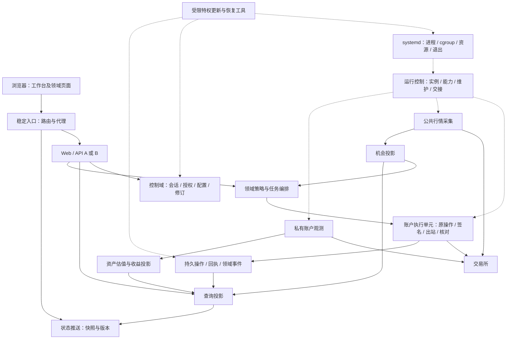

# 工作台重构提案：技术架构与可靠性

## 1. 结论、范围与证据约定

**推荐目标：统一仓库和统一发布的模块化系统，采用独立进程隔离故障，以真实账户执行权威收敛资金副作用，以领域唯一写入者管理持久状态。** 公共行情、账户观测、资产估值和策略执行分别拥有清晰契约；前端和 API 不拥有后台任务生命周期。单机是目前有证据支持的部署形态，SQLite 可以成为长期选择。PostgreSQL、多主机、持久推送重放都应有独立成立的需求与验证，不能把它们排列成必然终点。

这不是维持现状的建议。理想终局需要重做执行权限和数据语义的边界、解除进程生命周期耦合、补齐灾难恢复与可验证的升级交接；这些比拆文件或统一技术栈更关键。推荐不以开发工时、迁移方便或兼容旧代码为依据，保留已有机制是因为其中包含重要的交易与恢复契约。

| 项目 | 本次记录 |
| --- | --- |
| 用户依据 | “大家一起看看工作台该怎么重构最好，不需要考虑工作量” |
| 研究仓库与提交 | `hxx344/project-aggregation`，`f4aab218d247000623f84314919e1f60a2a3a0e1` |
| 研究方式 | 汇总本对话已完成的执行与恢复、进程与运维、数据与状态三个并行视角，并由报告负责人形成完整推荐；这些是研究输入，不是已完成的独立实现审查 |
| 本次改动等级 | R1，纯研究文档；方案若实施，资金、权限、迁库和部署激活分别按实际风险重新定级 |
| 写入范围 | 仅本报告；业务源码、部署、账户、团队配置及 `.company` 均不变 |
| 决策状态 | 供讨论，未获用户采纳；报告中的新建议不构成产品规则或实施授权 |
| 证据边界 | 源码与文档静态核对；未执行生产采样、实盘请求、故障演练或业务测试，未核验该提交的远端 CI 结果 |

全文使用四种标记：**【实现】**为该提交源码已接入的机制；**【设计】**为仓库已有方案；**【建议】**为本次判断；**【未知】**为缺少运行证据或用户决策。源码存在不等于覆盖所有失败路径，更不等于生产验收通过。外部资料只支持其说明的机制，不替本项目决定阈值或安全策略。

阅读入口：[项目规则](../../AGENTS.md)、[README](../../README.md)、[已有架构方案](../architecture-implementation.md)、[实施基线](../architecture-baseline.md)、[备份恢复契约](../backup-recovery.md)。以下源码路径均以研究提交为准。

## 2. 能从仓库确认的产品形态与剩余假设

【实现】README 将产品描述为统一交易与资产工作台，包含原生交易、Monitor、Asset、CrossEx、Greeks、ASTER，统一登录、一个对外 TCP 入口、内置模块统一发布。`server/app.mjs` 登录路径明确使用 `Single-account system` 的全局管理员账户。正式安装入口围绕 Ubuntu 24.04、systemd 和 x64 构建；Windows 同时用于开发和部分检查。这些支持“一个操作者管理多个交易连接、单机运行一套工作台”的当前模型，不证明真实用户数量、资金规模或未来协作模式。

【实现】仓库经验反复涉及身份错配、未知结果恢复、源时间与展示时间混淆、保证金功能被策略状态阻断、更新准入和部署缓存。这说明正确性与恢复边界是实在的设计输入。它不能替代线上故障频率、用户痛点排序和容量测量，不能据此宣称系统已经达到性能上限。

【建议】以“操作入口可短暂重连，后台采集与已接受任务有明确持续运行或安全停止语义，资金操作可追溯并可核对”为目标。是否必须无人工值守、允许多名操作者、需要异机接管，仍是开放问题。本文不设定 SaaS、多租户、跨区域多活或千人并发需求。

## 3. 现状证据：已有基础与真正的结构问题

| 领域 | 源码或机制证据 | 判断及边界 |
| --- | --- | --- |
| 启动与关闭 | [`server/index.mjs`](../../server/index.mjs) 先取得数据根生命周期锁、检查恢复保护，再 `startModules`、`createApp`；关闭时关闭应用与模块 | 【实现】已有启动保护；API 和后台运行时仍处于同一生命周期 |
| 故障传播 | [`runtime.mjs`](../../server/modules/runtime.mjs) 已就绪子进程退出后调用整组 `close` 与 `onFailure`；入口随后关闭工作台 | 【实现】有进程隔离，但单模块故障仍可扩散到全站；这不是独立恢复 |
| 父子进程依赖 | [`worker.mjs`](../../server/modules/worker.mjs) 在 IPC `disconnect` 时退出；Python 模块经桥接进程运行 | 【实现】拆开 API 不会自动消除监督者与子进程的命运绑定 |
| 应用职责 | [`app.mjs`](../../server/app.mjs) 创建原生采集、执行、资产同步、Portal、SSE 和基线采样，关闭时一并关闭 | 【实现】HTTP 应用同时是后台业务宿主；候选 API 若照常启动可能获得重复任务能力 |
| 内部通信 | [`transport.mjs`](../../server/modules/transport.mjs) 用进程内 Map 将固定内部来源映射到 UDS 或 named pipe；注册由监督者控制 | 【实现】有可信私有通道；独立进程后还需实例注册、发现和代次失效 |
| 能力与健康 | [`capabilities.mjs`](../../server/modules/capabilities.mjs)、worker 私有能力接口；Hub `/api/health` 返回 `ok` | 【实现】协议能力可核对；存活、数据新鲜、恢复完成、允许资金写入尚不是统一 readiness 契约 |
| 共享执行保护 | [`account-writer.mjs`](../../server/execution/account-writer.mjs) 与 [`account_writer.py`](../../server/execution/account_writer.py) 共用 `execution-control.sqlite` | 【实现】已有真实身份、模块绑定、租约、fence、持久操作与恢复隔离，不能称为尚未建立账户保护 |
| 原生执行 | [`trading-execution.mjs`](../../server/trading-execution.mjs) 及交易所适配器 | 【实现】有任务、请求去重、原订单身份、租约和末端守卫；不是无状态 HTTP 转发器 |
| 各模块末端保护 | CrossEx `live-runtime`/`live-client`，Greeks `bybit.py`/`account_writer.py`，ASTER `exchange.py`/`account_writer.py` | 【实现】保护接入真实出站路径，不能把理想终局建议写成当前没有最终发送检查 |
| 行情持久化 | Monitor [`market-store.mjs`](../../modules/monitor/server/market-store.mjs) 保存 `source_ms/saved_ms/attempt_ms/success_ms`；[`perpetual-store.mjs`](../../modules/monitor/server/perpetual-store.mjs) 为有界最新报价缓存 | 【实现】已有常驻采集和只读投影基础；不是所有请求都现查交易所 |
| 私有观测与收益 | [`trading.mjs`](../../server/trading.mjs) 保存连接 revision、持仓及资金费 coverage；[`trading-pnl.mjs`](../../server/trading-pnl.mjs) 使用精确十进制，并按当前资金费事件和 coverage 读取收益 | 【实现】已有重要语义，应保留；采样值不能替代随后补录后的当前计算 |
| 资产及精度 | Asset [`store.ts`](../../modules/asset/lib/store.ts) 的 `snapshot` 用 `number` 汇总资产、乘汇率；Greeks [`state.py`](../../modules/greeks/app/state.py) 的数量与成交数量使用 `float` | 【实现】全系统尚未统一精确金额/数量边界；这是类型差异证据，不是已证明发生资金损失 |
| 授权与推送 | [`portal.mjs`](../../server/portal.mjs) 的 tickets/grants 为内存 Map；[`overview-stream.mjs`](../../server/overview-stream.mjs) 每连接先 snapshot，sequence 局部递增 | 【实现】已有快照恢复形态；没有跨 API 共享 Portal 授权或持久事件重放 |
| 备份恢复 | [`server/recovery/`](../../server/recovery)、[恢复契约](../backup-recovery.md) | 【实现】冷停、生命周期排他锁、双密钥归档、隔离恢复、一次性交接；普通历史备份没有灾难后交易开闸入口 |
| 更新发布 | [`deploy/install.sh`](../../deploy/install.sh)、[`updater.py`](../../server/update-service/updater.py)、[`deploy/pipeline/`](../../deploy/pipeline) | 【实现】不可变版本、固定发布身份、增量构建和独立更新服务已有基础；统一服务重启仍不等于在线双槽切换 |
| 可观测性 | [`observability.mjs`](../../server/observability.mjs)、实施基线的 `coverage` | 【实现】已有分钟采样；执行接受/交易所确认、完整 UNKNOWN、浏览器延迟等尚无统一完整口径 |

上述结论是静态机制核对。现有测试文件是后续验证入口，不能据其存在声称本次运行通过。

## 4. 主要路线比较与选择理由

| 路线 | 适合之处 | 可靠性及运维代价 | 本次判断；什么证据会改变判断 |
| --- | --- | --- | --- |
| 单进程模块化单体 | 同进程事务与调用直接，故障诊断链短 | Web、采集与执行共用资源和退出边界；Python 能力仍需桥接，难保证 API 更新不影响后台 | 不推荐作为完整终局。若确认所有后台能力都可随界面停机，且故障影响可接受，才重新考虑 |
| **统一发布、领域模块化、同机进程分离** | 对账户副作用、行情、估值、Web 分别建立权限与故障边界；保留本机事务和可复现整包 | 必须管理 IPC、版本、启动恢复和冷停屏障；进程数量增加，需要有界资源和明确依赖 | **首选。** 若真实需求要求异机容灾或独立扩容，再将相应边界远程化 |
| 每个现有模块各自成为独立服务 | 保留模块自治，局部发版与扩容灵活 | 同一账户可能被多套凭据、执行器和恢复逻辑控制；跨模块语义仍不统一，发布矩阵膨胀 | 不以现有目录直接决定服务边界。只有模块确有独立运营与故障责任时才保留此形态 |
| 全面微服务、消息总线、分布式数据库 | 多机部署、独立容量和团队责任可明确落实 | 网络分区、消息重复、服务发现、授权、跨库恢复和兼容矩阵成为日常运行问题；无法解决交易所侧未知结果 | 当前没有足够需求证据。若独立扩容与隔离需求确实超过单机边界，应按领域选择拆分，而非整体照搬 |
| 统一语言并全面重写 | 可重新建立一致类型与工具链，清除历史结构负担 | 更换语言不自动修复账户所有权、源时间、恢复身份；同时替换所有已验证行为会扩大正确性证明范围 | 允许有证据地替换实现，但不作为目标。若某运行时确实无法满足隔离、精度或性能要求，再针对性替换 |

这里的“模块化单体”指统一产品、领域与发布边界，并非所有代码在同一进程。微服务的分界也不是有没有本地 RPC，而是是否承担独立部署、跨机故障和分布式数据责任。

公开实践支持先确认稳定业务边界，但不是本项目结论的证明。Fowler 在 [Monolith First](https://martinfowler.com/bliki/MonolithFirst.html) 中讨论边界不清时拆服务的风险，也明确其经验判断并非普遍定律。本文选择同机进程分离，主要依据是本仓库已有的统一产品形态、异构运行时和故障传播机制，而不是开发成本。

## 5. 推荐终局：领域、进程、权限与状态相互对应

### 5.1 完整结构

以下均为【建议】目标结构，图中的逻辑组件不要求一组件一进程；涉及凭据、资金写入和资源争用的隔离边界需要真实进程与 OS 权限落实。

### 5.2 领域所有权

| 领域 | 权威状态和职责 | 应避免的跨界 |
| --- | --- | --- |
| 控制域 | 会话、CSRF、登录风控、项目/连接配置、凭据引用、权限及修订 | Web 实例不直接拥有采集循环或交易定时器；内部进程身份不等于账户权限 |
| 运行控制域 | 实例 generation、能力协商、维护、交接、健康投影和受控生命周期请求 | 不重复实现 OS 的完整进程管理器，不持有随意 root 命令能力 |
| 公共市场数据域 | 合约目录、市场规格、公共行情、订阅及外部预算 | 不用显示名合并原始合约，不掌握交易凭据，不承担私人账户执行准入 |
| 账户观测域 | 账户身份、余额/持仓/订单/成交观察、完整性与历史 coverage | “刚收到”不等于“已反映成交”；展示观察不自动成为执行证据 |
| 资产与收益域 | 估值、汇率、资金费、费用、历史范围及可重建投影 | Asset 当前估值账本不直接升级为所有交易事实的唯一账本；不把缺失估值填成零 |
| 策略域 | Hub 原生任务、CrossEx 配对、Greeks RFQ/期权策略、ASTER 策略/ADL/保证金管理的各自语义 | 不自行绕过账户执行权威签名出站；不为统一接口抹平不同确认和恢复语义 |
| 账户执行域 | 获准账户的原操作记录、幂等身份、最终参数、签名、发送、回执和核对 | 不拥有所有策略决策；不把交易所请求与本地事务伪装成原子提交 |
| 审计与恢复 | 发布/存储世代、检查点、授权变更、交接证据、隔离状态、恢复水位 | 不靠编辑 JSON 或删除保护库恢复交易，不把旧备份直接作为最新资金事实 |

公共内核只统一需要跨域相等判断的语义：真实账户与环境、原始市场与合约身份、十进制与单位、时间与完整性、命令/事件身份和版本。不建立承载所有模块业务逻辑的巨大 `common` 包。Node 与 Python 可以继续承载各自适合的业务，协议和一致性夹具共享，关键执行权威则收敛到一个可验证的实现边界。

## 6. 执行所有权：保留领域策略，收敛真实副作用

### 6.1 当前保护值得保留，终局边界仍应前移

【实现】共享账户键以 `authority + environment + accountId` 为核心；API Key 或模块显示名不能创建新账户主体。模块归属被固定，租约到期不会授权其他模块接管，同模块接管也需要旧进程已退出或完成关闭。当前 Node/Python 保护不是一个无约束的过期锁。

【实现】原生适配器的 `beforeMutation`、CrossEx 的 `beforeSubmit`、Greeks 与 ASTER 的请求钩子均已把检查放到出站附近。ASTER 还核对固定端点和实际参数。不能把“检查与网络发送之间理论上可能暂停”写成已复现漏洞；当前代码已对旧活进程接管作了防护。

【建议】理想终局是**独占交易凭据、签名和真实资金出站的账户执行单元**。策略进程提交类型化命令，执行单元持有原操作、权限、预算及核对状态。它可以在一个进程中管理多个账户通道，也可把关键账户组隔离成不同进程；进程粒度由故障影响和资源证据决定，不按模块数或账户数机械生成服务。

收益是将“谁能造成副作用”的证明从多种语言、多处 HTTP 钩子收敛到受控边界，凭据不会因策略重启或候选 API 启动而复制成新的写能力。代价是新增 IPC、执行权威可用性和适配器管理责任；单个权威若承载全部账户会扩大故障域，因此需要账户通道隔离、容量限制及独立恢复状态。

这不等于通用 `placeOrder` 服务包办所有业务。RFQ 的确认、改单的未知结果、ADL 后持仓验证、划转的身份与额度各有类型化适配器和状态机。也不意味着同一账户自动允许多个模块并发写；当前模块绑定作为迁移输入保留，未来共享策略准入属于另一个产品决定。

### 6.2 命令、事务和未知结果

【建议；依据：已有执行契约】命令至少绑定原 `commandId`、规范化参数摘要、完整账户集合、连接及权限修订、预览证据、截止时间、存储与运行世代。同身份同内容返回原任务，同身份不同内容冲突。账户集合和本地资源在第一腿前完整取得；多腿可以并行发送，但不承诺跨交易所原子成交。

本地意图和投递记录先持久化，再出站。网络调用不能放在持有数据库写锁的事务里。已发送但未取得确定回执的操作保留 UNKNOWN，按原身份查询；没有查到不证明没有执行，不换编号重发。晚到回执只能落在其合法操作与代次，不能覆盖新所有者。

交易所公开说明也支持区分“接受请求”和“结果已确认”：Binance 的 [General Info](https://developers.binance.com/en/docs/products/derivatives-trading-usds-futures/general-info) 将部分 503 情况标为执行状态未知，Bybit 的 [Place Order](https://bybit-exchange.github.io/docs/v5/order/create-order) 说明下单接受响应与异步订单确认的区别。这些不是本项目已经完成全部交易所核对的证据。

【建议；依据：已有 fence 契约】租约和 fence 只能约束受管进程与存储，交易所不会替本地检验 fence。接管必须有旧发送者退出或其出站能力已被可靠撤销的证据，并保留所有在途原操作。TTL 不单独授权自动接管；多主机网络分区下的自动接管，在旧写者隔离可验证之前不应开放。

### 6.3 纠正“一切 UNKNOWN 阻断一切”的模型

【实现】`LESSONS.md` L041 的 T0 补充及账户保护核心已允许严格分类的历史非资金 UNKNOWN 不阻断特定保证金补充。许可绑定 ASTER 的固定 USD1 `FUTURE_FUTURE` 划转语义、完整参数与已核验身份；资金自己的 UNKNOWN、身份/fence、额度、冷却及恢复隔离仍可阻断。已有方案和基线中概括性的“任何 UNKNOWN 阻止新操作”不足以描述当前边界。

【建议】用**动作、账户资源、证据及冲突的矩阵**表达准入：开仓、撤单、改单、杠杆、资金划转、只读核对和本地停止分别定义依赖。保证金与核对有独立任务预算，不能被策略队列耗尽；未知状态保持原样，不通过“认定历史单已结束”换取可用性。

哪些新场景属于可独立放行的风险缓解动作，属于待讨论的安全策略，不能把现有特例推广成“所有减风险请求默认放行”。执行权威或其持久存储不可用时，独立预算也不能绕过持久意图与合法所有权继续发送资金请求。

### 6.4 账户身份仍有不可推断的边界

【实现】CrossEx 的 `writerScope` 为 `gate-crossex/mainnet`，场所前缀 `BINANCE_`、`OKX_` 不证明底层原生账户 UID。终局也不能把 Gate CrossEx 身份和原生 Binance/OKX 身份靠名称归并。

【未知】如果用户确实通过不同通道控制同一经济账户，需要交易所可核验的映射与权限证据。没有证据时只能陈述覆盖边界，不能宣称账户执行单元已经消除所有外部或人工并行写入。

## 7. 数据架构：事实、观察、估值和展示分层

### 7.1 先统一语义，再决定共享组件

【建议】数据契约区分四类内容：执行意图与回执、外部账户观察、估值与收益计算、页面投影。每类明确权威写入者、可否重建、保留依据和失败行为。源时间、接收时间、最后尝试、最后成功、完整性、来源代次及依赖版本分开表达；连接正常不保证数据新鲜，读取新鲜也不保证覆盖完整。

保留原始交易所/环境/市场类型/合约、计价币和结算币、数量单位与合约乘数。规范化标的用于关联，原始合约用于执行与核对。快照缺项只有在“完整非零列表”等明确来源契约下才可解释为零；损坏或未采集的列表不能当成空仓。

【建议；依据：现有精度差异】跨域金额、委托数量、成交累计和持久费率采用明确精度与舍入规则的十进制语义，传输使用字符串或等价精确表示。Asset 的 `number` 汇总、Greeks 的数量 `float` 需要逐边界核对迁移，不应宣称“保留已有精确十进制”就完成了全系统正确性。风险模型和图表可使用有误差边界的浮点运算，但模型输出进入委托和账务前必须显式量化。仅更换数据库列类型无法恢复已在上游丢失的精度。

### 7.2 公共行情与机会

【建议；部分承接已有 Quote Gateway 设计】按完整市场身份合并公开订阅，建立单一采集所有者、消费者依赖和有界缓存。集中的是数据身份、订阅与预算，并非把所有交易所压成一个连接或让所有行情串行经过同一个不可替代热点。

Monitor 的已有存储与采集可以作为来源适配器；机会计算成为独立领域投影，CrossEx 消费机会契约，不因 Monitor 页面进程存在才可运行。切换要求影子比对、正式读源切换、旧采集关闭，回退仍受同一外部预算约束。没有关闭旧采集，不能宣称已完成复用。

机会保留双腿真实费率、结算周期与时间、价差、费用假设、筛选证据和来源时效。8 小时等效费率可排序，不能冒充下一笔净收入。沿用现有“只预填精确合约与方向、清空数量、人工预览确认”的契约，不把重构变成自动交易授权。

### 7.3 私有账户数据、资产与收益

【建议】私有观察按真实账户隔离。多个页面可共用查询投影，但执行前的关键只读核验、完整挂单核验、成交后的持仓证据仍归执行责任方判断。公共行情故障可以使机会失效，不应无差别阻断一个不依赖该行情的合法资金读取；反过来，展示缓存也不能为执行开闸。

Asset 当前是估值及日快照账本，不是所有模块交易、费用和划转的完整会计账。推荐建立可追溯的资金流与费用事实、外部事件去重身份、修正记录及重建水位，再由资产域作统一估值。是否需要完整复式记账、税务或审计报表尚无用户需求证据，不能用新架构擅自定义其会计制度。

收益必须声明历史窗口、资金费 coverage、费用、外部出入金、估值币和计算版本。沿用 L002 的边界：采样后补录 coverage 或资金费事件，当前收益仍应变化；缓存必须随这些依赖失效。资产合计应同时表达已知合计和缺失范围，不以缺项零值掩盖部分估值。主动断开后保留的估值属于历史观察，不再假装持续实时同步。

### 7.4 持久事件、投影与浏览器推送各用其所

【建议；公开模式与已有设计】需要保证业务落盘后可投递的事件采用事务 outbox：业务记录和事件同事务，投递至少一次，消费者去重与投影同事务。事件身份、对象 revision、schema 版本和恢复世代明确；不承诺不同账户之间的全局业务顺序。该模式可能重复投递，见 Chris Richardson 的 [Transactional outbox](https://microservices.io/patterns/data/transactional-outbox.html)。

交易记录和更正证据需要持久，公共报价则可按身份合并最新值，通知也有独立去重语义。不要求所有数据采用完整事件溯源，更不为所有消息统一设置同一种丢弃策略。原操作、私有回执和共享保护库过渡期仍属多存储边界，必须按 L062 的原身份恢复；不能声称 outbox 已使这些现有存储整体原子化。

【建议；对已有方案的调整】首页与报价优先采用一致快照、epoch/revision、条件增量与断线回退。当前局部 sequence 不能变成跨连接游标，但也没有证据说明所有页面都必须持久重放每个推送事件。只有历史增量必须不丢或重建快照成本确实过高时，才增加持久流日志。需要重放时，快照和游标来自同一检查点，保留窗口外退回快照。

## 8. 持久存储选择：单写者比数据库品牌更重要

【建议】每个领域有唯一逻辑写入者；控制、执行、采集和估值通过窄接口访问，不跨域随意写表。多个进程可以有自己的数据库连接，但这不代表多个进程都能承担同一业务的写入所有权。长查询、历史补录和行情缓存不能无界占用资金操作的存储与调度资源。

SQLite 允许同机读写并发，但单库同一时刻只有一个写者；WAL 需要同机共享内存机制，并且不同数据库文件不因此组成一个原子事务。长读事务可能阻碍 checkpoint，`NORMAL` 与更强同步模式也有断电持久性取舍。这些是 [SQLite 使用场景](https://www.sqlite.org/whentouse.html) 与 [WAL 官方说明](https://www.sqlite.org/wal.html) 的机制边界，不是本项目当前负载已超标的证据。

【实现】Monitor 历史市场存储采用 `FULL`，最新永续报价缓存采用 `NORMAL` 与较短忙等待，说明本仓已有按可再生性区分持久性的做法。【建议】系统化区分可丢失重采的缓存、必须保留的意图/回执/权限、可重建的投影；验证实际 Node/Python 所链接的 SQLite 版本、同步设置和磁盘行为，不能只根据依赖声明推断持久性。

【建议】保留 SQLite 为单机终局的可选实现；下列证据足以重新评估 PostgreSQL：领域拆分及短事务后仍持续写争用、需要异机访问权威存储、单机备份恢复无法满足已确认的目标，或可靠运维确实需要服务端数据库能力。PostgreSQL 的 [numeric](https://www.postgresql.org/docs/current/datatype-numeric.html) 可承载精确数值，但不能替代数据单位和应用运算契约。

若迁库，沿用已有方案的正确方向：一致快照与变更水位、SQLite 唯一权威期间影子复制、逐对象与金额校验、停写切换存储世代，然后 PostgreSQL 单写。不能双写请求碰运气，也不能在新库已接受订单后直接退回旧 SQLite。执行保护库、操作日志和恢复身份必须一起纳入迁移证明，不能只迁 Hub 查询表后宣布资金状态完成迁移。

## 9. 进程、前后端与故障恢复

### 9.1 OS 管进程，应用管业务状态

【建议】正式 Ubuntu 部署由 systemd 的固定 unit/cgroup 管进程、资源预算、退出和有界重启；应用运行控制管理实例代次、能力、维护、交接和业务就绪。已有 root 更新协调器通过受限、固定的操作契约控制已登记 unit，业务请求不能指定任意命令或路径。systemd 的 [服务文档](https://www.freedesktop.org/software/systemd/man/latest/systemd.service.html) 支持重启、watchdog 和启动限速，但交易恢复是否完成必须由应用提供证据。

独立常驻 supervisor 仍是合理替代，特别适合统一跨平台开发。如果采用它，就应明确监督者退出会如何影响子进程、遗留实例如何识别、资金出站如何关闭。不能同时保留当前 `disconnect` 即退出，又声称监督者重启不影响模块。

【建议】数据根生命周期锁从 API 入口移交常驻运行协调边界，并建立所有数据写者参与的冷停屏障。API A/B 不争抢现有数据根排他锁，冷备份也不能只停旧单元漏掉新拆出的写者。这是 M3/M4 与 M2 衔接的关键依赖，不是文件迁移细节。

### 9.2 故障与就绪按用途表达

【建议】分别提供存活、查询就绪、采集健康、执行可写和恢复状态。身份未知的账户可以提供受限查询，但不能因此获准交易。单个行情来源或估值进程失败，只降级依赖它的能力；账户执行失败先进入核对，不因为进程自动重启就恢复新策略。

重启有总预算、退避、失败累计和人工诊断状态。进程身份变化使 IPC 注册缓存失效，旧 generation 消息不能覆盖新实例。运行控制不可用时，已持有合法权限的任务能做什么、多久必须停止，需在命令与权限契约中显式定义；不能隐含无限运行或盲目续约。

### 9.3 前端统一产品，后端保有执行权

【建议】统一导航、设计语言、账户/标的选择、状态与错误表达，按领域提供页面和 API 契约。React、Next.js、Python 页面可以继续存在；既有页面框架的保留或替换取决于其状态一致性、维护和实际加载测量，不把框架数量作为架构失败指标。

前端只保存交互草稿和可丢弃展示缓存。任务接受结果从服务端权威读取，页面卸载不取消已接受资金操作；取消按钮发显式命令。复用 L003、L048、L065 中的恢复合并、迟到就绪和真实代理加载契约，禁止重连隐式重发写请求。

API 双槽前须共享会话、原子登录风控、Portal ticket 的一次性消费、grant 撤销与上游加密认证材料。只把 tickets/grants 的部分字段搬进库不够。候选 API 在权限上不能启动执行/采集，不能靠“代码路径应该不会触发”维持只读。

## 10. 更新、备份与灾难恢复是不同的状态机

### 10.1 更新按受影响组件交接

【建议；承接已有设计】继续统一正式包、固定提交与不可变版本目录，版本清单列出模块、运行时、契约和 schema 兼容性。独立版本号用于兼容核对与选择性重启，不开放任意拼装模块版本。

API 更新允许浏览器重连而后台继续运行；执行单元更新则要关闭新任务准入、证明发送静止、保留原操作与核对水位、确认旧发送者退出后交接。采集进程更新也有采集所有权与缺口恢复，不能笼统承诺“全系统更新零中断”。

【实现；L008】“可以安全停机”和“恢复后可以新交易”不同。持久 UNKNOWN、post-fill、recovery watch 不必先被删除或全部判终态才能更新修复程序，但必须稳定持久保留并有完整新鲜挂单及执行静止证据。更新失败不能自行清空未知记录或解除恢复隔离。

发布回滚只回滚兼容程序与配置，不抹去期间已发生的成交、划转和权限变更。新增共享包、协议和运行输入必须进入 `scripts/modules.mjs`、安装器、打包与缓存指纹，验证真实工作台入口，不能用开发服务器成功代替整包交付。

### 10.2 保留 M2 的安全性，补齐恢复可用性问题

【实现】M2 冷备份用全部写者退出和数据根排他锁建立本地静止点，分别加密业务与秘密材料，恢复后撤销旧会话与预览、变更恢复身份并持久隔离。sealed handoff 需要原源完整静止并退休，只准入唯一目标。普通历史备份或原源丢失的恢复目录可以恢复可读服务，但没有自动交易开闸入口。

这个限制是当前安全契约，不应写成程序缺陷；但它意味着“完整灾难后的交易恢复”尚不是已交付能力。RPO 5 分钟、恢复可读 RTO 30 分钟仍是已有目标。当前没有自动周期备份、异地上传与密钥取回闭环，不能从冷操作或 CI 夹具耗时推导生产 SLA。

【建议】终局分别承诺三个可测量目标：恢复材料可取得、恢复到可信可读状态、恢复到允许交易状态。定期备份、离机副本、密钥可取回性和演练属于整体恢复能力；频率、保留和目标数值由业务可接受损失与运行证据决定。冷备份继续作为强校验基线；在线增量备份需要各域水位和一致检查点，逐库复制 WAL 不等于跨库同一点。

【建议；需要用户决定安全取舍】研究受审计的灾难交易恢复通道：在无法取得原源 handoff 时，通过可证明的旧主机出站隔离、旧凭据撤销/轮换等带外手段撤销旧写能力，验证新账户身份，从备份水位补查委托、成交、划转和当前余额/持仓，保留无法消除的不确定性，再由显式授权准入。不同交易所能否提供充分历史及撤权证据仍未知。

该建议不是现在手工解锁的步骤。如果不能证明旧源失去写能力，或无法重建必要资金事实，继续隔离；不能删除 `.required`、重置 fence 或修改恢复 JSON 来模拟成功。也不能承诺此通道必能达到用户尚未给出的交易恢复时间目标。

## 11. 可观测性与验证应回答资金和运行问题

【建议】关联命令、执行尝试、外部回执、核对、投影和版本切换，保留可查询的结构化审计事实。日志、指标和 trace 各有用途；[OpenTelemetry Signals](https://opentelemetry.io/docs/concepts/signals/) 提供这些信号及关联的公共模型，不要求现在部署一套特定遥测后端。

| 必须能回答的问题 | 建议观测与证据 |
| --- | --- |
| 请求只是被接受，还是交易所已确认？ | 分开记录持久接受、发送尝试、确认与终态核对；UNKNOWN 记录年龄与原因 |
| 展示值是否有资格用于该动作？ | 来源时间、接收时间、完整性、依赖版本及过期原因；展示与执行判断分开 |
| 某个失败拖累了谁？ | 领域/实例/generation、队列等待、IPC 超时、事件循环延迟、各资源预算和受影响能力 |
| 数据是否追平？ | coverage 缺口、对账差异、outbox 最老待投递与投影水位；不以队列长度单独证明一致 |
| 更新或恢复停在哪一步？ | 发布/任务身份、维护准入、旧写者隔离、备份水位、密钥取回、恢复隔离和完成回执 |

账户 UID、订单号和请求号不作为无界指标标签；需要时进入受控日志和审计查询。监控故障不得直接变更交易维护状态。分钟采样缺口仍保留缺失，不能填造健康记录。

外部与 IPC 调用的超时必须覆盖整条调用，重试有次数和总期限，重启不重置业务恢复预算；只读、命令接受重试和交易写重试分别处理。AWS 的 [Timeouts, retries, and backoff with jitter](https://aws.amazon.com/builders-library/timeouts-retries-and-backoff-with-jitter/) 支持超时不代表副作用未发生、重试可能放大负载以及按延迟选择预算的实践。本文不据此新增固定秒数、限频比例或失败次数规则。

## 12. 与已有 M0—M7 方案的关系

| 已有方案主题 | 本次态度 | 理由与调整 |
| --- | --- | --- |
| 先执行保护、恢复证据，再生命周期分离 | 保留 | M1/M2 已有实质实现，应以其身份与原操作记录作为迁移约束，不另建平行真相 |
| 模块化、统一仓库/发布、保留异构技术栈 | 保留 | 符合当前产品与运行形态，且不妨碍建立严格领域边界 |
| M3 supervisor 与数据进程分离 | 保留方向，重画责任 | OS 负责进程，应用负责业务运行状态；必须同时迁移数据根锁、冷停屏障、IPC 注册和父进程退出语义 |
| Execution Worker 保留各模块执行器 | 可作迁移态，终局加强 | 原生执行与 API 分离必要；终局建议进一步收敛账户凭据、实际签名/出站和原操作权威，领域策略继续分开 |
| 所有 UNKNOWN 统一阻断 | 修订概括 | 与当前 T0 保证金特例不一致；按动作/资源冲突和可核验证据表达，禁止泛化豁免 |
| 统一精确金额 | 保留目标，重做覆盖核对 | 目前 Hub 与 Asset/Greeks 类型不一致，不能只复用一份 decimal 工具就算全覆盖 |
| Quote Gateway、Opportunity Service | 保留领域方向 | 共享订阅和机会契约有依据；是否独立进程按资源和故障边界决定，执行关键私有读不依赖展示投影授权 |
| M4 API 双槽 | 有条件推荐 | 必须先无后台副作用、授权与登录风控共享、稳定路由和存储兼容；双槽不代表采集/执行无条件热更新 |
| 所有推送持久重放 | 改为按流选择 | 交易事实持久，首页最新状态可快照恢复；没有证据要求持久化全部 UI 增量 |
| M6 PostgreSQL、M7 多实例 | 改为证据触发分支 | 数据库切换和多主机不是质量等级；同机双 API 槽也不必先迁 PostgreSQL。跨机写者则需新的存储与旧写者隔离证明 |
| RPO/RTO、99% 新鲜度、1000 SSE、70% 外部预算等数值 | 保留为既有设计目标或候选参数，不升级为规则 | 尚无本次生产测量或用户承诺；负载、分母、故障范围及平台配额必须分别核定 |
| 90 天等规划窗口 | 不用于本次比较 | 用户不考虑工作量；阶段只以正确性依赖和证据退出，不以日历推动上线 |

总体上，已有方案正确抓住了所有权、恢复和生命周期的依赖顺序。本次建议改变的是终局执行权威、数据语义覆盖、监督责任，以及把存储/重放/多实例从线性升级路径改为条件分支；不是照抄原方案换目录。

## 13. 从现状抵达目标的依赖与验证

以下是采用方案后的验证路线，**不是本次实施计划、工期估算或已运行结果**。每步只有达到退出条件才可替换权威路径；影子路径没有资金写权限。

| 依赖节点 | 必要输入与交付 | 关键验证与退出条件 | 失败或回退边界 |
| --- | --- | --- | --- |
| A：固定领域与数据契约 | 账户/市场/计量/源时间/完整性；全部副作用与持久文件清单；已有 M1/M2 状态 | 对真实入口追踪到最终 HTTP 与状态提交；跨语言参数与身份夹具一致；未知需求显式列出 | 契约未清不切执行者，现有保护继续生效 |
| B：账户执行权威 | A；类型化命令与适配器；原操作/私有回执/保护库迁移映射 | 同键不同参、旧 PID 暂停、租约丢失、晚回执、准备后崩溃、发送后失联、改单未知、资金 T0 独立预算及参数篡改拒绝 | 按账户停写并保留原身份核对；旧/新单元不同时拥有凭据和发送能力 |
| C：运行时分离 | A；实例注册、数据根锁归属、全部写者冷停屏障 | API 单独重启不停止采集/任务；单模块退出只影响依赖者；监督者丢失和遗留进程有确定行为；备份不漏写者 | 资金状态不明则只读恢复；回退程序必须支持现有账户及恢复协议 |
| D：共享数据与精度 | A/C；完整市场身份、消费者依赖、采集所有权和计算版本 | 重连不刷新源时间；缺失列表不当空仓；补 coverage 后收益更新；十进制跨语言边界；成交后读有包含该事件的证据；停旧采集 | 可回退读源但预算和身份一致，不能用旧值延长执行有效期 |
| E：Web 与 API 双槽 | C；无副作用候选、共享会话/登录风控/Portal、兼容 schema | ticket 并发只消费一次、跨槽撤销与锁定；候选无法启动写者；切换后页面快照正确；真实 Host/代理路径可用 | 回退兼容 API 和路由；不回滚已发生业务记录 |
| F：备份与灾难恢复闭环 | B/C；密钥与离机材料、域水位、旧写能力撤销证据 | 真实包及服务账户下断电/缺密钥/坏 WAL/历史备份/原源丢失/重复交接；分别计时可读与可交易恢复 | 无法证明唯一写者或完整资金事实则继续隔离，不提供绕过开闸 |
| G：条件扩展 | 测得争用、恢复或跨机需求；先完成相应所有权与恢复证明 | PostgreSQL 影子逐对象核验与切换后新写回退演练；持久流快照/游标竞态；多机分区与旧写者隔离 | 未通过则保留单机或快照路线，不以负载目标到期强行扩展 |

可复用的检查入口如下，仅表示适合在相应实现时运行：

- 执行与账户：`tests/account-writer.test.mjs`、`tests/trading-execution.test.mjs`、`tests/trading-execution-http.test.mjs`、`modules/aster/tests/test_margin_t0.py`，以及各模块原操作恢复用例。
- 生命周期与真实入口：`tests/embedded-runtime.test.mjs`、`tests/embedded-node-modules.test.mjs`、`tests/embedded-aster.test.mjs`、`tests/embedded-updates.test.mjs`。
- 数据与契约：`tests/integration-state.test.mjs`、`tests/adapters.test.mjs`、`tests/trading-pnl-pairs.test.mjs`、`tests/embedded-funding.test.mjs`，以及各模块精度、完整性与成交后验证用例。
- 授权与恢复：`tests/portal.test.mjs`、`tests/portal-auth.test.mjs`、`tests/account-lockout.test.mjs`、`tests/recovery-admission.test.mjs`、`tests/recovery-backup.test.mjs`、`tests/recovery-startup.test.mjs`。
- 发布：`deploy/test-updater.py`、`deploy/test-module-builds.mjs`、`deploy/test-workspace.sh` 和 Ubuntu 下 systemd/cgroup/真实包恢复演练；构建缓存必须覆盖新增共享输入。

不能用成功路径单测代替这些失败场景，也不能让测试自身只镜像实现。交易所查询延迟、历史缺口和修正需要可控制时钟、虚拟交易所和故障注入；生产可用性仍需真实运行观察。本次没有执行上述业务检查。

## 14. 主要分歧、置信度与会改变方向的用户问题

三个研究视角在“统一产品与发布、先澄清权威状态、分离 Web 生命周期、不能用迁库替代所有权”上收敛。需要保留的实质取舍如下，均未替用户决策：

| 分歧 | 本次选择 | 代价与反证 |
| --- | --- | --- |
| 共享保护库还是集中执行出站 | 终局倾向账户执行单元，迁移期保留并验证 M1 | 失去部分模块自治，增加 IPC 与权威故障域；若不同交易协议无法在不削弱恢复语义下收敛，保留领域执行单元并统一协议证明，不能硬并 |
| 自建监督者还是 systemd 管进程 | 正式 Linux 倾向 systemd，应用管业务状态 | 跨平台生命周期需要适配；若正式运行需覆盖非 systemd 环境，应重新选择监督后端 |
| SQLite 还是 PostgreSQL | 现有证据支持单机 SQLite 可长期成立 | 接受同机边界与单库写串行；持续争用、异机权威存储或明确容灾需求会改变选择 |
| 快照恢复还是持久重放 | 最新状态优先快照，交易事实持久 | 快照可能丢失中间展示变化；若用户需要逐事件审计或重建成本超标，则为对应流增加重放 |
| 原源丢失后继续隔离还是人工准入交易 | 当前保持契约；建议设计受审计的带外恢复能力 | 安全与可用性存在真实取舍；没有交易所撤权和对账证据时不能作自动恢复承诺 |

**高置信度**：生命周期耦合应解除；账户/原操作身份及未知结果不可丢；源时间和完整性不能由展示更新代替；候选 API 必须无后台副作用。它们有直接源码与经验支撑。

**中等置信度**：账户执行单元是较好的终局证明边界；systemd 是当前正式形态合适的监督后端；首页快照足以承担多数恢复。它们仍需适配器、失败域和实际负载验证。

**未知**：真实账户交叉使用、用户痛点排序、生产容量、数据规模、可接受停机与数据损失、异机交易恢复要求。没有这些信息，不承诺具体拓扑数量、SLI 阈值或 SLA。

真正可能改变方向的用户问题只有四组：

1. **主要损失是什么？** 当前最需要避免的是交易中断/未知订单、保证金功能受阻、数据错误、更新停机，还是使用体验？请给实际场景。这决定执行隔离、数据治理和 Web 双槽之间的优先依赖。
2. **哪些人和账户需要共同操作？** 仍是一名管理员，还是多人有不同交易/只读权限？同一真实账户是否必须由多个模块同时管理？后者会改变授权、资源冲突与策略仲裁模型，不能靠 API Key 区分。
3. **机器彻底丢失后要恢复到哪一步？** 可接受多长时间的数据损失、可读停机、交易停机；能否通过交易所撤销旧凭据并进行人工审计准入？这会改变恢复设计，也可能触发异机存储或备用运行环境。
4. **运行形态是否必须变化？** 是否需要多个机器同时运行、独立发布模块、长期无人值守或离线使用？如果没有，单机进程分离可作为完整终局，而不只是过渡站。

这些问题不阻塞本次报告交付，但会影响方案是否采用及采用哪条分支。

## 15. 本次检查与交付边界

本报告为 R1 文档变更，最小检查集为范围核对、Markdown 结构与本地引用存在性、差异空白检查及仓库 staged 内容门禁。代码类型检查、全量构建和业务测试与本次行为影响不匹配，不运行。

| 状态 | 内容 |
| --- | --- |
| 已运行 | `git rev-parse HEAD`、`git status --short`、`git diff --cached --name-only`：基线不变，仅新增指定报告；PowerShell 原生引用/结构校验：28 个本地链接、21 个引用测试路径均存在，15 个编号章节，代码围栏成对；`git diff --cached --check` 通过；`node scripts/review-gate.mjs --staged`：1 个文件，阻断 0、提醒 0 |
| 未运行 | 类型检查、构建、Node/Python 业务测试、浏览器验收、Linux 部署/恢复演练、生产指标采集和实盘验证；本次仅写文档，没有实施方案 |
| 待确认 | 第 14 节用户问题，以及第 13 节列出的实施验证；现有 CI 夹具不等于已确认生产恢复能力 |

轻量自审：仅新增指定报告；事实、已有设计与建议已标记；引用已有规则入口，没有复制审查清单作为新规则；没有把引用测试写成测试通过。数据、安全、失败路径、前端和部署类别在本次均为方案论证，不是运行行为变更。报告本身没有以未复现猜测定级的 P0/P1 缺陷结论，也不声称全仓 P0/P1 已清零。

校验过程说明：首次临时 Node 引用检查因 PowerShell 向原生程序传递引号而报脚本语法错误，未形成有效校验；随后改用 PowerShell 原生检查，以上结果来自修正后的实际输出。门禁通过仅证明其机械检查范围，不证明架构已经实施或生产可靠性达标。

提交由本任务平台在回合结束时根据工作树生成；写报告时尚无新增提交号，研究基线提交号不能冒充报告提交号。报告的方案采纳与后续实施仍需另行决定。
