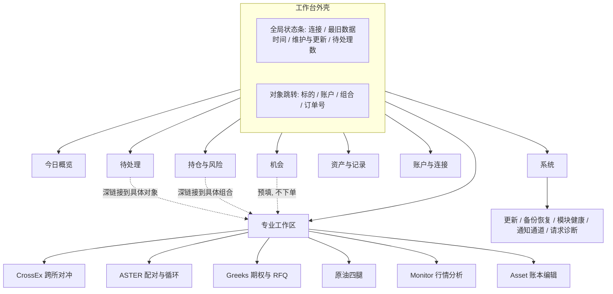
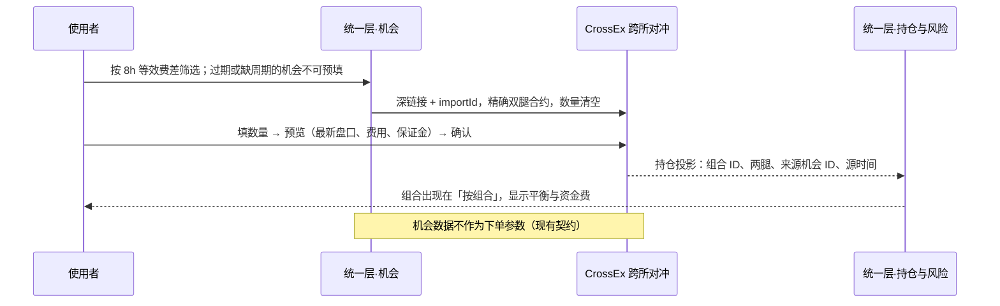
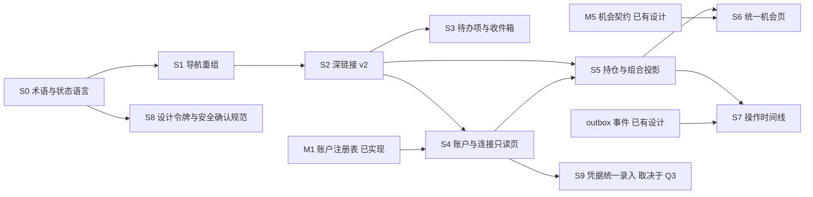

# 工作台重构方向研究：产品体验与整体设计（讨论稿）

| 项目 | 内容 |
| --- | --- |
| 文档性质 | 研究建议，供讨论；**未被用户采纳**，不构成已批准的规则、阈值或排期 |
| 日期 | 2026-10-20 |
| 实际研究的提交 | `f4aab218d247000623f84314919e1f60a2a3a0e1`（main，`docs: sync control and data plane plan with latest code`） |
| 重点视角 | 使用者角度：信息组织、页面结构、跨模块工作流程 |
| 写入范围 | 仅本文件；业务源码、`.company/` 与其它文档均未修改 |
| 改动分级 | 本文为 R1 纯文档；文中提出的实施步骤各自另行定级（见第 7 节） |

## 标注约定

为避免把个人判断写成既定规则，正文中的关键论断带有以下标签：

| 标签 | 含义 |
| --- | --- |
| **[已实现]** | 已在研究提交的源码中核对到的行为 |
| **[已有设计]** | 仓库文档中已有、但尚未实现或尚未完整实现的方案 |
| **[仓库契约]** | 仓库已存在并被测试或文档约束的接口、语义与规则 |
| **[公开实践]** | 可核验的外部资料，附原始链接；引用的是原则，不是对本项目的证明 |
| **[个人判断]** | 本文作者的推断或主张，未经用户确认 |
| **[未验证]** | 未运行、未取得数据或只做了部分源码核对的内容 |

文中路径相对仓库根目录；源码链接相对本文件位置。行号会漂移，实施时以符号名重新定位。

---

## 0 摘要

**推荐目标 [个人判断]：** 把工作台从「一个侧栏 + 五个 iframe」重组为两层：

1. **统一运营层**（工作台原生页面，按任务组织）：今日概览、待处理、持仓与风险、机会、资产与记录、账户与连接、系统。它统一「名词」——账户、标的身份、持仓、组合、操作、待办、新鲜度——以读、汇总、定位和确认为主，不新建一套下单通道。
2. **专业工作区**（保留各模块现有页面）：CrossEx 跨所对冲、ASTER 配对与循环、Greeks 期权与 RFQ、原油四腿执行、Monitor 行情分析、Asset 账本编辑。它们保留各自的「动词」：预览、确认、恢复、自动化设置，以及每个账户唯一的写入方。

两层之间用三类新的**只读产品契约**连接：带对象引用的深链接、可确认的待办项、统一身份的持仓投影。账户注册表（M1 已实现后端）提供第四个连接点。

**核心判断：**

- 现在的工作台已经把模块「放在一起」：统一登录、单端口、预加载、新鲜度和首页提醒都做得扎实 **[已实现]**。但真正贯通的跨模块链路只有四条，其中只有 Monitor → CrossEx 一条连到执行（第 2.3 节）。
- 用户最难回答的三个问题，现有结构都要跨多个页面拼凑：「现在有什么需要我处理」「我总共持有什么、风险在哪」「这个交易所账户在哪些地方配置、谁能用它下单」（第 3 节）。
- 应统一的是对象、状态语言和导航；应保留的是执行界面、风控规则和每个账户的单一写入所有权。不建议做「工作台通用下单票据」，也不建议把全部模块重写成一个单页应用（第 5 节）。

**与现有方案的关系：** [架构实现方案](../architecture-implementation.md) 的 M0–M7 解决可靠性与恢复，本文解决产品层，两者大体互补。本文的分歧主要是优先级：从使用者角度看，M1 账户注册表的界面化、M5 机会契约和事件 outbox 的用户价值更直接；M6/M7（PostgreSQL、多实例）在仓库中找不到对应的用户侧需求证据（第 6 节）。

---

## 1 用户与场景：仓库中的证据

用户画像、规模和主要痛点没有由本次用户说明。下表只列仓库中能找到的证据，以及据此做出的推断。

| 证据 | 来源 | 推断（[个人判断]） |
| --- | --- | --- |
| 「首版是一位管理员的个人工作台，没有多租户或细分角色」 | [接入协议](../integration.md) 项目设置一节 **[仓库契约]** | 目标用户是单人自营交易者，而不是团队或客户 |
| 侧栏底部文案「个人工作台 · 数据保存在自有服务器」；通过 SSH 本地转发访问 `hub.localhost:3100` | [App.tsx](../../src/App.tsx)、[接入协议](../integration.md) 单端口一节 **[已实现]** | 用户从个人电脑远程使用自有服务器；访问有一定门槛，打开后通常会停留较久 |
| 全部界面为简体中文；交易页按北京时间显示 | [TradingPositions.tsx](../../src/TradingPositions.tsx)、[App.tsx](../../src/App.tsx) 页脚 **[已实现]** | 主要用户使用中文、以北京时间作业 |
| 飞书机器人是唯一外部通知通道（Monitor 告警、ASTER 小时摘要、ADL、失衡、额度告警） | `modules/monitor/server/feishu.mjs`、`modules/aster/trading/notification_channels.py` **[已实现]** | 用户不在页面前时依赖飞书；工作台需要与飞书衔接，而不是替代飞书 |
| 策略覆盖：跨所永续价差与资金费（Monitor → CrossEx）、原油 CL/BZ 四腿资金费（工作台原生）、ASTER 配对/循环自动化、Greeks BTC 期权卖方组合、Asset 净资产与出金 | 第 2.2 节 **[已实现]** | 多策略并行；共同主线是**对冲组合**（多腿、跨账户、跨交易所），而不是单笔方向性交易 |
| 前端有 760/540 px 断点、移动端侧栏与焦点管理 | [styles.css](../../src/styles.css) **[已实现]** | 手机上也会使用，至少用来巡检；是否用手机操作资金不明（见 Q1） |
| 2026-09-20 以来的提交数：ASTER 49、CrossEx 18、Monitor 11、Asset 10、Greeks 4（`git log --since` 统计，按目录） | 本次运行的 `git log` | 弱证据：ASTER 与 CrossEx 迭代最频繁。模块是中途内置的，统计不代表使用频率 |
| 多条经验来自用户纠正：功能后端完成但页面找不到入口（L017）；状态颜色闪烁造成误解（L058） | [LESSONS.md](../../LESSONS.md) L017、L058 **[仓库契约]** | 用户对「能否找到」「状态是否可信」敏感，这正是产品层要解决的问题 |

**明确假设（未经用户确认）：**

- A1：只有一个使用者。不为多用户、权限分级或 SaaS 设计。
- A2：同时运行多个对冲策略，每天需要巡检、处理异常，偶尔新开或调整组合。
- A3：错误的资金操作代价远高于多点一次的成本。安全确认不能为了流畅而削弱。
- A4：模块会继续增加或替换（README 提到 Variational 暂停但保留数据）。架构需要能接纳新模块，而不是只服务当前五个。

---

## 2 现状：入口、页面与能力

### 2.1 工作台外壳 [已实现]

[App.tsx](../../src/App.tsx) 的侧栏依次是：**总览、交易、请求诊断**、内嵌模块列表（五项，带状态点）、**模块设置**、系统更新入口。

- **总览**：三格统计条（项目数、无提醒数、需关注数）；「资产概览」只取 Asset 的第一个指标和趋势；「当前关注」最多列 5 个项目，`action` 立即显示，`fault` 持续 120 s 后显示（[hub-state.ts](../../src/hub-state.ts) `ATTENTION_DELAY_MS`）；「项目工作区」卡片每个模块显示前 2 个指标。
- **交易**（[TradingPage.tsx](../../src/TradingPage.tsx)）：两个分区。「交易所仓位」只读汇总 Asset 提供的 Binance/Bybit/OKX/Aster 仓位；「原油四腿套利」是工作台原生的 CL/BZ 四腿策略，含只读账户、资金费账单和实盘组合执行。
- **请求诊断**：前端请求日志与耗时统计，是开发者工具，却放在一级导航。
- **模块设置**：只能改过期阈值、排序和 Asset 自动同步；模块自身设置都在各模块内部。
- **模块页**：通过 `p-<hex>.hub.localhost` 独立来源的 iframe 加载，有一次性授权票据、`activity` 握手、后台低频刷新和预加载（[ProjectPage.tsx](../../src/ProjectPage.tsx)、[ProjectWorkspace.tsx](../../src/ProjectWorkspace.tsx)）。

### 2.2 模块能力 [已实现，基于源码核对]

| 模块 | 页面结构 | 实盘或会写入的操作 | 自有凭据与设置 | 与其它模块的连接 |
| --- | --- | --- | --- | --- |
| Monitor | 4 个监控标签：原油价差、金油比、海力士 ADR、合约价差；合约价差下分「发现机会 / 持仓跟踪 / 图表」，机会分「价格套利 / 资金费套利 / 全部报价」，每行再展开 4 个详情页签 | 无交易所写入；监控开关、告警阈值、CrossEx 推送过滤、飞书 webhook 存服务器；筛选、列、资本假设存浏览器 localStorage | 无交易所密钥；飞书配置在页面内 | 「导入 CrossEx」；摘要 v2 |
| Asset | 4 个 hash 视图：资产总览、历史记录、出金记录、交易所连接 | 导入原表、编辑资产行、出金、汇率、同步、连接与断开（断开保留估值） | Binance/Bybit/OKX/Gate 密钥、Variational token、Aster 多账户钱包私钥 | 向工作台导出只读连接（`/api/hub/trading-connections`）；仓位投影（`/api/hub/positions`）；摘要 |
| CrossEx | 5 个标签：交易终端、跨所对冲、投资组合（默认）、订单记录、设置；**深色主题** | 预览 → 确认开平仓、撤单、加仓与平衡双腿（`kind: 'position'`，见[说明](../crossex-position-actions.md)） | Gate API 密钥、Monitor 地址与登录、暂停新开仓、名义额与费用限额 | 接收 Monitor 导入；自行读取 Monitor 机会；摘要 |
| Greeks | 单页长滚动：到期盈亏、账户保证金、期权链、执行控制、组合结构、仓位与事件、实盘收益、RFQ | 开平仓任务、停止、RFQ 创建/执行/取消；模拟/测试网/实盘三态标识 | Bybit 密钥只来自环境变量，**页面没有设置入口** | 摘要；无深链接参数 |
| ASTER | 7 个标签：配对组、多空循环、普通开仓、仓位迁移、币种监控中心、账户、记录；账户绑定配对后，循环/普通/迁移三个标签禁用 | 配对与账户的创建、启停、暂停、恢复预览与确认、基线采纳、保证金自动划转、ADL 处理 | 每账户 API 钱包；飞书配置需在服务器运行 `sudo aster-desk feishu-configure`（`monitor-settings.tsx`） | 摘要带 `diagnostics=1`；可请求工作台打开 Asset |
| 工作台原生交易 | 见 2.1 | 组合执行：预览 → `confirmLive` → 分批任务，未知结果横幅（[TradingExecution.tsx](../../src/TradingExecution.tsx)） | **两套**交易所连接：只读密钥（仓位/资金费，可从 Asset 导入）与实盘执行密钥（`execution_accounts`，用途 `execution`，[trading-execution.mjs](../../server/trading-execution.mjs)） | 读 Asset 导出与仓位 |

### 2.3 已贯通的跨模块链路 [已实现]

| 链路 | 方式 | 边界 |
| --- | --- | --- |
| Monitor 机会 → CrossEx 跨所对冲 | 桥接 `navigate` + `importId`，携带精确双腿合约；只预填，数量清空，仍需预览确认 | 只能从工作台内触发；只通往 CrossEx |
| CrossEx 内读取 Monitor 机会 | CrossEx 服务端用自己保存的 Monitor 地址和凭据拉取 | 用户要在 CrossEx 设置里再配一次 Monitor 连接 |
| Asset 凭据 → 工作台原油页只读连接 | 服务端一次性导出并重新验证只读权限 | 只覆盖只读用途；执行密钥仍需手填 |
| Asset 仓位 → 工作台「交易所仓位」 | `/api/trading/positions` → Asset `/api/hub/positions` | 不含 Gate CrossEx 账户、ASTER 配对语义和 Greeks 期权结构（Bybit 期权是否进入投影**[未验证]**） |
| ASTER → Asset | 桥接 `openAssets()` | 只打开 Asset 首页，不带对象 |

工作台的导航白名单只接受 `monitor`、`crossex`、`greeks`、`asset` 四个目标，Greeks 和 Asset 只能接受空条件（[hub-state.ts](../../src/hub-state.ts) `navigation()`、[hub-navigation.mjs](../../server/hub-navigation.mjs)）。因此，现在无法从任何地方直接打开「ASTER 的某个配对」「CrossEx 的某个组合」或「Greeks 的某个任务」。

### 2.4 后端已具备、但没有用户入口的能力 [已实现]

[架构实施基线](../architecture-baseline.md) 中的 `/api/system/architecture`、`/api/system/metrics`、`/api/system/accounts`、`/api/system/recovery` 都已接入，但 `src/` 中没有任何页面读取它们。其中 `/api/system/accounts` 是 M1 的跨模块账户注册表：账户域、模块归属、身份核验与隔离原因。它恰好能回答「这个账户归谁写入」，目前却只能用接口读取。

---

## 3 「放在一起」与「真正贯通」的差距

| # | 差距 | 证据 [已实现] | 对使用者的后果 [个人判断] |
| --- | --- | --- | --- |
| G1 | 导航按「模块来源」组织，而不是按任务组织 | 侧栏把 5 个模块平铺；「交易」页只含原生策略，CrossEx/Greeks/ASTER 也是交易却在别处；「请求诊断」占一级导航 | 用户要先记住「这件事在哪个模块」，才能开始做事；新增模块只会让侧栏变长 |
| G2 | 账户与凭据分散在 6 处，没有总视图 | Asset（只读多所）、工作台只读连接、工作台执行连接、Greeks 环境变量、ASTER 每账户钱包、CrossEx Gate；M1 注册表无界面 | 无法回答「某个 Bybit 主账户在哪里配置、哪些地方能下单」；轮换密钥时容易漏改；M1 拒绝跨模块写入时，用户看不到原因 |
| G3 | 没有全局持仓与风险视图 | 「交易所仓位」只覆盖 Asset 来源；CrossEx 组合、ASTER 配对、Greeks 期权、原油四腿各在自己页面；Asset 总额有意排除 CrossEx 与 Greeks 收益以避免重复计算 | 回答「BTC 总敞口多少」「哪些对冲腿不平衡」要打开 4–5 个页面，在脑中拼合 |
| G4 | 待处理事项分散，状态语言不一致 | 首页「当前关注」只有项目级文本；未知订单、基线恢复、ADL 处理等各在模块内；飞书在 Monitor 页面配置，在 ASTER 需服务器命令配置 | 飞书告警与工作台提醒对不上号；处理完一个问题，不知道还有没有别的；没有「已确认、处理中」的状态 |
| G5 | 「机会 → 执行 → 持仓 → 复盘」只在一条线上贯通 | 只有 Monitor → CrossEx 能导入；Monitor 原油价差与原生原油四腿执行之间没有链接；执行后的持仓和收益回到各模块各自的页面 | 同一个策略的发现、执行和跟踪在不同地方，结果无法回溯到当初的机会和假设 |
| G6 | 深链接能力过窄 | 导航白名单与查询键见 2.3；ASTER 不在白名单 | 首页提醒只能跳到「模块首页」，用户还要在模块内重新寻找对象 |
| G7 | 视觉与时间口径不一致 | CrossEx 是深色主题（`modules/crossex/src/dark-theme.css`），[界面约定](../workspace-style.md) 规定浅色且未列 CrossEx；Greeks 是原生 JS 页面；总览页脚写「按本机时区」，交易页写「按北京时间」 | 切换模块时有明显断层；同一时刻在两个页面显示为不同时间，影响核对 |
| G8 | 设置分散在多层 | 工作台「模块设置」只有阈值与排序；模块设置各在模块内；Greeks 没有设置界面 | 「改通知」「改限额」「暂停新开仓」要分别找；Greeks 改配置要上服务器 |
| G9 | 安全确认各自实现，表达不同 | CrossEx、原油执行、ASTER 恢复都有「预览有效期 + 确认 + 未知结果」，但文案、位置和视觉各不相同 | 各模块已经很安全，但用户每到一个模块都要重新学习「这里怎样才算安全」 |

**需要区分的一点 [个人判断]：** G9 和部分 G1 不是缺陷，而是专业差异的副作用；G2–G6 才是真正的「没有贯通」。重构的重点应放在 G2–G6，G7–G9 用统一语言和组件处理，不要求统一实现。

---

## 4 推荐目标

### 4.1 设计原则

| # | 原则 | 依据 |
| --- | --- | --- |
| P1 | **按任务组织一级导航，按模块组织二级入口。** 一级回答「我要做什么」，模块名降为专业工作区的入口 | [个人判断]；用户以策略和账户思考，模块只是实现边界 |
| P2 | **统一名词，保留动词。** 账户、标的身份、持仓、组合、操作、待办、新鲜度在全工作台只有一种含义和一种显示方式；下单、恢复、自动化留在专业工作区 | [个人判断] |
| P3 | **统一层只读，写入回到唯一写入方。** 统一层可以汇总、筛选、定位、确认待办，不新增资金写入通道 | [仓库契约] M1「同一真实账户只能配置一个受管理写入模块」（[架构实现方案](../architecture-implementation.md) 6.1、[实施基线](../architecture-baseline.md) M1） |
| P4 | **未知就是未知。** 统一视图聚合时，缺失、过期、结果未知不补零、不被其它新数据掩盖；汇总值的新鲜度取最早来源 | [仓库契约] [接入协议](../integration.md) 摘要规则；L023、L040、L058 |
| P5 | **每条提醒都要可执行，并能直达处理位置。** 不可执行的信息降为「运行详情」 | [仓库契约] 现有 `action/fault/notice` 分级；[公开实践] Google SRE 关于告警应基于症状、可执行的原则：<https://sre.google/sre-book/monitoring-distributed-systems/> |
| P6 | **确认只用在有后果的操作上，并展示后果本身。** 预览要显示账户身份、数量、方向、有效期；不为只读操作加确认 | [公开实践] NN/g《Confirmation Dialogs Can Prevent User Errors》：<https://www.nngroup.com/articles/confirmation-dialog/>；危险与普通操作分开放置：<https://www.nngroup.com/articles/proximity-consequential-options/> |
| P7 | **专业工作区可独立打开、可单独故障。** 统一层不可用时，各模块原页面仍能完成全部工作 | [仓库契约] [界面约定](../workspace-style.md)「独立访问原项目时仍保留全部功能」 |
| P8 | **首页是「需要注意什么」，不是指标陈列。** 优先显示偏离正常的状态，不平均展示每个模块 | [公开实践] NN/g 关于仪表盘利用前注意加工、突出异常：<https://www.nngroup.com/articles/dashboards-preattentive/>；[个人判断] |

### 4.2 统一什么、保留什么

| 领域 | 统一（工作台负责） | 保留专业差异（模块负责） |
| --- | --- | --- |
| 导航 | 一级任务导航、全局状态条、按对象的深链接与返回路径 | 模块内部标签、筛选和视图状态 |
| 账户 | 真实账户身份（`accountKey`）、凭据**用途**的总视图、写入归属、身份核验与隔离原因 | 各模块的密钥录入与验证流程（至少在 Q3 有答案之前） |
| 标的 | 统一标的（`canonicalBase`）与原生合约并列显示，规则见 L020 | 各交易所目录、步长、计价币规则 |
| 持仓 | 跨模块持仓投影、按标的的净敞口、按组合的腿平衡状态、「由谁管理」 | 组合的开平、加仓、平衡、ADL 处理、保证金划转 |
| 待办 | 统一待办列表、严重级别、首次发现时间、确认与暂缓、跳转目标、飞书去重 | 问题的判定逻辑与处理操作（如未知订单归档、基线采纳） |
| 机会 | 跨来源机会列表、来源时效、「可在哪里执行」 | 机会的计算、资本假设、执行端的再次核验 |
| 记录 | 跨模块操作与成交时间线、资产曲线与出金 | 各模块的详细执行记录、成交质量、成本拆分 |
| 状态语言 | 新鲜度、未知结果、维护中、模拟/测试网/实盘的文案、颜色与图标 | 具体阈值（各模块 TTL 已有依据） |
| 视觉 | 设计令牌（颜色、字号、间距、状态色）、安全确认组件的视觉规范 | 组件实现与技术栈（React/Next/原生 JS/Python 页面） |
| 设置 | 通知通道、数据过期阈值、模块启停、全局维护状态的入口 | 策略参数、风控限额、自动化开关 |

### 4.3 信息架构与页面结构（提案）



与现状的对应关系：

| 现有入口 | 提案位置 |
| --- | --- |
| 总览 | 今日概览（内容重做，见下） |
| 交易 → 交易所仓位 | 持仓与风险（扩展为全模块投影） |
| 交易 → 原油四腿套利 | 专业工作区 → 原油四腿 |
| 请求诊断 | 系统 → 请求诊断 |
| 内嵌模块列表 | 专业工作区（入口保留，并附各模块状态点） |
| 模块设置 | 系统 → 模块；各模块策略设置仍在模块内 |
| 系统更新 | 系统 → 更新；全局状态条显示维护与更新状态 |
| Asset 资产总览与出金 | 资产与记录（统一层展示）+ Asset 账本编辑（专业工作区） |
| （无） | 待处理、机会、账户与连接（新增） |

**今日概览草图（提案）：**

```text
┌ 全局状态条 ─ 服务正常 · 最旧数据 12s（Greeks）· 无维护 · 待处理 3 ───────────────┐
├──────────────────────────────┬──────────────────────────────────────────────┤
│ 需要处理（3）                 │ 资金与风险                                      │
│ ● 需要处理 ASTER 配对 BTC-1   │ 净资产 xxx USD · 源数据 09:41（Asset）          │
│   未知订单待核对   [去处理 →] │ 按标的净敞口（仅已确认数据）                     │
│ ● 持续异常 CrossEx 盘口过期   │   BTC  +0.02  ⚠ Greeks 数据过期，不含期权 delta │
│   已 3 分钟        [查看 →]   │   CL/BZ 四腿  平衡 · 资金费今日 +x              │
│ ○ 已确认 Monitor 告警通道…    │ 腿不平衡的组合：1   [查看 →]                     │
├──────────────────────────────┼──────────────────────────────────────────────┤
│ 运行中的自动化                │ 机会（来自 Monitor，按来源时效过滤）              │
│ ASTER 配对 4 运行 / 1 暂停    │ 资金费 · XXX  Binance↔OKX  8h 等效差 …          │
│ Greeks 任务 0 · CrossEx 暂停新开│   [在 CrossEx 预填 →]                          │
└──────────────────────────────┴──────────────────────────────────────────────┘
```

**持仓与风险草图（提案）：**

```text
视图切换： [按组合] [按标的] [按账户]        筛选：交易所 / 模块 / 只看异常
按组合：
  组合                 腿                         平衡     资金费/收益   管理方      新鲜度
  CrossEx BTC 对冲     OKX 多 0.5 / Binance 空 0.5  ✓       …            CrossEx     8s
  ASTER 配对 ETH-2     A 多 / B 空                   ⚠ 1.2%  …            ASTER 自动  21s
  原油四腿             Bybit CL 多 / … 4 腿          ✓       …            工作台原生  5s
  Greeks 卖出宽跨      4 腿期权                      —       …            Greeks      过期 ⚠
  未归组持仓           Binance SOL 多 3（手动）      —       —            无管理方
每行： [在管理方中打开 →]   （统一层不提供平仓按钮）
```

「未归组持仓」很重要：Asset 能读到、但没有任何模块声明管理的持仓，往往就是手动单或残留腿。这是现在完全看不到的一类风险 **[个人判断]**。

**账户与连接草图（提案）：**

```text
真实账户                    身份核验        只读用途                  写入归属          状态
Bybit 主账户（密钥尾号 ab12）已核验 10:02    Asset 资产 · 工作台仓位    Greeks（期权）    正常
Binance（密钥尾号 cd34）    已核验          Asset · 原油只读           工作台原生执行     正常
Gate CrossEx（尾号 ef56）   已核验          —                          CrossEx           正常
Aster 钱包 0xab…            已核验          Asset                      ASTER             隔离：跨模块旧交易待核对 [详情 →]
未能确认身份的连接（只读）  …
```

这一页只显示账户域、用途、归属和状态，不显示密钥。是否显示 UID（哪怕是尾号）需要单独决定：`/api/system/accounts` 现在不返回 UID，而原生执行页已显示完整 UID（[TradingExecution.tsx](../../src/TradingExecution.tsx)）。数据来自 M1 的 `/api/system/accounts`（**[已实现]**）加上各模块连接状态（需新契约）。

### 4.4 核心对象：统一定义与拥有者

| 对象 | 统一定义 [个人判断] | 权威来源 | 现有基础 |
| --- | --- | --- | --- |
| 真实账户 | `authority + environment + accountId` 确定的主体；密钥轮换不改变身份 | M1 账户注册表 | [仓库契约] [实施基线](../architecture-baseline.md) M1 |
| 凭据用途 | 某个真实账户上的一把密钥，标明只读资产、只读仓位、执行三类用途之一，以及归属模块 | 各模块（只上报元数据，不上报密钥） | 部分已有：工作台把只读与执行用途分开存储 |
| 标的身份 | 统一标的 + 交易所原生合约 + 计价币；两者都显示 | `server/asset-identity.mjs` | [仓库契约] L020 |
| 持仓 | 某真实账户上某原生合约的已确认仓位，附源时间 | 执行模块或 Asset 读取 | 部分已有：Asset 仓位投影 |
| 组合 | 由执行方声明的一组腿（CrossEx 双腿、ASTER 配对、原油四腿、Greeks 组合）；组合 ID 由执行方拥有 | 执行模块 | 各模块内部已有，尚无统一投影 |
| 操作 | 一次有副作用的请求及其状态：已持久化、已发送、已确认、结果未知、已终结 | 执行模块 | [仓库契约] M1 操作 ID 与 UNKNOWN 语义 |
| 待办 | 需要人处理或观察的条目，带稳定 ID、级别、对象引用、处理位置 | 来源模块判定，工作台记录首次发现与确认 | [仓库契约] 现有 diagnostics 的 ID 与分级 |
| 机会 | 发现方给出的候选组合，含双腿原始数据和时效；不是下单参数 | Monitor（M5 后为 Opportunity Service） | [仓库契约] 导入只预填、清空数量 |
| 新鲜度 | 源时间 + TTL；汇总值取最早来源；页面刷新不延长 | 各来源 | [仓库契约] 摘要与资产新鲜度规则 |

### 4.5 代表性流程（提案）

**F1 开工巡检**

1. 打开今日概览。全局状态条显示「待处理 2」和最旧的数据来源。
2. 点击「ASTER 配对 BTC-1 未知订单待核对」，直接打开 ASTER 配对页的订单恢复面板（需要深链接 v2）。
3. 在 ASTER 内按现有流程预览、确认归档。ASTER 不再上报该诊断后，待办自动转为「已解决」；用户的「已确认」不会清除来源状态。

**F2 资金费机会 → 开仓 → 跟踪**



前两步现在已经实现。提案新增的部分是：机会页成为统一入口，并能路由到其它执行方；执行后组合带回「来源机会 ID」，以后复盘能回答「当时为什么开这个仓」。

**F3 新增或轮换交易所密钥**

1. 在账户与连接中选择交易所和环境，先完成身份核验（UID）。
2. 选择用途：只读资产、只读仓位、执行（执行只能选一个归属模块）。
3. 如果所选归属与 M1 已有归属冲突，页面直接说明冲突对象和处理方法，而不是等到下单时被拒绝。

近期只做第 1、3 步的「总视图与冲突说明」，密钥仍在各模块录入。是否改为「一次录入、按用途分发」取决于 Q3。

**F4 飞书告警 → 工作台**

飞书卡片带待办 ID 和深链接。点开后进入同一条待办，看到首次发现时间、当前状态和处理位置。飞书只在状态迁移时发送，不重复刷屏。

**F5 更新前检查**

系统 → 更新在点击更新之前，列出会阻止停机的条目（未知订单、在途请求、证据过期），每条都能跳到处理位置。现有的停机准入规则保持不变（L008）。

### 4.6 系统侧需要的产品契约（提案）

以下都是**只读或导航**契约，不携带交易动作，延续 [接入协议](../integration.md)「摘要不得透传订单操作」的约束。

| # | 契约 | 内容要点 | 失败与新鲜度 |
| --- | --- | --- | --- |
| C1 | 深链接 v2 | `{ projectId, target: { view, entity: { type, id } } }`；每个模块声明可接受的 `type`（如 `pair`、`position-group`、`order`、`task`、`account`）；只定位，不触发写入；目标不存在时显示原因 | 未知 `type` 拒绝；保留现有 v1 查询键 |
| C2 | 待办项 | 在现有 diagnostics 上增加 `severity`、`entities[]`、`target`（C1 格式）；工作台持久化首次发现、确认与暂缓；来源停止上报才算解决 | 来源不可读时保留最后状态并标记「来源不可用」，不判定为已解决 |
| C3 | 持仓投影 v2 | 每个执行模块上报 `accountKey`、原生合约与统一标的、方向、数量与单位、源时间、`groupId`、`managedBy`；十进制字符串 | 沿用 Asset 投影的 `live/stale/error` 状态语义；空列表只在 `live` 时表示空仓 |
| C4 | 组合投影 | `groupId`、腿列表、平衡状态（由执行方计算）、来源机会 ID（可选）、收益口径说明 | 执行方未上报平衡状态时显示「未知」，统一层不自行计算 |
| C5 | 凭据用途元数据 | 每个模块上报其连接的 `accountKey`、用途、验证时间、密钥尾号（已有字段）；**不上报密钥本身** | 身份未核验时显示「未知身份」，不做合并 |
| C6 | 操作时间线 | 基于 [架构实现方案](../architecture-implementation.md) 7.1 的 outbox 事件，投影为跨模块时间线 | 依赖 outbox；在此之前只读各模块现有记录接口 |

### 4.7 明确不建议

- **不做工作台通用下单票据。** 期权 RFQ、ASTER 自动化、CrossEx 统一保证金和原油分批追价的风控和数量语义完全不同。统一票据要么削弱这些检查，要么在工作台重写一遍，违背 P3。
- **不在统一层计算资金或平衡。** 资本、ROC、平衡判定由执行方或共享计算模块给出（L059），统一层只展示，避免出现两套口径。
- **不把模块页面改造成 iframe 内的「组件」。** 现有 iframe 的独立来源和一次性授权是安全边界（[接入协议](../integration.md)），产品统一靠契约实现，而不是靠拆这道边界。
- **不只做换肤。** 只统一颜色和字体解决不了 G2–G6。

---

## 5 替代路线与取舍

| 路线 | 内容 | 优点 | 代价与风险 | 结论 |
| --- | --- | --- | --- | --- |
| A 维持结构，只统一视觉 | 统一主题、字体与组件外观 | 风险最低，见效快 | 不解决账户、持仓、待办、链路问题（G2–G6） | 作为 D 的一部分，不单独作为目标 |
| B 全部重写为一个原生单页应用 | 拆掉模块边界，所有页面用工作台前端重做 | 一致性最好；跨页面状态共享最自然 | 失去模块独立打开与独立故障（P7）；资金路径大量重写，已验证的确认、恢复与未知结果逻辑要重新证明；Python 模块要另建 API 层；同一界面同时承担读与写，单一写入归属更难审查 | 不推荐。即使不考虑工作量，可靠性和可验证性也更差 |
| C 共享运行时的微前端 | 去掉 iframe，用模块联邦或 Web Components 在同一文档加载各模块 | 视觉与交互可以统一；深链接更容易 | 要拆掉独立来源与授权边界；React/Next/原生 JS/Python 页面混合，共享运行时的版本耦合重；任一模块脚本错误可能影响整页。[公开实践] Cam Jackson 对运行时集成方式的取舍讨论：<https://martinfowler.com/articles/micro-frontends.html> | 不推荐作为终局；只有当 iframe 的隔离成本被证明过高时再考虑 |
| D 统一运营层 + 专业工作区（推荐） | 第 4 节 | 解决 G2–G6；保留模块独立性与写入边界；可逐步交付；与 M1/M5/outbox 方向一致 | 需要新的产品契约（C1–C6），每个模块都要实现；两层之间仍有一次页面切换；统一层与模块可能出现文案或口径不一致，需要契约测试 | 推荐 |
| E 以策略为一级导航 | 每个策略一个页面（资金费对冲、原油四腿、ASTER、期权），把发现、执行和跟踪放在一起 | 最贴近「我在跑哪些策略」的心智；单策略内的流程最短 | 策略会增减、跨模块组合（如 Monitor 机会可以路由到不同执行方）不好放；全局问题（总敞口、所有待办）仍需另一套视图 | 作为 D 的「持仓与风险 → 按组合」视图吸收；若 Q2 显示策略很少且长期稳定，可提升为一级导航 |

**什么证据会改变结论：**

- 如果用户实际只常用一两个模块，且很少跨模块核对（Q1/Q2），D 的统一层收益下降，A + 深链接（C1）可能就够了。
- 如果用户希望工作台成为唯一操作入口，并愿意让模块不能再单独打开，B 或 C 的一致性收益才值得讨论。
- 如果 iframe 加载与内存成为实际瓶颈（目前已有预加载与容量上限，未见用户报告），C 的优先级上升。
- 如果策略数量少且稳定，E 应提升为一级结构。

---

## 6 与已有方案的关系

| 文档 | 关系 | 说明 |
| --- | --- | --- |
| [架构实现方案](../architecture-implementation.md)（M0–M7） | 互补，部分依赖 | 本提案的账户页依赖 M1 注册表（**已实现**后端）；机会页依赖 M5 的 Opportunity 契约（**已有设计**）；操作时间线依赖 7.1 outbox（**已有设计**）；实时首页受益于 9.2 持久 SSE（**已有设计**），但不是前提 |
| [实施基线](../architecture-baseline.md) | 直接复用 | `/api/system/*` 四个接口已具备，可作为「系统」与「账户与连接」页的首批数据源 |
| [控制面与数据面分离](../control-data-plane-separation.md) | 正交 | P0「模块故障不关闭全站」直接改善用户体验，应作为「模块健康」显示的前提；其余进程拆分对产品层透明 |
| [接入协议](../integration.md) | 扩展 | C1–C5 是对 v1 桥接与摘要 v2 的扩展，保留「只读、不带交易动作」「未知不补零」 |
| [界面约定](../workspace-style.md) | 部分修订 | 保留「状态与数据流不随视觉统一而重构」；建议补上 CrossEx 的主题决定，并把状态语言与安全确认的视觉规范纳入约定 |

**我对已有方案的挑战 [个人判断]：**

1. **优先级。** 已有方案按可靠性排序（M3 生命周期 → M4 双槽 → M5 共享数据 → M6 主库 → M7 多实例）。从使用者角度看，M1 注册表的界面、M5 的机会契约和 outbox 时间线价值最直接。M6/M7 在仓库中找不到对应的用户侧证据：单人使用（A1），SQLite 写等待也尚未测量（已有方案第 17 节自己也把它列为待核定）。建议在决定 M6/M7 之前，先完成本提案第 7 节中 S1–S5 的只读部分。
2. **「摘要」不应是统一层的唯一契约。** 已有方案把 `GET /api/overview` 与摘要 v2 作为工作台聚合的主要输入。摘要适合卡片，但不适合持仓、组合和待办：它不带对象引用，指标最多 24 个且是展示文本。建议新增 C2–C4，而不是继续往摘要里塞字段（摘要 v2 也拒绝未知字段）。
3. **账户保护需要用户界面。** M1 的「冲突即拒绝、身份未知即只读」在安全上是对的，但用户只会在下单失败时才发现。建议把注册表界面视为 M1 交付的一部分，而不是可选项。

**发现的文档与源码不一致（只登记，未修改）：**

- [接入协议](../integration.md) 仍写「最多保留六个 iframe」「六个内置模块」并列出 Variational 预加载；源码 [catalog.mjs](../../server/modules/catalog.mjs) 只有五个模块，[hub-state.ts](../../src/hub-state.ts) 的预加载表也只有五项，README 写明 Variational 暂停。
- [界面约定](../workspace-style.md) 要求浅色主题，适用范围未列 CrossEx；CrossEx 实际是深色主题。
- 总览页脚写「时间按本机时区显示」，交易页写「北京时间」（[App.tsx](../../src/App.tsx) 页脚）。

---

## 7 从现状到目标：依赖与验证

这里只写依赖关系和验收证据，不估算工期。每一步都应能单独交付、单独回滚。



| 步骤 | 内容 | 前置 | 验收证据（实施时运行，不是本次已运行） | 建议等级 |
| --- | --- | --- | --- | --- |
| S0 | 术语表与状态语言：账户、连接、持仓、组合、操作、未知结果、过期、维护中、模拟/测试网/实盘的统一文案与颜色 | 无 | 对各模块现有文案做清单比对；用户确认术语（Q 之外的小确认） | R1 |
| S1 | 导航重组：一级任务导航；「请求诊断」移入系统；交易页拆分；旧书签参数（`tradingSection`、`tradingPair` 等）继续可用 | S0 | 工作台入口浏览器回归：旧链接跳转、移动端侧栏焦点、预加载顺序不变（复用 `tests/project-priority.browser.mjs` 等现有用例并补充） | R2 |
| S2 | 深链接 v2（C1）：工作台与五个模块的桥接都支持对象定位；ASTER 加入白名单 | S1 | 每个模块：合法目标定位、未知类型拒绝、目标不存在提示、不产生任何写请求（拦截写 API 断言 0 次） | R2（公共契约） |
| S3 | 待办项（C2）与收件箱；飞书卡片带待办 ID | S2 | 待办生命周期测试：出现、计时、确认、来源解决、来源不可读；确认不清除来源状态；飞书只在状态迁移时发送 | R2；涉及通知去重时复核 L013 |
| S4 | 账户与连接只读页：注册表 + 各模块凭据用途元数据（C5）+ 冲突说明 | M1、S2 | 断言响应和页面不含密钥、连接名、原始意图与订单号；UID 的显示粒度按用户决定实现；身份未知时不合并；与 `/api/system/accounts` 现有脱敏边界一致 | R3（凭据与权限边界） |
| S5 | 持仓投影 v2（C3）与组合投影（C4），按标的净敞口与「未归组持仓」 | S2、S4 | 契约夹具覆盖 live/stale/error、空仓、未知数量、别名标的（L020）、Gate CrossEx 与原生账户不合并；对同一时刻的模块页面做数值一致性比对 | R3（资金数据正确性） |
| S6 | 统一机会页，路由到可执行方 | M5、S5 | 复用 `tests/embedded-funding.test.mjs`、`tests/opportunity-import.browser.mjs` 的语义：过期不可预填、缺周期不推断、数量清空 | R2 |
| S7 | 跨模块操作时间线 | outbox、S5 | 去重、乱序、缺修订号时重读快照；未知结果不显示为成功 | R2 |
| S8 | 设计令牌与安全确认的视觉规范；CrossEx 主题决定 | S0 | 宽屏、嵌入、窄屏截图对比；过期与缺失数据在任何主题下都不能看起来正常（[界面约定](../workspace-style.md) 已有要求） | R1–R2 |
| S9 | 凭据「一次录入、按用途分发」（仅当 Q3 选择统一） | S4 | 独立安全审查；最小权限（只读与执行仍是不同密钥）；密钥不进浏览器与日志；轮换后所有用途同步失效 | R3 |

**怎样验证方向本身是对的（而不只是实现正确）[个人判断]：**

- 在 S1 之前，用 3–5 个真实任务做一次观察（例如「找出所有需要处理的问题」「BTC 总敞口是多少」「这个 Bybit 账户在哪些地方能下单」），记录现在需要打开的页面数和用时。S3–S5 之后用同样的任务复测。这是唯一能直接证明「贯通」的证据；本文没有做过这项观察。
- 本地记录导航事件（不上报外部），看一级导航各项的使用比例，用来判断 E 路线是否该升级（Q2）。

---

## 8 风险与反例

| 风险 | 说明 | 缓解 |
| --- | --- | --- |
| 统一层成为第二套口径 | 持仓、收益在统一层和模块里显示不同数字 | 统一层只展示执行方给出的数值（C3/C4），并显示来源与源时间；做契约一致性测试 |
| 统一层给人「可以在这里操作」的错觉 | 用户在持仓页找平仓按钮 | 每行明确「管理方」和「在管理方中打开」；不放写按钮（4.7） |
| 待办过多导致疲劳 | 所有 fault 都进收件箱 | 保留现有 `action/fault/notice` 分级与 120 s 观察期；`notice` 不进收件箱（P5） |
| 深链接被滥用为动作 | 链接里携带数量或方向导致误下单 | C1 只允许对象定位；延续 `importId` 只预填、数量清空的契约 |
| 账户页暴露敏感信息 | 汇总视图更容易被截图或旁观 | 沿用 `/api/system/accounts` 的脱敏粒度；按 R3 审查 |
| 统一层不可用时影响交易 | 用户习惯从统一层进入后，统一层故障就挡住了路 | 专业工作区保留独立打开入口（P7）；控制面分离 P0 先行 |

---

## 9 会真正改变方向的用户问题

| # | 问题 | 为什么会改变方向 |
| --- | --- | --- |
| Q1 | 主要在什么设备和场景下使用：桌面常驻盯盘、定时巡检，还是手机响应飞书告警？手机上是否需要执行资金操作？ | 决定今日概览与收件箱是否优先做移动端；手机执行会显著提高确认与身份显示的要求 |
| Q2 | 长期稳定运行的策略有几个？新策略多久出现一次？ | 策略少且稳定 → 按策略组织一级导航（路线 E）；策略多变 → 按对象组织（路线 D） |
| Q3 | 是否接受「同一交易所账户的密钥只录入一次，再按只读、执行用途分发给各模块」？还是更愿意每个模块各自保管，彼此隔离？ | 决定「账户与连接」是总视图（S4）还是凭据保管中心（S9）；后者是 R3 安全边界变化 |
| Q4 | 飞书之外是否还需要其它通知渠道？是否希望工作台成为「告警已确认」的权威记录？ | 决定待办的确认状态是否回写飞书，以及是否需要通知渠道抽象 |
| Q5 | 是否需要一个全局的「暂停所有新风险」开关（只阻止新开仓，保留平仓与撤单）？ | 这是统一层唯一可能需要的写操作；需要单独的 R3 设计，且依赖各模块已有的暂停与维护门 |
| Q6 | 未来是否会继续接入新模块，或恢复 Variational？ | 决定 C1–C5 是否需要做成通用接入协议，还是只服务现有五个模块 |

---

## 10 研究边界与检查记录

**已做：**

- 在提交 `f4aab218` 上阅读了 `AGENTS.md`、`README.md`、架构实现方案、实施基线、控制面与数据面分离方案、接入协议、界面约定、CrossEx 持仓操作说明，以及 `LESSONS.md` 中 L017、L020、L023、L058、L059。
- 核对了工作台前端（`App.tsx`、`ProjectPage.tsx`、`ProjectWorkspace.tsx`、`TradingPage.tsx`、`TradingPositions.tsx`、`OilTradingPage.tsx`、`TradingExecution.tsx`、`hub-state.ts`、`types.ts`）与服务端路由（`server/app.mjs`、`server/modules/catalog.mjs`、`server/trading-import.mjs`、`server/trading-execution.mjs`、`server/hub-navigation.mjs`）。
- 五个模块的页面与操作，由只读子任务对源码做定向检索后汇总，作者抽查了关键点：原油页只读与执行密钥分离、ASTER 飞书配置方式、CrossEx 深色主题、Asset 仓位投影覆盖的交易所、导航白名单。
- 用 `git log --since=2026-09-20` 统计各目录提交数。

**未做：**

- 没有运行任何业务测试、构建或浏览器用例。本文涉及的行为都来自源码阅读，不是运行结果。
- 没有观察真实用户操作，没有生产指标或实盘数据；第 1 节的使用画像是推断。
- 没有逐文件通读各模块；模块能力表中标为「未验证」的项（如 Bybit 期权是否进入 Asset 仓位投影）需要实施前确认。
- 外部资料只作为原则参考，未据此推断本项目的具体阈值。

**文档检查：** 本文为纯文档改动，按 [AGENTS.md](../../AGENTS.md) 无需代码检查。交付前运行了 `node scripts/review-gate.mjs`（工作区模式），输出「门禁：本次没有代码改动。」，退出码 0；该门禁把本文识别为非代码改动。另用脚本核对了本文 19 个不同的相对链接，目标文件全部存在。没有运行 `pnpm run check`、`pnpm test`，原因是没有改动代码。

## 附录：外部资料

| 资料 | 用途 | 类型 |
| --- | --- | --- |
| Google SRE Book, Chapter 6 *Monitoring Distributed Systems*：<https://sre.google/sre-book/monitoring-distributed-systems/> | P5 告警可执行、基于症状 | [公开实践] |
| NN/g, *Confirmation Dialogs Can Prevent User Errors (If Not Overused)*：<https://www.nngroup.com/articles/confirmation-dialog/> | P6 确认只用于有后果的操作 | [公开实践] |
| NN/g, *Dangerous UX: Consequential Options Close to Benign Options*：<https://www.nngroup.com/articles/proximity-consequential-options/> | P6 危险操作与普通操作分开 | [公开实践] |
| NN/g, *Dashboards: Making Charts and Graphs Easier to Understand*：<https://www.nngroup.com/articles/dashboards-preattentive/> | P8 首页突出异常 | [公开实践] |
| Cam Jackson, *Micro Frontends*（martinfowler.com）：<https://martinfowler.com/articles/micro-frontends.html> | 路线 C 的集成方式取舍 | [公开实践] |
