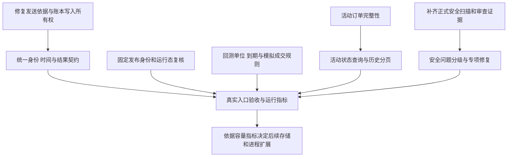

# 技术演进迭代初稿

版本：v0.1，2026-10-30。源码基线：`37cb9e2947801c39c7432606302b5e5f4407e433`。依据为[本次审查报告](comprehensive-audit-2026-10-30.md)、对应 Issues 和现有[架构实现方案](architecture-implementation.md)。这是可拆分实施的初稿，不表示相关能力已经交付。

近期应先修复会让动作依据、账本、部署身份和研究结果失真的问题，再统一跨模块契约与历史读取方式。现有模块化单体、进程隔离、SQLite、五模块统一仓库和统一正式发布继续作为基础；本次测量指向查询范围、异步所有权与契约断点，尚没有证据要求立即引入微服务、PostgreSQL、Rust 或新的托管平台。

## 1 当前能力与缺口

| 领域 | 已有基础 | 下一步需要补齐 |
| --- | --- | --- |
| 生命周期 | API/运行时分离、模块监督、双槽入口和切换代码、真实 systemd CI | 真实 main 串联覆盖与生产连续性证据；运行态不可由历史成功缓存代替 |
| 执行 | 持久意图、确定性原编号、共享账户身份、租约/fence、维护门、未知结果恢复 | 规划证据在最终 HTTP 前复核；原策略身份和“未创建/未知/人工结束”语义一致 |
| 数据 | 各模块已有市场身份、目录、报价/持仓时间、账本、历史缓存 | 用同一生产者产物贯穿消费者；区分报价币/结算币、原生代码/canonical base、快照年龄/读取成功 |
| 存储 | SQLite WAL、短事务、局部索引、样本保留机制 | Asset 异步写者代次；活动状态与终态历史分开查询；按测量决定归档与迁移 |
| 研究 | 公开行情与纸面模拟、自动费率版本、延迟情景、期权 CLI | 成交时规则验证、显式数据单位、决策时刻存续期、逐腿到期和入场估值 |
| 交付 | 固定正式包、摘要校验、幂等安装、准备/激活分离、回滚 | pipeline 选定目标→晋级→安装→运行回执的身份闭环 |
| 质量 | 较丰富的单测、离线夹具、Linux CI、审查门禁 | 少量真实跨层契约用例、可稳定执行的浏览器入口、性能规模预算、正式安全深扫 |

[架构实施基线](architecture-baseline.md)记录的是 `462e43a`，其中“M4 其余批次尚未实施”不能直接代表当前 `37cb9e2`。后续应按实际双槽、准备/激活代码与验收证据更新状态，不重做已存在能力，也不将 CI 通过等同生产验收。

`tools/options-backtest` 是独立研究工具，不随工作台模块打包。其数据 schema、CLI、缓存及报告单独验收，不能与实盘账户读写保护混为一套能力声明。

## 2 分批实施顺序

批次表示依赖与退出条件，不承诺日历工期。每批仅改变一类行为；资金、锁所有权、部署激活、schema 和公共契约按 R3 留下独立审查与回滚记录。

### 批次 A 修复关键正确性

| 工作包 | 问题 | 最小实现方向 | 退出条件 |
| --- | --- | --- | --- |
| A1 发送依据 | [#88](https://github.com/hxx344/project-aggregation/issues/88) | 为普通开仓意图绑定本次账户/行情/容量依据；最终发送守卫重新校验 | 日志、DB、准入、签名分别延迟跨 TTL 时均明确未发送；正常发送与原编号恢复通过 |
| A2 账本写入 | [#87](https://github.com/hxx344/project-aggregation/issues/87) | 锁带 token/代次，续租或总截止；提交校验账本与凭据版本 | 旧刷新不能覆盖删除/新配置，也不能释放新锁；失败不丢已有有效来源 |
| A3 人工处置入口 | [#83](https://github.com/hxx344/project-aggregation/issues/83) | 活动/未知订单独立返回，终态历史单独分页 | 历史 300/301 条及大规模历史下活动订单完整，摘要/页面/撤单入口一致 |
| A4 恢复证据 | [#98](https://github.com/hxx344/project-aggregation/issues/98) | 人工确认时做有限历史查询，或明确保留身份未知的人工结案语义 | status=3、附近终态、分页缺失不再被误写成已证明未创建 |

A1 不重写已有交易执行器或共享 writer。所有权、市场规则和规划时效分别是必要条件，不能互相替代。明确未发送与请求已可能送达的处理也须分开，不能因新增时效门把 UNKNOWN 自动清零。

A2 不仅修 unlock。令牌防止旧任务释放新锁，版本/代次校验防止旧结果覆盖新值；两者缺一不可。锁代次、账本及凭据版本的校验与写入须在同一短事务或 CAS 中完成；成功结果、错误状态和快照写入均受约束，失去提交资格的任务不得更新相关状态。外部请求不放进长数据库事务，计算结果与短事务提交分离。迁移采用附加字段/表、保留旧数据；回滚到仍会产生过期写者的版本前，应停止相关同步或维持兼容校验，不能假定回滚程序能撤销已写数据。

### 批次 B 对齐跨模块身份与时间契约

处理 [#84](https://github.com/hxx344/project-aggregation/issues/84)、[#85](https://github.com/hxx344/project-aggregation/issues/85)、[#86](https://github.com/hxx344/project-aggregation/issues/86) 和既有 [#55](https://github.com/hxx344/project-aggregation/issues/55)。

市场身份至少区分 venue、nativeSymbol、已验证 baseIdentity、原生 base、quoteCurrency、settlementCurrency、multiplier 和 quantityUnit。只复用已核验映射；LUNA/LUNA2 不得扩大到 LUNC，同名跨平台权益合约也不能自动当作等价。前端需要 canonical 分组和原生展示，执行请求仍使用原合约身份。

时间契约把源更新时间、接收时间、成功读取时间和版本分别携带。展示节流只控制渲染/推送频率，不能阻止已收到的有效恢复证据进入排名。读取成功不自动延长源数据有效期；历史展示可保留，但是否允许当前动作由单独的时效证据判断。

最小契约测试直接连接实际目录产物与 URL、历史 reader、持仓投影、预览消费者。首批固定样本包含 Hyperliquid BTC/HYPE、中文原生合约、Gate/OKX LUNA 与 Binance LUNA2、不同计价币、不同乘数和已退市/未知市场。不要在每个消费者测试中重新手写一份恰好被接受的目录。

退出条件：上述 Issue 的正常入口可用，错误身份继续拒绝；一份输入在各层的身份与时间语义可追踪。公共 schema 的变动带版本或兼容适配，不给严格旧响应随意追加字段。

### 批次 C 恢复研究结果的可解释性

| 工作包 | 问题 | 关键设计与验收 |
| --- | --- | --- |
| C1 模拟成交规则 | [#89](https://github.com/hxx344/project-aggregation/issues/89) | 信号与到达时检查分开；每笔模拟成交核对当时规则；拒绝/未决不计为完成盈利，已成交另一腿保留 |
| C2 显式数据单位 | [#95](https://github.com/hxx344/project-aggregation/issues/95) | 数据集声明价格/IV/时间单位；转换规则带版本，旧缓存失效；追加未来数据不得改变固定历史结果 |
| C3 逐腿生命周期 | [#96](https://github.com/hxx344/project-aggregation/issues/96) | decision time 与 quote time 分开；开仓时合约未到期，逐腿使用自身到期证据；证据缺失保留未决，不用过期盘口补成已结算 |
| C4 风险统计 | [#97](https://github.com/hxx344/project-aggregation/issues/97) | 入场瞬间估值进入 worst；明确逐笔盈亏、持仓估值和完整账户净值的差异 |

报告保留数据版本、费用版本、成交模型、缺报价小时、mark 回退、结算来源和未结束持仓数量。结算估计与真实交割价不能共用没有来源说明的字段。期权报告的交易级 Sharpe 近似及“仅已平仓交易”的回撤应标清口径；若需要账户级指标，先定义统一资本、时间轴与未实现盈亏，再实现计算。

此批不扩展实盘或自动交易。退回旧引擎时，带新语义版本的结果不与旧缓存/旧报告混用；保留输入和原始结果以便重跑，而不是重写历史收益掩盖变化。

### 批次 D 收窄高频查询范围

针对 [#90](https://github.com/hxx344/project-aggregation/issues/90)，先在现有 SQLite 上区分三类读取：所有活动/未知原操作、有限近期终态历史、指定 job/execution 的完整明细。SQL 层先过滤和排序再解析 JSON，索引与实际 WHERE/ORDER BY 对齐。

Hub 可为状态和时间增加受控派生列或索引，tick 只取实际需处理的状态；UI 历史分页，不扫描全部任务再截 30 条。CrossEx 利用已有 state/version/execution_id/updated_at 字段建立相应查询，活动完整性优先于数量上限。历史归档另有保留策略，不能删除未知订单、原操作身份或恢复依赖。

建议先采用同环境规模目标：固定活动集时，终态历史从 1k 增至 50k，活动读取解析行数保持与活动集有关；近期历史解析量保持与页大小有关。时延目标经首轮优化测量确定，不把本机内存结果直接承诺为生产 SLA。记录 p50/p95、event-loop delay、SQL 扫描/返回行数、RSS 和 WAL/数据库大小。

Asset 大持仓逐合约元数据读取、Greeks 完整 JSON 保存、ASTER 状态响应体积可作为下一组基准。先取得 10/50/100 持仓和一年历史规模的耗时，再选择有界缓存、受限并发或历史拆分，不能只凭源码看起来重复就声称存在生产瓶颈。

### 批次 E 完成发布身份与运行态闭环

处理 [#93](https://github.com/hxx344/project-aggregation/issues/93)、[#94](https://github.com/hxx344/project-aggregation/issues/94)，并沿既有 [#71](https://github.com/hxx344/project-aggregation/issues/71) 补安装 main 串联验收。

构建产物可按内容复用，外部运行态必须每轮复核。健康且身份正确时，安装器快速完成，无重复安装、构建或重启；停止、错误版本或健康失败时，不能因上次成功记录而返回 ok。

引入一个明确的“选定正式版本”值，贯穿计划、包清单、激活请求和完成回执，至少含 commit、tag、清单摘要、目标架构/组件键、部署模式和范围。复用现有清单，不另造可彼此矛盾的身份来源。候选发布与正式晋级继续分开；本轮提交未晋级时明确 deferred/失败，或把“安装另一正式 latest”记录成独立目标。

从真实 main 进入首次双槽、API-only、full、失败回退和中断续作，用已有 disposable systemd 环境扩展少量关键用例。保持“一条命令”的增量幂等体验；回滚核对程序/单元/配置/槽记录，保留业务数据，不把回退程序视为撤销成交或账本历史。

### 批次 F 验证体系与安全收口

先修 [#92](https://github.com/hxx344/project-aggregation/issues/92) 的语义区域定位；把少量关键跨层契约和浏览器夹具接到相应路径的检查入口。保留现有覆盖，避免每次局部改动机械执行全部模块。源码稳定后独立检查并发，复用同输入/环境的结果，Linux 专属验证走既有 CI，继续禁止 WSL。

回测补显式关闭 mmap 或上下文管理，并在锁定依赖环境重跑完整测试；Windows 的 junction、备份路径与测试解释器选择分别定位，不能把环境初始化失败当成生产源码漏洞，也不能把失败写成通过。

正式安全深扫等待受管理文件权限配置就绪。本次未获得安全覆盖结论；完成后再基于已验证攻击路径安排鉴权、凭据、代理/IPC、更新特权、备份和供应链专项。不得为填满路线图预设漏洞或提前宣称某安全架构改造必需。

## 3 横向契约与实施约束

| 契约 | 最小内容 | 失败行为 |
| --- | --- | --- |
| 动作依据 | 账户身份/代次、快照源时间、行情源时间、规则版本、原意图ID | 最终发送前失效为明确未发送；已可能发送保持UNKNOWN |
| 异步提交 | owner/token/fence、ledger revision、credential revision、截止时间 | 旧结果不提交、不释放新锁，保留可诊断原因 |
| 市场身份 | venue/nativeSymbol/canonical base、quote/settlement、乘数/单位 | 不猜等价，不以展示名改写执行身份 |
| 读取结果 | 数据、源时间、成功/缓存/缺失、完整性与版本 | 不把读取失败当空仓，不把截断当完整 |
| 部署目标 | 正式commit/tag/manifest摘要、scope、实际回执 | 不匹配明确失败，latest变化不能静默换目标 |
| 研究数据 | 单位、schema、输入摘要、决策/报价时间、模型与费用版本 | 含混输入拒绝；缺失结果明确标记，不生成假零值 |

新外部调用必须明确超时、重试上限和总预算；缓存明确失效条件。公共 helper 只在至少两条已确认同语义路径需要时抽取，不为统一代码外观合并不同业务规则。每批保留旧读兼容和必要迁移，先定义真实入口验收，再实施。

## 4 容量与后续架构的进入条件

| 后续选择 | 进入条件 | 暂不进入的原因 |
| --- | --- | --- |
| 事务事件/outbox | 至少一个明确跨进程消费者需要可重放、一致水位，已有本地事务写源 | 当前局部SSE快照重连不能自动等同持久事件，但也不要求为所有页面先建总线 |
| PostgreSQL | 索引/短事务/查询范围优化后仍有持续写争用，或确需跨主机权威写源 | 本次已测瓶颈首先是全量解析，换库不自动消除 |
| 新进程/服务拆分 | 观察到隔离收益、独立扩缩需求与故障边界 | 现有模块和API/运行时已有隔离，继续拆分会增加运维成本 |
| 多实例 | 共享控制状态、任务归属、旧写者隔离与部署证据齐全，容量测量支持 | 双槽切换不等于任意多主或跨主机运行 |
| 更换语言/算法栈 | 剩余CPU热点经profile确认，局部替换能保留可验证语义 | 未取得支持整仓重写的证据 |

生产 SLO、RPO/RTO、恢复材料异地取回和实际容量仍需用户运行环境的脱敏证据。建议先收集现有基线接口、进程资源、数据库/WAL规模、摘要年龄、交易所读取耗时、更新回执与故障恢复时长；避免新增高基数账户标签或原始凭据日志。

## 5 首轮交付清单与决策

首轮可独立推进 A1/A2/A3、C2/C3 和 E；B 与 D 在各自正确性保护下并行。每包交付包含代码、失败场景回归、真实入口证据、兼容/回滚说明、固定版本与 Issue 关闭依据。只有修复验收通过才关闭问题单，不能因已有 CI 绿色或代码合入直接结案。

需要明确的产品选择只有两项：ADL 是否按合约独立推进（#91），pipeline 的目标是本轮正式提交还是单独选择的 latest（#94）。其余实现细节可按现有契约推进。正式发布沿用仓库流程，服务器仍由用户自行更新，除非当次另有部署授权。

本初稿不替代现有权威规则，也不推进历史复盘检查点。下一版应把安全扫描结果、修复后的基准和实际生产验收填入相应批次，删除被证伪的假设，并据完成证据更新架构实施基线。
