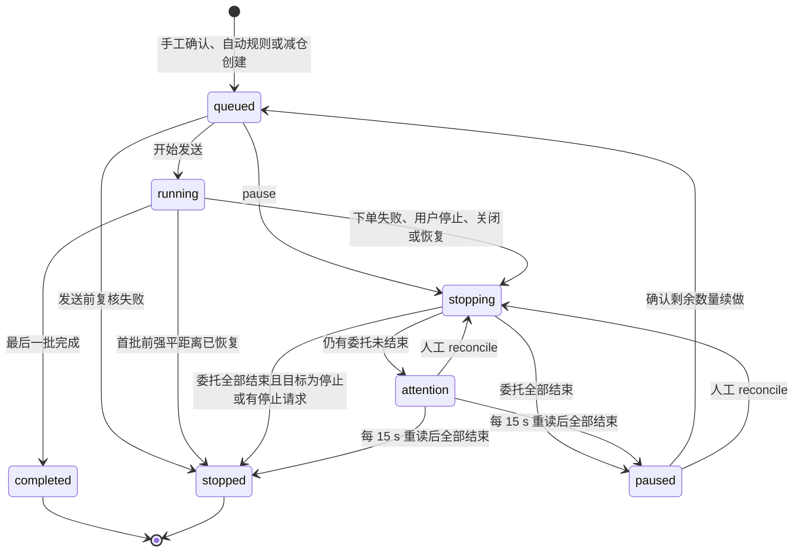
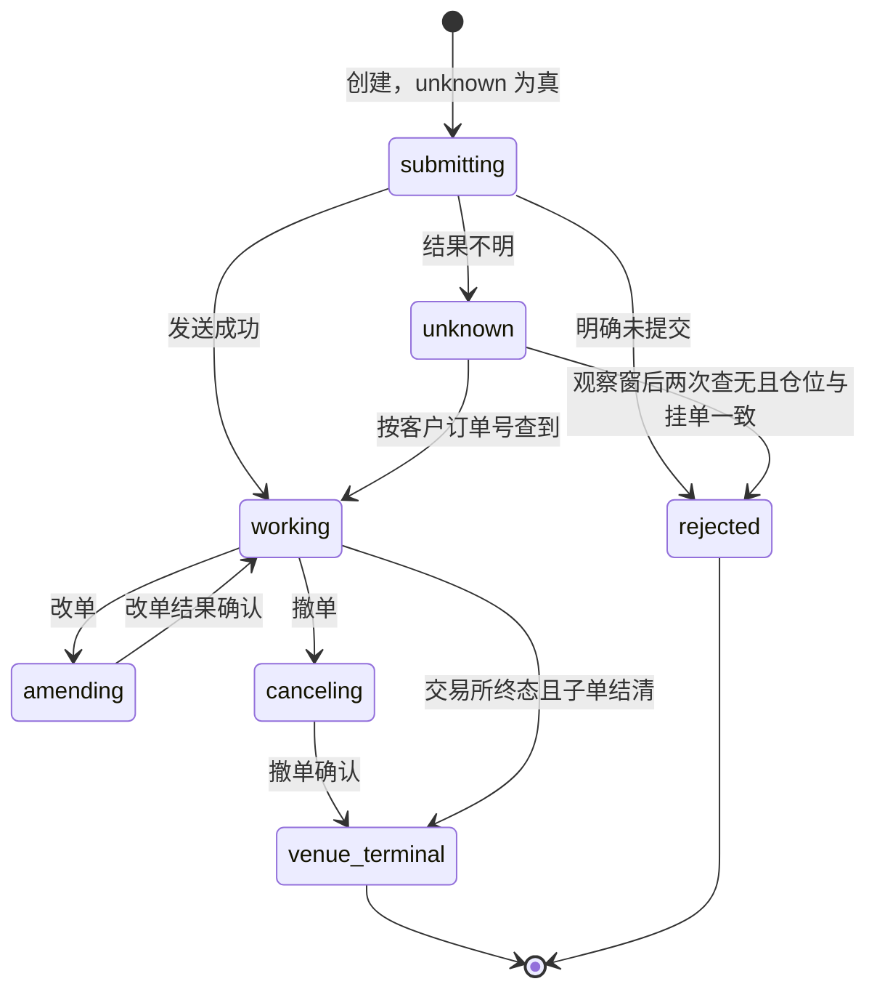
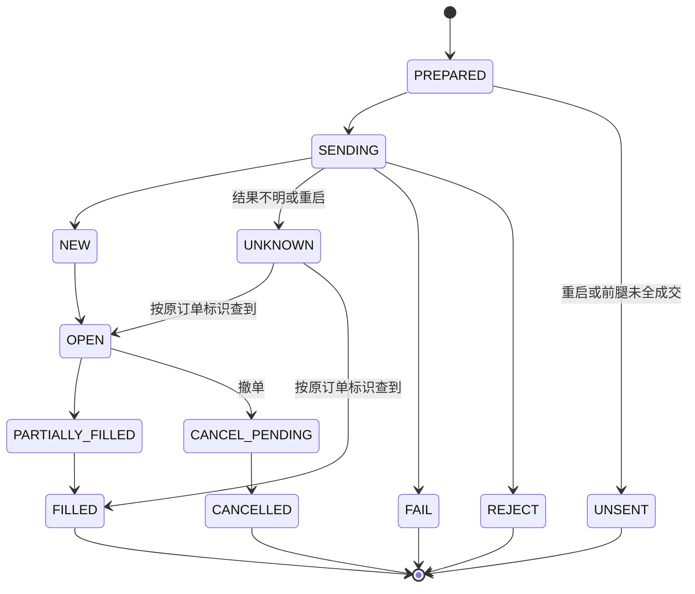
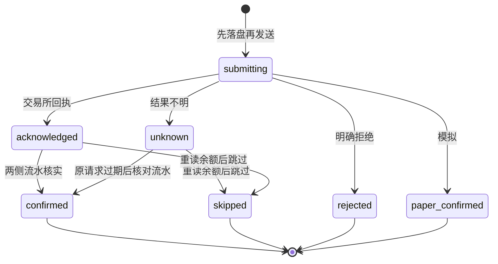
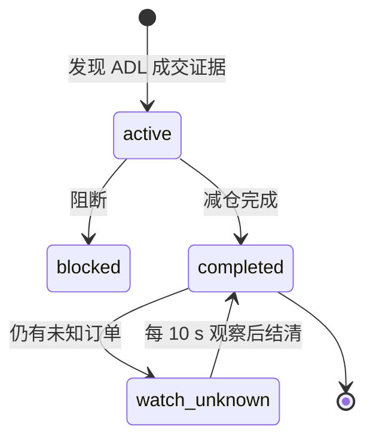
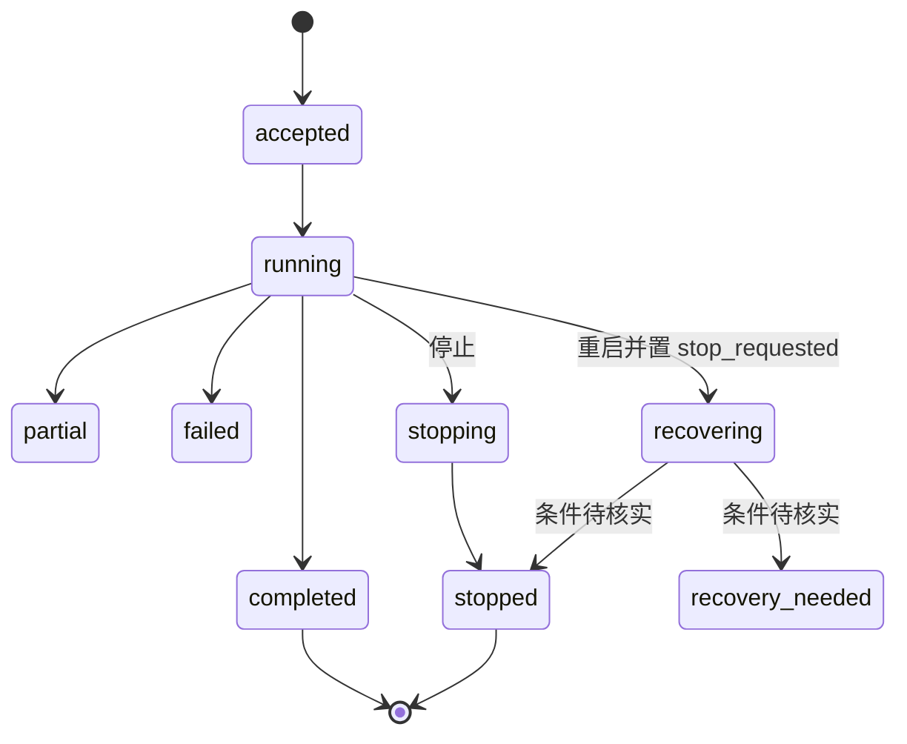
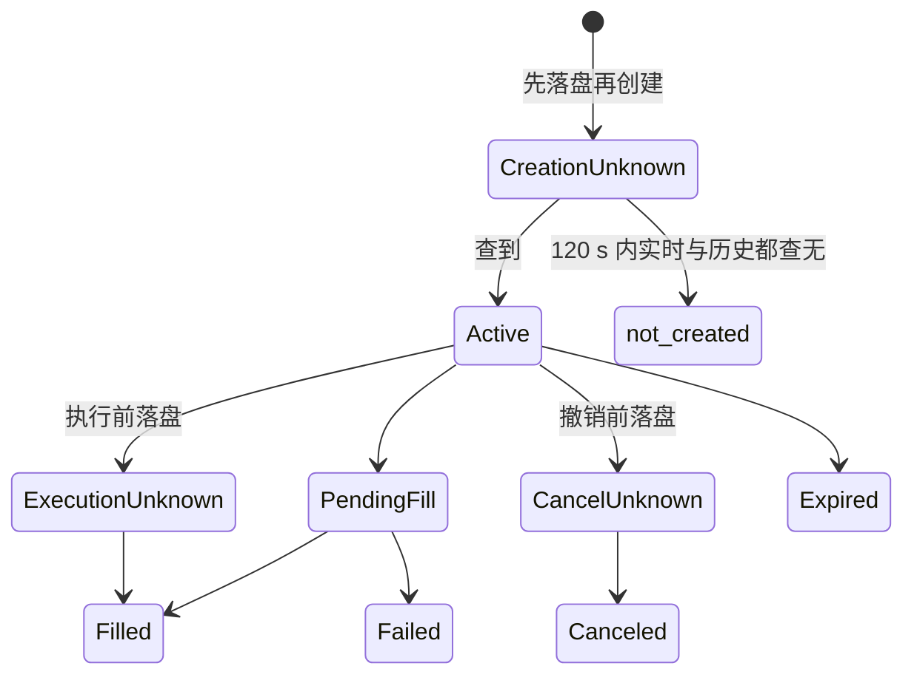
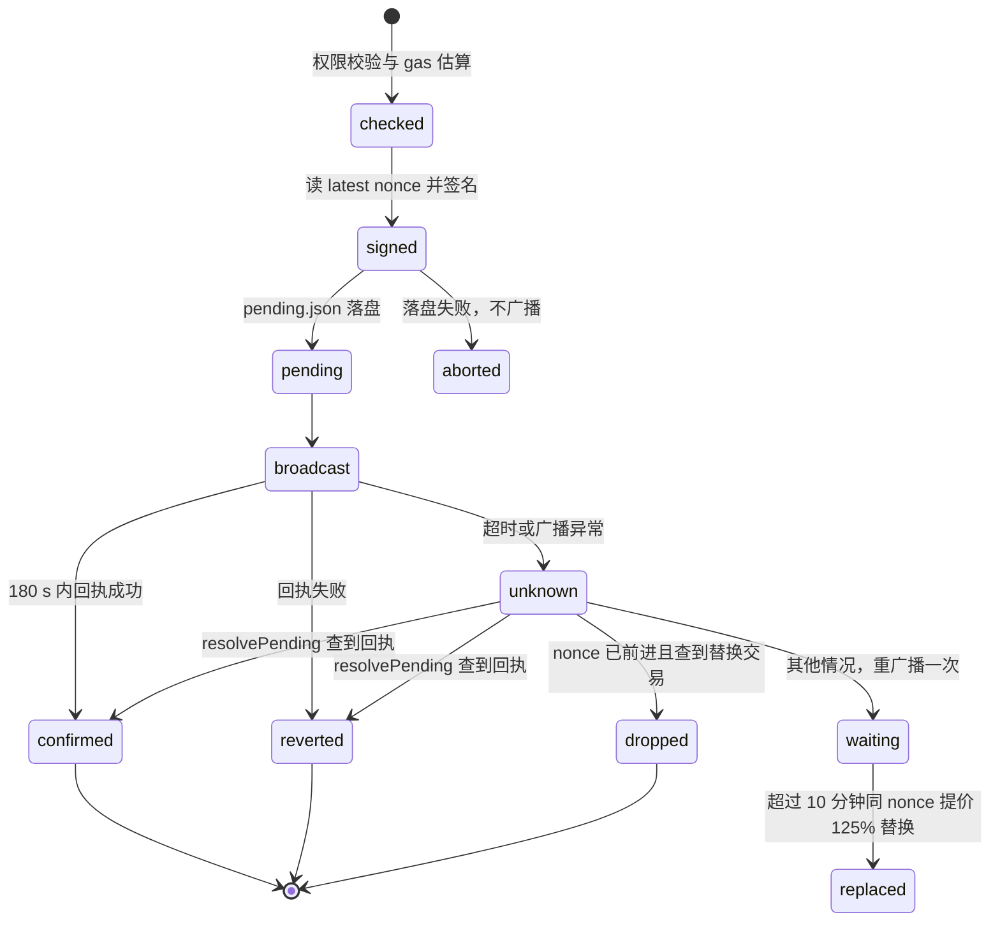
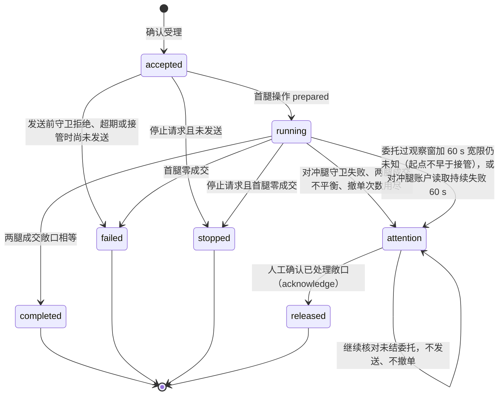
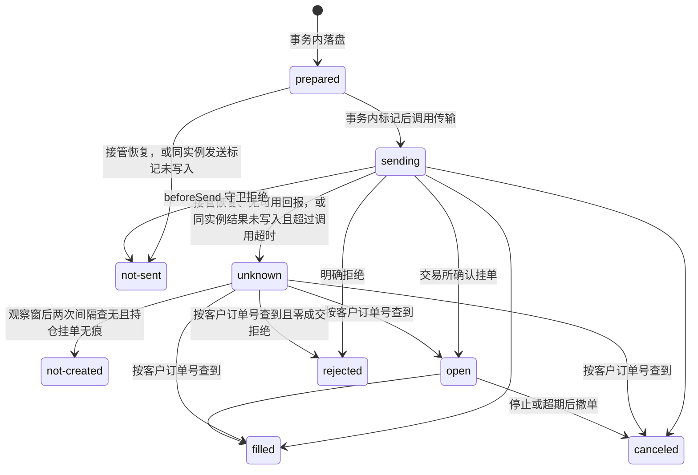

# 统一平台阶段 0 收口盘点

日期：2026-11-11。状态：**阶段 0 收口盘点。旧系统部分为只读源码整理，未运行旧系统测试；新执行器原型部分已运行原型测试与本机测量；未连接真实账户**。对应[总体方案](unified-platform-plan.md) v0.6 与[阶段 0 首批清单](unified-platform-phase0.md)。

## 0 结论与使用说明

- 基线：工作树 `feat/unified-platform` 的 HEAD `f721068`，即主分支 `6039493` 合入方案分支 `27ab74b`。本文行号均以该提交为准；首批清单固定的 `feb56f0` 是更早的基线，两者不混用。
- 来源：四份只读源码盘点，加本文对少量矛盾点的抽查。没有运行任何测试，没有连接交易所或链上账户，没有部署。下文“测试证据”只表示测试代码存在，不表示通过。
- 新执行器原型（`platform/executor/src`）为阶段 1 首切片，仅模拟传输；第 6.8、6.9、7.2、8 节按当前代码与测试记录。
- 已完成：全工作区功能矩阵（111 行）、进程拓扑、数据分类与缺口、凭据位置、旧系统与新原型执行状态图、时效常量、阶段 1 预算登记（含本机测量，非目标服务器）、待核实清单。
- 未完成：收益口径专项、旧测试期望值逐项核对、代表性真实负载采集。原因见第 10 节。
- 用户已确认（2026-11-11）：M15 随 ASTER 在阶段 3 迁移；Aero（D06–D12、S05）与 ASTER 单账户开仓（S06）在阶段 3 迁移；接管后首腿已成交时自动补发对冲腿；接真实账户的前置项全部放进阶段 2。详见第 9 节《用户决定》。其后同日的范围调整：新平台的 ASTER 只保留币种额度监控、保证金平衡划转、ADL 应急处理、账户持仓，S06 改为不迁移，阶段 2 的抢额度时序原型取消。

## 1 编号约定与 F 行关系

| 前缀 | 工作区 | 行数 | 说明 |
| --- | --- | --- | --- |
| Y | 系统 | 15 | |
| A | 总览与资产 | 15 | |
| M | 市场与机会 | 15 | |
| T | 交易中心 | 18 | 原油两腿与 ANT 首批由 F01–F09 覆盖，T 只登记 F 未覆盖的部分 |
| S | 策略与风险 | 16 | S01 与 F08 重叠，S03 即 F09 |
| O | 期权 | 10 | |
| D | 链上（Aero） | 13 | 原盘点编号 C01–C13 依序改为 D01–D13，避免与验收场景 C01–C09 撞号 |
| R | 研究室 | 9 | |

T、S 与首批 F 行的对应：

| F 行 | 对应的 T/S/Y 行 | 关系 |
| --- | --- | --- |
| F01 账户连接 | Y02、T01 | F01 是 Binance/Bybit 执行账户；T01 是只读账本连接与 Asset 导入 |
| F02 报价、盘口、仓位 | T04、T09 | T09 登记执行行情与推送流的其他场所 |
| F03–F05 预览、追踪、证据 | T10 | 原油两腿执行本体不在 T 中重复；T10 只登记证据导出 |
| F06 成交与盈亏 | T04、T11 | T11 登记 ANT 与原生成交归属 |
| F07 Binance ANT 只读 | T11、T12 | |
| F08 同所、四腿、自动规则 | S01、S02 | |
| F09 ANT 组合与减仓 | S03、T06、T07 | HL 与 Lighter RH 执行是现有 ANT 组合的第二场所 |

## 2 功能矩阵

性质取值：只读、本地写入、实盘写入、模拟、已移除、特权。迁移去向取值：原地收敛、阶段 2、阶段 3、不迁移、待核实。阶段编号按总方案 v0.6（v0.7 未改阶段编号）：阶段 1 原油双腿闭环，阶段 2 复杂恢复与选型冻结，阶段 3 逐模块迁移。证据路径相对仓库根。

### 2.1 系统（Y）

| 编号 | 能力与入口 | 性质 | 迁移去向 | 验收案例 | 主要证据 |
| --- | --- | --- | --- | --- | --- |
| Y01 | 工作台登录、登出、会话 `/api/login` `/api/logout` `/api/session` | 特权 | 原地收敛 | 连续 5 次失败锁 30 分钟；同 IP 15 分钟最多 10 次；登录换新会话 ID | `server/api/server.mjs:290-344`；`server/control/login-guard.mjs:8-107` |
| Y02 | 实盘账户连接 `PUT/DELETE /api/trading/execution/accounts/{venue}` | 特权（凭据写入，经更新协调器准入） | 阶段 3 | 维护期间写入被拒；凭据解不开返回 503 并提示重连 | `server/trading-execution.mjs:113,379-383` |
| Y03 | 只读账户连接与写者诊断 `/api/system/accounts` `/api/system/recovery` | 只读，配置写入 | 阶段 3 | 注册表损坏或时钟回退诊断为 unknown，不显示空成功 | `server/runtime/data-plane.mjs:447-448`；`tests/account-writer-diagnostics.test.mjs:27` |
| Y04 | 飞书日报 `/api/automation/feishu-digest/*` | 本地写入，外部发送 | 原地收敛 | 每时段只发一次（重启后不重复）；webhook 不回显 | `server/automation/feishu-digest.mjs:26-33,177` |
| Y05 | 其他通知通道：ANT 监视、Aero、Monitor | 本地写入 | 阶段 3 | webhook 只在发送时解密；文件不可读时停发不崩溃 | `server/trading-anthropic-watch.mjs:177-192`；`modules/monitor/server/notification-store.mjs:26` |
| Y06 | 存活与就绪 `/api/health` `/api/ready` | 只读 | 原地收敛 | 运行时停止时 ready 503、health 200 | `server/api/server.mjs:276-281` |
| Y07 | 模块状态与重启 `/api/system/modules[/:id/restart]` | 只读，特权 | 原地收敛 | 非 fault 模块 restart 返回 409 | `server/api/server.mjs:367-385` |
| Y08 | 负载与平台基线 `/api/system/{host,metrics,event-loop,architecture}` | 只读 | 原地收敛 | 数据面不可用时 host 仍回答；基线保留 28 天且有行数上限 | `server/host-status.mjs:33-83`；`server/observability.mjs:4-6` |
| Y09 | 项目诊断与新鲜度 | 只读 | 原地收敛 | 超 TTL 报 `hub:data-freshness`；上游时间戳不作首次发现时间 | `server/diagnostics.mjs:12-30` |
| Y10 | 备份恢复 CLI 与定时备份、`/api/system/backup-readiness` | 特权 | 原地收敛 | 恢复后能用 `credentials.key` 解开全部凭据；category 漂移时拒绝备份 | `server/recovery/cli.mjs:51`；`server/recovery/maintenance.py:17-26` |
| Y11 | 系统更新 `/api/system/updates*`，经 root updater | 特权 | 原地收敛 | 有未终结实盘任务时拒绝更新；登出撤销在途特权请求 | `server/updates.mjs:7`；`server/update-service/updater.py:34-67` |
| Y12 | 一键安装、双槽切换、模块迁移 | 特权 | 原地收敛 | 重复执行幂等；切换失败回滚旧槽 | `deploy/install.sh:5-41,2912-3019` |
| Y13 | Agent 数据接口 `/api/agent/v1/*` 与令牌管理 | 只读，配置写入 | 原地收敛 | 令牌只显示一次；重置密码撤销全部令牌 | `server/agent-feed/tokens.mjs:8-73`；`server/agent-feed/http.mjs:4-8` |
| Y14 | Portal 模块授权与代登录 | 特权 | 原地收敛 | 只接受唯一且合规的会话 cookie；撤销授权立即失效 | `server/portal-auth.mjs:24-52`；`server/control/portal-store.mjs:36-41` |
| Y15 | 控制面/数据面进程划分与双槽入口 | 基础设施 | 原地收敛 | API 崩溃单独重启且会话保留；运行时退出时 unit 非零结束 | `server/launcher.mjs:12-82`；`server/entry/main.mjs:14-25` |

`server/portal-auth.mjs` 是 Portal 代用户登录内嵌模块，不是工作台自身登录。

### 2.2 总览与资产（A）

资产模块不向交易所下单，交易所同步全部只读。唯一的外部影响是 A14 把已保存的 Key 导出给交易中心。

| 编号 | 能力与入口 | 性质 | 迁移去向 | 验收案例 | 主要证据 |
| --- | --- | --- | --- | --- | --- |
| A01 | 交易所资产同步 `POST /api/sync`，后台每 60 s | 只读（外部），本地写入 | 原地收敛 | 单所失败显示“同步失败 · 保留旧值”，不清零；30 s 内重复同步返回旧账本 | `modules/asset/lib/store.ts:220-330`；`server/asset-sync.mjs:4-15` |
| A02 | 交易所连接管理 `/api/connections` | 本地写入（凭据） | 原地收敛（凭据管理并入系统账户连接） | 换 Key 后旧 Key 的同步结果不写回 | `modules/asset/lib/store.ts:126,157,227-231`；`modules/asset/lib/vault.ts:3` |
| A03 | Aster 多账户 `/api/aster-accounts` | 只读，本地写入 | 原地收敛 | 已删除或换 Key 的账户不被并发同步恢复 | `modules/asset/lib/store.ts:181,207,255-277` |
| A04 | 持仓汇总 `/api/hub/positions` → `/api/trading/positions` | 只读 | 原地收敛 | 数据源超时返回带过期标记的旧持仓 | `modules/asset/lib/hub-positions.ts:41,84`；`server/runtime/data-plane.mjs:473-479` |
| A05 | 成交与周期盈亏 `/api/hub/fills`，回溯 85 天 | 只读 | 原地收敛（统一账本属阶段 3） | 开仓早于 85 天时提示“仅统计最近 85 天” | `modules/asset/lib/positions-cycle.ts:4,88,133`；`server/asset-fills.mjs:3-14` |
| A06 | 手工资产与汇率编辑 `PATCH /api/ledger` | 本地写入 | 原地收敛 | 改数量后当日快照立即重写 | `modules/asset/lib/store.ts:81,91,95` |
| A07 | USD→CNY 汇率（Coinbase，失败取 Frankfurter） | 只读 | 原地收敛 | 取价失败 `fxStatus.error` 有值，同步标 partial | `modules/asset/lib/fx.ts:11-19` |
| A08 | 历史账本导入 `POST /api/import`（预览后 apply） | 本地写入（执行前备份库） | 原地收敛 | 同一文件二次导入返回 `alreadyImported` | `modules/asset/lib/import-ledger.ts:54-98` |
| A09 | 出金登记 `/api/withdrawals` | 本地写入（不发起提现） | 原地收敛 | 调整后资产 = 持有额 + 出金，交易所余额不变 | `modules/asset/lib/withdrawals.ts:27-58` |
| A10 | 资产趋势与月度、年化收益 `/api/history` | 只读 | 原地收敛 | 跨度不足 25 天的月份不显示月收益率 | `modules/asset/lib/performance-metrics.ts:26,62,85` |
| A11 | 现金流标注 `/api/cash-flows`，修改留审计 | 本地写入 | 原地收敛 | 只标注入金的一天不计投资盈利 | `modules/asset/lib/cash-flows.ts:11-85` |
| A12 | 日变化归因 `/api/daily-changes`（90 天） | 只读 | 原地收敛 | 两端持仓不可读时 `complete=false`，不补零 | `modules/asset/lib/daily-changes.ts:9,90,141` |
| A13 | 总览卡片 `/api/hub/summary` → `/api/overview` 与 SSE | 只读 | 原地收敛 | 运行时超 `runtimeStaleMs` 无响应时显示过期 | `modules/asset/lib/hub-summary.ts:22,79-89`；`server/api/server.mjs:186-197` |
| A14 | Key 导出给交易中心 `/api/hub/trading-connections/export` | 凭据传递（接收方可用于实盘） | 阶段 3（凭据与执行主体绑定） | 未带工作台密钥的请求被拒 | `modules/asset/lib/trading-export.ts:98,150`；`server/trading-import.mjs:102` |
| A15 | Var 访问诊断 | 只读 | 原地收敛 | 诊断不暴露会话内容 | `modules/asset/lib/variational-diagnostics.ts:79,87` |

口径提示：A05 只算 85 天，A12 只算 90 天，不能写成完整盈亏核算；A08 导入会归档全部原快照。

### 2.3 市场与机会（M）

路由统一为 `/api/monitors/{id}/{action}`，分发在 `modules/monitor/server/http.mjs:41-149`。

| 编号 | 能力与入口 | 性质 | 迁移去向 | 验收案例 | 主要证据 |
| --- | --- | --- | --- | --- | --- |
| M01 | 原油价差行情、日线、15m K 线、资金费 | 只读 | 原地收敛 | 写库失败返回 `status:"snapshot"` 加 stale | `modules/monitor/server/market-collector.mjs:29-55`；`modules/monitor/server/monitor-services.mjs:53` |
| M02 | 海力士 ADR 行情、历史、资金费；旧接口 `/api/quote` 兼容 | 只读 | 原地收敛 | 旧路径与新路径结果一致 | `modules/monitor/server/http.mjs:115-126` |
| M03 | Anthropic 每股价差与 K 线 | 只读 | 原地收敛 | 只有 quote 与 candles，无告警 | `modules/monitor/server/monitor-services.mjs:122-129` |
| M04 | 永续全市场报价与 SSE | 只读 | 原地收敛（统一行情层） | 部分交易所断线时 `status:"partial"` 并列出缺失 | `modules/monitor/modules/perpetual/exchanges.mjs:11-20`；`modules/monitor/server/perpetual-service.mjs:510-534` |
| M05 | 价差与机会筛选、质量 | 只读 | 原地收敛 | 已公告下架合约被排除 | `modules/monitor/server/perpetual-opportunities-v2.mjs:7,26,48` |
| M06 | 资金费、价格历史、合约指标 | 只读 | 原地收敛 | 新上市合约不当作完整窗口 | `modules/monitor/server/perpetual-funding-history.mjs:4,21` |
| M07 | 盘口深度与退出成本估算 | 只读（估算） | 原地收敛 | 已到下架时间提示核实能否平仓 | `modules/monitor/server/perpetual-depth.mjs:27,107,158` |
| M08 | 纸面持仓 `paper` | 模拟 | 原地收敛 | 最多 20 个活跃；平仓 30 天后清除 | `modules/monitor/server/perpetual-paper-service.mjs:51,71-76` |
| M09 | 价差告警（油价、海力士、永续机会） | 本地写入，外部通知 | 原地收敛 | 采集不健康时暂停告警 | `modules/monitor/server/perpetual-alert-service.mjs:13,115`；`modules/monitor/server/monitor-services.mjs:50` |
| M10 | 统一飞书通知配置与测试 | 外部写入（只发消息） | 原地收敛（并入系统通知） | 跨站 PUT 403，非 JSON 415 | `modules/monitor/server/notification-store.mjs:6-41` |
| M11 | 监控运行开关 | 本地写入 | 原地收敛 | 关闭后停止采集和告警 | `modules/monitor/server/monitor-control.mjs:9,37` |
| M12 | Var 会话 token | 本地写入（凭据） | 原地收敛 | token 过期时只有 Var 腿不可用 | `modules/monitor/server/variational-session.mjs:9-30` |
| M13 | CrossEx 资格筛选与导入预填 | 只读 | 原地收敛（下单在 T16） | 已公告下架合约拒绝导入 | `modules/monitor/lib/crossex-import.ts:51,67` |
| M14 | 关联持仓与成交标记 | 只读 | 原地收敛 | 未登录工作台时显示“未登录工作台” | `modules/monitor/lib/hub-bridge.ts:182,261` |
| M15 | 上新与额度监控（方案第 2 节所列） | 归属 ASTER（见 S13/S14），市场工作区无独立实现 | 阶段 3（随 ASTER 迁移，用户已确认） | — | monitor 只有下架字段 `modules/monitor/server/perpetual-service.mjs:157-168`；上新与额度告警在 `modules/aster/trading/server.py:513-531` |

M15 抽查：monitor 源码中 `listing` 相关命中都是下架时间或“新上市窗口不完整”，没有上新告警；ASTER 的 `PATCH /api/listings/{symbol}/capacity-alert` 才是上新额度提醒。

### 2.4 交易中心（T）

| 编号 | 能力与入口 | 性质 | 迁移去向 | 验收案例 | 主要证据 |
| --- | --- | --- | --- | --- | --- |
| T01 | 只读账本连接（含 OKX）与从 Asset 导入 | 只读（本地存加密凭据） | 原地收敛 | 版本号已变返回 409 不保存；OKX 缺 Passphrase 返回 400 | `server/trading.mjs:506-555`；`server/trading-import.mjs:42-45` |
| T02 | 只读读取诊断（权限、模式、分页、上限错误码） | 只读 | 原地收敛 | 只显示有界错误码，不出现上游原文、URL 或凭据 | `server/trading-diagnostics.mjs:1-20` |
| T03 | 全部仓位（Asset 聚合） | 只读 | 原地收敛 | 只打开“全部仓位”不触发套利读取 | `src/TradingPage.tsx:25-27,54` |
| T04 | 交易所配对选择与海力士仓位 `GET /api/trading` | 只读 | 原地收敛 | `binance,okx` 时海力士腿单独显示 | `server/trading-markets.mjs:12-16,35-44` |
| T05 | OKX 实盘执行（cross/isolated，按张） | 实盘写入 | 阶段 3 | 保证金模式不一致拒绝；限流码 50011 走限流重试 | `server/trading-okx-execution.mjs:25`；`server/trading-execution-exchanges.mjs:304-306` |
| T06 | Hyperliquid 执行（API agent 钱包） | 实盘写入 | 阶段 3 | 填主钱包私钥或 agent 未授权时提示权限错误，不发送 | `server/trading-hyperliquid-execution.mjs:129,149-152` |
| T07 | Lighter RH 执行（签名 worker，原单改价） | 实盘写入 | 阶段 3 | 本地拒发记 rejected，最多延后 30 次；已签名交易 10 分钟内保持未知 | `server/trading-rh-lighter-execution.mjs:23,118`；`server/trading-execution.mjs:51-57,1042-1047` |
| T08 | 海力士价差执行 | 实盘写入 | 阶段 3 | 只在场所白名单合约上生成腿 | `server/trading-markets.mjs:6-11,18-23` |
| T09 | 执行行情与推送流（Binance 执行 WS、Lighter WS） | 只读 | 阶段 3 | 单腿超时显示“交易所请求超时”，2 s 内复用同次读取 | `server/trading-execution.mjs:97,642-660`；`server/trading-binance-stream.mjs:5-13` |
| T10 | 执行证据导出 `/jobs/{id}/evidence` | 只读（持久状态投影） | 阶段 3 | 只对 ANT 平仓且 completed/stopped 的任务给成本；不存在 404 | `server/trading-execution-evidence.mjs:13-15` |
| T11 | 成交归属 `/api/trading/fills?market=oil\|anthropic` | 只读 | 阶段 3 | 只按已核验账户和订单号归属，不按时间推断配对 | `server/trading-fill-attribution.mjs:12-24` |
| T12 | ANT 仓位监视与飞书预警 | 只读（外部通知） | 阶段 3 | 仓位超 75 s 显示过期；按阈值与重复间隔发送 | `server/trading-anthropic-watch.mjs:36-42`；`server/trading-execution-position-watch.mjs:68-72` |
| T13 | 账户写者与恢复诊断 | 只读 | 原地收敛 | 被隔离账户显示原因与开始时间 | `server/execution/account-writer.mjs:440-452` |
| T14 | CrossEx 连接与账户读取 | 只读（存凭据） | 阶段 3 | 缓存超 15 s 拒绝交易并提示“未完整同步” | `modules/crossex/server/live-runtime.mjs:345,528` |
| T15 | CrossEx 机会、行情、K 线 | 只读 | 阶段 3 | 汇率超 180 s 视为过期，不进估值 | `modules/crossex/server/clients.mjs:8-20`；`modules/crossex/server/funding-opportunities.mjs:6` |
| T16 | CrossEx 预览、容量、确认、撤单、请求状态 | 实盘写入 | 阶段 3 | 前腿未全成交时后腿记 UNSENT；结果不明记 UNKNOWN 不重发 | `modules/crossex/server/market.mjs:283,392,468`；`modules/crossex/server/live-runtime.mjs:818-900` |
| T17 | CrossEx 资金费、历史与 Hub 摘要 | 只读 | 阶段 3 | `schemaVersion=2` 时带 health | `modules/crossex/server/position-funding.mjs:6-7` |
| T18 | CrossEx 模拟交易 `/api/open` `/api/close` `/api/execution` | 已移除（返回 410） | 不迁移（阶段 3 只清理旧表） | 调用返回 410 | `modules/crossex/server/app.mjs:122`；`modules/crossex/server/store.mjs:15-19` |

### 2.5 策略与风险（S）

方案阶段 2 只做 ASTER 划转或 ADL 的复杂恢复切片，以及 ADL 与划转的时序测量（方案 v0.7 取消了抢额度时序原型）；ASTER 页面与数据的整体迁移在阶段 3，范围限于币种额度监控、保证金平衡划转、ADL 应急处理、账户持仓。原盘点把 S08–S12 标为阶段 2，本文改为“阶段 2 切片 / 阶段 3 迁移”或“阶段 3”。

| 编号 | 能力与入口 | 性质 | 迁移去向 | 验收案例 | 主要证据 |
| --- | --- | --- | --- | --- | --- |
| S01 | 自动规则观察与转实盘（与 F08 重叠） | 观察只读；实盘写入 | 阶段 3 | 须走 `live` 单独确认才转实盘；转后连续计数清零 | `server/trading-auto.mjs:150,207-283` |
| S02 | 自动敞口预览 | 只读 | 阶段 3 | 读取期间任务变化提示重刷；不跨方向轧差 | `server/trading-auto-exposure.mjs:9,22-40` |
| S03 | ANT 自动减仓与强平保护（F09） | 实盘写入 | 阶段 3 | 风险证据超 30 s 不触发；上一轮未完整确认不开始下一轮 | `server/trading-anthropic-reduction.mjs:8,72-152`；`server/trading-reduction-plan.mjs:4-6` |
| S04 | 飞书汇总（与 Y04 同一实现，从策略视角登记） | 只读（外部通知） | 原地收敛 | 来源超 20 s 未返回时该节标缺失 | `server/automation/feishu-digest-sources.mjs:8-13` |
| S05 | Aero Safe 链上执行（D06–D12 的总入口） | 实盘写入（链上） | 阶段 3（用户已确认） | 写者恢复状态非 normal 拒绝执行；`pending.json` 损坏返回 409 | `server/runtime/data-plane.mjs:393-419`；`server/automation/aero-safe.mjs:20-46` |
| S06 | ASTER 单账户普通开仓 | 实盘写入（需 `ASTER_ALLOW_LIVE=1`） | 不迁移（用户决定，2026-11-11；旧系统保留到该账户接管） | 未设开关时启动报错 | `modules/aster/trading/engine.py:239,878`；`modules/aster/trading/execution.py:93,272-295` |
| S07 | ASTER 模拟账户 `mode=paper` | 模拟 | 阶段 3 | 不设实盘开关可运行，划转记 `paper_confirmed` | `modules/aster/trading/paper.py` |
| S08 | ASTER 配对组管理（只绑定账户） | 本地写入（不下单） | 阶段 3 | 运行中、ADL 未完成或划转未核实时拒绝删除 | `modules/aster/trading/pairing.py:122,231,367` |
| S09 | ASTER 配对保证金平衡（子账户划转） | 实盘写入 | 阶段 2 切片 / 阶段 3 迁移 | 结果未知的划转不重发，等原请求过期后核对流水再结算 | `modules/aster/trading/margin_balance.py:40-118,1544,1784-1869` |
| S10 | ASTER 划转档案与备注 | 只读（本地备注写入） | 阶段 3 | 档案最多返回 50 条 | `modules/aster/trading/margin_archive.py:10` |
| S11 | ASTER ADL 监测与应急减仓 | 实盘写入 | 阶段 2 切片 / 阶段 3 迁移 | 只减有 ADL 成交证据的多出一侧；原单最多查 3 次，满 120 s 重读现场 | `modules/aster/trading/adl.py:28-37,404-423`；`modules/aster/trading/adl_recovery.py:11-14` |
| S12 | ASTER ADL 处理报告 | 只读 | 阶段 3 | 打开报告不触发交易所请求 | `modules/aster/trading/adl_view.py:13` |
| S13 | ASTER 币种监控、上新与额度告警、失衡通知 | 只读（外部通知） | 原地收敛（M15 随 ASTER 在阶段 3 迁移） | 快照超 8 s 不作失衡样本 | `modules/aster/trading/server.py:513-531`；`modules/aster/trading/monitoring.py:26` |
| S14 | ASTER 额度中继（XAU/XAG）与 Hub 摘要 | 只读 | 原地收敛（只服务额度监控，不再作为时序原型的对照） | 中继数据过期时显示过期，不用于开仓 | `modules/aster/trading/capacity_relay_client.py:48-50` |
| S15 | 配对组普通开仓、补单、底仓采纳等 | 已移除 | 不迁移（阶段 3 兼容旧数据） | 启动丢弃旧批次并归档；提交 `ordinary` 返回 422 | `modules/aster/trading/pair_legacy.py`；`modules/aster/docs/README.md:17-24` |
| S16 | 单账户多空循环、仓位迁移、配对循环 | 已移除 | 不迁移（阶段 3 兼容旧数据） | 有旧批次的账户保持暂停待人工核对 | `modules/aster/trading/account_legacy.py`；`modules/aster/docs/README.md:26-36` |

### 2.6 期权（O）

| 编号 | 能力与入口 | 性质 | 迁移去向 | 验收案例 | 主要证据 |
| --- | --- | --- | --- | --- | --- |
| O01 | 期权链与行情，后台每 10 s 刷新 | 只读 | 原地收敛 | 行情超 30 s 时 `/api/dashboard/market` 503，不生成策略 | `modules/greeks/app/main.py:160-205`；`modules/greeks/app/engine.py:778-786` |
| O02 | 持仓 Greeks、账户健康、日志 | 只读 | 原地收敛 | 行情过期时 Greeks 汇总标不可用 | `modules/greeks/app/main.py:207-264` |
| O03 | 策略预览（iron condor / short strangle） | 模拟（只读计算） | 原地收敛 | 合约未上线返回 `waiting_for_listing` 且 `read_only: true` | `modules/greeks/app/strategy.py` |
| O04 | 开平仓计划 `POST /api/trading/plans`，有效 30 s | 只读（计划，只在内存） | 阶段 3 | 计划过期后提交被拒 | `modules/greeks/app/trade_tasks.py:16,156-200` |
| O05 | 开平仓任务（BBO 跟价限价，可选 IOC 兜底） | 实盘写入 | 阶段 3 | 同一 `request_id` 重复提交只产生一个任务 | `modules/greeks/app/trade_tasks.py:222-330`；`modules/greeks/app/orders.py:98-216` |
| O06 | 定时自动开仓（周五 21:00 UTC，默认关闭） | 实盘写入 | 阶段 3 | 同一 ISO 周只生成一次 `scheduled-<week>` | `modules/greeks/app/engine.py:765-776` |
| O07 | RFQ 询价、成交、撤销 | 实盘写入 | 阶段 3 | 撤单结果丢失后重启仍为 `CancelUnknown` 并阻断新开仓 | `modules/greeks/app/rfq.py:35-133,259-305,402-420` |
| O08 | 对账与健康，后台 15 s | 只读 | 原地收敛 | 有未决订单或 RFQ 时 `/api/health` 为 degraded | `modules/greeks/app/reconciliation.py:185,252-276` |
| O09 | 收益与绩效，60 s 盯市采样 | 只读 | 阶段 3（随状态文件迁移） | 采样失败保留已有点，不补造 | `modules/greeks/app/performance.py:325-410` |
| O10 | 旧直开直平 `/api/trading/open` `/close` | 已移除（固定 409） | 不迁移 | 调用返回 409 提示走 plans → tasks | `modules/greeks/app/main.py:287-294` |

### 2.7 链上（D，原编号 C）

编号映射：原盘点 C01–C13 依序改为 D01–D13（C01→D01 … C13→D13），内容不变。总方案第 2 节列出了链上工作区，但第 7 节阶段 3 只写“Aero 与研究”，没有单独给出收敛或迁移方式；只读研究部分（D01–D05）保留原地收敛；Safe 执行部分（D06–D12）与总入口 S05 经用户确认在阶段 3 迁移。

| 编号 | 能力与入口 | 性质 | 迁移去向 | 验收案例 | 主要证据 |
| --- | --- | --- | --- | --- | --- |
| D01 | 多链池扫描 `/api/research/aero-market`（手动刷新间隔 ≥ 30 s） | 只读 | 原地收敛 | 单轮超 5 分钟中止，保留上一轮 | `server/research/aero-market.mjs:28,49,174-193` |
| D02 | 池详情、价格历史与流动性分布 | 只读 | 原地收敛 | 60 s 内重复请求共享读取，失败不缓存 | `server/research/aero-market.mjs:53-56,602` |
| D03 | 小时样本与窗口均值 | 只读（观测） | 原地收敛 | 超 30 天样本清理，其余重启后仍在 | `server/research/aero-market-samples.mjs:6-9,130` |
| D04 | LP 区间策略回放，最多 250 池 | 模拟 | 原地收敛 | 历史不足 6 小时返回 `insufficient_history` | `server/research/aero-market-replay.mjs:15,80` |
| D05 | 收藏池，最多 500 | 本地写入 | 原地收敛 | 重启后顺序保持；文件损坏回退并提示 | `server/research/aero-market.mjs:57,177` |
| D06 | Safe 配置与 bot 私钥 | 本地写入（实盘配置、凭据） | 阶段 3 | 私钥加密保存，任何接口不回显 | `server/automation/aero-safe.mjs:75-89,1293-1298` |
| D07 | Safe 仓位、余额、nonce 读取（刷新间隔 ≥ 5 s，预算 60 s） | 只读 | 阶段 3 | 读取超 60 s 报错，原快照保留 | `tools/aero-roles/executor.mjs:398-458`；`server/automation/aero-safe.mjs:565-590` |
| D08 | 手动链上操作（开、平、减、退池、质押、解押、领取、卖出、兑换），预览 2 分钟 | 实盘写入 | 阶段 3 | `pending.json` 写失败时不广播 | `server/automation/aero-safe.mjs:42,606-616,1345-1371`；`tools/aero-roles/executor.mjs:488-541` |
| D09 | 自动调仓（出区间满 5 分钟平仓并居中重开），30 s 一轮 | 实盘写入 | 阶段 3 | 平仓中断后自动调仓停用待人工核对 | `server/automation/aero-auto.mjs:7,105-199` |
| D10 | 单池仓位策略与美元上限 | 本地写入 | 阶段 3 | `policy.json` 损坏时禁止加仓并暂停自动调仓 | `server/automation/aero-safe.mjs:984-988` |
| D11 | Roles 白名单与权限变更批次 | 本地写入（实盘配置；是否由 bot 发送待核实） | 阶段 3 | 加池批次只含变化作用域，不重置已有额度 | `server/automation/aero-safe.mjs:10,1020-1023` |
| D12 | 状态通知（中断、需核对、恢复） | 外部写入 | 阶段 3 | 发送失败重试 3 次、间隔 60 s | `server/automation/aero-notifications.mjs:10-14` |
| D13 | 资产模块中的 Aero LP 估值 | 已移除 | 不迁移 | 资产总额不含 `mode='aero'` 行 | `modules/asset/drizzle/0004_remove_aero_lp.sql` |

### 2.8 研究室（R）

研究室不使用账户凭据，也没有实盘写入。

| 编号 | 能力与入口 | 性质 | 迁移去向 | 验收案例 | 主要证据 |
| --- | --- | --- | --- | --- | --- |
| R01 | Entropy/Lighter 采集与会话报告（子进程） | 只读 | 原地收敛 | 子进程退出按 1/2/4/8/16 s 重试，用尽显示 `fault` | `server/research/entropy-lighter.mjs:37-188` |
| R02 | 纸面交易模拟 | 模拟 | 原地收敛 | 上次留有未决敞口时新会话只采集，并写 `unresolved-paper.json` | `tools/entropy-lighter-lab/cli.mjs:296-300` |
| R03 | Binance 方向剥头皮实验 | 模拟 | 原地收敛 | 退出超时时情景总净收益为 `null` | `tools/entropy-lighter-lab/binance-scalper.mjs` |
| R04 | Entropy 费率自动获取 | 只读 | 原地收敛 | 获取失败暂停新增模拟信号，采集继续 | `docs/entropy-lighter-lab.md:50-52` |
| R05 | 研究证据导出（窗口 ≤ 24 h） | 只读 | 原地收敛 | 段文件被清理时标出 `segments_missing_or_cleaned` | `tools/entropy-lighter-lab/evidence.mjs:8-12,141` |
| R06 | 研究洞察面板 | 只读（派生） | 原地收敛 | 报告超 15 s 未更新撤回当前判断 | `server/research/entropy-lighter-insights.mjs` |
| R07 | Binance/Lighter 库存报价成本模拟 | 模拟 | 原地收敛 | 并发多次启动只建一个会话 | `server/research/binance-lighter-cost.mjs:210-225` |
| R08 | 单情景明细 | 只读 | 原地收敛 | 只返回最近 200 笔成交、300 个曲线点、30 条事件 | `server/runtime/data-plane.mjs:301-302` |
| R09 | 报告归档与旧版报告 | 本地写入（业务记录） | 原地收敛 | 归档失败时库存保留，可幂等重试 | `server/research/binance-lighter-cost.mjs:12-13,415-417` |

## 3 进程拓扑

| 进程 | 职责 | IPC | systemd 单元 | 位置 |
| --- | --- | --- | --- | --- |
| 运行时（数据面） | 持有 `.runtime.lock`；启动内嵌模块；唯一持有 `credentials.key` | HTTP-over-Unix-socket，发现文件 `run/runtime.json` | `project-aggregation.service`（停止 150 s） | `server/runtime/main.mjs:48-150` |
| API（控制面） | 会话、更新协调、配置、Portal、总览流、静态文件 | 经 socket 访问运行时，直连模块 socket | `project-aggregation-api.service`（75 s） | `server/api/main.mjs:55-153` |
| API 槽 a/b | 候选槽 query-only 打开库，`POST /promote` 后服务 | 私有 `probe.sock`、`ctl.sock`、`http.sock` | `project-aggregation-api@{a,b}.service` | `server/api/main.mjs:34-41,110-148` |
| 稳定入口 | 持有公网端口，转发到目标槽 | TCP 到 Unix socket | `project-aggregation-entry.service`（15 s） | `server/entry/main.mjs:56-235` |
| launcher | 非 systemd 拆分模式，先运行时后 API | `child_process.fork` IPC | 无 | `server/launcher.mjs:21-104` |
| 单进程工作台 | Windows 与本地开发 | 进程内 | 无 | `server/workbench.mjs:13-68` |
| 内嵌模块 worker | monitor、asset、crossex（Node）；greeks、aster（Python） | 每模块一个 socket 或 named pipe，带 secret | 随运行时 | `server/modules/runtime.mjs:53,148` |
| 更新服务 | root 更新协调与一次性 worker | `/run/project-aggregation-updater/control.sock` | `project-aggregation-updater.service`、`-update-worker.service` | `server/update-service/updater.py:34-37` |
| 定时备份 | timer 每分钟检查窗口 | 调用 `server/recovery/cli.mjs` | `project-aggregation-backup.{timer,service}` | `server/recovery/maintenance.py:21-22` |
| 附属服务 | Aster 额度中继、熵实验室、main-watch | 各自独立 | `aster-capacity-relay`、`entropy-lighter-lab`、`main-watch*` | `deploy/install-aster-relay.sh:22` |

新执行器原型目前只是库代码，没有入口进程或 systemd 单元；阶段 1 需要新增独立入口与数据目录，并登记到本表。

## 4 数据分类

### 4.1 总表

备份规则：`server/recovery/inventory.mjs:118-140` 遍历整个 DATA_DIR，只排除锁、socket、`-wal`/`-shm`、`.tmp` 和顶层 `run/`；未在 `DATA_CATALOG`（`server/recovery/data-catalog.mjs:35-53`）登记的路径统一归 `secrets`。所以下表除 DATA_DIR 外的项都会进入备份，“登记”列只说明是否显式登记及分类。

| 存储（相对 DATA_DIR） | 拥有者 | 性质 | 保留期限 | 重建来源 | 登记与分类 | checkpoint |
| --- | --- | --- | --- | --- | --- | --- |
| `hub.sqlite`：`execution_jobs`、`execution_orders` | hub | 业务权威 | 未定义（任务事件只留 80 条） | 无 | 登记，data，必需 | 有 |
| `hub.sqlite`：`execution_stop_requests`、`execution_locks`、`execution_lease` | hub | 业务权威（运行控制） | 锁随任务结束删除；租约关闭时删除 | 无 | 同上 | stop_requests、locks 有 |
| `hub.sqlite`：`execution_previews`、`execution_requests` | hub | 业务权威（幂等记录） | 未消费过期预览下次预览时删；其余未定义 | 无 | 随整库 | 无 |
| `hub.sqlite`：`execution_accounts`、`trading_accounts`、`projects` | hub | 凭据（加密）+ 身份；`trading_accounts` 含可重拉快照 | 未定义；资金费回看 30 天 | 重新连接；快照可重拉 | 随整库 | 有 |
| `hub.sqlite`：`execution_auto_rules`、`execution_anthropic_reduction` | hub | 业务权威（配置与状态） | 规则删除时删 | 无 | 随整库 | 无 |
| `hub.sqlite`：`trading_views_v2` | hub | 可重拉缓存 | 重建时清空 | 由快照重算 | 随整库 | 无 |
| `hub.sqlite`：`trading_pnl_samples_v2` | hub | 不可重采观测 | 31 天，换连接版本即删 | 无 | 随整库 | 无 |
| `hub.sqlite`：`sessions`、`settings`、`portal_*`、`platform_baseline_samples` | hub | 运行态 / 配置 / 观测 | 会话 7 天；基线 28 天 | 无 | 随整库 | 无 |
| `execution-control.sqlite`：`aw_operations`、`aw_isolations` 及 `.required` | shared | 业务权威（写者归属与未决操作） | 未定义 | 无 | 登记，data，必需 | 有 |
| `credentials.key` | hub | 密钥 | 永久 | 无 | 登记，secrets | — |
| `modules/monitor/market.sqlite` | monitor | 观测：K 线与资金费可重拉，报价序列不可重采 | 观测 360 天，每日清理 | 交易所历史与内置归档 | 登记，data | 无 |
| `modules/monitor/perpetual/market.sqlite` | monitor | `quotes` 可重拉；`quality_samples` 不可重采；历史缓存可重拉 | 质量 24 h 或 1440 条；缓存每表 5000 条 | 公共 WS/REST | 登记，data | 无 |
| `modules/monitor/*.json`（告警、通知、开关、Var 会话、纸面、机会告警、CrossEx 设置、油价 monitor.json） | monitor | 配置、凭据、告警记录、模拟记录混合 | 事件 100 条；纸面 30 天；其余未定义 | 无 | 未登记 → secrets | 无 |
| `modules/asset/ledger.sqlite`：`assets`、`settings`、`snapshots` | asset | 业务权威（手工资产、出金、现金流审计、原表）与不可重采观测（每日快照） | 未定义 | 手工部分无；余额可重新同步 | 登记，data | 只查 `connections`（optional） |
| `ledger.sqlite`：`connections` | asset | 凭据（加密） | 删除连接时清除 | 重新录入 | 同上，key 为 `config.json` | 有（optional） |
| `ledger.sqlite`：`fill_cache`、`sync_locks`、`auth_attempts` | asset | 可重拉缓存 / 运行态 | 回溯 85 天；行级未定义 | 交易所 | 同上 | 无 |
| `modules/asset/config.json` | asset | 密钥与配置 | — | 丢失则 connections 无法解密 | 登记，secrets | — |
| `modules/asset/backups/before-import-*.sqlite` | asset | 导入前备份 | 未定义，不自动清理 | — | 登记（pattern） | 无 |
| `modules/asset/imported-ledger.json` | asset | 导入种子 | 未定义 | 原表 | 未登记 → secrets | 无 |
| `modules/crossex/crossex.sqlite`：`live_executions`、`live_orders`、`live_requests`、`live_previews` | crossex | 业务权威 | 未定义 | 无 | 登记，data | executions、orders 有 |
| `crossex.sqlite`：`live_connection`、`live_cache`、`settings` | crossex | 凭据（加密）/ 可重拉缓存 / 配置 | 断开连接时删 | 缓存可从 Gate 重拉 | 同上 | 有 |
| `crossex.sqlite`：`live_trades`、`live_account_book`、`live_supplemental` | crossex | 可重拉缓存（受限） | 回看 7 天 | 超 7 天无法重拉 | 随整库 | 无 |
| `crossex.sqlite`：`positions`、`executions`、`samples`（旧模拟） | crossex | 旧业务记录 | `samples` 截断，其余未定义 | 无 | 随整库 | 无 |
| `modules/crossex/credentials.key` | crossex | 密钥 | 永久 | 无 | 登记，secrets | — |
| `modules/greeks/engine_state.json` | greeks | 业务权威（订单台账、任务、RFQ、成交、绩效采样） | 未定义；成交同步回溯 ≤ 729 天 | 成交可部分重拉；任务与订单关联无法重建 | 登记，**secrets** | 只核大小 |
| `modules/greeks/.env` | greeks | 凭据（明文） | — | 人工填写 | 登记，secrets | 只核大小 |
| `modules/aster/trading.sqlite3`：`accounts`、`deleted_accounts`、`pairs`、`pair_members`、`intents`、kv | aster | 业务权威 | 划转档案显示 50 条，其余未定义 | 无 | 登记，data | 有，但 `pair_members` 不在其中 |
| `trading.sqlite3`：`events`、`outbox`、仓位观测 | aster | 观测与通知队列 | `outbox` 按 `expires_at`；`events` 未定义 | 无 | 随整库 | 无 |
| `modules/aster/.env` | aster | 凭据（明文） | — | 人工填写 | 登记，secrets | 无 |
| `aero-safe/{config,policy,changes,auto,minted,permission-history,notifications}.json` | hub/aero | 业务权威 | 按条数或大小限制，`config`/`policy` 未定义 | 无（`auto.json` 的 `closing`/`reopen` 无法重建） | 未登记 → secrets | 无 |
| `aero-safe/wallet.json` | hub/aero | 凭据（hub 密钥加密） | — | 人工填写 | 未登记 → secrets，未声明依赖 `credentials.key` | 无 |
| `aero-safe/pending.json`、`txs.jsonl` | hub/aero | 业务权威（已签名交易唯一记录、交易台账） | pending 结清后删；txs 未定义且不清理 | 部分可从链上追溯 | 未登记 → secrets | 无 |
| `aero-market/{config,favorites}.json` | hub/aero | 业务权威（配置） | 未定义 | 人工 | 未登记 → secrets | 无 |
| `aero-market/{registry,snapshot,history}-<chain>.json` | hub/aero | 可重拉缓存（history 依赖 archive RPC） | 6 小时重发现；history 7 天，价格 30 天 | RPC | 未登记 → secrets | 无 |
| `aero-market/samples.sqlite` | hub/aero | 不可重采观测 | 30 天 | 无 | 未登记 → secrets | 无 |
| `entropy-lighter/{config,control,config.before-auto-fees}.json`、`unresolved-*.json` | hub/research | 业务权威（含风险证据） | 未定义 | 无 | 未登记 → secrets | 无 |
| `entropy-lighter/events-*.jsonl` | hub/research | 不可重采观测 | 默认 7 天或 2048 MB | 无 | 未登记 → secrets | 无 |
| `entropy-lighter/{report,status}.json` | hub/research | 会话汇总 / 可丢弃心跳 | 每会话覆盖 | report 能否重算待核实 | 未登记 → secrets | 无 |
| `binance-lighter-cost/*`（v2 与旧版配置、会话、归档、冷却） | hub/research | 业务权威（研究会话与报告） | 归档 50 个、合计 64 MiB | 无 | 未登记 → secrets | 无 |
| `anthropic-watch/{config,state,channel}.json` | hub | 配置、预警状态、加密 webhook | 历史 20 条 | 无 | 未登记 → secrets | 无 |
| `feishu-digest/{config,channel,state,reviews}.json` | hub | 配置、投递状态、加密 webhook | 历史 20 条 | 无 | 未登记 → secrets | 无 |
| `recovery-control.json`、`run/*` | recovery / 运行时 | 运行态 | 每次启动重建 | 不需要 | 主动排除 | — |
| DATA_DIR 外：`/var/lib/project-aggregation-updater/`、`/var/backups/project-aggregation/scheduled`、`/etc/project-aggregation-recovery/schedule.json`、`/var/lib/project-aggregation-backup-status/readiness.json`、`/etc/project-aggregation.env`、`/opt/project-aggregation/.module-migration.json`、`.api-slot` | updater / 备份 / 部署 | 凭据（GitHub Token 明文）、任务历史、备份台账、部署状态 | 更新历史 10 条；备份台账 128 条 | 部分可重装 | 不在 inventory 范围 | — |
| 内存：执行仓位监视、ANT 历史、行情缓存；Greeks 计划；Aero 任务对象 | 各模块 | 可重拉缓存 / 短期运行态 | 75 s / 5 min / 2 s；计划 30 s | 重拉；计划需重新生成 | 不落盘 | — |

### 4.2 缺口（后续阶段处理项，本文不给修复结论）

| 缺口 | 影响 | 建议归属阶段 |
| --- | --- | --- |
| 未登记目录 `aero-safe/`、`aero-market/`、`entropy-lighter/`、`binance-lighter-cost/`、`anthropic-watch/`、`feishu-digest/`、monitor JSON、`modules/asset/imported-ledger.json` 默认归 secrets | 能进备份，但没有按第 6.1 节性质分类，没有 checkpoint 与恢复依赖核验；改分类需新的 manifest schema（`server/recovery/data-catalog.mjs:7-11`），且已被测试固定（`tests/recovery-data-catalog.test.mjs:53`） | 阶段 3 首个模块建立备份恢复工具时统一处理 |
| `modules/greeks/engine_state.json` 是业务权威却归 secrets、只核大小 | 恢复时无法证明内容完整 | 阶段 3（期权迁移） |
| `aero-safe/wallet.json` 依赖 `credentials.key` 解密，清单未声明 | 恢复时不会校验 bot 私钥能否解开 | 阶段 3（Aero）；如需提前，可作为旧系统独立小改动 |
| Asset `settings`（出金、现金流审计、原表）与 monitor 两库没有 checkpoint | 业务权威记录恢复后不可核 | 阶段 3（资产与行情模块） |
| 保留期限未定义：`execution_jobs`/`orders`/`requests`、已消费预览、`aw_operations`、ASTER `events`、Asset `snapshots`、`aero-safe/txs.jsonl` | 只增长不清理；未知操作不能按普通历史清理 | 新执行器表在阶段 1 先定义；旧表在阶段 3 迁移时定义 |
| 写锁统计只覆盖 `hub.sqlite` 的 `immediate()`；`execution-control.sqlite` 与各模块库不计 | 第 6.4 节混合负载无法看到这些库的争用 | 阶段 1（新原型 `store.ts` 自带统计；混合负载需补旧库观测） |
| DATA_DIR 外持久化（updater、备份目录、`/etc` env、部署标记） | 不在 inventory 范围，恢复演练需单独覆盖 | 阶段 3 备份恢复工具；阶段 4 接管演练前复核 |
| `samples.sqlite` 等 WAL 库在备份中排除 `-wal`，一致性快照方式待核实 | 可能丢最近写入 | 阶段 3 |

## 5 凭据存储总览

只列位置与机制，不含任何值。

| 加密格式 | 算法与封装 | 密钥位置 | 使用者 |
| --- | --- | --- | --- |
| 格式 1：hub | AES-256-GCM，base64 的 iv(12) + tag(16) + 密文 | `DATA_DIR/credentials.key`（32 字节，0600，只运行时持有） | `projects`、`trading_accounts`、`execution_accounts` 的 credentials；`aero-safe/wallet.json`；`feishu-digest/channel.json`；`anthropic-watch/channel.json`（`server/runtime/credentials.mjs:8-20`） |
| 格式 2：crossex | AES-256-GCM，base64 的 iv + 密文 + tag（tag 在尾部） | `modules/crossex/credentials.key` | `live_connection`、`settings` 中的监控密码（`modules/crossex/server/store.mjs:10,23-24`） |
| 格式 3：asset | WebCrypto AES-GCM，JSON `{iv[], cipher[]}`，带 AAD（调用方传入 owner 与交易所） | `modules/asset/config.json` 中的 hex 密钥，同文件还有会话密钥与口令哈希 | `ledger.sqlite` 的 `connections`（`modules/asset/lib/vault.ts:1-16`） |
| 格式 4：备份归档 | AES-256-GCM 文件信封：iv(12) + 密文 + tag(16)，AAD 绑定 checkpoint 与条目元数据 | 备份密钥（由 `keys` 动作管理） | 备份文件（`server/recovery/crypto.mjs:39-58`） |

| 明文或哈希存储 | 位置 | 机制 |
| --- | --- | --- |
| 工作台管理员口令 | `hub.sqlite` `settings.password` | scrypt 64 字节加 salt（`server/control/password.mjs:1-15`） |
| 会话、Agent 令牌 | `hub.sqlite` `sessions`、`settings.agent-feed-tokens` | 只存 SHA-256 |
| Greeks Bybit Key | `modules/greeks/.env`，托管时由环境变量注入 | 明文文件，靠权限（`modules/greeks/app/config.py:15-16,84-88`） |
| ASTER 账户签名材料与面板口令 | `modules/aster/.env`（`<PREFIX>_USER/_SIGNER/_PRIVATE_KEY` 等变量名）；`trading.sqlite3` 的 `accounts.data` | env 明文；`accounts.data` 是否含密钥待核实（`modules/aster/trading/exchange.py:585-599`） |
| Monitor 飞书 webhook 与签名 | `modules/monitor/notifications.json` | 明文 JSON（抽查 `modules/monitor/server/notification-store.mjs:6-41`，未见加密） |
| Monitor Var 会话 token | `modules/monitor/variational-session.json` | 明文 JSON（未逐行核对，待核实） |
| CoinGecko Key | 环境变量 `COINGECKO_DEMO_API_KEY` | 环境变量 |
| updater GitHub Token | `/var/lib/project-aggregation-updater/credentials.json` | 明文 JSON，非私有权限时拒绝读取（`server/update-service/updater.py:362-410`） |
| 模块传输 secret | 运行时内存，经 IPC 下发 | 每次启动随机生成 |
| RPC URL（可能内嵌 Key） | `aero-safe/config.json`、`aero-market/config.json` | 明文配置；日志脱敏在 `server/research/aero-market-rpc.mjs:61-95` |

Hub 执行账户的凭据形态：Hyperliquid 为 agent 私钥加主钱包地址；Lighter RH 为地址、账户序号、API key 序号和 API key，签名在独立 worker。凭据跨模块流动只有一条：Asset 经 A14 导出明文给 hub，再按格式 1 加密存入。

新执行器原型不保存凭据：`accounts` 表只存场所、环境、真实主体 ID、账户模式和凭据版本（`platform/executor/src/store.ts:15-17`）。

## 6 执行状态图

### 6.1 Hub 执行任务（`execution_jobs`）

- 终态只有 `completed`、`stopped`（`server/control/execution-jobs.mjs:7`）；状态缺失或无法解析按未完成处理，阻止更新。
- 重启或接管：所有 `queued`/`running`/`stopping` 任务进入 `stopping`，撤销剩余委托（`server/trading-execution.mjs:354-355`）；合约锁只在 `stopped`/`completed` 时释放。
- `attention` 非终态，每 15 s 重读（`server/trading-execution.mjs:1739-1741`）；Bybit 原生追价策略可人工填写策略编号或在 `createSettledAt` 后确认“未创建”。

### 6.2 Hub 每腿订单与写者操作

写者操作 `writerOperation.state`：`prepared` → `sending` → `confirmed`/`rejected`/`unknown`；共享登记 `aw_operations.state`：`sending`/`unknown`/`confirmed`/`rejected`，终态不可改（`server/execution/account-writer.mjs:666,745,754-776`）。

- 观察窗：`createSettledAt = createdAt + max(120 s, 调用超时 + 60 s)`，Lighter RH 另加 10 分钟交易有效期（`server/trading-execution.mjs:1042-1043`）。
- 查无判定：观察窗后计数，两次计数间隔 ≥ `ATTENTION_RETRY_MS / 3`（5 s）；满 2 次后读仓位，不一致时按 60 s 重查，仍不一致就保留未知（`server/trading-execution.mjs:1048-1069`）。抽查确认判定结果写为 `rejected`，与本地拒发同名。
- 重启：`writerDispatch === 'prepared'` 记 rejected；旧未知订单导入为 `unknown`（`server/trading-execution.mjs:248-268`）。备份恢复时 `aw_operations` 的 `sending` 改为 `unknown`（`server/recovery/restore.mjs:109`）。

### 6.3 CrossEx 订单（`live_orders`）

- 图中 `NEW`/`OPEN`/`PARTIALLY_FILLED` 之间与到终态的转移按状态集合推定，未逐条核对。
- 重启映射：`PREPARED` → `UNSENT`，`SENDING` → `UNKNOWN`（`modules/crossex/server/live-runtime.mjs:283-288`）。
- 订单超过 7 天无法从历史确认时保持 `UNKNOWN`，不重发（`modules/crossex/server/live-runtime.mjs:395-402`）。
- 还有 `INVALID` 状态；执行级汇总为 completed/reconciling/pending/partial/failed（`live-runtime.mjs:280`）。

### 6.4 ASTER 保证金划转（kv `pair_margin:<pair>.pending`）

- `acknowledged`/`unknown` 到 `skipped` 的转移按结算结果集合推定。
- 未知不重发：nonce 有效期 120 s，历史等待 120 s，未知跨度 180 s，时钟容差 60 s（`modules/aster/trading/margin_balance.py:40-118`）。
- 共享写者操作 ID 前缀 `aster:transfer:`；ASTER 未知写入 120 s 后才视为过期（`server/execution/account-writer.mjs:11,175-177`）。
- 跳过的划转归档到 `pair_margin_skipped:<pair>:<request>`。

### 6.5 ASTER ADL

- 图中 `active` 到 `blocked` 的触发条件与是否可回到 `active` 未逐条核对（见 `modules/aster/trading/adl.py:858-880`）。
- 配对运行时 `phase` 为 `recovering`/`attention`/`paused`，事件另有 `hold` 标记（`modules/aster/trading/adl.py:411,858-891`）。
- 恢复订单：原单最多查 3 次，观察 120 s，撤单 10 s（`modules/aster/trading/adl_recovery.py:11-14`）。
- 恢复准入检查 `ASTER_ADL_UNRESOLVED`、`ASTER_ADL_EVENT_UNRESOLVED`（`server/recovery/admission.mjs:265-280`）。

### 6.6 Greeks 任务与 RFQ

- 任务图中 `running` 到各终态的转移按状态枚举推定（`modules/greeks/app/state.py:59`）；RFQ 图的中间态位置按“先落盘再发送”推定。
- 订单以 `orderLinkId` 为身份，`attempted` 在 await 前置位；对账最多 5 次，仍未知时阻断自动重试（`modules/greeks/app/orders.py:72-96,174-183`）。
- 未决 RFQ 阻断新开仓、新 RFQ 和撤单（`modules/greeks/app/rfq.py:23-33`）。
- 计划只在内存，重启后不可再被接受；状态文件原子写失败时禁止交易。

### 6.7 Aero 单笔链上交易

- 结果追加到 `txs.jsonl`；台账写失败时保留 `pending.json`（`server/automation/aero-safe.mjs:511-531`）。
- `pending.json` 损坏标 `unreadable` 并禁止新操作；`auto.json` 的 `closing` 中断后不自动续做。
- 调仓进行中或回执未到时拒绝停机；维护或隔离恢复期间签名前停下（`server/automation/aero-safe.mjs:292,1374-1378`）。

### 6.8 新执行器原型

来源：`platform/executor/src/executor.ts`。行为由 `platform/executor/test/` 的 41 个测试覆盖（模拟传输）。

`released` 不是独立状态值：任务仍为 `attention`，`acknowledgedAt` 写入后删除合约锁（`executor.ts:379-396`）。`attention` 期间保留锁，同账户同合约不能开新任务（`executor.ts:212-217`）。未知委托转人工不等于判定未创建：操作保持 `unknown`，继续按原客户订单号核对；核对前校验当前绑定仍是任务的账户，否则暂停核对。预览要求两腿桶数完全相等（`executor.ts:321`），因为只有相等才能完成；对冲量按首腿实际成交换算并向下取整到对冲所步长。

写者租约与代次：`writer` 表单行保存 owner、generation、expires_at（`platform/executor/src/store.ts:18`）。每个写事务先 `assertWriter()`；租约过期后本实例永久 retired，不复活（`executor.ts:150-178`）。入口按 TTL/3（20 s）独立续租，与执行循环分开；执行循环连续失败 5 次或租约丢失时，入口交还租约并以非零码退出，避免循环停了却仍占着租约（`platform/executor/src/main.ts:52-70`）。新实例只能在旧租约过期或被交还后取得，代次加 1，并在同一事务内执行接管恢复：`prepared` → `not-sent`，`sending` → `unknown`；没有任何操作的 `accepted` 任务置 `failed`，其他未完成任务置 `holdNewSends`，只核对、撤挂单，不再发送（`executor.ts:185-194,604`）。正常关闭时 `close()` 把租约到期时间改为当前时刻并交还（`executor.ts:733-740`）。预览绑定 `writerGeneration`，换代后确认被拒。

### 6.9 新原型与 Hub 的差异

| 项目 | Hub | 新原型 | 判断 |
| --- | --- | --- | --- |
| `attention` 处理 | 非终态，15 s 重读，可人工 reconcile | 不再发送和撤单，但每轮继续核对未结委托；保留合约锁，人工 `acknowledge` 后释放 | 已对齐“敞口未处理不得再开同合约”；没有执行器内的人工改单入口 |
| 未送达的区分 | 本地拒发、重启时的 prepared、查无判定都写 `rejected` | `not-sent`（可证明未离开进程）、`not-created`（观察窗后判定未送达）、`rejected`（交易所明确拒绝）分开 | 新原型更贴近契约“未知不折叠为失败” |
| 中间控制态 | `stopping`、`paused`，可续做剩余数量 | 无；停止是持久 `stop_requests`，只撤 `open` 操作 | 首切片不含续做，属范围差异 |
| 重启处理 | 活动任务进入 `stopping` 并撤余单 | `holdNewSends`：只核对，立即撤挂单；首腿已成交也不再发对冲腿，转 `attention` | 用户已确认改为自动补发对冲腿，阶段 2 实现（第 9 节第 28 项） |
| 撤单尝试用尽 | 未结清进入 `attention` | 5 次用尽且过重试间隔后进入 `attention` | 与 Hub 等价 |
| `open` 操作查无 | 走对账路径 | 只写备注，保持 `open` | 待核实：人工处理接口未实现 |
| 停止时首腿已成交 | 停止后保留已成交，任务 `stopped` | 不发对冲腿，按不平衡进入 `attention` | 更保守；需在页面契约中说明 |
| 写者代次 | `execution_lease` 只有 owner 与 expires | 有 generation，预览绑定代次 | 新原型更严格 |
| 共享写者登记 | 接入 `execution-control.sqlite` | 只用自有库 | 阶段 1 模拟足够；接管真实账户前须接入或替代 |
| Bybit 原生追价策略 | 单独建模，人工确认未创建 | 已建模（Bybit 首腿）：策略编号认领、观察窗后确认未创建或强制释放 | 阶段 2 第二批处理（第 9 节第 25 项） |
| 观察窗 | max(120 s, 调用超时 + 60 s)，Lighter 另加 | 再加 `requestValidityMs + 60 s`；查无间隔 5 s、次数 2，须连续（中间按客户订单号查询失败则重新计数；账户读取失败不清零计数，但不判定未创建） | 与 Hub 等价或更宽 |
| 未知长期不定 | 不一致 60 s 后重查（`MISMATCH_RECHECK_MS`） | 观察窗后再 60 s 仍未知即转 `attention`（宽限起点不早于本写者接管时刻；核对中任何读取失败都不跳过这一判定），保留锁继续核对 | 有界，与 Hub 同量级 |

## 7 时效常量登记

### 7.1 执行相关

| 名称 | 值 | 位置 | 用途 |
| --- | --- | --- | --- |
| `QUOTE_MAX_AGE` | 10 s | `server/trading-execution-plan.mjs:36`；`server/trading-okx-execution.mjs:21` | Hub 预览与执行盘口年龄上限 |
| `AUTO_BOOK_WINDOW_MS` | 1500 ms | `server/trading-execution.mjs:66` | 自动任务发送决策的本地盘口窗口 |
| `PREVIEW_TTL` / `LEASE_TTL` | 30 s / 60 s | `server/trading-execution.mjs:18` | Hub 预览有效期 / 执行器租约 |
| `CREATE_ARRIVAL_MARGIN_MS` / `CREATE_OBSERVE_MS` / `ABSENT_CREATE_CHECKS` | 60 s / 120 s / 2 | `server/trading-execution.mjs:23` | 未知创建观察窗 |
| `ATTENTION_RETRY_MS` / `CANCEL_RETRY_MS` / `CANCEL_ATTEMPTS` / `CANCEL_DEFERRALS` / `MISMATCH_RECHECK_MS` | 15 s / 10 s / 5 / 30 / 60 s | `server/trading-execution.mjs:24` | 待核对重读、撤单、不一致重查；查无间隔取 15 s / 3 |
| `READ_RETRY_MS` / `READ_RETRY_ATTEMPTS` | 20 s / 3 | `server/trading-execution.mjs:30` | 订单读取失败保留窗 |
| `POSITION_READ_WINDOW_MS` / 次数 / 间隔 | 20 s / 4 / 1 s | `server/trading-execution.mjs:33` | 减仓后仓位投影滞后 |
| `RATE_READ_RETRY_MS` / 窗口 / 次数 | 10 s / 180 s / 3 | `server/trading-execution.mjs:37` | 限流读取恢复 |
| `SEND_DEFER_MS` / `MAX_SEND_DEFER_MS` / `CREATE_DEFERRALS` | 10 s / 120 s / 30 | `server/trading-execution.mjs:57` | Lighter RH 本地拒发后延后 |
| `RH_LIGHTER_MIN_REPRICE_MS` | 5 s | `server/trading-execution.mjs:51` | 改价最小间隔 |
| `VENUE_CLOCK_TOLERANCE_MS` | 300 s | `server/trading-execution.mjs:41` | Bybit 策略时钟容差 |
| `QUOTES_TTL_MS` / `QUOTE_TIMEOUT_MS` | 2 s / 6 s | `server/trading-execution.mjs:97` | 执行行情缓存 / 每腿超时 |
| `EXECUTION_CALL_TIMEOUT_MS` / `EXECUTION_ENTRY_TTL_MS` | 35 s / 90 s | `server/control/execution-jobs.mjs:14,20` | 每次执行调用 / 维护闸门入口 |
| 执行 HTTP 超时 | 12 s；HL 10 s；RH 10 s；OKX 12 s | `server/trading-execution-exchanges.mjs:304`；`server/trading-okx-common.mjs:184` | 交易所 HTTP |
| Lighter `TX_EXPIRES` / 限流窗 / 签名器超时 | 600 s / 60 s / 20 s | `server/trading-rh-lighter-execution.mjs:23-50`；`server/trading-rh-lighter-signer.mjs:5` | Lighter 有效期与限流 |
| `HYPERLIQUID_EXPIRES_MS` | 30 s | `server/trading-hyperliquid-execution.mjs:22` | HL 动作有效期 |
| Binance 流订单年龄 / 空闲 / maxBookAge | 30 s / 120 s / 5 s | `server/trading-binance-stream.mjs:9-13,82` | 执行推送流 |
| `REDUCTION_RISK_MAX_AGE_MS` / 测试截止 | 30 s / 120 s | `server/trading-reduction-plan.mjs:4-6` | ANT 减仓风险证据 |
| ANT 减仓重试 / 提醒 / 轮询 | 3 / 5 min / 15 s | `server/trading-anthropic-reduction.mjs:11,14` | 减仓 |
| 自动规则失败上限 / 退避 / 轮询 | 3 / 30 s / 2 s | `server/trading-auto.mjs:30`；`server/runtime/data-plane.mjs:94` | 自动规则 |
| 账户写者 TTL / 心跳 / 安全余量 / ASTER 未知过期 | 60 s / 5 s / 10 s / 120 s | `server/execution/account-writer.mjs:6-11`；`server/execution/account_writer.py:24-29` | 共享写者 |
| CrossEx 新鲜度 / 请求 / 属主租约 / 确认轮询 / 确认等待 / 预览 | 15 / 12 / 60 / 15 / 20 / 30 s | `modules/crossex/server/live-runtime.mjs:35-36`；`modules/crossex/server/market.mjs:283` | CrossEx |
| CrossEx 仓位投影等待 / 历史回看 | 30 s / 7 天 | `modules/crossex/server/live-runtime.mjs:14,19` | 成交后投影 |
| ASTER BBO / 标记价 / 账户快照 | 3 s / 3 s / 8 s | `modules/aster/trading/models.py:168,202,305` | 开仓证据年龄 |
| ASTER 快速额度采样 | 0.2 s | `modules/aster/trading/engine.py:42`（方案登记） | 额度监控（新平台不再用于触发开仓） |
| ASTER HTTP 超时；ADL 下单与查询 | 8 s（连接 4 s）；3 s | `modules/aster/trading/exchange.py:415`；`modules/aster/trading/adl.py:781` | HTTP 客户端参数，不是端到端截止 |
| ASTER 划转 nonce / 历史等待 / 未知跨度 / 时钟容差 / 结算冷却 | 120 / 120 / 180 / 60 / 30 s | `modules/aster/trading/margin_balance.py:40-118` | 划转未知窗 |
| ASTER ADL 扫描 / 最长 / 恢复查询 / 观察 / 撤单 | 60 s / 1800 s / 3 次 / 120 s / 10 s | `modules/aster/trading/adl.py:28-37`；`modules/aster/trading/adl_recovery.py:11-14` | ADL |
| ASTER 单账户恢复观察 / 最少检查 / 杠杆冷却 | 120 s / 3 / 300 s | `modules/aster/trading/recovery.py:12-14` | 意图恢复 |
| Greeks `PLAN_TTL_SECONDS` / `RFQ_CREATION_CHECK_SECONDS` | 30 s / 120 s | `modules/greeks/app/trade_tasks.py:16`；`modules/greeks/app/rfq.py:17` | 计划有效期 / RFQ 未创建判定 |
| Greeks 跟价总时限 / 行情过期 / 对账周期 | 600 s / 30 s / 15 s | `modules/greeks/app/config.py:20,36,51` | 期权执行 |
| Greeks Bybit 超时 / recv_window；worker 请求 / 启动 | 12 s / 5000 ms；55 s / 90 s | `modules/greeks/app/bybit.py:79`；`server/modules/greeks.mjs:13` | 期权 HTTP |
| Aero 预览 / 同 nonce 替换门槛 / 回执 / 单次 RPC / deadline | 2 min / 10 min / 180 s / 20 s / 600 s | `server/automation/aero-safe.mjs:36,38`；`tools/aero-roles/executor.mjs:10-13` | 链上执行 |
| Aero 写请求预算 / 读取预算 / 自动调仓 tick | 50 s / 60 s / 30 s | `server/automation/aero-safe.mjs:27,34,46` | 链上预算 |
| 内部协议预算 | read 5 s，maintenance 25 s，prepareStop 70 s | `server/runtime/protocol.mjs:12` | 进程间调用 |

### 7.2 新执行器原型当前取值

| 名称 | 值 | 位置 | 与 Hub 对照 |
| --- | --- | --- | --- |
| `previewTtlMs` | 30 s | `platform/executor/src/executor.ts:31` | 同 `PREVIEW_TTL` |
| `previewQuoteMaxAgeMs` / `sendQuoteMaxAgeMs` | 10 s / 10 s | `executor.ts:31` | 同 `QUOTE_MAX_AGE`；发送前守卫未用 1500 ms（首切片为手工任务） |
| `futureToleranceMs` | 1 s | `executor.ts:31` | Hub 未见同名常量；划转余额快照的接收时刻超前本机超过它同样拒绝（`platform/executor/src/transfer.ts`），须为非负整数 |
| `callTimeoutMs` | 35 s | `executor.ts:31` | 同 `EXECUTION_CALL_TIMEOUT_MS` |
| `createObserveMs` / `createArrivalMarginMs` | 120 s / 60 s | `executor.ts:32` | 同 Hub |
| `absentChecks` / `absentSpacingMs` | 2 / 5 s | `executor.ts:32` | 同 Hub |
| `cancelAttempts` / `cancelRetryMs` | 5 / 10 s | `executor.ts:32` | 同 Hub |
| `leaseTtlMs` / 续租间隔 | 60 s / 20 s | `executor.ts:32`；`main.ts:52` | 同 `LEASE_TTL`；续租独立于执行循环 |
| `unresolvedGraceMs` | 60 s | `executor.ts:33` | 对应 `MISMATCH_RECHECK_MS`；未知委托与对冲腿账户读取失败的升级宽限 |
| 入口连续失败上限 | 5 次；第 n 次失败后等待 (n+1) s | `main.ts:15` | — |
| 执行循环间隔 | 1 s | `platform/executor/src/main.ts` | — |
| 模拟场所 `requestValidityMs` | 5 s | `platform/executor/src/sim-venue.ts:41` | 对应 Binance recvWindow |
| 任务 `timeoutMs` 范围 | 30 s – 1 h | `platform/executor/src/contracts.ts:212` | — |
| SQLite `busy_timeout` / `synchronous` | 5000 ms / FULL | `platform/executor/src/store.ts:57,64` | 与 hub.sqlite 的 5000 ms 相同 |
| 写锁等待分桶 / 样本上限 | [1,10,100,1000,5000] ms / 20000 | `platform/executor/src/store.ts:41-42` | 分桶同 `server/sqlite-writes.mjs`，另保留样本用于分位数 |
| 划转 `transferHistorySpanMs` / 模拟 ASTER `requestValidityMs` | 180 s / 120 s | `platform/executor/src/executor.ts`；`platform/executor/src/sim-aster.ts` | 同 `TRANSFER_UNKNOWN_HISTORY_SPAN_SECONDS` / `TRANSFER_NONCE_EXPIRY_SECONDS`；到期取 max(调用超时 + 有效期, 历史跨度) |
| 划转 `transferClockToleranceMs` / `transferLabelDeferMs` | 60 s / 300 s | `platform/executor/src/executor.ts` | 同 `TRANSFER_CLOCK_TOLERANCE_SECONDS` / `TRANSFER_LABEL_DEFER_SECONDS` |
| 划转 `transferSettleCooldownMs` / `transferUncertainCooldownMs` / `transferRetryMs` | 30 s / 300 s / 5 s | `platform/executor/src/executor.ts` | 同 `TRANSFER_SETTLE_COOLDOWN_SECONDS` / `TRANSFER_PARTIAL_SETTLE_COOLDOWN_SECONDS`；只读重试间隔为新增 |
| 划转 `transferReadTimeoutMs` / `transferBaselineTimeoutMs` / `transferBalanceMaxAgeMs` | 8 s / 1.5 s / 8 s | `platform/executor/src/executor.ts` | 读取超时为新增（发送仍用 `callTimeoutMs`）；后两项同 `TRANSFER_SNAPSHOT_TIMEOUT_SECONDS` / `ACCOUNT_SNAPSHOT_MAX_AGE_SECONDS`（`modules/aster/trading/margin_balance.py:106,110`） |
| 划转 `transferRefreshDeferMs` / `transferTickBudgetMs` | 300 s / 10 s | `platform/executor/src/executor.ts` | 新增：已回执后等待余额刷新的上限（到期按回执结清）；每轮划转处理的时间预算 |
| 划转已用流水保留窗口 | 2 × `transferClockToleranceMs` + `transferHistorySpanMs` = 300 s | `platform/executor/src/transfer.ts` | 旧实现按条数保留；这里按时间，由上述预算导出，不单独配置 |
| 划转配对默认配置 | 门槛 10、最小 1、单次上限 1000 USD1，保留比例 0.05，冷却 30 s，检查间隔 5 s | `platform/executor/src/contracts.ts` | 同 `DEFAULT_MARGIN`（绝对保留未迁移） |

### 7.3 与阶段 1 预算相关的非执行常量

| 名称 | 值 | 位置 |
| --- | --- | --- |
| 事件循环 tick / stall 阈值 / 窗口 | 100 ms / 200 ms / 5 min | `server/runtime/event-loop-lag.mjs:7-11` |
| 平台基线保留 / 间隔 | 28 天 / 60 s | `server/observability.mjs:4-6` |
| 写锁统计日志间隔 | 15 min，有变化才输出 | `server/sqlite-writes.mjs:26-36` |
| perpetual 库 WAL 限制 | `wal_autocheckpoint=1000`、`journal_size_limit=4MiB` | `modules/monitor/server/perpetual-store.mjs:9-14` |
| 运行时停止期限 / API 停止期限 | 150 s / 75 s | `deploy/install.sh:2921,2950` |
| 内部响应上限 / 事件积压上限 | 4 MiB / 8 MiB | `server/runtime/protocol.mjs:13`；`server/runtime/internal-server.mjs:20` |

## 8 预算登记（阶段 1 新执行器）

测量方式：`node platform/executor/scripts/measure.ts`，200 个双腿任务经进程内模拟场所跑完，同时在同一数据库上运行旧表回填（每 20 ms 写 500 行 × 256 B）、2 个读线程（含长扫描）、周期性 checkpoint 与一次 `VACUUM INTO` 备份。任一建议预算未达时以退出码 2 结束。

测量环境：本机 Windows 11（10.0.22631），i5-14600KF，32 GB，Node v24.22.1。**不是目标服务器（Ubuntu 24.04 x64）基线**；CI 的同名步骤只作信息输出，不阻断。建议值未经用户确认，“通过值”列只在目标环境测量后填写。

下表“本机测量”取阶段 1 收口前 10 次运行的范围（其中 4 次在独立审查修复之后，最后 1 次为提交版本）。

| 预算项 | 建议值 | 新原型当前取值 | 本机测量 | 旧系统现值（对照） | 状态 | 通过值 |
| --- | --- | --- | --- | --- | --- | --- |
| 预览有效期 | 30 s | 30 s | 功能测试覆盖过期拒绝 | Hub 30 s；CrossEx 30 s；Greeks 计划 30 s；Aero 2 min | 取值确定 | |
| 报价最大年龄 | 预览 10 s；手工任务发送前 10 s；自动任务沿用 1500 ms | 10 s / 10 s | 功能测试覆盖过期拒发 | Hub 10 s，自动 1500 ms；ASTER 3 s | 取值确定 | |
| 写者租约 TTL | 60 s，续租 ≤ TTL/3 | 60 s，续租 20 s；正常关闭交还 | 功能测试覆盖交还后立即接管 | Hub 60 s；账户写者 60 s，心跳 5 s；CrossEx 60 s | 取值确定 | |
| 未知创建观察窗与查无次数 | max(120 s, 调用超时 + 60 s, 请求有效期 + 60 s)；2 次，间隔 ≥ 5 s | 同建议值 | 功能测试覆盖 | Hub 同口径，Lighter RH 另加 10 分钟 | 取值确定 | |
| 撤单尝试上限 | 5 次，间隔 10 s；用尽后进入人工核对 | 5 次 / 10 s，用尽进入 `attention` | 功能测试覆盖 | Hub 5 次 / 10 s，用尽进 attention | 取值确定 | |
| 单次 SQLite 写事务持锁时长 | p99 ≤ 50 ms，最大 ≤ 250 ms | `synchronous=FULL` | p99 3–18 ms；最大 13–275 ms，10 次中 4 次超过 250 ms | hub.sqlite 只有 `maxHoldMs` 日志，无基线值 | 本机最大值未达标 | |
| 写锁等待 | p99 ≤ 100 ms，最大 ≤ 1000 ms | `busy_timeout` 5000 ms | p99 约 16 ms，最大 16–30 ms，busy 0 | hub.sqlite busy_timeout 5000 ms；execution-control 750 ms | 本机达标 | |
| 确认受理（`executor.confirm()` 调用，不含 HTTP） | p99 ≤ 200 ms | — | p99 5–26 ms；HTTP 往返未单独计时 | Hub 无基线 | 本机达标 | |
| 重启后恢复到可接受新命令（单账户） | ≤ 5 s | 正常关闭交还租约；异常退出需等租约过期（最长 60 s） | 未计时 | Hub 同样需等租约过期 | 未测量 | |
| 进程峰值 RSS | ≤ 256 MiB | — | 131–137 MiB（含测量脚本自身与回填线程） | 无基线 | 本机达标 | |
| 事件循环阻塞 | p99 ≤ 50 ms | — | p99 28–87 ms，10 次中 7 次超标 | 旧系统 stall 阈值 200 ms | 本机未达标 | |
| 数据库与 WAL 增长 | WAL ≤ 64 MiB；库增长按任务数登记 | 未设 `journal_size_limit`；事件、命令、已消费预览无清理 | WAL 峰值 4.2–4.8 MiB；库 28 MiB（含回填表） | perpetual 库 journal 上限 4 MiB；其他库未设 | WAL 本机达标；保留期未定 | |

CI 中测量步骤只在退出码 2（仅预算未达）时视为通过；任务未全部完成（退出码 3）或崩溃会使步骤失败，步骤限时 5 分钟。

事件循环用 `setImmediate` 往返测阻塞：本机空载计时器延迟已约 15 ms（Windows 计时器粒度），用 `setTimeout` 会把粒度算进去。

未达标原因：执行器在主线程同步提交，`synchronous=FULL` 下每次提交等待 fsync，回填线程与 checkpoint 并发时 fsync 偶发拉长到数百毫秒；关闭回填的对照运行中持锁最大值仍出现 394 ms。处理决定：不降低同步级别换取数字；把“写入移到独立线程或进程”与“改为批量提交”列入阶段 2 选型，届时在目标服务器重新测量。

## 9 待核实项

按主题去重合并，括号内为来源。

**基线与范围**
1. `f721068` 与 `6039493` 除方案文档外是否完全一致（报告 0）。
2. ~~M15“上新与额度监控”归属~~：随 ASTER 在阶段 3 迁移（用户决定）。
3. ~~Aero（D 系列、S05）迁移阶段~~：D06–D12 与 S05 在阶段 3 迁移，D01–D05 原地收敛（用户决定）。
4. ~~ASTER 单账户开仓（S06）归阶段 3 是否符合方案意图~~：不迁移（用户决定，取代此前“阶段 3”的结论，见本节末《用户决定》）。

**存储与备份**
5. `hub.sqlite` 在 WAL 下未显式设置 `synchronous` 时的实际值（报告 0）。
6. 部分 monitor JSON 的具体子目录；Aero 通知 `notifications.json` 的实际目录（报告 0）。
7. journald 保留策略（报告 0）。
8. Asset 导入前备份的清理与恢复说明（报告 1）。
9. `aero-market/samples.sqlite` 在排除 `-wal` 时能否得到一致快照（报告 2）。
10. 成本研究归档超过 50 个或 64 MiB 时的行为（报告 2）。
11. `entropy-lighter/report.json` 能否从 events 重算（报告 2）。
12. CrossEx 旧模拟表 `positions`、`executions` 是否仍被只读页面使用（报告 3）。

**凭据**
13. ASTER `accounts.data` 是否含交易所密钥、是否加密（报告 0）。
14. Greeks 托管模式下 `.env` 注入环境变量的具体代码；`tools/aero-roles` CLI 与 fork 测试的私钥来源（报告 0、2）。
15. Monitor `variational-session.json` 与 `hynix/alerts.json` 是否明文；ANT 监视、飞书、Aero 其他 JSON 中哪些字段加密（报告 3；`notifications.json` 已抽查为明文）。

**旧系统语义**
16. Roles 权限批次 `/changes/apply` 由 bot 发送还是人工在 Safe 执行（报告 2）。
17. Greeks `recovering` 到 `recovery_needed`/`stopped` 的转移条件（报告 2，本文状态图标为待核实）。
18. M02、M03 的外部行情来源（报告 1）。

**新执行器原型**

已在原型内处理（有测试覆盖）：
19. ~~`attention` 为终态并释放合约锁~~：现保留合约锁并继续核对未结委托，人工 `acknowledge` 后才释放。
20. ~~撤单尝试用尽后没有出口~~：用尽且过重试间隔后进入 `attention`。
22. ~~接管后不主动撤销挂单~~：`holdNewSends` 任务立即撤挂单。
23. ~~`close()` 不释放写者租约~~：正常关闭交还租约，新实例无需等待过期。

阶段 2 第一批已处理（有测试覆盖）：
26. ~~事件、命令、已消费预览没有保留期限；WAL 未设上限~~：已结束且无待确认人工项的任务，其事件、命令、已消费预览超过 90 天后分批删除；WAL 上限 64 MiB。
28. ~~接管或重启后首腿已成交时不再发对冲腿~~：按落盘进度自动补发对冲腿，最多 5 笔，价格偏离不阻断补发。
29. ~~无价格保护~~：首腿发送前两腿盘口须同窗且不越过预览界限，市价首腿以界限价 IOC 限价发送；对冲腿为市价 IOC。
31. ~~会话 cookie 不是本地鉴权、不按端口隔离~~：数据目录 `access-url` 中本次进程有效的登录链接换取按端口命名的会话 cookie，无会话返回 401。
25（部分）. ~~未接入共享写者登记~~：可通过构造参数注入登记写者，建单与撤单均登记、出站前复核、结果落盘后结清，重启按本地事实结清遗留登记；入口未接入，只在临时登记库测试。

阶段 2 第二批已处理（有测试覆盖）：
25（部分）. ~~未建模 Bybit 原生追价策略（F04 要求）~~：Bybit 首腿可选原生追价。交易所不接受客户编号，本地客户订单号只用于登记；追价腿不带 `limitPrice`，`maxChasePrice` 取预览价格保护界限 `priceBound`。ACK 回报的策略编号经查询核对身份后才采用并按其核对与停止，截止、停止请求或暂停时停止并重查，终态子单未结清超过宽限转人工；创建结果未知（含回报编号已被认领、查无、身份不符或创建时间不在本次发送时段；以及 ACK 后查询失败、之后查无、身份不符、创建时间不符或超过宽限仍未核对）时不重发，回报编号先落盘供人工核对，人工填写策略编号认领、在观察窗后确认未创建（有发送时段前后创建或仍在运行的未认领策略、持仓或挂单不符即拒绝），或带风险确认强制释放（委托保持未知，登记按可能已执行结清）。子单结清依赖连接器回报，策略列表须由连接器分页读完；ACK 核对与认领的时钟偏差容限只有 `adoptSkewMs`（5 秒），接真实账户前须按交易所服务器时间校准。

阶段 2 第三批已处理（有测试覆盖，仅模拟传输）：
36. ASTER 配对保证金平衡划转的复杂恢复切片（S09，状态图见 6.4 的旧实现）：`platform/executor/src/transfer.ts` 与模拟连接器 `src/sim-aster.ts`。配对为同一主账户下的多侧与空侧子账户；规划沿用旧规则（差额须严格大于门槛，金额取差额一半、单次上限、转出侧可划上限、扣除现金保留后的可用四者最小值，向下取整到 1e-8，低于最小额不划）；发送前在动作内重读子账户归属与两侧余额并重新规划，尽力记录发送前同额流水基线，意图在发送前落盘。状态：`prepared` → `sending` →（`acknowledged` → `confirmed`）/ `rejected` / `not-sent` / `unknown`；`unknown` 到期后结算为 `confirmed`（`late_receipt_confirmed`）、`expired-not-executed`（`nonce_expired_no_receipt`）或 `expired-unverified`（部分匹配、归属歧义、不可读、身份已变）。已回执的划转只刷新余额、从不重发，刷新最多等到回执后 300 s（`transferRefreshDeferMs`），到期按回执结清并注明余额未刷新；规划与发送只用 8 s 内取得、且晚于本配对及共用账户配对上一笔划转结算时刻的余额，发送前基线每侧限时 1.5 s，余额在基线之后重读；结果未知的划转永不重发，到期（发送时刻 + max(调用超时 + 连接器请求有效期, 历史跨度 180 s)）后读一次两侧流水打标签并全自动结算，读取失败最多推迟 300 s，标签、终态、已用流水与配对冷却同一事务提交；冷却：回执或明确拒绝后从发送时刻起为配置冷却（同旧实现 `margin_balance.py:1795`）；未知结算后从结算时刻起，普通 30 s，部分匹配、歧义、不可读与无交易编号的确认 300 s，均与配置冷却取大（旧实现 `margin_balance.py:925-930` 只对部分匹配、歧义与无编号确认用 300 s，不可读为 30 s；这里不可读取 300 s，是保守偏离）；未发送按检查间隔指数退避，上限为配置冷却。已用流水按 300 s 时间窗口保留；已结清的划转记录超过保留期后删除；每轮划转处理有 10 s 时间预算，单笔或整体出错不影响两腿任务。接管时 `prepared` 记为未发送、`sending` 记为未知、`acknowledged` 继续刷新，未结清前所有配对不新发；同一配对或共用子账户的配对有未结清划转时不新发。与旧实现的差异：两侧各一笔但交易编号不同记为归属歧义（旧实现为部分匹配）；到期时刻计入调用超时；任何读取失败或不完整都推迟（旧实现只在限流时推迟）；未知结算的终态拆成已执行、未执行、未能确认三种；新增存储迁移 3（`transfer_pairs`、`transfers`）。

仍待处理：
21. `open` 操作查无时只写备注，人工处理接口未实现。
24. `busy_timeout` 5000 ms 大于写锁等待预算最大值 1000 ms；本机测量最大等待约 17 ms，暂未触发，阶段 2 与写入线程方案一起定。
25. 共享写者登记的协议缺口：账户一经认领永久归属该模块（`ACCOUNT_PINNED`），没有交接或解除隔离接口，账户被隔离后登记操作也无法结清；`executor.sqlite` 不在工作台恢复清单内；同一账户上未核对的撤单会阻止该账户所有新写入直至结清。接真实账户（阶段 4）前须有对应协议能力。
27. 本机持锁最大值与事件循环阻塞未达建议预算（第 8 节）；需在目标服务器测量，并在阶段 2 决定写入线程或批量提交。
30. 接真实连接器时，“客户订单号重复”的拒绝应视为订单可能存在（按未知处理），不能映射为明确拒绝；签名与时间戳须在 `beforeSend` 守卫之后生成，并补守卫测试。
32. 数据目录检查会拒绝位于工作台代码或数据目录之下的任何路径（两者都含 `modules`），属安全方向的误拒；检查与建库之间路径被替换为链接的窗口未处理。
33. 宽限起点用进程内的接管时刻（未知委托、对冲等待、撤单受阻三条路径一致）：入口重启间隔小于 60 s 时会不断推后转人工（不发新单、锁保留，查无判定仍可完成）；需要严格上界时把首次接管时刻持久化到操作上。宽限判定依赖连接器能力，重启后缺少该场所连接器时任务停在 `running`（安全方向），接真实连接器前补保守兜底。
34. 存储层小项：两个进程同时首次迁移空库时后者失败（安全失败）；事务拒绝异步回调后，回调 await 之后的部分仍在事务外运行。
35. 阶段 2 第一批 R3 审查登记的 P3（未修）：
    - 登录令牌在进程运行期间可重复使用，不是一次性；Windows 上 0600/0700 权限不生效，已存在的数据目录不改权限。
    - 部分索引 `previews_consumed` 对清理条件 `consumed_job IS NULL OR …` 无帮助，清理按过期时间扫描；单次有批量上限，影响有限。
    - 登记结清只遍历当前绑定的账户：换绑后旧账户上的未决登记不会由本模块结清；登记库有未决操作时，结清会认领所有已绑定账户（钉选）。
    - 停止请求在首腿成交后也阻止首笔对冲，任务转人工（保持原语义）。
    - 对冲腿不设价格上限（用户决定），残余风险是极端行情下市价对冲远离预览价成交。
    - 登记在准入之后、建单登记时才暂时拒绝（竞态，罕见）：该笔记为未发送，对冲腿计入补发次数，首腿则任务失败；方向安全，未发送任何委托。
    - 建单观察窗取各窗口最大值而非相加；接真实连接器时若签名时刻可能晚于 `sentAt`，改为与撤单窗口一致的相加口径。
37. ASTER 划转未接入共享写者登记（用户决定，见下）：划转只在执行器内部按配对与子账户互斥；注入登记时执行器拒绝启用配对且不发送划转。接真实账户前须把划转接入登记，并让登记协议支持“结果未知、到期自动结算”的操作（现有协议的未知写入需逐笔结清，见第 25 项）。
38. ASTER 划转的未验证假设（接真实账户前逐项核实）：
    - nonce 有效窗口按文档 60 s，加 60 s 时钟偏差取 120 s，未在线上验证；模拟连接器按 120 s。
    - 划转两侧流水的交易编号是否相同未验证；不同则结果未知的划转无法确认，一律记为归属歧义。
    - 流水只能按侧、金额、时间归属，发送后出现的同额外部划转会造成错误的“已执行”标签或归属歧义，到期后才出现的流水会造成错误的“未执行”标签；无交易编号的回执不登记已用流水，之后同额同向的未知划转在无基线且交易所时钟超前时可能被前一笔流水误确认（同属“按侧、金额、时间归属”限制的一个情形）；最坏后果被论证为资金在配对自有子账户之间多移动或少移动一次，这是设计论证，不是交易所保证。
    - 标签读取推迟上界 300 s、基线回看 60 s、历史跨度 180 s 沿用旧系统取值，未按真实接口重新论证。
    - 流水完整性（分页读完、满页视为不完整）只在模拟连接器实现。
39. 接真实 ASTER 账户前的前置项（均未做；完成前 `transfers` 只接受模拟传输）：
    - 真实 ASTER 划转契约测试，逐项取得实测结论：nonce 有效期（现按 120 s）；回执是否带交易编号；两侧流水的交易编号是否相同；流水查询 `endTime` 的开闭；入账延迟上界（回执到两侧余额、流水可见的最长时间）。结论须回填到期公式、标签规则与 `transferRefreshDeferMs`、`transferLabelDeferMs` 的取值。
    - 划转接入共享写者登记（第 37 项），含登记协议对“结果未知、到期自动结算”操作的支持。
    - 余额时序校验在真实连接器上的验证：`transferBalanceMaxAgeMs` 与“快照须晚于上一笔划转结算时刻”按本机收到时刻判断，须确认真实接口在该时刻返回的余额已反映此前结算的划转，否则改用交易所数据时刻或加入账延迟余量。真实连接器的 `receivedAt` 必须是本机收到应答的时刻且不得超前（超前超过 `futureToleranceMs` 的余额快照被拒绝）。
    - 把划转从任务 tick 拆出或并行化：现在划转在两腿任务循环末尾串行执行，按默认预算单个配对一轮评估最坏 68.5 s（余额 8 + 子账户列表 8 + 基线 1.5 + 重读余额 8 + 发送 35 + 刷新 8），一轮划转处理最长约 78.5 s，期间两腿任务循环被阻塞。
    - 保留期清理查询无专用索引（`transfers` 按 `settled = 1 AND created_at` 删除，`commands` 按 `accepted_at` 删除）：原型数据量下无影响，接真实数据前评估加索引。

**用户决定（2026-11-11）**

- 接管或重启时首腿已成交、对冲腿未发：新写者按落盘进度自动补发对冲腿，仍经过账户绑定、数量和对冲守卫；价格偏离不作为补发的阻断条件（用户明确选择不设限制）。首腿发送前的价格保护（第 29 项）照常适用。阶段 2 实现并补接管补发测试。
- 接真实账户的前置项全部放进阶段 2：接入 `execution-control.sqlite`（第 25 项）、Bybit 原生追价（第 25 项）、价格保护（第 29 项）、本地鉴权（第 31 项）、保留期与 WAL 上限（第 26 项）。
- M15 随 ASTER 在阶段 3 迁移；Aero（D06–D12、S05）在阶段 3 迁移；ASTER S06 在阶段 3 随 ASTER 迁移。

**用户决定（2026-11-11，阶段 2 第三批，ASTER 划转切片）**

- 结果未知的划转全自动到期结算：永不重发，原请求过期后读两侧流水，照旧系统打标签并结算，没有人工环节（不做认领、确认未执行或强制释放）。
- 本切片不接共享写者登记：划转只在执行器内部互斥；登记缺口登记为接真实账户前的前置项（第 37、39 项）。

**用户决定（2026-11-11，ASTER 范围收窄）**

- 新平台的 ASTER 只需要四项功能：币种额度监控（M15 中的额度部分、S14）、保证金平衡划转、ADL 应急处理、账户持仓。普通开仓不再需要，包括额度达标时的优先开仓（抢额度）。
- S06（ASTER 单账户普通开仓）由“阶段 3 迁移”改为“不迁移”，取代上文同日的结论。旧系统中的该功能在账户接管前不变，是否提前停用另行决定。
- 阶段 2 的“ASTER 抢额度时序原型”取消，已开工的原型未产生任何提交。此前为它登记的三项选择（预算按不劣于旧系统实测、只比 TypeScript 与旧 Python、引入签名库）随之作废；新平台是否需要 ASTER 签名库在 ADL 应急处理迁移时再定。
- 阶段 2 的时序与存储验证对象改为 ADL 应急处理和保证金划转（总方案 v0.7 第 7、10 节）。尚未做：ADL 应急处理的恢复切片与时序测量、目标服务器（Ubuntu 24.04）上的混合负载测量；存储与语言边界在取得这些数据后冻结。
- 0.2 秒快速额度采样与额度中继在新平台只服务监控与告警，不再有发单路径依赖它；迁移时是否保留该频率按监控需要评估。

第 19–23 项及独立审查（R3）提出的 P1/P2 已在原型内修复：未知委托与对冲腿账户读取失败有界转人工、同实例结果未写入的恢复、入口循环失败交还租约退出、预览出口脱敏、页面确认重试保留按钮、数据目录按祖先与大小写检查、预览要求两腿桶数相等。

## 10 阶段 0 退出条件对照

总方案第 7 节阶段 0 的交付与退出条件：

| 项目 | 状态 | 说明 |
| --- | --- | --- |
| 功能矩阵 | 已完成（源码级） | 第 2 节 111 行，含入口、性质、迁移去向、验收案例与证据；“是否实盘验证”统一为未验证 |
| 数据分类 | 已完成，缺口已登记 | 第 4 节；缺口按阶段归属，未给修复结论 |
| 账户及合约模型 | 部分完成 | 首批契约在 [阶段 0 清单](unified-platform-phase0.md#3-首批契约草案) 第 3 节；原型 `contracts.ts` 已实现 Binance/Bybit 原油切片；ANT、OKX、HL、Lighter RH、CrossEx、ASTER 账户模型未起草 |
| 收益口径 | 未完成 | 只登记了 A05、A12 的窗口限制和导入归档口径；统一账本口径需单独整理 |
| 执行状态图 | 已完成 | 第 6 节，旧系统 7 类加新原型；新原型差异已列出 |
| 代表性负载与预算 | 部分完成 | 预算已登记并有本机测量（第 8 节），持锁最大值与事件循环阻塞未达标；负载为合成负载，真实账户数、历史规模、目标服务器负载未采集 |
| 现状、目标、未验证假设可区分 | 已完成 | 性质列、迁移去向列、“推定/待确认”标注与第 9 节 |
| 旧测试期望值与来源已核对 | 未完成 | 只定位了测试文件，未运行，也未逐项核对断言期望；按首批清单第 7 节第 1 步在阶段 1 提取夹具时逐项核对 |

阶段 0 尚未完全退出。原先阻塞阶段 1 的原型语义（第 9 节第 19、20、22、23 项）已在原型内处理；其余未完成项可以与阶段 1 并行补齐。
